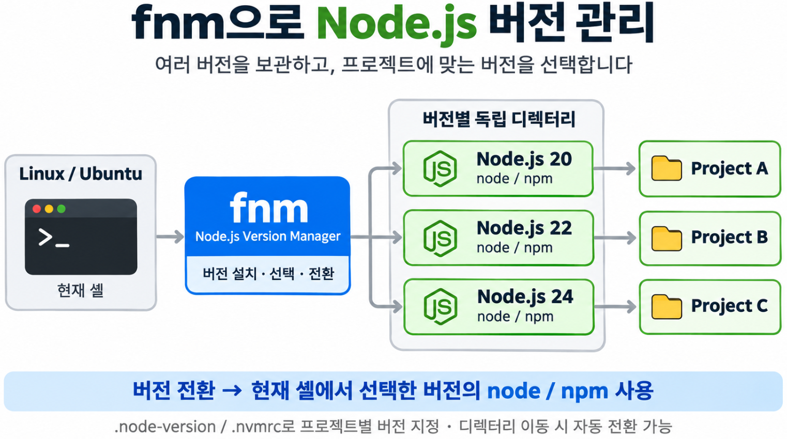

## 1. fnm(Fast Node Manager) 개념 {#session-01}

fnm(Fast Node Manager)을 사용하면 두 버전을 한 컴퓨터에 설치해 두고, 현재 터미널에서 쓸 버전을 바꿀 수 있습니다.  

`fnm use 22`를 실행하면 같은 `node` 명령으로 22 버전이 실행됩니다.  
프로젝트에 `.node-version`을 두고 자동 전환을 설정하면 `cd`로 프로젝트를 옮길 때 fnm이 그 파일을 읽어 버전을 선택합니다.  



## 2. 온라인에서 fnm 설치 및 Bash 설정 {#session-02}

Bash를 기본 셸로 사용하는 Ubuntu에서 다음 명령을 한 줄씩 실행합니다. 기본 설치 경로는 `~/.local/share/fnm`입니다.  

```bash
cd /home/ubuntu
sudo apt update
sudo apt install -y curl unzip
curl -fsSL https://fnm.vercel.app/install | bash 
source ~/.bashrc
fnm --version
```

설치 스크립트는 `~/.bashrc`에 fnm 설정을 자동으로 추가합니다. 설정이 없다면 아래 내용을 직접 추가합니다.  

```bash
# fnm
FNM_PATH="/home/ubuntu/.local/share/fnm"
if [ -d "$FNM_PATH" ]; then
  export PATH="$FNM_PATH:$PATH"
  eval "$(fnm env --shell bash)"
fi
```

이 옵션을 사용하면 프로젝트 디렉터리로 이동할 때 Node.js 버전이 자동으로 전환됩니다.  

## 3. Node.js 설치와 프로젝트별 버전 전환 {#session-03}

Bash 설정을 저장한 뒤 아래 명령을 같은 터미널에서 한 줄씩 실행합니다.  
`fnm install`로 22와 24를 준비하고, `fnm use`로 사용할 버전을 바꿉니다.  
마지막에는 각 실습 디렉터리의 `.node-version`을 읽어 자동으로 전환되는지 확인합니다.  

```bash
# Node.js 22와 24를 설치하고 설치 목록을 확인합니다.
# ubuntu:~/.local/share/fnm/node-versions/v22.23.5 에 설치 됩니다.
fnm install 22
fnm install 24
fnm list

# 현재 터미널에서 두 버전을 직접 전환합니다.
fnm use 22
node --version
fnm use 24
node --version
npm --version

# 각 실습 디렉터리에 사용할 메이저 버전을 기록합니다.
mkdir -p ~/fnm-workspace/project-a ~/fnm-workspace/project-b
printf '22\n' > ~/fnm-workspace/project-a/.node-version
printf '24\n' > ~/fnm-workspace/project-b/.node-version

# 디렉터리를 이동하면서 현재 Node.js 버전을 확인합니다.
cd ~/fnm-workspace/project-a
node --version
cd ~/fnm-workspace/project-b
node --version
```

마지막 두 결과는 각각 `v22.x.x`와 `v24.x.x`입니다. 팀에서 세부 버전까지 맞추려면 `.node-version`에 전체 버전 번호를 적고 Git에 포함합니다.  

### 자주 사용하는 fnm 명령어

| 명령어 | 하는 일 |
| --- | --- |
| `fnm --version` | fnm 자체의 버전을 확인합니다. |
| `fnm list-remote` | 내려받을 수 있는 Node.js 버전을 확인합니다. |
| `fnm install 22` | Node.js 22 계열의 최신 버전을 설치합니다. |
| `fnm install --lts` | 최신 장기 지원(LTS) 버전을 설치합니다. |
| `fnm list` | 이 컴퓨터에 설치된 Node.js 버전을 확인합니다. |
| `fnm use 22` | 현재 터미널에서 사용할 Node.js를 설치된 22 계열 버전으로 바꿉니다. |
| `fnm use` | `.node-version`이 있는 프로젝트에서 파일에 지정된 버전으로 전환합니다. |
| `fnm current` | 현재 터미널에서 선택된 Node.js 버전을 확인합니다. |
| `fnm default 24` | 새 터미널에서 기본으로 사용할 버전을 설치된 24 계열 버전으로 지정합니다. |
| `fnm uninstall 22.23.5` | 설치된 Node.js `v22.23.5`를 삭제합니다. |

`fnm use 22`는 현재 터미널에 바로 적용되고, `fnm default 24`는 새 터미널에서 사용할 기본값을 지정합니다.  
`fnm list-remote`와 `fnm install`은 Node.js 배포 서버에 연결할 수 있는 환경에서 사용합니다.  

자세한 옵션은 [fnm 공식 명령어 문서](https://github.com/Schniz/fnm/blob/v1.39.0/docs/commands.md)에서 확인할 수 있습니다.  

## 4. 폐쇄망에서 fnm과 Node.js 설치하기 {#session-04}

### 🟦 인터넷이 연결된 Ubuntu에서 파일 준비하기

설치 대상 Ubuntu에서 `cat /etc/os-release`로 릴리스를 확인합니다. 
`unzip`의 `.deb` 파일은 대상과 같은 Ubuntu 릴리스와 아키텍처를 사용하는 컴퓨터에서 내려받습니다.  

```bash
mkdir -p ~/fnm-offline/v22.23.5 ~/fnm-offline/v24.22.3
cd ~/fnm-offline
apt-get download unzip
```

아래 링크에서 파일을 내려받아 각 위치에 저장합니다.  

- `~/fnm-offline/`에 [fnm v1.39.0 ZIP](https://github.com/Schniz/fnm/releases/download/v1.39.0/fnm-linux.zip)
- `~/fnm-offline/v22.23.5/`에 [Node.js 22 압축 파일](https://nodejs.org/dist/v22.23.5/node-v22.23.5-linux-x64.tar.xz)
- `~/fnm-offline/v24.22.3/`에 [Node.js 24 압축 파일](https://nodejs.org/dist/v24.22.3/node-v24.22.3-linux-x64.tar.xz)

대상 Ubuntu에 `xz`가 없다면 같은 디렉터리에서 `apt-get download xz-utils`도 실행합니다.  
파일을 모두 준비하면 `fnm-offline` 디렉터리 전체를 폐쇄망 Ubuntu의 홈 디렉터리로 옮깁니다.  

### 🟦 폐쇄망 Ubuntu에서 설치하기

폐쇄망 Ubuntu의 `~/.bashrc`에 아래 설정을 추가합니다. 기존 fnm 설정이 있다면 해당 블록을 수정합니다. 저장한 설정은 아래 명령에서 fnm ZIP을 푼 뒤 적용합니다.  

```bash
# fnm
FNM_PATH="/home/ubuntu/.local/share/fnm"
if [ -d "$FNM_PATH" ]; then
  export PATH="$FNM_PATH:$PATH"
  eval "$(fnm env --shell bash)"
fi
```

아래 명령을 한 줄씩 실행합니다. 오류가 발생하면 원인을 확인한 뒤 다음 줄로 넘어갑니다. 이미 설치한 Node.js 버전의 압축 해제 단계는 건너뜁니다.  

Node.js는 버전별 `installation` 디렉터리에서 압축을 풉니다.  
`--strip-components=1`을 사용하면 `node`와 `npm`이 `installation/bin/` 바로 아래에 놓입니다.  
`--keep-old-files`는 같은 이름의 파일이 있으면 그 파일을 보존하고 오류를 표시합니다.  

```bash
# 필요한 도구를 옮겨 온 .deb 파일로 설치합니다.
cd ~/fnm-offline
command -v unzip >/dev/null || sudo apt-get --no-download install ./unzip_*.deb
command -v xz >/dev/null || sudo apt-get --no-download install ./xz-utils_*.deb

# fnm 실행 파일을 설치하고 Bash 설정을 적용합니다.
mkdir -p ~/.local/share/fnm
unzip -n fnm-linux.zip fnm -d ~/.local/share/fnm
chmod u+x ~/.local/share/fnm/fnm
source ~/.bashrc
fnm --version

# 홈 디렉터리에서 Node.js 22의 설치 위치로 이동해 압축을 풉니다.
cd ~
mkdir -p .local/share/fnm/node-versions/v22.23.5
mkdir .local/share/fnm/node-versions/v22.23.5/installation
cd ./.local/share/fnm/node-versions/v22.23.5/installation
tar -xJf ~/fnm-offline/v22.23.5/node-v22.23.5-linux-x64.tar.xz --strip-components=1 --keep-old-files

# 같은 방식으로 Node.js 24를 설치합니다.
cd ~
mkdir -p .local/share/fnm/node-versions/v24.22.3
mkdir .local/share/fnm/node-versions/v24.22.3/installation
cd ./.local/share/fnm/node-versions/v24.22.3/installation
tar -xJf ~/fnm-offline/v24.22.3/node-v24.22.3-linux-x64.tar.xz --strip-components=1 --keep-old-files

# 두 버전을 전환하며 실행 결과를 확인합니다.
fnm list
fnm use 22.23.5
node --version
fnm use 24.22.3
node --version
npm --version
```

`node --version`이 차례대로 `v22.23.5`와 `v24.22.3`을 표시하면 설치가 완료된 것입니다. 프로젝트에서 쓸 npm 패키지는 npm 캐시나 내부 레지스트리에 따로 준비합니다.  
