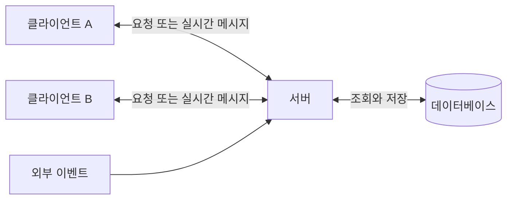
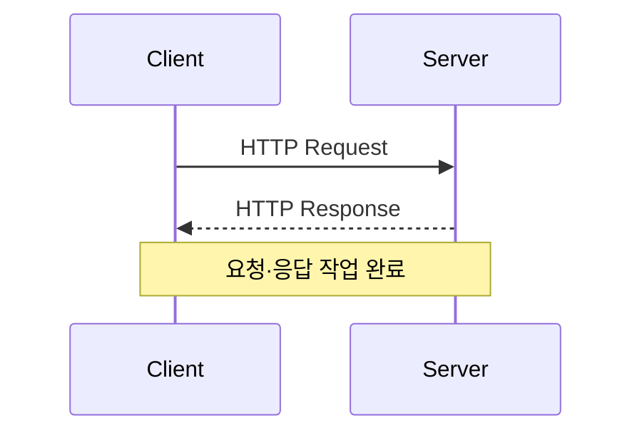
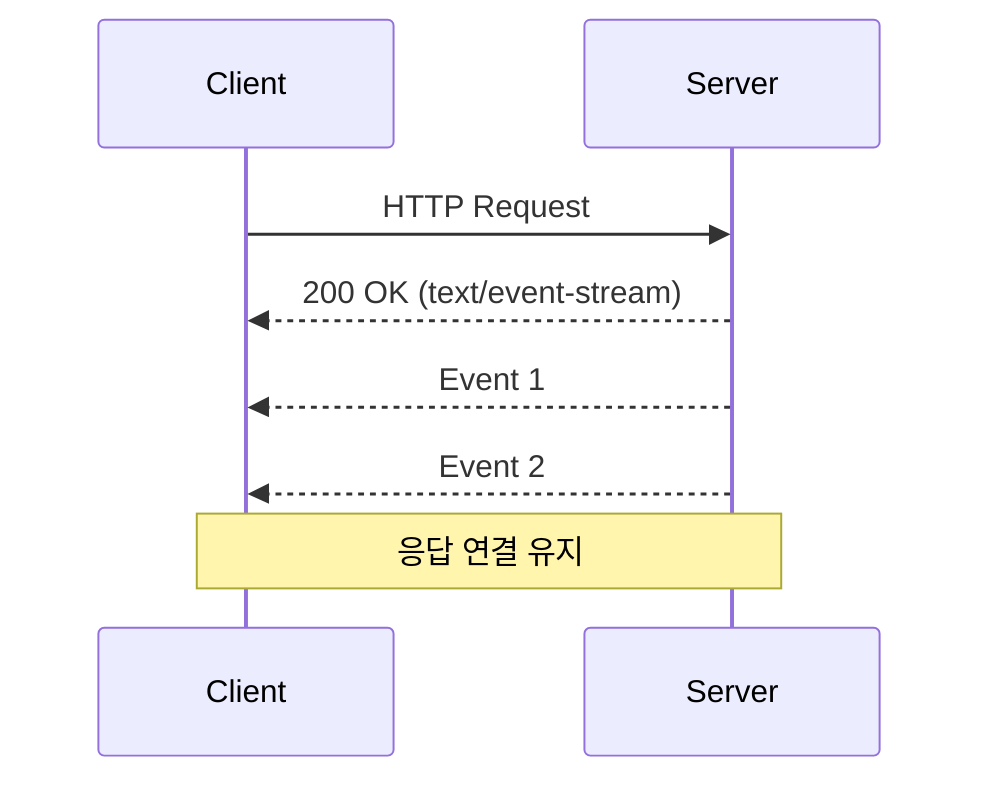
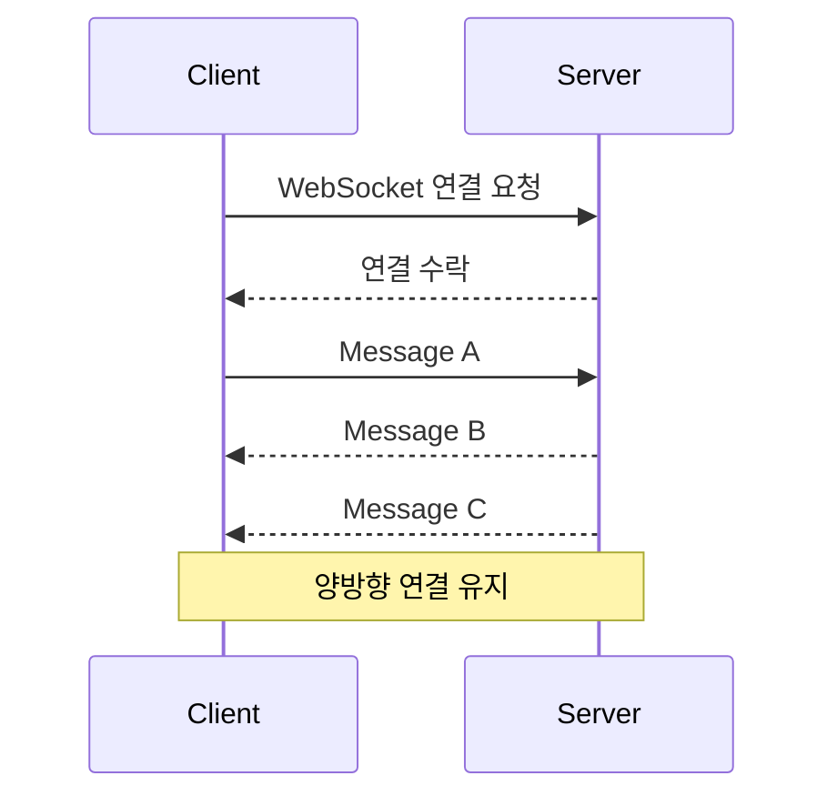
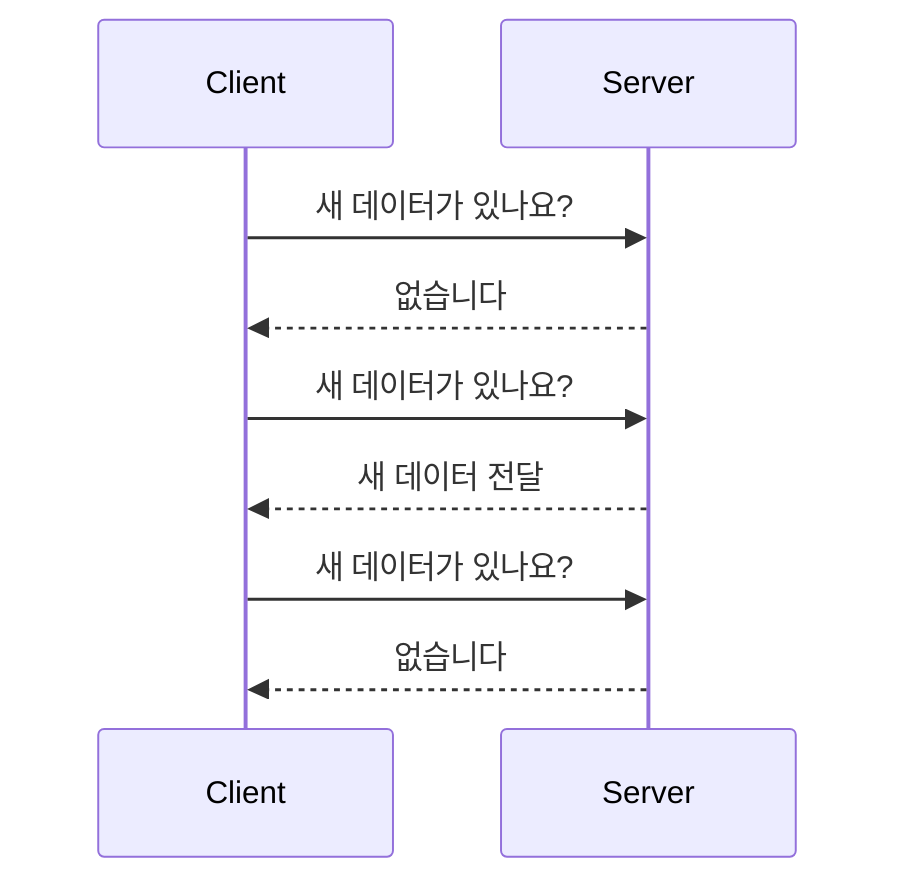
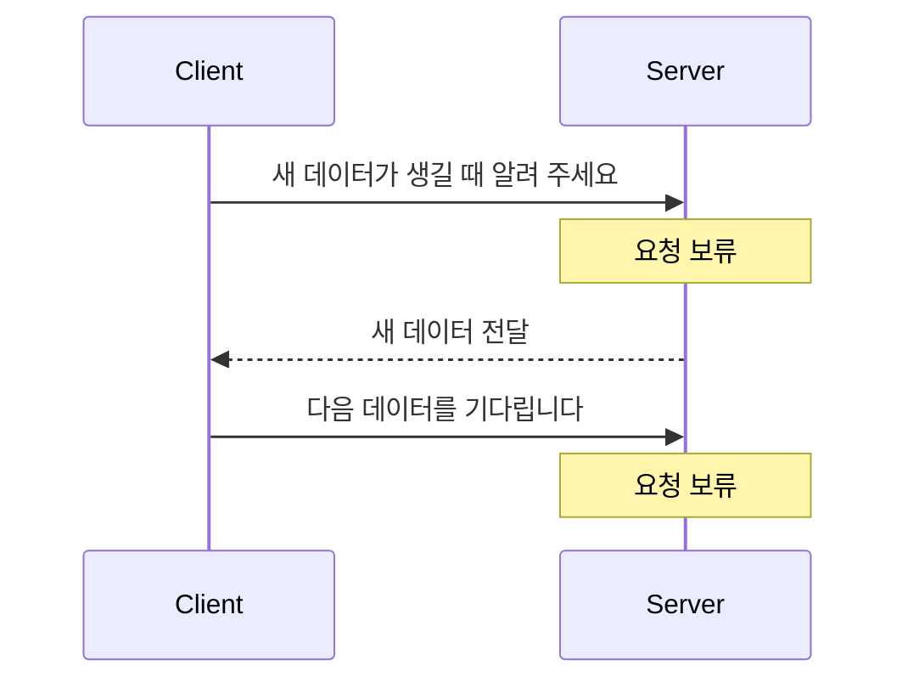
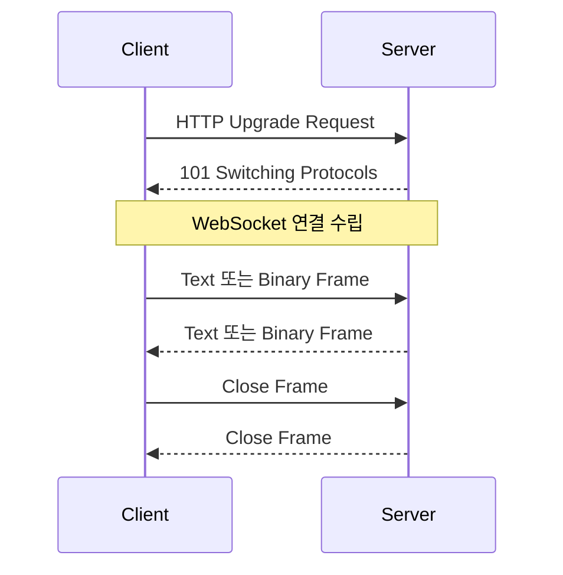
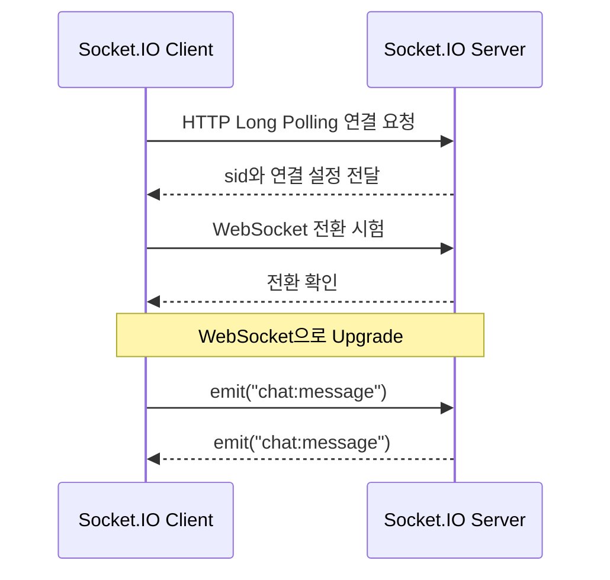

📂 **[[GitHub 코드 보러가기]](https://github.com/cericube/nodejs-workbook/tree/main/socketio-basics){: target="_blank" rel="noopener noreferrer" }**  

## 1. 실시간 통신의 개념과 특징 {#session-01}

### 🟦 실시간 통신이 필요한 이유와 활용 사례

실시간 통신은 새로운 데이터가 생겼을 때 이를 상대방에게 바로 전달하는 방식입니다.  
실시간 통신은 다음과 같은 기능에 활용할 수 있습니다.  

- **채팅과 협업 도구**: 새 메시지, 입력 상태, 문서 변경 내용을 참여자에게 전달합니다.  
- **알림과 상태 변화**: 주문·배송 상태, 결제 결과, 새 알림을 즉시 보여 줍니다.  
- **대시보드와 모니터링**: 서버 지표, 로그, 센서 데이터를 계속 갱신합니다.  
- **라이브 서비스**: 경기 점수, 경매 가격, 위치 정보를 여러 사용자에게 전파합니다.  
- **스트리밍 응답**: 오래 걸리는 작업의 진행률이나 AI가 생성하는 응답을 순서대로 전달합니다.  

실시간 기능을 만든다고 해서 항상 WebSocket을 사용해야 하는 것은 아닙니다.  
데이터를 한쪽으로만 보낼지 양쪽에서 주고받을지, 얼마나 자주 갱신할지, 재연결이나 그룹 전송이 필요한지를 기준으로 알맞은 방식을 선택해야 합니다.  

### 🟦 서버와 클라이언트 간 실시간 통신 구조

실시간 통신에서도 중심 역할은 서버와 클라이언트가 나누어 맡습니다.  
클라이언트는 연결을 시작하고 데이터를 표시하거나 사용자 입력을 보냅니다.  
서버는 연결을 관리하고, 데이터가 발생하면 필요한 클라이언트에 전달합니다.  



예를 들어 채팅 서비스에서는 한 클라이언트가 서버로 메시지를 보냅니다.  
서버는 메시지를 검증하고 저장한 뒤 같은 채팅방의 다른 클라이언트에 전달합니다.  
연결 자체는 실시간 통신 기술이 담당하지만, 인증·검증·저장과 같은 비즈니스 로직은 별도로 설계해야 합니다.  

또한 연결이 끊어질 가능성도 고려해야 합니다. 모바일 네트워크 전환, 프록시 제한, 서버 재시작 등으로 연결이 종료될 수 있으므로 재연결과 누락 데이터 복구 전략이 필요합니다.  

## 2. HTTP, SSE, WebSocket, Socket.IO 비교 {#session-02}

### 🟦 HTTP 요청·응답과 Polling 방식

HTTP의 기본 흐름에서는 클라이언트가 요청해야 서버가 응답합니다.  
응답을 받으면 하나의 요청·응답 작업이 끝나며, HTTP Keep-Alive나 HTTP/2를 사용하면 실제 네트워크 연결은 다음 요청에서 재사용할 수 있습니다.  



서버의 변경 사항을 주기적으로 확인하려면 클라이언트가 일정한 간격으로 요청하는 Polling을 사용할 수 있습니다.  
구현은 단순하지만 데이터가 없어도 요청을 보내므로 간격이 짧을수록 서버와 네트워크의 부담이 커집니다. 반대로 간격을 길게 잡으면 변경 사항을 늦게 발견합니다.  

HTTP와 Polling은 일반적인 CRUD API, 갱신 빈도가 낮은 상태 조회, 간단한 실시간 기능에 잘 맞습니다.  

### 🟦 SSE 기반 단방향 이벤트 전송

SSE(Server-Sent Events)는 클라이언트의 HTTP 요청에 서버가 `text/event-stream` 형식으로 응답하고, 그 응답 연결을 유지하면서 이벤트를 계속 보내는 방식입니다.  
데이터는 서버에서 클라이언트로만 흐르며 UTF-8 텍스트를 사용합니다.  



브라우저의 `EventSource` API는 연결이 끊기면 자동으로 재연결을 시도합니다.  
서버 알림, 로그, 진행률, AI 응답 스트리밍처럼 서버가 데이터를 계속 보내고 클라이언트의 실시간 전송은 필요하지 않은 기능에 적합합니다.  
클라이언트에서 서버로 데이터를 보내야 할 때는 별도의 HTTP 요청을 사용합니다.  

### 🟦 WebSocket 기반 양방향 통신

WebSocket은 서버와 클라이언트가 하나의 연결을 유지하면서 양쪽에서 원하는 시점에 메시지를 보낼 수 있는 표준 프로토콜입니다.  
연결이 만들어진 뒤에는 텍스트 또는 바이너리 프레임을 주고받으며, 각 메시지에 HTTP 요청 헤더를 반복해서 붙이지 않습니다.  



채팅, 온라인 게임, 공동 편집처럼 양쪽이 자주 데이터를 보내야 하는 기능에 적합합니다. 다만 자동 재연결, 이벤트 형식, 그룹 전송, 수신 확인 같은 애플리케이션 기능은 직접 설계하고 구현해야 합니다.  

### 🟦 Socket.IO 기반 이벤트 통신

Socket.IO는 WebSocket과 HTTP Long Polling 같은 전송 방식을 이용해 이벤트 기반 양방향 통신을 제공하는 라이브러리입니다.  
한쪽에서 `emit()`으로 이벤트 이름과 데이터를 보내면 반대쪽은 같은 이름을 등록한 `on()`으로 받습니다.  

```typescript
// 메시지를 보내는 쪽은 이벤트 이름과 데이터를 함께 전달합니다.
socket.emit('chat:message', {
  sender: 'Kim',
  text: '안녕하세요!',
});

// 메시지를 받는 쪽은 같은 이벤트 이름으로 처리 함수를 등록합니다.
socket.on('chat:message', (message) => {
  console.log(message.sender, message.text);
});
```

Socket.IO는 자동 재연결, Broadcasting, Room, Namespace, Acknowledgement 같은 기능을 제공합니다. 채팅방이나 협업 서비스처럼 연결과 그룹을 관리해야 하는 기능을 빠르게 구현할 수 있습니다.  

Socket.IO는 WebSocket을 전송 방식으로 사용할 수 있지만 **WebSocket 프로토콜 자체는 아닙니다.** 자체 프로토콜을 사용하므로 순수 WebSocket 클라이언트는 Socket.IO 서버에 직접 연결할 수 없습니다.  

### 🟦 기술별 특징과 선택 기준

| 기술 | 데이터 방향 | 연결과 전달 방식 | 장점 | 적합한 사례 |
| --- | --- | --- | --- | --- |
| HTTP / Polling | 클라이언트 요청 → 서버 응답 | 필요한 시점 또는 일정한 간격으로 요청 | 구현과 디버깅이 단순함 | CRUD API, 낮은 빈도의 상태 조회 |
| SSE | 서버 → 클라이언트 | 하나의 HTTP 응답 스트림 유지 | 브라우저 재연결 지원, 텍스트 스트리밍에 간단함 | 알림, 로그, 진행률, AI 응답 |
| WebSocket | 양방향 | WebSocket 연결에서 프레임 교환 | 낮은 오버헤드, 바이너리 전송 가능 | 게임, 채팅, 공동 편집 |
| Socket.IO | 이벤트 기반 양방향 | Long Polling 또는 WebSocket 사용 | 재연결과 그룹 관리 기능 제공 | 채팅방, 협업 서비스, 실시간 대시보드 |

선택할 때는 먼저 데이터 방향을 확인합니다. 서버에서 클라이언트로만 전송하면 SSE가 단순하며, 양방향 통신이 필요하면 WebSocket이나 Socket.IO를 고려할 수 있습니다. 표준 프로토콜을 세밀하게 제어하려면 WebSocket이 알맞고, 이벤트와 재연결·그룹 관리 기능이 필요하면 Socket.IO가 편리합니다. 갱신 빈도가 낮고 약간의 지연을 허용할 수 있다면 Polling만으로도 충분합니다.  

## 3. 실시간 통신 기술의 동작 원리 {#session-03}

### 🟦 HTTP Polling과 Long Polling

일반 Polling에서는 클라이언트가 정해진 간격마다 서버에 요청합니다. 서버는 새 데이터가 있는지와 관계없이 바로 응답하고, 클라이언트는 다음 시간이 되면 다시 요청합니다.  



Long Polling도 HTTP 요청을 사용하지만 서버가 바로 빈 응답을 보내지 않습니다. 새 데이터가 생기거나 제한 시간이 끝날 때까지 요청을 보류하고, 응답이 끝나면 클라이언트가 곧바로 다음 요청을 보냅니다. 일반 Polling보다 불필요한 응답과 지연을 줄일 수 있지만, 응답이 끝날 때마다 새로운 요청이 필요합니다.  



### 🟦 SSE의 연결 유지와 이벤트 전달

SSE 연결은 일반 HTTP 요청으로 시작합니다. 서버는 `Content-Type: text/event-stream` 응답을 열어 둔 채, 이벤트가 발생할 때마다 정해진 텍스트 형식으로 데이터를 기록합니다. 빈 줄은 하나의 이벤트가 끝났음을 나타냅니다.  

```text
event: notification
id: 101
data: {"message":"새 알림이 있습니다."}

```

브라우저의 `EventSource`는 이벤트를 계속 받아 처리하며, 연결이 끊기면 자동으로 재연결합니다. 서버는 `id`로 마지막 이벤트를 구분하여 재연결 중 누락된 데이터를 다시 보낼 수 있습니다.  

### 🟦 WebSocket Handshake와 메시지 송수신

HTTP/1.1에서 WebSocket 연결은 HTTP Handshake로 시작합니다.  
클라이언트는 `Upgrade: websocket` 헤더와 검증에 사용할 키를 보내고, 서버가 요청을 수락하면 `101 Switching Protocols`로 응답합니다. 그 뒤부터 같은 TCP 연결에서 WebSocket 프레임을 교환합니다.  



메시지는 하나 이상의 프레임으로 전달되며, 연결 상태 확인에는 Ping과 Pong 제어 프레임을 사용할 수 있습니다.  
한쪽에서 Close 프레임을 보내면 상대도 Close 프레임으로 응답한 뒤 연결을 종료합니다.  
애플리케이션에서는 예상하지 못한 연결 종료를 처리하고 필요하면 재연결해야 합니다.  

### 🟦 Socket.IO의 연결 관리와 이벤트 처리

Socket.IO의 내부 구조는 Engine.IO와 Socket.IO, 두 계층으로 나뉩니다.  
Engine.IO는 서버와의 연결을 만들고 Long Polling이나 WebSocket 같은 전송 방식을 선택합니다.  
Socket.IO는 이 연결을 이용해 이벤트를 주고받고, Namespace와 Room으로 전송 대상을 관리합니다.  

```text
애플리케이션
  └─ Socket.IO: 이벤트, Acknowledgement, Namespace, Room
       └─ Engine.IO: 연결, 전송 방식, Upgrade, Heartbeat
            ├─ HTTP Long Polling
            └─ WebSocket
```

별도의 옵션을 지정하지 않으면 Socket.IO는 다음 순서로 연결합니다.  

1. 먼저 HTTP Long Polling으로 서버에 연결합니다.  
2. 서버가 WebSocket을 지원하는지 확인합니다.  
3. WebSocket을 사용할 수 있으면 전송 방식을 자동으로 전환합니다.  

이 과정을 **Upgrade**라고 합니다. 처음부터 WebSocket 연결에 실패해 서비스가 늦게 시작되는 상황을 줄이면서, 연결된 뒤에는 WebSocket을 사용할 수 있다는 장점이 있습니다.  

첫 연결에서 서버는 `sid`와 `upgrades` 등의 정보를 보냅니다. `sid`는 현재 연결을 구분하는 ID이며, `upgrades`에는 전환할 수 있는 전송 방식이 들어 있습니다.  



기본 연결에서는 WebSocket 전환에 실패해도 기존 Long Polling 연결을 계속 사용할 수 있습니다.  

Long Polling을 거치지 않고 처음부터 WebSocket으로 연결하려면 클라이언트의 `transports` 옵션을 지정합니다.  

```typescript
import { io } from 'socket.io-client';

// Long Polling을 사용하지 않고 WebSocket으로 바로 연결합니다.
const socket = io('http://localhost:3000', {
  transports: ['websocket'],
});
```

이 설정은 WebSocket만 허용하므로 WebSocket 연결에 실패했을 때 Long Polling으로 대체되지 않습니다. 네트워크 환경과 서비스 요구 사항을 확인한 뒤 사용하는 것이 좋습니다.  

연결이 예기치 않게 끊어지면 Socket.IO 클라이언트는 자동으로 재연결을 시도합니다.  
하지만 연결이 끊긴 동안 발생한 이벤트까지 자동으로 다시 받는 것은 아닙니다.  
중요한 데이터는 서버에 저장하고, 이벤트 ID나 재조회 기능을 이용해 누락된 내용을 복구해야 합니다.  

Namespace는 하나의 연결을 `/chat`, `/admin`처럼 논리적인 채널로 나눕니다.  
Room은 같은 Namespace 안에서 일부 Socket을 묶는 서버 측 그룹입니다.  
이를 이용하면 전체 사용자 또는 특정 채팅방처럼 전송 대상을 구분할 수 있습니다.  

```typescript
io.on('connection', (socket) => {
  // 현재 Socket을 특정 채팅방 그룹에 포함합니다.
  socket.join('room:1');

  // 같은 Room에 속한 모든 Socket으로 이벤트를 전달합니다.
  io.to('room:1').emit('notice', '1번 방 공지입니다.');
});
```

## 4. Node.js + TypeScript + Fastify 개발 환경 구축 {#session-04}

`nodejs-workbook` 프로젝트에 `socketio-basics` 하위 프로젝트를 추가합니다.  

### 🟦 프로젝트 생성

먼저 workspace 루트에서 실습 디렉터리와 `package.json`을 생성합니다.  

```bash
# npm workspace 루트로 이동합니다.
cd /home/ubuntu/blog-workspaces/nodejs-workbook

# 실시간 통신 실습용 하위 프로젝트를 생성합니다.
mkdir socketio-basics
cd socketio-basics
npm init -y
mkdir src
```

루트 `package.json`의 `workspaces` 목록에 `socketio-basics`를 추가합니다.  
패키지의 실제 설치 버전을 기록하는 `package-lock.json`은 workspace 루트에서 함께 관리합니다.  

```jsonc
{
  "name": "nodejs-workbook",
  "private": true,
  "type": "module",
  "workspaces": [
    "prisma-basics",
    "redis-basics",
    "vitest-basics",
    "fastify-basics",
    "observability-basics",
    "graphql-basics",
    "socketio-basics"
  ]
}
```

### 🟦 실시간 통신 패키지 설치

`socketio-basics` 디렉터리에서 Fastify와 실시간 통신에 필요한 패키지를 설치합니다.  

```bash
# Fastify HTTP 서버를 구성합니다.
npm install fastify
# WebSocket과 Socket.IO 서버·클라이언트를 구성합니다.
npm install @fastify/websocket socket.io socket.io-client
# SSE 엔드포인트를 구성합니다.
npm install @fastify/sse
# @fastify/websocket에서 사용하는 ws의 TypeScript 타입을 설치합니다.
npm install -D @types/ws
# Fastify에서 브라우저의 교차 출처 요청을 허용하는 CORS Plugin을 설치합니다.
npm install @fastify/cors
# Fastify에서 JWT를 발급하고 검증하는 인증 Plugin을 설치합니다.
npm install @fastify/jwt
```

`@fastify/websocket`에는 자체 타입이 포함되어 있지만, TypeScript 프로젝트에서는 `ws`의 타입도 필요하므로 `@types/ws`를 개발 의존성으로 설치합니다.  
반면 `socket.io`, `socket.io-client`, `@fastify/sse`에는 TypeScript 타입이 포함되어 있어 별도의 `@types` 패키지가 필요하지 않습니다.  

설치 결과에서 실시간 통신과 관련된 의존성만 살펴보면 다음과 같습니다. 버전은 이 글에서 사용한 소스 코드를 기준으로 작성했습니다.  

```jsonc
{
  // package.json 중 실시간 통신에 필요한 패키지만 표시합니다.
  "dependencies": {
    "@fastify/sse": "^0.6.1",
    "@fastify/websocket": "^11.3.4",
    "fastify": "^5.12.7",
    "socket.io": "^4.8.4",
    "socket.io-client": "^4.8.4"
  },
  "devDependencies": {
    "@types/ws": "^8.18.2"
  }
}
```

### 🟦 TypeScript 설정

`socketio-basics/tsconfig.json`은 workspace 루트의 설정을 상속합니다.  
하위 프로젝트에서는 다른 workspace의 경로 별칭을 사용하지 않도록 초기화하고, 검사할 소스 경로와 증분 검사 캐시 위치를 지정합니다.  

```jsonc
{
  // Node.js, ESM과 엄격한 타입 검사 옵션을 루트에서 상속합니다.
  "extends": "../tsconfig.json",
  "compilerOptions": {
    // 다른 workspace용 경로 별칭을 이 프로젝트에서는 사용하지 않습니다.
    "paths": {},
    // 증분 검사 캐시는 소스 디렉터리 밖에 저장합니다.
    "tsBuildInfoFile": "./node_modules/.cache/tsconfig.tsbuildinfo"
  },
  "include": ["src/**/*.ts", "vitest.config.ts"],
  "exclude": ["node_modules", "dist", "coverage"]
}
```

### 🟦 Fastify 서버 구성

현재 프로젝트는 애플리케이션 구성과 서버 실행을 두 파일로 나눕니다. `src/app.ts`는 Fastify 인스턴스를 만들고 공통 설정과 Route를 등록합니다. `src/server.ts`는 완성된 인스턴스를 실행하고 종료 신호를 처리합니다.  

먼저 `src/config/env.ts`에서 서버 실행에 필요한 환경 변수를 읽습니다. 핵심 설정만 보면 다음과 같습니다. 값을 지정하지 않으면 `0.0.0.0:3000`에서 서버를 실행합니다.  

```typescript
import 'dotenv/config';
import process from 'node:process';

const port = Number(process.env.PORT ?? 3_000);

export const env = {
  HOST: process.env.HOST ?? '0.0.0.0',
  PORT: port,
  LOG_LEVEL: process.env.LOG_LEVEL ?? 'error',
};
```

`src/app.ts`의 `createApp()`은 Fastify 인스턴스를 생성하고 공통 Handler와 Route를 등록합니다. 전체 옵션 가운데 애플리케이션 구성 흐름에 필요한 부분만 살펴보겠습니다.  

```typescript
import Fastify from 'fastify';

import { env } from './config/env';
import { notFoundHandler } from './errors/not-found.handler';
import { routes } from './routes';

export function createApp() {
  const app = Fastify({
    logger: {
      level: env.LOG_LEVEL,
    },
  });

  // 공통 404 응답과 /api Route를 등록합니다.
  app.setNotFoundHandler(notFoundHandler);
  app.register(routes, { prefix: '/api' });

  return app;
}
```

`src/server.ts`는 `createApp()`으로 애플리케이션을 만든 뒤 환경 변수에 지정된 주소에서 서버를 실행합니다. 실제 소스에는 종료 신호와 처리되지 않은 오류를 다루는 코드도 있지만, 여기서는 서버 시작 흐름만 살펴봅니다.  

```typescript
import { createApp } from './app';
import { env } from './config/env';

async function startServer() {
  const app = createApp();

  try {
    await app.listen({
      port: env.PORT,
      host: env.HOST,
    });
  } catch (error) {
    app.log.error({ err: error }, 'Failed to start server');
    process.exit(1);
  }
}

await startServer();
```

이 구조에서는 `createApp()`이 반환한 Fastify 인스턴스에 SSE와 WebSocket Plugin을 등록할 수 있습니다. Socket.IO는 Fastify가 사용하는 Node.js HTTP 서버인 `app.server`에 연결하면 같은 포트를 공유할 수 있습니다.  

### 🟦 실시간 통신 실습을 위한 프로젝트 구조

현재 `socketio-basics` 프로젝트의 파일 구조는 다음과 같습니다.  

```text
nodejs-workbook/
├── package.json
├── package-lock.json
├── tsconfig.json
└── socketio-basics/
    ├── package.json
    ├── tsconfig.json
    ├── vitest.config.ts
    └── src/
        ├── app.ts
        ├── routes.ts
        └── server.ts
```

```text
브라우저 / 앱
├─ HTTP 요청 ─────────▶ Fastify Route ─┐
└─ Socket.IO 이벤트 ─▶ Socket Handler ─┴─▶ Service / Database
```
