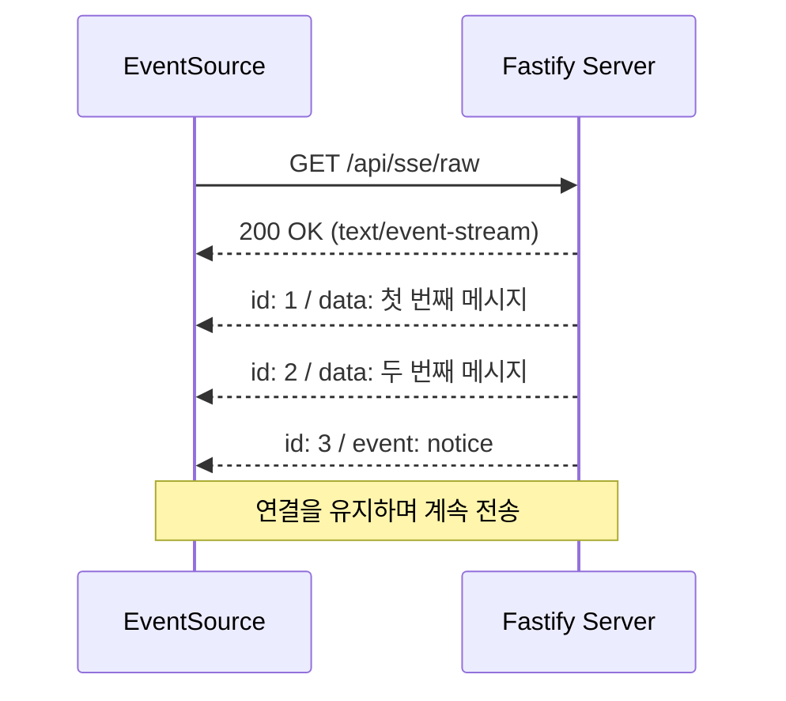
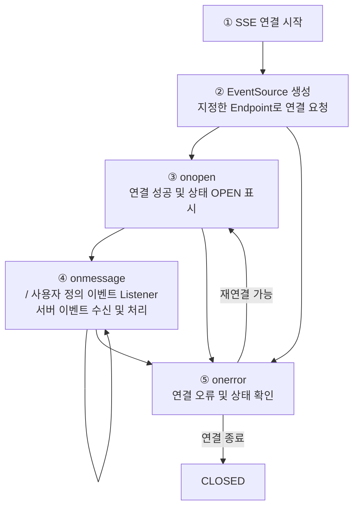
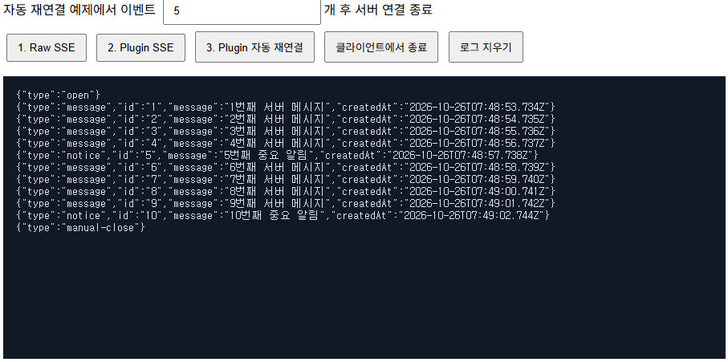
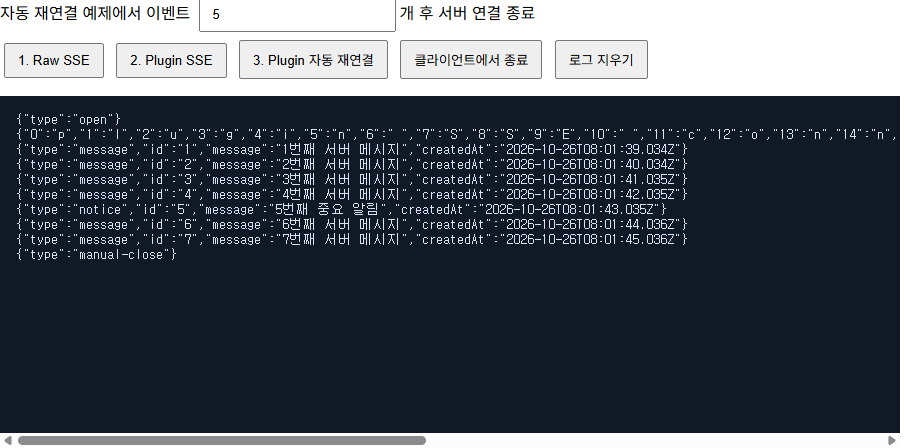
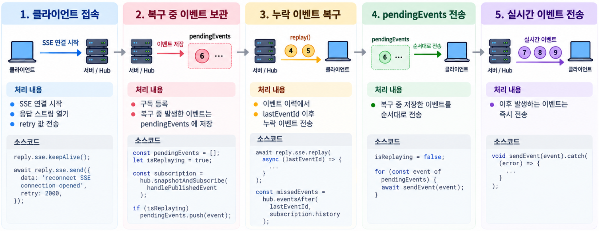
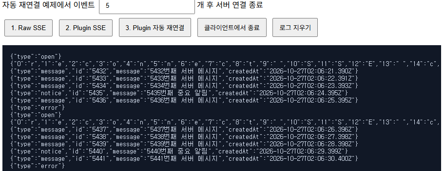

SSE(Server-Sent Events)는 서버에서 클라이언트로 이벤트를 계속 보내는 HTTP 기반 통신 방식입니다.  
브라우저에서는 `EventSource`만 생성하면 연결을 열고 이벤트를 받을 수 있으며, 연결이 끊겼을 때 자동으로 재연결할 수도 있습니다.  

📂 **[[GitHub 코드 보러가기]](https://github.com/cericube/nodejs-workbook/tree/main/socketio-basics){: target="_blank" rel="noopener noreferrer" }**  

## 1. SSE의 이벤트 전송 방식 {#session-01}

### 🟦 `text/event-stream` 응답 형식

SSE는 새로운 프로토콜이 아니라 오래 유지되는 HTTP 응답을 이용합니다.  
클라이언트가 HTTP 요청을 보내면 서버는 응답을 끝내지 않고, 새로운 데이터가 생길 때마다 같은 응답 스트림에 이벤트를 추가합니다.  

서버는 응답의 `Content-Type`을 `text/event-stream`으로 지정해야 합니다.  
캐시나 프록시 버퍼링 때문에 이벤트가 한꺼번에 전달되지 않도록 다음 헤더도 함께 사용할 수 있습니다.  

```http
HTTP/1.1 200 OK
Content-Type: text/event-stream; charset=utf-8
Cache-Control: no-cache, no-transform
Connection: keep-alive
X-Accel-Buffering: no
```

- `Content-Type`은 응답이 SSE 스트림임을 나타냅니다.  
- `Cache-Control`은 중간 캐시가 이벤트 응답을 저장하거나 변형하지 않게 합니다.  
- `Connection`은 HTTP 연결을 유지하려는 의도를 나타냅니다.  
- `X-Accel-Buffering`은 Nginx 같은 프록시가 이벤트를 모아서 보내지 않도록 합니다.  

### 🟦 SSE 표준 메시지 구조: `data`, `event`, `id`, `retry`

SSE 메시지 형식은 HTML 표준에 정의되어 있습니다. 브라우저가 정해진 의미로 처리하는 필드는 `data`, `event`, `id`, `retry`입니다.  

네 필드는 모두 표준이지만, 메시지마다 전부 작성할 필요는 없습니다.  
일반적인 메시지는 `data`만으로 전송할 수 있으며, 이벤트 이름·식별자·재연결 시간을 지정해야 할 때만 나머지 필드를 추가합니다.  

각 필드는 **필드: 값** 형태로 작성하고, 마지막에 빈 줄을 넣어 메시지가 끝났음을 표시합니다.  

```text
id: 7
event: notice
retry: 2000
data: {"message":"중요 알림입니다.","createdAt":"2026-10-26T10:00:00.000Z"}

```

각 필드의 역할은 다음과 같습니다.  

| 필드 | 역할 |
| --- | --- |
| `data` | 클라이언트에 전달할 실제 데이터입니다. 여러 줄이라면 각 줄에 `data:`를 붙입니다. |
| `event` | 이벤트 이름입니다. 생략하면 기본 `message` 이벤트로 전달됩니다. |
| `id` | 이벤트 식별자입니다. 브라우저는 마지막 ID를 기억했다가 재연결할 때 사용합니다. |
| `retry` | 연결이 끊긴 뒤 브라우저가 재연결을 시도하기까지 기다릴 시간이며 단위는 밀리초입니다. |

참고 소스에서는 이벤트 객체를 `text/event-stream` 형식으로 바꾸는 함수를 따로 분리했습니다.  

```typescript
// /src/ch02/sse.format.ts
export function formatSseEvent(event: SseEvent): string {
  const lines = [`id: ${event.id}`];

  if (event.event !== undefined) lines.push(`event: ${event.event}`);
  if (event.retry !== undefined) lines.push(`retry: ${event.retry}`);

  // data가 여러 줄이면 각 줄을 별도의 data 필드로 만듭니다.
  const data = JSON.stringify(event.data);
  for (const line of data.split('\n')) {
    lines.push(`data: ${line}`);
  }

  // 마지막 빈 줄이 하나의 이벤트를 끝냅니다.
  return `${lines.join('\n')}\n\n`;
}
```

### 🟦 HTTP 연결 유지와 이벤트 스트리밍

일반 HTTP 응답은 데이터를 한 번 보낸 뒤 끝납니다. SSE 응답은 연결을 열어 둔 채 여러 이벤트를 시간순으로 보냅니다.  



이 방식은 서버가 새 데이터를 즉시 보낼 수 있지만 통신 방향은 서버에서 클라이언트로 한정됩니다.  
클라이언트가 서버로 데이터를 보내야 한다면 별도의 HTTP 요청을 사용해야 합니다.  

### 🟦 SSE 클라이언트 실행 흐름

브라우저의 SSE 클라이언트는 `EventSource`를 생성하는 순간 서버에 연결을 시도합니다. 연결이 열린 뒤에는 등록된 Listener로 이벤트를 계속 처리하며, 네트워크 문제로 연결이 끊기면 브라우저가 자동으로 재연결합니다.  



1. 애플리케이션에서 실시간 이벤트가 필요한 시점에 SSE 연결을 시작합니다.
2. SSE Endpoint를 전달해 `EventSource`를 생성하면 브라우저가 서버에 연결을 요청합니다. 새로운 연결로 교체할 때는 기존 `EventSource`를 먼저 종료해 중복 수신을 막아야 합니다.
3. 서버와 연결되면 `onopen`이 실행되며, `readyState`는 `EventSource.OPEN`이 됩니다.
4. `onmessage`는 이름이 없는 기본 이벤트를 받습니다. 서버가 `event` 필드로 이름을 지정한 이벤트는 `addEventListener()`로 등록한 Listener에서 받아 애플리케이션 로직에 맞게 처리합니다.
5. 연결에 실패하거나 연결이 끊기면 `onerror`가 실행됩니다. 재연결 가능한 상태라면 브라우저가 같은 Endpoint로 자동 재연결하며, 연결에 성공하면 `onopen`부터 흐름을 다시 진행합니다. `close()`로 직접 종료한 연결은 재연결하지 않습니다.

## 2. Fastify에서 플러그인 없이 SSE 구현 {#session-02}

### 🟦 `reply.raw.writeHead()`로 응답 헤더 설정

Fastify의 `reply.raw`는 Node.js의 원본 HTTP 응답 객체입니다. 이를 직접 사용하면 SSE 응답 형식과 전송 시점을 세밀하게 제어할 수 있습니다.  

```typescript
fastify.get('/raw', (request, reply) => {
  // 이후 응답은 Node.js 응답 객체로 직접 처리합니다.
  reply.hijack();

  reply.raw.writeHead(200, {
    'Content-Type': 'text/event-stream; charset=utf-8',
    'Cache-Control': 'no-cache, no-transform',
    'Connection': 'keep-alive',
    'X-Accel-Buffering': 'no',
  });

  // 주석 한 줄을 보내 응답 헤더를 즉시 전달합니다.
  reply.raw.write(': raw SSE connection opened\n\n');
});
```

`reply.hijack()`은 이후 응답을 직접 처리하겠다고 Fastify에 알립니다.  
이를 호출하지 않으면 Fastify가 Handler의 반환값을 다시 응답으로 처리할 수 있습니다.  

SSE에서는 콜론(`:`)으로 시작하는 줄을 주석(Comment)으로 처리하며, 브라우저는 이를 일반 이벤트로 전달하지 않습니다.  
서버는 연결 직후 주석 메시지를 보내 응답 헤더를 전달하고 SSE 스트림을 시작할 수 있습니다. 이후 주석 메시지를 주기적으로 전송하면 프록시나 서버가 유휴 연결을 종료하지 않도록 유지하는 데 도움이 됩니다.  

### 🟦 `reply.raw.write()`로 이벤트 전송

새 이벤트가 생기면 앞에서 만든 `formatSseEvent()`로 문자열을 만들고 응답 스트림에 기록합니다.  
연결이 이미 끝났는지 먼저 확인하면 종료된 응답에 데이터를 쓰는 오류를 막을 수 있습니다.  

```typescript
let sequence = 0;

const eventTimer = setInterval(() => {
  sequence += 1;
  // 이벤트 객체를 SSE 문자열로 바꾸어 같은 응답에 계속 기록합니다.
  reply.raw.write(formatSseEvent(createEvent(sequence)));
}, 1_000);

// 브라우저가 연결을 닫으면 반복 타이머도 제거합니다.
request.raw.once('close', () => clearInterval(eventTimer));
```

`createEvent()`는 증가하는 ID와 생성 시각을 가진 이벤트를 만듭니다.  
다섯 번째 이벤트마다 `event: notice`를 지정하고, 나머지는 기본 `message` 이벤트로 전송합니다.  
각 연결은 자체 Timer와 순번을 가지며, 브라우저가 연결을 닫으면 Timer도 함께 정리합니다.  

### 🟦 `EventSource`로 클라이언트 구현

브라우저에서는 `EventSource`에 SSE URL을 전달하면 즉시 연결을 시작합니다. 기본 메시지는 `onmessage`로 받고, `event` 필드가 있는 메시지는 같은 이름의 Listener로 받습니다.  

```javascript
// /src/ch02/sse.client.ts
const eventSource = new EventSource('/api/sse/raw');
eventSource.onopen = () => {
  console.log('SSE 연결이 열렸습니다.');
};
// event 필드가 없는 기본 메시지를 받습니다.
eventSource.onmessage = (event) => {
  console.log('message:', event.lastEventId, JSON.parse(event.data));
};
// event: notice로 전송한 이벤트만 받습니다.
eventSource.addEventListener('notice', (event) => {
  console.log('notice:', event.lastEventId, JSON.parse(event.data));
});
```

`event.data`에는 서버가 `data` 필드로 보낸 문자열이 들어 있습니다. 예제 서버는 JSON 문자열을 보내므로 `JSON.parse()`로 객체로 변환합니다. `event.lastEventId`에서는 마지막으로 받은 이벤트의 `id`를 확인할 수 있습니다.  

### 🟦 이벤트 송수신 및 연결 종료 테스트

서버를 실행한 뒤 브라우저에서 다음 주소를 엽니다.  

```text
http://localhost:3000/api/sse/demo
```


실습 화면에서 **1. Raw SSE**를 누르면 `/api/sse/raw`에 연결됩니다. 서버는 기본 메시지를 1초마다 보내고, 다섯 번째마다 `notice` 이벤트를 보냅니다.  

## 3. @fastify/sse 플러그인을 이용한 SSE 구현 {#session-03}

### 🟦 `@fastify/sse` 설치 및 플러그인 등록

`@fastify/sse`를 사용하면 이 작업을 플러그인에 맡기고 이벤트 전송 로직에 집중할 수 있습니다.  
`src/app.ts`에서 Route보다 먼저 플러그인을 등록합니다. Fastify Plugin은 등록 순서와 적용 범위가 중요하므로 SSE Route를 등록하기 전에 호출해야 합니다.  

```typescript
// src/app.ts
import fastifySSE from '@fastify/sse';

app.register(fastifySSE, {
  //  프록시가 유휴 연결이 끊기지 않도록 15초마다 Heartbeat를 보냅니다.
  heartbeatInterval: 15_000,
});

app.register(routes, { prefix: '/api' });
```

### 🟦 `reply.sse.send()`로 이벤트 전송

Route 옵션에 `sse: 'only'`를 지정하면 SSE 전용 Endpoint가 됩니다.  
Handler가 끝난 뒤에도 연결을 유지하려면 `keepAlive()`를 호출하고, `send()`에 이벤트 객체를 전달합니다.  

```typescript
// /src/ch02/plugin/plugin-sse.routes.ts
// 1. 브라우저가 /plugin에 연결할 때마다 아래 handler가 한 번 실행됩니다.
// sse: 'only'는 이 라우트가 SSE 응답만 제공한다는 플러그인 설정입니다.
fastify.get('/plugin', { sse: 'only' }, async (request, reply) => {
  let sequence = 0;
  
  // 2. handler 실행이 끝난 뒤에도 플러그인이 HTTP 연결을 닫지 않도록 합니다.
  reply.sse.keepAlive();

  // 3. 첫 send()를 호출하면 플러그인이 text/event-stream 헤더를 만들고 스트림을 시작합니다.
  // Raw 예제와 달리 writeHead(), JSON 변환과 write()를 직접 호출할 필요가 없습니다.
  // reply.sse.send() API에는 별도의 comment 필드가 문서화되어 있지 않습니다
  await reply.sse.send({
    data: 'plugin SSE connection opened',
    retry: 2_000,
  });
  // 4. 1초마다 이벤트 번호를 증가시키고 이벤트 객체를 플러그인으로 전송합니다.
  const eventTimer = setInterval(() => {
    sequence += 1;

    // send()는 이벤트 객체를 SSE 문자열로 변환하고 클라이언트로 전송하는 Promise를 반환합니다.
    // setInterval()은 Promise를 기다리지 않으므로 void로 의도적인 비동기 호출임을 표시합니다.
    void reply.sse.send(createEvent(sequence)).catch((error: unknown) => {
      // 전송에 실패하면 오류를 기록하고 현재 SSE 연결을 종료합니다.  
      request.log.error({ err: error }, 'Failed to send SSE event');
      reply.sse.close();
    });
  }, 1_000);

  // 5. 탭을 닫거나 reply.sse.close()로 연결이 끝나면 플러그인이 callback을 호출합니다.
  // clearInterval()로 타이머를 제거하여 종료된 연결에 이벤트가 계속 생성되지 않게 합니다.
  reply.sse.onClose(() => clearInterval(eventTimer));
});
```

`reply.sse.send()`는 객체를 SSE 형식으로 직렬화하고 응답 스트림의 흐름 제어도 처리합니다. 직접 구현처럼 1초마다 이벤트를 만들지만, 문자열 변환과 응답 기록은 플러그인에 맡깁니다. `onClose()`에서 Timer를 제거하면 종료된 연결에 이벤트를 계속 만들지 않습니다.  

### 🟦 `EventSource`로 플러그인 이벤트 수신

클라이언트 코드는 직접 구현 방식과 같습니다. 연결할 URL만 플러그인 Route로 바꾸면 됩니다. SSE 메시지 형식이 같으므로 `onmessage`, `addEventListener()`, `onerror`를 그대로 사용할 수 있습니다.  

```javascript
// /src/ch02/sse.client.ts
const eventSource = new EventSource('/api/sse/plugin');

eventSource.onmessage = (event) => {
  console.log('message:', JSON.parse(event.data));
};
// event: notice로 전송한 이벤트만 받습니다.
eventSource.addEventListener('notice', (event) => {
  console.log('notice:', JSON.parse(event.data));
});
```

### 🟦 이벤트 송수신 및 연결 관리 테스트

실습 화면에서 **2. Plugin SSE**를 누르면 `/api/sse/plugin`에 연결됩니다. 직접 구현 방식과 마찬가지로 기본 메시지와 `notice` 이벤트가 화면에 출력됩니다.  


## 4. SSE 연결 관리와 자동 재연결 {#session-04}

### 🟦 `EventSource`의 연결 상태와 오류 처리

`EventSource.readyState`는 현재 연결 상태를 숫자로 제공합니다.  

| 값 | 상수 | 의미 |
| --- | --- | --- |
| `0` | `EventSource.CONNECTING` | 처음 연결하거나 재연결하는 중입니다. |
| `1` | `EventSource.OPEN` | 연결이 열려 이벤트를 받을 수 있습니다. |
| `2` | `EventSource.CLOSED` | 연결이 완전히 닫혔습니다. |

`onopen`은 연결이 열릴 때마다 실행됩니다.  
`onerror`는 연결이 끊기거나 연결 시도에 실패했을 때 실행되므로, 그 안에서 `readyState`를 확인하면 재연결 중인지 완전히 닫혔는지 구분할 수 있습니다.  

```javascript
eventSource.onopen = () => {
  statusElement.textContent = 'OPEN';
};

eventSource.onerror = () => {
  const states = ['CONNECTING', 'OPEN', 'CLOSED'];
  statusElement.textContent = states[eventSource.readyState];
};
```

### 🟦 자동 재연결과 `retry` 설정

서버가 SSE 연결을 종료하거나 네트워크가 잠시 끊기면 브라우저의 `EventSource`는 같은 URL로 자동 재연결을 시도합니다.  
서버가 이벤트에 `retry` 값을 보내면 다음 연결 시도까지 기다릴 시간을 지정할 수 있습니다.  

```text
retry: 2000
data: {"message":"2초 후 재연결합니다."}
```

`retry: 2000`은 연결이 끊긴 뒤 약 2초 후 다시 연결하라는 뜻입니다.  
반면 사용자가 `eventSource.close()`를 직접 호출하면 브라우저는 자동 재연결하지 않습니다.  

```javascript
document.querySelector('#close').addEventListener('click', () => {
  eventSource?.close();
  statusElement.textContent = 'CLOSED';
});
```

자동 재연결 예제에서는 `/api/sse/reconnect` Route에 `closeAfter` 값을 전달합니다. 서버는 지정한 개수만큼 이벤트를 보낸 뒤 연결을 종료합니다.  

```javascript
const closeAfter = 5;
const eventSource = new EventSource(
  `/api/sse/reconnect?closeAfter=${closeAfter}`,
);
```

### 🟦 `Last-Event-ID`로 누락 이벤트 복구

브라우저는 마지막으로 받은 이벤트의 `id`를 기억합니다. 자동 재연결 요청을 보낼 때는 이 값을 `Last-Event-ID` 요청 헤더에 담습니다. 서버는 해당 ID 다음에 발생한 이벤트를 찾아 다시 보내야 합니다.  

이 복구 과정은 재접속할 때만 실행되는 별도 절차가 아닙니다. 클라이언트가 최초로 접속하거나 연결이 끊어져 다시 접속할 때마다 `/reconnect` Route Handler가 새로 실행되고, 다음 흐름을 반복합니다.  



1. **클라이언트 접속**: SSE 연결을 시작하고 누락 이벤트를 복구할 수 있도록 연결 상태를 초기화합니다.  
2. **실시간 이벤트 구독**: Hub에 Listener를 등록합니다. 복구가 진행되는 동안 새로 발생한 이벤트는 먼저 `pendingEvents`에 저장합니다.  
3. **누락 이벤트 복구**: `Last-Event-ID`를 기준으로 이벤트 이력에서 클라이언트가 받지 못한 이벤트를 찾아 전송합니다.  
4. **대기 이벤트 전송**: 누락 이벤트 복구를 마치면 `pendingEvents`에 저장해 둔 이벤트를 발생 순서대로 전송합니다.  
5. **실시간 이벤트 전송**: 복구가 모두 끝난 뒤부터 새로 발생하는 이벤트를 클라이언트에 즉시 전송합니다.  

이 다섯 단계는 클라이언트가 최초 접속하거나 연결이 끊어진 뒤 재접속할 때마다 실행됩니다.  
다만 최초 접속에는 `Last-Event-ID`가 없으므로 3단계에서 복구할 누락 이벤트가 없으며, 나머지 단계를 거쳐 실시간 전송 상태로 전환됩니다.  

```typescript
// src/ch02/reconnect/plugin-reconnect.routes.ts
/** Hub가 발행한 이벤트를 복구 상태에 따라 대기열에 넣거나 즉시 전송하는 함수 정의 */
const handlePublishedEvent = (event: SseEvent) => {
  // 과거 이벤트보다 새 이벤트가 먼저 전송되지 않도록 복구가 끝날 때까지 보류합니다.
  if (isReplaying) {
    pendingEvents.push(event);
    return;
  }
  // 복구 중이 아니면 수신한 이벤트를 전송합니다.
  // 오류가 발생하면 로그를 남긴 뒤 현재 연결을 닫습니다.
  void sendEvent(event).catch((error: unknown) => {
    request.log.error({ err: error }, 'Failed to send SSE event');
    reply.sse.close();
  });
};
```

`handlePublishedEvent()`는 Hub에서 새 이벤트를 받을 때마다 실행됩니다.  
누락 이벤트를 복구하는 중이면 새 이벤트를 `pendingEvents`에 보관하고, 복구가 끝난 상태라면 `sendEvent()`로 즉시 전송합니다. 실시간 전송에 실패하면 오류를 기록하고 현재 SSE 연결을 종료합니다.  

```typescript
// src/ch02/reconnect/plugin-reconnect.routes.ts
const subscription = hub.snapshotAndSubscribe(handlePublishedEvent);

await reply.sse.replay(async (lastEventId) => {
  const missedEvents = hub.eventsAfter(
    lastEventId,
    subscription.history,
  );

  for (const event of missedEvents) {
    await sendEvent(event);
  }
});
```

`snapshotAndSubscribe()`는 현재 이벤트 이력을 복사하는 동시에 `handlePublishedEvent()`를 Listener로 등록합니다.  
`reply.sse.replay()`가 재접속 요청의 `Last-Event-ID`를 읽고, `eventsAfter()`가 해당 ID 이후의 누락 이벤트를 찾습니다. `for...of`와 `await`로 이벤트를 하나씩 전송하므로 저장된 순서를 유지하면서 복구할 수 있습니다.  

### 🟦 서버 연결 종료 및 재연결 테스트

실습 화면에서 서버가 연결을 종료한 뒤 `EventSource`가 자동으로 재접속하고, 누락 이벤트를 이어서 받는지 확인합니다.  

1. **이벤트 5개 후 서버 연결 종료**로 설정합니다.  
2. **3. Plugin 자동 재연결** 버튼을 눌러 `/api/sse/reconnect?closeAfter=5`에 접속합니다.  
3. 이벤트를 다섯 개 받으면 서버가 연결을 종료하고 화면에 `error` 로그가 표시됩니다. 이때 `EventSource`는 `CONNECTING` 상태로 전환됩니다.  
4. 약 2초 뒤 `open` 로그가 다시 표시되는지 확인합니다.  
5. 재접속 전 마지막 이벤트 ID 다음부터 메시지가 이어지는지 확인합니다. ID가 끊기지 않았다면 누락 이벤트가 정상적으로 복구된 것입니다.  
6. **클라이언트에서 종료** 버튼을 누른 뒤에는 더 이상 재접속하지 않는지 확인합니다.  


