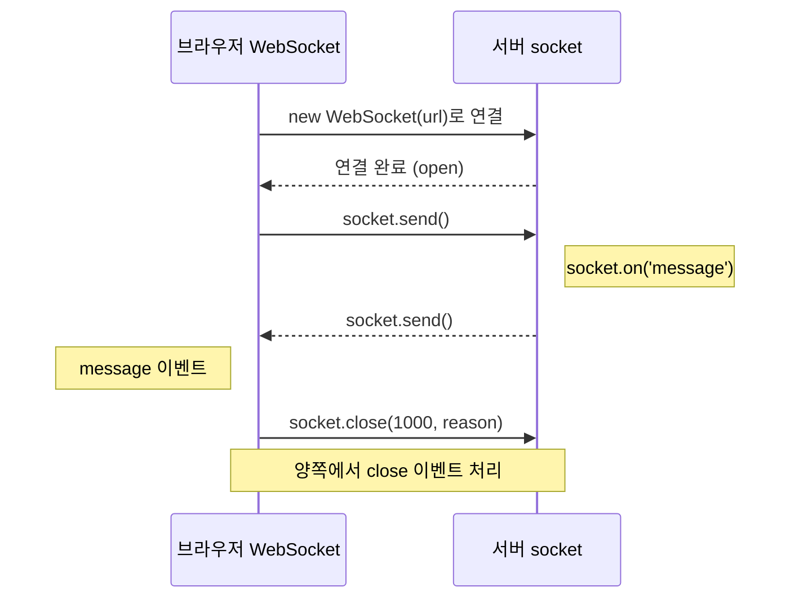
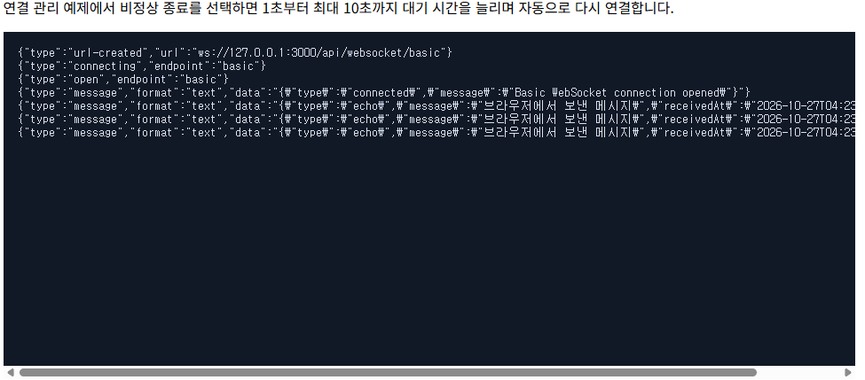
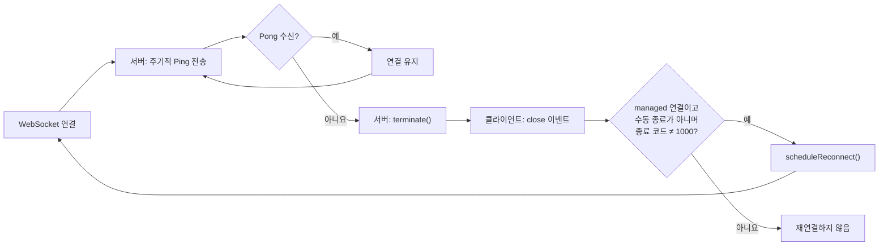
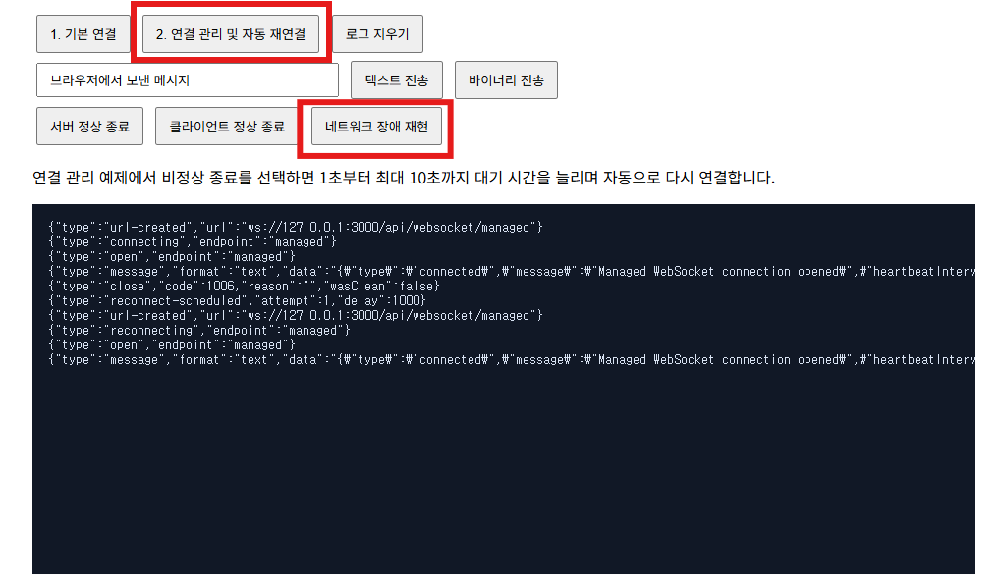

WebSocket은 하나의 연결에서 서버와 클라이언트가 서로 메시지를 보낼 수 있는 양방향 통신 방식입니다.  
HTTP 요청마다 응답을 기다리지 않아도 되므로 채팅, 온라인 게임, 공동 편집처럼 양쪽에서 데이터가 자주 발생하는 기능에 적합합니다.  

📂 **[[GitHub 코드 보러가기]](https://github.com/cericube/nodejs-workbook/tree/main/socketio-basics){: target="_blank" rel="noopener noreferrer" }**  

## 1. WebSocket 연결과 이벤트 처리 {#session-01}

### 🟦 WebSocket 연결 상태

브라우저에서 `new WebSocket(url)`을 호출하면 HTTP Upgrade Handshake를 시작합니다.  
서버가 요청을 수락하면 연결이 열린 뒤 하나의 TCP 연결에서 메시지를 양방향으로 주고받습니다.  

`WebSocket.readyState`는 현재 연결 상태를 다음 네 가지 숫자로 나타냅니다.  

| 값 | 상수 | 의미 |
| --- | --- | --- |
| `0` | `WebSocket.CONNECTING` | 연결 Handshake가 진행 중입니다. 아직 메시지를 보낼 수 없습니다. |
| `1` | `WebSocket.OPEN` | 연결이 열려 메시지를 주고받을 수 있습니다. |
| `2` | `WebSocket.CLOSING` | 종료 Handshake가 진행 중입니다. |
| `3` | `WebSocket.CLOSED` | 연결이 종료되었거나 연결에 실패했습니다. |

`send()`는 반드시 `OPEN` 상태에서 호출해야 합니다. `CONNECTING` 상태에서 호출하면 오류가 발생할 수 있으며, `CLOSING`이나 `CLOSED` 상태에서는 더 이상 메시지를 보낼 수 없습니다.  

### 🟦 `open`, `message`, `error`, `close` 이벤트

브라우저의 WebSocket 객체는 연결 생명주기에 따라 네 가지 주요 이벤트를 발생시킵니다.  

| 이벤트 | 발생 시점 | 주요 처리 |
| --- | --- | --- |
| `open` | Handshake가 완료되어 연결이 열릴 때 | 화면 상태를 `OPEN`으로 바꾸고 메시지 전송을 시작합니다. |
| `message` | 서버가 텍스트나 바이너리 메시지를 보낼 때 | `event.data`의 형식을 확인하고 데이터를 처리합니다. |
| `error` | 연결이나 메시지 처리 중 오류가 발생할 때 | 오류 발생 사실을 기록합니다. 자세한 종료 정보는 이어지는 `close`에서 확인합니다. |
| `close` | 정상 종료 Handshake가 끝나거나 연결이 끊길 때 | 종료 코드와 사유를 확인하고 필요한 경우 재연결을 예약합니다. |

`error` 이벤트만으로는 오류 원인을 자세히 알기 어렵습니다.  
실제 종료 판단에는 `close` 이벤트의 `code`, `reason`, `wasClean`을 함께 사용합니다.  

### 🟦 텍스트와 바이너리 메시지

WebSocket은 텍스트 프레임과 바이너리 프레임을 모두 전송할 수 있습니다. 메시지 하나의 형식은 전송하는 값에 따라 결정됩니다.  

- 문자열을 `send()`에 전달하면 텍스트 메시지로 전송합니다.  
- `ArrayBuffer`, `TypedArray`, `Blob`을 전달하면 바이너리 메시지로 전송합니다.  
- 일반 JavaScript 객체는 `send()`가 직접 처리하는 전송 형식이 아닙니다. 객체를 보내려면 JSON 문자열이나 바이트 배열로 직렬화해야 합니다.  
- JSON 문자열로 보낸 객체는 수신 측에서 `JSON.parse()`를 사용해 다시 객체로 복원합니다.  

객체를 텍스트 메시지로 보낼 때는 `JSON.stringify()`를 사용합니다.  
바이너리 메시지가 필요하다면 JSON 문자열을 `TextEncoder`로 인코딩한 뒤 전송할 수도 있습니다.  

```javascript
socket.send('텍스트 메시지');
socket.send(new TextEncoder().encode('바이너리 메시지'));

const message = { type: 'chat', content: '안녕하세요.' };

// 객체를 JSON 텍스트 메시지로 전송합니다.
socket.send(JSON.stringify(message));

// 객체를 JSON으로 변환한 뒤 UTF-8 바이너리 메시지로 전송합니다.
socket.send(new TextEncoder().encode(JSON.stringify(message)));
```

### 🟦 서버와 클라이언트의 이벤트 처리 흐름

클라이언트와 서버는 같은 연결을 사용하지만 서로 다른 이벤트 API로 메시지를 처리합니다.  

| 상황 | 브라우저 | 서버 |
| --- | --- | --- |
| 연결 완료 | `addEventListener('open', ...)` | WebSocket Route Handler 실행 |
| 메시지 수신 | `addEventListener('message', ...)` | `socket.on('message', ...)` |
| 오류 발생 | `addEventListener('error', ...)` | `socket.on('error', ...)` |
| 연결 종료 | `addEventListener('close', ...)` | `socket.on('close', ...)` |

서버는 Handshake가 끝난 뒤 WebSocket Route Handler를 실행하므로 별도의 `socket.on('open')`을 사용하지 않습니다. Handler 실행이 브라우저의 `open` 이벤트에 대응합니다.  



브라우저와 서버는 각각 `send()`로 메시지를 보내고 상대의 `message` Listener에서 받습니다. 어느 한쪽에서 `close()`를 호출하면 종료 Handshake 후 양쪽의 `close` Listener가 실행됩니다.  

## 2. Fastify를 이용한 WebSocket 서버 구현 {#session-02}

### 🟦 `@fastify/websocket` 플러그인 등록

Fastify에서 WebSocket Route를 사용하려면 `@fastify/websocket`을 Route보다 먼저 등록해야 합니다. 플러그인이 HTTP Upgrade 요청을 가로채 해당 WebSocket Handler로 전달하기 때문입니다.  

```typescript
// src/app.ts
import fastifyWebsocket from '@fastify/websocket';

app.register(fastifyWebsocket, {
  options: {
    // 클라이언트에서 서버로 들어오는 메시지는 합친 크기를 기준으로 최대 1 MiB까지 허용합니다.
    // 한도를 초과하면 메시지를 거부하고 일반적으로 코드 1009(Message Too Big)로 연결을 종료합니다.
    // 이 설정은 서버가 socket.send()로 보내는 메시지에는 적용되지 않습니다.
    maxPayload: 1024 * 1024,
  },
  // WebSocket 연결 오류를 공통으로 처리합니다.
  errorHandler(error, socket, request) {
    request.log.error({ err: error }, 'WebSocket connection error');
    socket.terminate();
  },
});

// WebSocket Route보다 플러그인을 먼저 등록합니다.
app.register(routes, { prefix: '/api' });
```

`maxPayload`는 서버가 수신하는 전체 메시지의 최대 크기를 제한합니다. 공통 `errorHandler`에서는 오류를 기록하고 더 이상 정상적으로 사용할 수 없는 연결을 즉시 종료합니다.  

### 🟦 `socket.on('message')`로 메시지 수신

Route 옵션에 `websocket: true`를 지정하면 일반 HTTP 응답 대신 WebSocket 연결을 처리합니다.  

기본 Route의 Handler는 WebSocket 연결이 성립할 때마다 한 번 실행됩니다. 메시지를 놓치지 않도록 Handler가 시작되면 `message` Listener부터 동기적으로 등록합니다.  

```typescript
// src/ch03/websocket-basic.routes.ts
fastify.get('/basic', { websocket: true }, (socket, request) => {

  // 연결 직후 도착한 데이터도 놓치지 않도록 handler 안에서 listener를 즉시 등록합니다.
  socket.on('message', (data, isBinary) => {
    // 바이너리 메시지는 변환하지 않고 같은 형식으로 돌려줍니다.
    if (isBinary) {
      socket.send(data, { binary: true });
      return;
    }

    // RawData의 실제 타입에 맞춰 UTF-8 텍스트로 변환합니다.
    const message = Buffer.isBuffer(data)
      ? data.toString('utf8')
      : Array.isArray(data)
        ? Buffer.concat(data).toString('utf8')
        : Buffer.from(data).toString('utf8');

    // 텍스트 메시지는 서버의 수신 시각과 함께 JSON 문자열로 전송합니다.
    socket.send(
      JSON.stringify({
        type: 'echo',
        message,
        receivedAt: new Date().toISOString(),
      }),
    );
  });
});
```

서버가 받는 `data`는 `Buffer`, `ArrayBuffer`, `Buffer[]` 중 하나일 수 있습니다. `isBinary`가 `true`이면 원본 바이트를 그대로 돌려주고, 텍스트 프레임이면 UTF-8 문자열로 변환한 뒤 JSON Echo 응답을 만듭니다.  

### 🟦 `socket.send()`로 메시지 전송

서버는 연결 직후에도 `socket.send()`를 호출할 수 있습니다. 실습에서는 브라우저가 기본 Route와 관리 Route를 구분할 수 있도록 `connected` 메시지를 먼저 전송합니다.  

```typescript
socket.send(
  JSON.stringify({
    type: 'connected',
    message: 'Basic WebSocket connection opened',
  }),
);
```

WebSocket에는 SSE의 `event` 필드처럼 메시지 종류를 구분하는 표준 애플리케이션 형식이 없습니다. 따라서 JSON의 `type`처럼 서버와 클라이언트가 함께 사용할 메시지 구조를 직접 정해야 합니다.  

### 🟦 클라이언트 연결과 종료 처리

서버에서는 `close`로 종료 코드와 사유를 확인하고, `error`로 연결 오류를 기록합니다.  

```typescript
socket.on('close', (code, reason) => {
  request.log.info(
    { code, reason: reason.toString() },
    'WebSocket client disconnected',
  );
});

socket.on('error', (error) => {
  request.log.error({ err: error }, 'WebSocket message error');
});
```

연결마다 등록한 Timer나 Listener가 있다면 `close`에서 함께 정리해야 합니다.

## 3. WebSocket 클라이언트 구현 {#session-03}

### 🟦 브라우저 WebSocket API로 서버 연결

WebSocket URL은 HTTP 환경에서 `ws:`, HTTPS 환경에서 `wss:`를 사용합니다.  
현재 페이지의 프로토콜에 맞춰 주소를 만들면 로컬 환경과 HTTPS 배포 환경을 모두 지원할 수 있습니다.  

```javascript
// src/ch03/websocket.client.ts
const DEMO_HOST = '127.0.0.1:3000';
function createWebSocketUrl(endpoint) {
  const protocol = location.protocol === 'https:' ? 'wss:' : 'ws:';
  return protocol + '//' + DEMO_HOST + '/api/websocket/' + endpoint;
}

function connect(endpoint) {
  const socket = new WebSocket(createWebSocketUrl(endpoint));
  socket.binaryType = 'arraybuffer';
}
```

`new WebSocket()`은 생성 즉시 Handshake를 시작합니다. `binaryType`을 `arraybuffer`로 지정하면 브라우저가 바이너리 메시지를 `Blob` 대신 `ArrayBuffer`로 전달합니다.  

### 🟦 `open`과 `message` 이벤트 처리

`open`에서는 연결 상태를 갱신하고, `message`에서는 텍스트와 바이너리 형식을 구분합니다.  

```javascript
// /src/ch03/client/websocket.js
// handshake가 완료되어 메시지를 보낼 수 있는 OPEN 상태가 되면 발생합니다.
socket.addEventListener('open', () => {
  updateStatus(socket.readyState);
  log('open', { endpoint });
});

// 서버가 텍스트 또는 바이너리 메시지를 보낼 때마다 발생합니다.
socket.addEventListener('message', (event) => {
  const isBinary = typeof event.data !== 'string';
  const data = isBinary
    ? new TextDecoder().decode(event.data)
    : event.data;

  log('message', {
    format: isBinary ? 'binary' : 'text',
    data,
  });
});
```

텍스트 메시지의 `event.data`는 문자열입니다. 바이너리 메시지는 앞에서 `binaryType`을 지정했으므로 `ArrayBuffer`이며, `TextDecoder`로 UTF-8 문자열을 확인할 수 있습니다.  

### 🟦 `send()`로 텍스트와 바이너리 전송

연결이 열리기 전이나 닫힌 뒤에 메시지를 보내지 않도록 공통 `send()` 함수에서 `readyState`를 검사합니다.  

```javascript
// /src/ch03/client/websocket.js
/** 연결이 OPEN일 때만 텍스트 또는 바이너리 데이터를 서버로 보냅니다. */
function send(data) {
  if (!socket || socket.readyState !== WebSocket.OPEN) {
    log('send-skipped', { reason: 'WebSocket is not OPEN' });
    return;
  }

  socket.send(data);
}

// 문자열은 텍스트 프레임으로 전송합니다.
send(messageElement.value);

// UTF-8 바이트 배열은 바이너리 프레임으로 전송합니다.
send(new TextEncoder().encode(messageElement.value));
```

전송 버튼마다 연결 상태를 다시 검사하므로 Handshake가 끝나기 전에 사용자가 버튼을 눌러도 예외를 만들지 않고 로그만 남깁니다.  

### 🟦 `close`와 `error` 이벤트 처리

브라우저의 `error` 이벤트에는 자세한 원인이 제공되지 않습니다. 오류 발생을 기록한 뒤 `close`에서 종료 정보를 확인합니다.  

```javascript
// /src/ch03/client/websocket.js
// 브라우저의 error 이벤트에는 보통 상세 원인이 없으므로 close 이벤트에서 종료 정보를 확인합니다.
socket.addEventListener('error', () => {
  log('error');
});

// 정상 종료 handshake가 끝나거나 네트워크 연결이 끊어지면 발생합니다.
socket.addEventListener('close', (event) => {
  updateStatus(WebSocket.CLOSED);
  log('close', {
    code: event.code,
    reason: event.reason,
    wasClean: event.wasClean,
  });
});
```

`code`는 종료 이유를 나타내고, `reason`은 상대가 보낸 설명입니다. `wasClean`은 종료 Handshake가 정상적으로 완료되었는지를 나타냅니다.  

### 🟦 양방향 메시지 송수신 테스트

실습에서는 WebSocket 서버와 브라우저 클라이언트를 별도의 개발 서버로 실행합니다. 먼저 `socketio-basics` 디렉터리의 첫 번째 터미널에서 Fastify 서버를 실행합니다.  

```text
// src/app.ts
// Chapter 3 실습 시 아래 import의 주석을 해제하고 나머지를 주석 처리합니다.
// import { registerWebSocketPractice } from './ch03/websocket.practice';

// Chapter 3 실습 시 아래 호출의 주석을 해제하고 나머지 호출을 주석 처리합니다.
// registerWebSocketPractice(app);
```

```bash
npx tsx watch ./src/server.ts
```

두 번째 터미널에서는 `src/ch03/client`를 Vite의 Root 디렉터리로 지정해 클라이언트 개발 서버를 실행합니다.  

```bash
npx vite ./src/ch03/client
```

Vite가 `index.html`을 진입 파일로 사용하므로 브라우저에서 다음 주소로 접속합니다.  

```text
http://localhost:5173/
```

클라이언트의 `websocket.js`는 `127.0.0.1:3000`의 Fastify 서버에 WebSocket 연결을 요청합니다. 따라서 메시지를 테스트할 때는 Fastify 서버와 Vite 클라이언트 서버가 모두 실행 중이어야 합니다.  



## 4. WebSocket 연결 관리와 재연결 처리 {#session-04}



### 🟦 Ping/Pong으로 연결 상태 감지

브라우저는 Ping 제어 프레임을 받으면 Pong을 자동으로 응답합니다.  
Ping/Pong 자체는 WebSocket 프로토콜에 내장된 연결 확인 기능입니다.  
브라우저 WebSocket API는 Ping과 Pong을 JavaScript 이벤트로 노출하지 않으므로 서버에서 생존 상태와 Timer를 관리합니다.  

```typescript
// src/ch03/websocket-reconnect.routes.ts
const HEARTBEAT_INTERVAL_MS = 5_000;

let isAlive = true;
socket.on('pong', () => {
  isAlive = true;
});

const heartbeatTimer = setInterval(() => {
  // 이전 Ping에 응답하지 않은 연결은 즉시 종료(비정상 종료)합니다.
  if (!isAlive) {
    socket.terminate();
    return;
  }

  if (socket.readyState === socket.OPEN) {
    isAlive = false;
    socket.ping();
  }
}, HEARTBEAT_INTERVAL_MS);

socket.once('close', () => {
  clearInterval(heartbeatTimer);
});
```

### 🟦 정상 종료와 비정상 연결 해제

정상 종료는 `close()`로 종료 코드와 사유를 교환하는 Handshake를 수행합니다. 
실습에서는 정상 종료에 코드 `1000`을 사용합니다.  

```typescript
if (message === 'close-normally') {
  // close()는 종료 코드와 사유를 교환하는 정상 종료 handshake를 시작합니다.
  // 종료 코드 1000과 사유가 포함되어 클라이언트로 전달됩니다.
  // socket.close()는 정상적인 종료 절차를 진행합니다.
  socket.close(1000, 'Normal closure requested');
  return;
}
```

반면 `terminate()`는 종료 Handshake 없이 연결을 즉시 끊습니다. 실습의 `simulate-failure` 명령은 네트워크 장애와 비슷한 비정상 종료를 재현합니다.  

```typescript
if (message === 'simulate-failure') {
  socket.terminate();
  return;
}
```

클라이언트가 직접 `close(1000, ...)`를 호출하거나 서버가 코드 `1000`으로 종료한 경우에는 의도한 종료로 판단해 자동 재연결하지 않습니다.  
비정상 종료는 다시 연결할 수 있지만, 애플리케이션에서 재연결 조건과 최대 시도 횟수를 정해야 합니다.  

### 🟦 클라이언트 자동 재연결

브라우저 WebSocket API는 SSE의 `EventSource`와 달리 자동 재연결을 제공하지 않습니다. 실습 클라이언트는 관리 Route가 비정상 종료되었을 때만 지수 백오프로 재연결합니다.  

```javascript
function scheduleReconnect() {
  // 1초, 2초, 4초, 8초 순서로 늘리되 최대 10초까지만 기다립니다.
  const delay = Math.min(1_000 * 2 ** reconnectAttempt, 10_000);
  reconnectAttempt += 1;

  log('reconnect-scheduled', { attempt: reconnectAttempt, delay });
  reconnectTimer = setTimeout(() => connect('managed', true), delay);
}

// 정상 종료 handshake가 끝나거나 네트워크 연결이 끊어지면 발생합니다.
socket.addEventListener('close', (event) => {
  updateStatus(WebSocket.CLOSED);
  // managed 연결 중 수동 종료가 아니고 종료 코드도 1000이 아니면 다시 연결합니다.
  // 서버에서 socket.close(1000, 'Normal closure requested'); 를 호출하면 정상 종료로 처리합니다.
  if ( activeEndpoint === 'managed' && !manuallyClosed && event.code !== 1000 ) {
    scheduleReconnect();
  }
});
```

재연결에 성공하면 `reconnectAttempt`를 `0`으로 초기화합니다. 사용자가 직접 종료한 경우에는 `manuallyClosed`를 `true`로 설정하고 예약된 Timer도 취소해 다시 연결되지 않게 합니다.  

새 연결을 만든 뒤 이전 소켓의 `close` 이벤트가 늦게 도착할 수도 있습니다. 실습에서는 연결마다 `connectionId`를 발급하고 현재 ID와 다른 소켓의 이벤트를 무시해 오래된 연결이 새 연결 상태를 변경하지 못하게 합니다.  

```javascript
connectionId += 1;
const currentConnectionId = connectionId;

socket.addEventListener('close', (event) => {
  if (currentConnectionId !== connectionId) return;

  // 현재 연결의 종료 이벤트만 처리합니다.
});
```

### 🟦 네트워크 장애와 재연결 테스트

관리형 WebSocket은 비정상적으로 연결이 끊겼을 때 자동으로 재연결합니다.  
서버 정상 종료와 클라이언트 정상 종료에는 종료 코드 `1000`을 사용하므로 재연결하지 않으며, `terminate()`로 연결을 끊는 **네트워크 장애 재현**에서만 재연결을 시도합니다.  


1. **2. 연결 관리 및 자동 재연결**을 눌러 `/api/websocket/managed`에 연결합니다.  
2. 텍스트와 바이너리 메시지를 보내 Echo 응답을 확인합니다.  
3. **서버 정상 종료**를 누릅니다. 서버가 코드 `1000`으로 연결을 종료하며, 재연결이 예약되지 않는지 확인합니다.  
4. 관리형 연결을 다시 연 뒤 **클라이언트 정상 종료**를 누릅니다. `manuallyClosed`가 `true`로 설정되고 연결이 `CLOSED` 상태로 유지되는지 확인합니다.  
5. 관리형 연결을 다시 연 뒤 **네트워크 장애 재현**을 누릅니다. 서버가 `terminate()`로 연결을 비정상 종료하면 `reconnect-scheduled` 로그가 표시됩니다.  
6. 대기 시간이 지난 뒤 `reconnecting`, `open` 로그가 차례로 나타나고 상태가 다시 `OPEN`이 되는지 확인합니다.  

정리하면 `activeEndpoint`가 `managed`이고, 사용자가 직접 종료하지 않았으며, 종료 코드가 `1000`이 아닐 때만 `scheduleReconnect()`를 호출합니다.  
  
