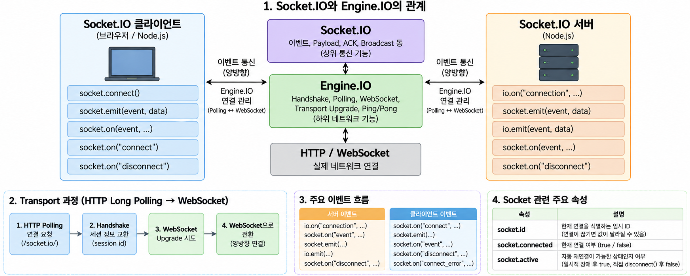
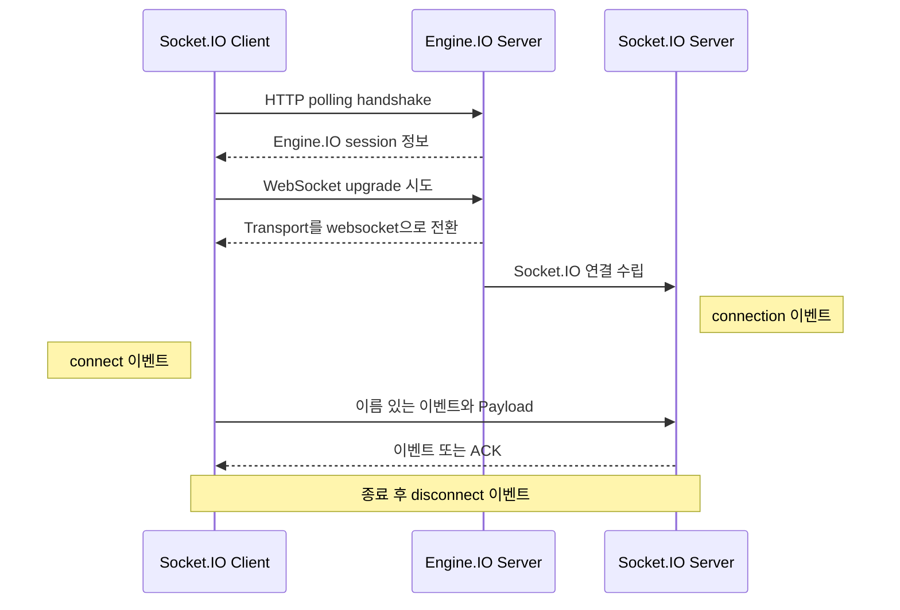
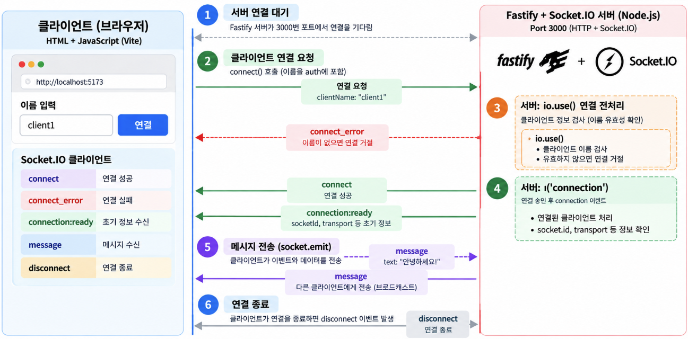
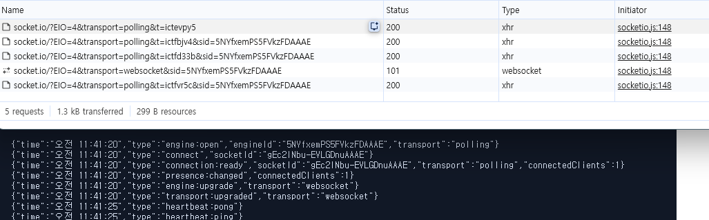

Socket.IO는 서버와 클라이언트가 이름 있는 이벤트를 주고받도록 도와주는 실시간 통신 라이브러리입니다.  
WebSocket을 전송 수단으로 사용할 수 있지만 브라우저의 WebSocket API와 같은 기술은 아닙니다.  
연결 관리, 이벤트 기반 API, 응답 확인, 브로드캐스트와 자동 재연결 같은 기능을 함께 제공합니다.  

📂 **[[GitHub 코드 보러가기]](https://github.com/cericube/nodejs-workbook/tree/main/socketio-basics){: target="_blank" rel="noopener noreferrer" }**  

## 1. Socket.IO의 동작 구조와 연결 생명주기 {#session-01}

  

### 🟦 Socket.IO 서버와 클라이언트의 역할

Socket.IO 서버는 클라이언트의 연결을 받아 각 연결을 나타내는 `Socket` 객체를 만듭니다.  
서버는 이 객체에 이벤트 Listener를 등록하고, 특정 클라이언트 또는 여러 클라이언트에 이벤트를 보냅니다.  

클라이언트는 서버 주소로 연결한 뒤 `Socket` 객체를 통해 이벤트를 보내고 받습니다. 양쪽은 자유롭게 이벤트 이름을 정할 수 있지만, 이벤트 이름과 Payload 형식은 미리 약속해야 합니다.  

| 구분 | 서버 | 클라이언트 |
| --- | --- | --- |
| 연결 완료 | `io.on('connection', ...)` | `socket.on('connect', ...)` |
| 이벤트 전송 | `socket.emit()` 또는 `io.emit()` | `socket.emit()` |
| 이벤트 수신 | `socket.on()` | `socket.on()` |
| 연결 종료 감지 | `socket.on('disconnect', ...)` | `socket.on('disconnect', ...)` |

### 🟦 Engine.IO와 Socket.IO의 관계

Socket.IO는 이벤트 이름, Payload, Acknowledgement 같은 상위 통신 기능을 담당합니다.  
그 아래의 Engine.IO는 실제 네트워크 연결, Transport 선택, Transport Upgrade와 Ping/Pong Heartbeat를 관리합니다.  

```text
애플리케이션 코드
  └─ Socket.IO: connect, emit, on, ACK, broadcast
       └─ Engine.IO: handshake, polling, WebSocket, upgrade, Ping/Pong
            └─ HTTP 또는 WebSocket 연결
```

따라서 Socket.IO 클라이언트는 일반 WebSocket 서버에 직접 연결할 수 없고, 일반 WebSocket 클라이언트도 Socket.IO 서버의 이벤트 규약을 그대로 사용할 수 없습니다. 두 계층이 주고받는 패킷 형식과 연결 절차가 다르기 때문입니다.  

### 🟦 HTTP Long Polling과 Transport Upgrade

기본 설정의 Engine.IO 클라이언트는 먼저 HTTP Long Polling으로 연결합니다.  
Polling은 클라이언트가 HTTP 요청을 열어 두고 서버의 데이터를 기다린 뒤, 응답을 받으면 다시 요청하는 방식입니다.  

연결 뒤 서버와 클라이언트가 모두 WebSocket을 지원하면 기존 연결을 유지한 채 WebSocket으로 전환합니다.  
이를 Transport Upgrade라고 합니다. 초기 연결의 호환성은 Polling으로 확보하고, 이후에는 WebSocket의 양방향 연결을 이용할 수 있습니다.  



브라우저 개발자 도구의 Network 탭에서 `/socket.io/` 요청을 찾으면 처음의 polling 요청과 이어지는 WebSocket 연결을 확인할 수 있습니다.  

### 🟦 Handshake부터 연결 종료까지

연결 생명주기는 다음 순서로 진행됩니다.  

1. 클라이언트가 `socket.connect()`를 호출하고 `handshake.auth` 정보를 보냅니다.  
2. Engine.IO가 Polling 연결을 만들고 필요하면 WebSocket으로 전환합니다.  
3. 서버 Middleware가 연결 정보를 검사합니다.  
4. 연결이 승인되면 서버에서 `connection`, 클라이언트에서 `connect` 이벤트가 발생합니다.  
5. 양쪽이 `emit()`과 `on()`으로 이벤트를 주고받습니다.  
6. 직접 연결을 닫거나 네트워크가 끊기면 양쪽에서 `disconnect` 이벤트가 발생합니다.  
7. 예상하지 못한 종료라면 클라이언트 Manager가 설정에 따라 재연결을 시도합니다.  

연결에 성공하기 전에 서버 Middleware가 요청을 거절하거나 네트워크 연결에 실패하면 클라이언트의 `connect_error`가 발생합니다.  
이때는 아직 Socket.IO 연결이 완료되지 않았으므로 `disconnect`가 아니라 `connect_error`에서 오류를 처리합니다.  

### 🟦 Socket ID와 연결 상태

연결에 성공하면 서버와 클라이언트에서 `socket.id`로 현재 Socket을 구분할 수 있습니다.  
이 값은 현재 연결을 식별하는 임시 ID입니다.  
연결이 끊어진 뒤 새로 연결되면 달라질 수 있으므로 회원 ID나 영구 저장 키로 사용하면 안 됩니다.  

클라이언트의 `socket.connected`는 현재 연결 여부를 나타냅니다.  
`socket.active`는 현재 연결 여부가 아니라, 연결이 끊겼을 때 자동으로 다시 연결할 수 있는 상태인지를 나타냅니다.  
예를 들어 일시적인 전송 장애 뒤에는 `active`가 `true`일 수 있지만, `socket.disconnect()`로 직접 종료한 뒤에는 `false`가 됩니다.  

## 2. Fastify와 Socket.IO 서버 및 HTML 클라이언트 구성 {#session-02}

### 🟦 Fastify HTTP 서버에 Socket.IO 통합

Fastify가 사용하는 Node.js HTTP 서버인 `fastify.server`를 Socket.IO의 `Server`에 전달합니다. 그러면 일반 HTTP API와 Socket.IO가 같은 3000번 포트를 사용합니다.  

```typescript
// src/ch04/socketio.server.ts
// Fastify의 HTTP 서버에 Socket.IO를 연결하고 Transport와 Heartbeat를 설정합니다.
export function registerSocketIoServer(fastify: FastifyInstance) {
  const io = new Server(fastify.server, {
    // HTML은 Vite가 제공하므로 Socket.IO 서버는 클라이언트 번들을 제공하지 않습니다.
    serveClient: false,
    cors: {
      origin: ['http://localhost:5173', 'http://127.0.0.1:5173'],
    },
    // Polling으로 연결한 뒤 가능한 경우 WebSocket으로 전환합니다.
    // WebSocket만 사용할 수도 있습니다.
    transports: ['polling', 'websocket'],
    // polling으로 연결된 클라이언트가 연결을 끊지 않고 WebSocket으로 전환할 수 있게 합니다.
    allowUpgrades: true,
    // 5초마다 Ping을 보내고 3초 안에 Pong이 없으면 연결을 종료합니다.
    pingInterval: 5_000,
    pingTimeout: 3_000,
  });

  // Fastify 종료 전에 Socket.IO 연결과 Heartbeat 타이머를 정리합니다.
  fastify.addHook('preClose', async () => {
    await io.close();
  });
}
```

`serveClient: false`인 이유는 이 예제에서 Vite와 `socket.io-client` 패키지로 클라이언트를 따로 실행하기 때문입니다. 서버와 클라이언트의 Origin이 다르므로 `cors.origin`에는 두 가지 로컬 주소를 허용합니다.  

### 🟦 Fastify와 Socket.IO의 CORS 설정

브라우저의 HTML 클라이언트가 다른 Origin에서 실행된다면 Fastify REST API와 Socket.IO 서버에 CORS를 각각 설정해야 합니다. 두 서버가 같은 HTTP 서버와 포트를 사용하더라도 CORS 설정은 자동으로 공유되지 않습니다.  

```text
브라우저
 ├─ REST 요청 ───────→ Fastify의 CORS 설정
 └─ Socket.IO 연결 ──→ Socket.IO의 CORS 설정
```

Fastify REST 요청은 `@fastify/cors` Plugin으로 허용합니다.  

```typescript
import fastifyCors from '@fastify/cors';

app.register(fastifyCors, {
  origin: ['http://localhost:5173', 'http://127.0.0.1:5173'],
});
```

Socket.IO 연결은 앞의 서버 구성 코드처럼 `Server`의 `cors` 옵션으로 허용합니다. REST와 Socket.IO에 같은 Origin 목록을 지정하면 한쪽만 허용해서 발생하는 연결 오류를 막을 수 있습니다.  

### 🟦 WebSocket만 사용하는 경우

HTTP Long Polling이 필요하지 않다면 서버와 클라이언트 양쪽의 `transports`를 `['websocket']`으로 설정합니다. 처음부터 WebSocket으로 연결하므로 Transport Upgrade가 발생하지 않으며 `allowUpgrades`와 `upgrade` 옵션도 필요하지 않습니다.  

```typescript
const io = new Server(fastify.server, {
  // 서버는 WebSocket 연결만 허용합니다.
  transports: ['websocket'],
});
```

```javascript
const socket = io('http://localhost:3000', {
  // 클라이언트도 처음부터 WebSocket으로 연결합니다.
  transports: ['websocket'],
});
```

WebSocket 연결이 차단된 환경에서는 Polling으로 대체할 수 없으므로 연결에 실패합니다. 배포 환경에서 WebSocket을 안정적으로 지원할 때 사용합니다.  

### 🟦 Socket.IO에서 Fastify 로거 사용

Socket.IO 이벤트 처리에서도 Fastify 인스턴스의 `fastify.log`를 직접 사용할 수 있습니다.  
서버 등록 함수가 받은 `fastify`를 이벤트 Callback에서도 참조할 수 있기 때문입니다.  
이렇게 하면 HTTP API와 Socket.IO 로그에 같은 로그 레벨과 출력 설정을 적용할 수 있습니다.  

먼저 Fastify 인스턴스를 만들 때 로거를 활성화합니다. 다음은 `info` 이상 수준의 로그를 출력하는 최소 설정입니다.  

```typescript
import Fastify from 'fastify';

// 로거는 Fastify 인스턴스를 생성할 때 설정합니다.
const app = Fastify({
  logger: { level: 'info' },
});
```

앞의 `registerSocketIoServer()` 함수 안에서는 `fastify.log.info()`로 연결과 종료를 기록합니다. 다음 코드는 `io`를 생성한 뒤 등록하는 예제입니다.  

```typescript
// registerSocketIoServer(fastify) 함수 안에 등록합니다.
io.on('connection', (socket) => {
  // 첫 번째 인자에는 검색할 데이터를, 두 번째 인자에는 설명을 전달합니다.
  fastify.log.info(
    { socketId: socket.id, transport: socket.conn.transport.name },
    'Socket.IO client connected',
  );

  socket.on('disconnect', (reason) => {
    // 같은 Socket ID와 종료 이유를 남겨 연결의 시작과 끝을 확인합니다.
    fastify.log.info(
      { socketId: socket.id, reason },
      'Socket.IO client disconnected',
    );
  });
});
```

`socketId`, `transport`, `reason`을 객체로 전달하면 로그의 개별 필드로 기록되어 연결별 흐름을 찾기 쉽습니다. 일반 상태는 `info()`, 주의가 필요한 상황은 `warn()`, 오류는 `error()`로 구분할 수 있습니다.  

HTTP Route에서는 현재 요청의 `request.log`를 사용하지만, Socket.IO 이벤트에서는 `fastify.log`에 `socketId`를 직접 포함해 연결을 구분합니다.  

### 🟦 연결과 종료 이벤트 처리  


서버는 `connection` Callback 안에서 현재 연결에 필요한 이벤트 Listener를 등록합니다.  
연결 직후에는 Socket ID, 현재 Transport와 접속자 수를 클라이언트 한 곳에 전달합니다.  

```typescript
// /src/ch04/socketio.server.ts
// 연결이 승인될 때마다 현재 클라이언트를 나타내는 socket을 받습니다.
io.on('connection', (socket) => {
  // handshake.auth에는 클라이언트가 연결을 요청할 때 보낸 인증 정보가 들어 있습니다.
  const clientName = String(socket.handshake.auth.clientName);
  // socket.conn은 실제 통신을 담당하는 Engine.IO 연결이며, transport.name으로 현재 전송 방식을 확인합니다.
  const initialTransport = socket.conn.transport.name;

  fastify.log.info(
    { socketId: socket.id, clientName, transport: initialTransport },
    'Socket.IO client connected',
  );

  // 현재 클라이언트 한 곳에 초기 연결 정보를 보냅니다.
  // socket.emit()은 이 socket에 연결된 클라이언트 한 곳에만 이벤트를 전송합니다.
  // emit()은 이벤트를 보내기만 하므로 상대방이 처리했는지 바로 알 수 없습니다.
  socket.emit('connection:ready', {
    socketId: socket.id, //Socket.IO가 연결될 때마다 새로 만들어지는 식별자
    transport: initialTransport, //전송방식
    connectedClients: io.of('/').sockets.size, // 전체 접속자수
  });

  // 연결 종료 이유와 종료된 Socket ID를 서버 로그에 남깁니다.
  socket.on('disconnect', (reason) => {
    fastify.log.info(
      { socketId: socket.id, clientName, reason },
      'Socket.IO client disconnected',
    );
  });
});
```

실습 서버는 Socket.IO 연결 Middleware에서 클라이언트 이름을 검사합니다. 이 Middleware는 Engine.IO의 Transport 연결을 처리하는 기능이 아닙니다. Socket.IO의 `connection` 이벤트가 발생하기 전에 실행되어, 애플리케이션에서 사용할 연결을 받아들일지 결정합니다.  

클라이언트가 보낸 이름은 `socket.handshake.auth.clientName`에서 읽습니다.  
올바른 이름이면 인자 없이 `next()`를 호출해 다음 단계로 넘깁니다. 이름이 없거나 공백뿐이면 `next(error)`를 호출해 연결을 거절합니다.  
이 오류는 클라이언트의 `connect_error` 이벤트로 전달됩니다.  

```typescript
// io.use()는 connection 이벤트보다 먼저 실행할 Socket.IO 연결 Middleware를 등록합니다.
// 여기서는 이름이 없는 클라이언트가 연결되지 않도록 미리 검사합니다.
// next(): 현재 연결 Middleware의 검사를 끝내고 다음 연결 단계로 넘기는 함수입니다.
io.use((socket, next) => {
  // handshake.auth에는 클라이언트가 auth 옵션으로 보낸 값이 들어 있습니다.
  // 외부에서 받은 값이므로 unknown으로 읽고 아래 조건문에서 타입을 확인합니다.
  const clientName: unknown = socket.handshake.auth.clientName;

  // 문자열이 아니거나 공백만 있는 이름이면 올바르지 않은 값으로 처리합니다.
  if (typeof clientName !== 'string' || clientName.trim() === '') {
    // next(error)는 연결을 거절하고 클라이언트에서 connect_error를 발생시킵니다.
    next(new Error('클라이언트 이름을 입력해 주세요.'));
    return;
  }
  // next()에 오류를 전달하지 않으면 검사를 통과하고 connection 이벤트로 넘어갑니다.
  next();
});
```

### 🟦 HTML과 JavaScript 클라이언트 연결

HTML은 연결 버튼과 상태 표시 영역을 제공하고, `socketio.js`를 ES Module로 불러옵니다.  
JavaScript에서는 `io()`로 Socket을 만들되 `autoConnect: false`를 설정해 사용자가 버튼을 누를 때 연결합니다.  

Socket.IO의 연결 주소를 읽을 때는 Namespace와 HTTP 통신 경로를 구분해야 합니다. 다음은 `/chat` Namespace에 연결하는 예입니다.  

```javascript
const SERVER_URL = 'http://localhost:3000';

const socket = io(`${SERVER_URL}/chat`, {
  path: '/socket.io',
  autoConnect: false,
});
```

| 값 | 역할 |
| --- | --- |
| `http://localhost:3000` | Socket.IO 서버의 주소입니다. |
| `/socket.io` | 브라우저가 서버와 연결을 시작할 때 사용하는 HTTP 통신 경로입니다. |
| `/chat` | 연결 후 참여할 Socket.IO Namespace입니다. |

Polling으로 연결을 시작한다면 최초 HTTP 요청은 대략 다음 주소로 전송됩니다.  

```text
http://localhost:3000/socket.io/?EIO=4&transport=polling
```

이 HTTP 요청으로 서버와 연결한 다음, Socket.IO 프로토콜을 통해 `/chat` Namespace 참여를 요청합니다. 전체 흐름은 다음과 같습니다.  

```text
http://localhost:3000/socket.io
        ↓ Socket.IO 연결 생성
      /chat Namespace 참여
```

`path`를 생략하면 `/socket.io`를 기본값으로 사용합니다.  
경로를 다른 값으로 변경할 때는 서버와 클라이언트에 같은 `path`를 설정해야 합니다.  

아래 Chapter 4 실습 코드는 서버 주소만 `io()`에 전달하므로 기본 Namespace(`/`)에 연결합니다. `path`도 생략했으므로 HTTP 통신에는 기본 경로인 `/socket.io`를 사용합니다.  

```javascript
// src/ch04/client/socketio.js
import { io } from 'socket.io-client';

// io()는 서버와 통신할 Socket을 만들며 autoConnect가 false이므로 아직 연결하지 않습니다.
// 실제 HTTP 통신 경로는 path 옵션을 생략했으므로 Socket.IO 기본값인 /socket.io를 사용합니다.

const socket = io('http://localhost:3000', {
  // 이름을 auth에 넣은 뒤 사용자가 원하는 시점에 연결합니다.
  autoConnect: false,
  // polling으로 연결한 뒤 서버가 허용하면 WebSocket으로 전환합니다.
  transports: ['polling', 'websocket'],
  upgrade: true,
  // 예기치 않게 연결이 끊어지면 1~5초 간격으로 최대 5번 다시 연결합니다.
  reconnection: true,
  reconnectionAttempts: 5,
  reconnectionDelay: 1_000,
  reconnectionDelayMax: 5_000,
});

// 연결 버튼은 입력한 이름을 handshake에 넣고 서버 연결을 시작합니다.
document.querySelector('#connect').addEventListener('click', () => {
  // auth의 이름은 Socket.IO handshake에서 서버 Middleware로 전달됩니다.
  socket.auth = { clientName: clientNameElement.value.trim() };
  socket.connect();
});
```

연결 관련 Listener는 `connect()`를 호출하기 전에 한 번만 등록합니다.  
`connect` Handler 안에 다른 이벤트 Listener를 등록하면 재연결할 때마다 같은 Listener가 중복될 수 있습니다.  

```javascript
// 최초 연결과 자동 재연결이 성공할 때마다 실행됩니다.
socket.on('connect', () => {
  statusElement.textContent = 'CONNECTED';
  socketIdElement.textContent = socket.id ?? '-';
  log('connect', { socketId: socket.id });
});

// 연결 완료 전 실패나 서버 Middleware의 거절을 처리합니다.
socket.on('connect_error', (error) => {
  statusElement.textContent = 'CONNECT_ERROR';
  log('connect_error', { message: error.message });
});

// 연결이 끝난 이유와 자동 재연결 가능 상태를 기록합니다.
socket.on('disconnect', (reason) => {
  statusElement.textContent = 'DISCONNECTED';
  socketIdElement.textContent = '-';
  log('disconnect', { reason, active: socket.active });
});
```

### 🟦 서버와 클라이언트 실행

실습 저장소의 상위 디렉터리에서 터미널을 두 개 열어 다음 명령을 실행합니다.  

```text
// src/app.ts
// Chapter 4 실습 시 아래 import의 주석을 해제하고 나머지를 주석 처리합니다.
import { registerChapter04SocketIoServer } from './ch04/socketio.server';

// Chapter 4 실습 시 아래 호출의 주석을 해제하고 나머지 호출을 주석 처리합니다.
registerChapter04SocketIoServer(app);
```

```bash
# 터미널 1: Fastify와 Socket.IO 서버를 실행합니다.
 npx tsx watch ./src/server.ts
```

```bash
# 터미널 2: Chapter 4 HTML 클라이언트를 실행합니다.
npx vite src/ch04/client
```


브라우저에서 `http://localhost:5173`을 열고 **연결**을 누릅니다.  
화면 로그에서 `engine:open`, `connect`, `connection:ready`를 확인하고 서버 터미널에서 Socket ID와 초기 Transport를 확인합니다.  
이어서 Network 탭에서 Polling 요청과 WebSocket 연결을 살펴봅니다.  

이름을 비우고 연결하면 화면에 `connect_error`와 서버가 전달한 오류 메시지가 나타납니다. 다시 이름을 입력한 뒤 **연결**을 누르면 정상적으로 연결됩니다.  

## 3. Socket.IO 이벤트 송수신과 응답 처리 {#session-03}

### 🟦 이벤트 기반 통신 구조

Socket.IO 이벤트는 이벤트 이름과 Payload로 구성됩니다.  
보내는 쪽이 `emit(이벤트 이름, Payload)`을 호출하면 받는 쪽의 같은 이름을 가진 `on()` Listener가 실행됩니다.  

```text
클라이언트 emit('message:send', payload)
  → 서버 on('message:send')
  → 서버 socket.emit('message:received', payload)
  → 클라이언트 on('message:received')
```

이벤트 이름은 `message:send`처럼 기능과 동작을 함께 표현하면 송신과 수신 흐름을 구분하기 쉽습니다.  
Payload는 문자열뿐 아니라 직렬화할 수 있는 객체와 배열도 전달할 수 있습니다.  

### 🟦 클라이언트에서 서버로 이벤트 전송

클라이언트는 입력한 메시지와 전송 시각을 하나의 Payload 객체로 만든 뒤 서버에 보냅니다.  

```javascript
// 여러 이벤트에서 같은 형식의 Payload를 사용합니다.
function createPayload() {
  return {
    text: messageElement.value.trim(),
    sentAt: new Date().toISOString(),
  };
}

document.querySelector('#send').addEventListener('click', () => {
  //emit()은 이벤트를 보내기만 하므로 상대방이 처리했는지 바로 알 수 없습니다.
  socket.emit('message:send', createPayload());
});
```

서버는 `message:send`를 수신하고 클라이언트 이름과 Socket ID를 더합니다. 그 결과를 `socket.emit()`으로 요청한 클라이언트 한 곳에 돌려줍니다.  

```typescript
// 클라이언트의 Payload에 서버가 알고 있는 연결 정보를 추가합니다.
socket.on('message:send', (payload: MessagePayload) => {
  socket.emit('message:received', {
    ...payload,
    from: clientName,
    socketId: socket.id,
  });
});
```

### 🟦 `on()`과 `off()`로 Listener 관리

`on()`은 이벤트 Listener를 등록하고 `off()`는 제거합니다.  
특정 Listener만 제거하려면 두 메서드에 같은 함수 참조를 전달해야 합니다.  

```javascript
// 이름 있는 함수를 사용해야 나중에 같은 Listener만 정확히 제거할 수 있습니다.
function handleMessage(data) {
  log('message:received', data);
}

socket.on('message:received', handleMessage);
socket.off('message:received', handleMessage);
```

### 🟦 Acknowledgement와 `emitWithAck()`

Acknowledgement(ACK)는 이벤트를 받은 쪽이 처리를 마친 뒤 그 결과를 보낸 쪽에 바로 알려 주는 기능입니다.  
ACK를 사용하면 별도의 응답 이벤트를 만들지 않고도 요청과 응답을 한 흐름으로 처리할 수 있습니다.  

```typescript
// Acknowledge 타입은 개발 및 컴파일 단계에서 ACK 결과의 형식을 검사합니다.
// 문자열 키를 가진 결과 객체를 받고 값을 반환하지 않는 함수만 사용할 수 있습니다.
type Acknowledge = (result: Record<string, unknown>) => void;
```

TypeScript에서 Acknowledge 타입을 정의하는 이유는 개발 및 컴파일 단계에서 ACK 함수에 전달할 데이터의 형식을 검사하기 위해서입니다.  
컴파일 과정에서 TypeScript 타입 정보는 제거되며,  
실제 실행 시에는 타입과 무관하게 Socket.IO가 제공하는 acknowledge 함수가 전달받은 데이터를 클라이언트로 전송합니다

```typescript
// /src/ch04/socketio.server.ts
// 마지막 인자의 Callback을 호출해 요청한 클라이언트에 처리 결과를 반환합니다.
socket.on('message:save', (payload: MessagePayload, acknowledge: Acknowledge) => {
  acknowledge({
    ok: true,
    messageId: randomUUID(),
    receivedAt: new Date().toISOString(),
  });
});
```

클라이언트의 `emitWithAck()`는 ACK 결과를 Promise로 반환합니다.  
서버가 응답하지 않을 가능성에 대비해 `timeout()`으로 최대 대기 시간을 함께 정하는 편이 안전합니다.  

```javascript
// /src/ch04/client/socketio.js
// 최대 3초 동안 서버의 ACK를 기다리고 결과를 화면에 기록합니다.
try {
  const result = await socket
    .timeout(3_000)
    .emitWithAck('message:save', createPayload());

  log('message:ack', result);
} catch {
  log('message:ack', { error: 'ACK 응답 시간이 초과되었습니다.' });
}
```

ACK는 서버가 클라이언트에 처리 결과를 전달하는 응답 방식일 뿐입니다.  
요청의 성공 여부는 서버 로직에서 판단하고, 그 결과를 ACK로 명확하게 반환해야 합니다..  

## 4. Socket.IO 브로드캐스트와 연결 상태 관리 {#session-04}

### 🟦 `socket.emit()`, `io.emit()`, `socket.broadcast.emit()`

이벤트를 보내는 객체에 따라 수신 범위가 달라집니다.  

| API | 수신 대상 | 주요 용도 |
| --- | --- | --- |
| `socket.emit()` | 현재 Socket 한 곳 | 요청자에게 결과 또는 개인 알림 전송 |
| `io.emit()` | 기본 Namespace의 모든 Socket | 전체 공지와 공유 상태 동기화 |
| `socket.broadcast.emit()` | 현재 Socket을 제외한 모든 Socket | 다른 사용자에게 변경 사항 전파 |

실습 서버는 클라이언트가 보낸 같은 Payload를 두 가지 범위로 전달합니다.  

```typescript
// /src/ch04/socketio.server.ts
// io.emit()은 송신자를 포함한 모든 클라이언트에 메시지를 전달합니다.
socket.on('broadcast:all', (payload: MessagePayload) => {
  io.emit('broadcast:message', {
    ...payload,
    scope: 'all',
    from: clientName,
  });
});

// socket.broadcast.emit()은 송신자를 제외한 모든 클라이언트에 메시지를 전달합니다.
socket.on('broadcast:others', (payload: MessagePayload) => {
  socket.broadcast.emit('broadcast:message', {
    ...payload,
    scope: 'others',
    from: clientName,
  });
});
```

### 🟦 연결과 연결 해제 시 접속자 수 관리

`io.of('/').sockets.size`는 기본 Namespace에 현재 연결된 Socket 수입니다.  
서버는 연결 직후와 연결 해제 뒤에 `presence:changed`를 전체 전송하여 모든 화면의 접속자 수를 맞춥니다.  

```typescript
// 새 연결을 포함한 현재 접속자 수를 모든 클라이언트에 알립니다.
io.emit('presence:changed', {
  connectedClients: io.of('/').sockets.size,
});

//연결 종료가 감지되면 disconnect 이벤트의 reason으로 종료 원인을 확인해 로그에 남깁니다.
socket.on('disconnect', (reason) => {
  fastify.log.info({ socketId: socket.id, reason });

  // disconnect 시점에는 종료된 Socket이 목록에서 빠져 있습니다.
  io.emit('presence:changed', {
    connectedClients: io.of('/').sockets.size,`
  });
});
```

서버 메모리의 Socket 수는 현재 프로세스에서 연결된 수를 나타냅니다.  
서버를 여러 대 운영할 때 전체 접속자 수를 계산하려면 Socket.IO Adapter와 공유 저장소를 고려해야 합니다.  

### 🟦 Ping/Pong Heartbeat로 연결 상태 감지

Ping/Pong Heartbeat는 Engine.IO가 자동으로 관리하므로 애플리케이션에서 직접 구현할 필요가 없습니다.  
서버는 `pingInterval`마다 Ping을 보내고, 클라이언트는 자동으로 Pong을 반환합니다. 서버가 `pingTimeout` 안에 Pong을 받지 못하면 연결이 끊긴 것으로 판단합니다.  

```javascript
// /src/ch04/client/socketio.js
// Engine.IO가 서버 Ping을 받으면 자동으로 Pong을 생성합니다.
engine.on('ping', () => {
  heartbeatElement.textContent = 'PING 수신';
  log('heartbeat:ping');
});

// 생성되는 Pong 패킷을 관찰해 화면에 왕복 상태를 표시합니다.
engine.on('packetCreate', (packet) => {
  if (packet.type !== 'pong') return;
  heartbeatElement.textContent = 'PONG 전송';
  log('heartbeat:pong');
});
```

### 🟦 자동 재연결과 이벤트 처리

예상하지 못한 전송 장애가 발생하면 `socket.io`의 Manager가 재연결을 시도합니다. `reconnect_attempt`와 `reconnect`는 Manager 이벤트이고, 연결이 다시 완료될 때는 Socket의 `connect`도 다시 발생합니다.  

```text
Engine.IO가 Ping/Pong으로 연결 상태 확인
              ↓
Pong이 오지 않으면 연결 종료로 판단
              ↓
disconnect 발생
              ↓
Socket.IO Client Manager가 자동 재연결 시도
```

Ping/Pong은 연결 끊김을 감지하고, 자동 재연결은 끊어진 연결을 다시 만드는 기능입니다  

```javascript
// /src/ch04/client/socketio.js
// 재연결 시도 횟수를 화면에 표시합니다.
socket.io.on('reconnect_attempt', (attempt) => {
  statusElement.textContent = 'RECONNECTING';
  log('reconnect_attempt', { attempt });
});

// Manager가 새 연결을 확보한 시점을 기록합니다.
socket.io.on('reconnect', (attempt) => {
  log('reconnect', { attempt, socketId: socket.id });
});

// 새 Socket.IO 연결이 완료되면 connect가 다시 실행됩니다.
socket.on('connect', () => {
  statusElement.textContent = 'CONNECTED';
  socketIdElement.textContent = socket.id ?? '-';
  log('connect', { socketId: socket.id });
});
```

`socket.disconnect()`로 직접 종료하면 자동 재연결하지 않습니다.  
재연결은 새 연결을 만드는 기능이므로 Socket ID가 달라질 수 있고, 끊긴 동안의 이벤트가 자동으로 복구된다고 가정해서는 안 됩니다.  
