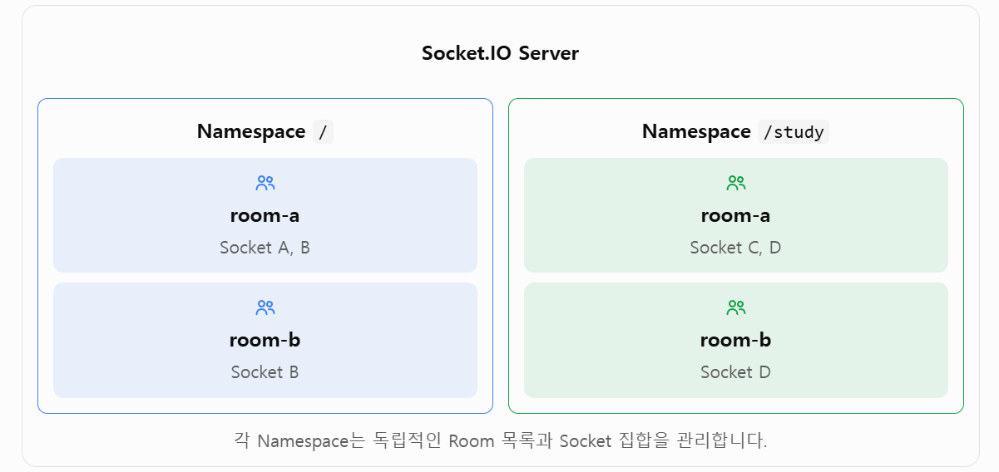

📂 **[[GitHub 코드 보러가기]](https://github.com/cericube/nodejs-workbook/tree/main/socketio-basics){: target="_blank" rel="noopener noreferrer" }**  

## 1. Socket.IO Room과 Namespace의 개념 {#session-01}



### 🟦 Room의 역할

Room은 같은 Namespace에 연결된 Socket 중 일부를 묶는 서버 측 그룹입니다.  
채팅방 참여자, 같은 문서를 편집하는 사용자, 같은 프로젝트의 구성원처럼 특정 대상에게만 이벤트를 보낼 때 사용합니다.  

Room은 서버에서 관리합니다.  
클라이언트가 서버에 참여를 요청할 수는 있지만, 실제 참여와 퇴장은 서버가 `socket.join()`과 `socket.leave()`로 처리합니다.  
클라이언트는 자신이 참여한 Room 목록에 직접 접근할 수 없으므로 필요한 목록은 서버가 이벤트나 ACK로 전달해야 합니다.  

### 🟦 Namespace의 역할

Namespace는 하나의 Socket.IO 서버 안에서 통신 영역을 논리적으로 분리하는 기능입니다.  
각 Namespace는 자체 Socket, 이벤트 Listener, Middleware와 Room을 가집니다.  

기본 Namespace는 `/`이고, `io.of('/study')`처럼 원하는 경로로 사용자 정의 Namespace를 만들 수 있습니다.  
예를 들어 일반 사용자 기능은 `/`, 학습 기능은 `/study`, 관리자 기능은 `/admin`으로 분리할 수 있습니다.  

Namespace를 여러 개 사용해도 클라이언트와 서버는 기본적으로 하나의 하위 전송 연결을 공유할 수 있습니다. Socket.IO가 각 패킷을 알맞은 Namespace로 나누어 전달하는 방식을 Multiplexing이라고 합니다.  

### 🟦 Room과 Namespace의 차이

| 구분 | Room | Namespace |
| --- | --- | --- |
| 목적 | 일부 Socket을 그룹으로 묶음 | 통신 기능과 이벤트 영역을 분리함 |
| 생성과 참여 | 서버가 `join()`으로 Socket을 추가함 | 서버가 `io.of()`로 만들고 클라이언트가 해당 경로에 연결함 |
| 이벤트 Listener | 같은 Namespace의 Listener를 공유함 | Namespace마다 별도로 등록함 |
| Middleware | Namespace의 Middleware를 공유함 | Namespace마다 다르게 설정할 수 있음 |
| 주요 예 | 채팅방, 문서 구독자, 프로젝트 그룹 | 일반 사용자, 관리자, 서비스 기능 분리 |

Room은 수신 대상을 나눌 때 사용하고, Namespace는 연결과 이벤트 처리 영역 자체를 나눌 때 사용합니다. 인증 방식이나 이벤트 이름까지 분리해야 한다면 Namespace가 적합합니다. 같은 기능 안에서 일부 사용자만 묶으면 Room이 더 간단합니다.  

### 🟦 Socket, Room, Namespace의 관계

Socket은 반드시 하나의 Namespace에 속합니다.  
해당 Socket은 그 Namespace 안에서 여러 Room에 동시에 참여할 수 있습니다.  

```text
Socket.IO Server
├─ 기본 Namespace (/)
│  ├─ Socket A ── room-a, room-b
│  └─ Socket B ── room-a
└─ 사용자 정의 Namespace (/study)
   ├─ Socket C ── room-a
   └─ Socket D ── room-b
```

위 구조에서 `/`의 `room-a`와 `/study`의 `room-a`는 이름만 같을 뿐 서로 다른 Room입니다. Room은 항상 자신이 속한 Namespace 안에서만 유효합니다.  

### 🟦 이벤트 전달 범위

| 전송 코드 | 전달 범위 |
| --- | --- |
| `io.emit()` | 기본 Namespace(/)의 모든 Socket |
| `socket.emit()` | 현재 Socket 한 곳 |
| `namespace.emit()` | 현재 Namespace의 모든 Socket |
| `namespace.to(room).emit()` | 현재 Namespace에서 해당 Room에 참여한 모든 Socket |
| `socket.to(room).emit()` | 같은 Namespace와 Room에서 송신자를 제외한 Socket |

Namespace가 가장 바깥의 통신 경계를 만들고, Room은 그 안에서 수신 대상을 더 작게 나눕니다.  
`/study`에서 Room 이벤트를 보내도 기본 Namespace `/`의 같은 이름을 가진 Room에는 전달되지 않습니다.  

## 2. Room을 이용한 그룹 통신 {#session-02}

### 🟦 Room 참여와 퇴장

클라이언트는 `room:join` 이벤트로 참여를 요청합니다. 서버는 Room 이름을 검사한 뒤 `socket.join(room)`으로 현재 Socket을 추가합니다.  

TypeScript에서 Acknowledge 타입을 정의하는 이유는 개발 및 컴파일 단계에서 ACK 함수에 전달할 데이터의 형식을 검사하기 위해서입니다.  
컴파일 과정에서 TypeScript 타입 정보는 제거되며, 실제 실행 시에는 타입과 무관하게 Socket.IO가 제공하는 acknowledge 함수가 전달받은 데이터를 클라이언트로 전송합니다  

```typescript
// /src/ch05/socketio.server.ts
// Room 이름을 확인하고 현재 Socket을 해당 Room에 참여시킵니다.
socket.on('room:join', async (payload: RoomPayload, acknowledge: Acknowledge) => {
  const room = normalizeRoom(payload.room);

  if (!room) {
    acknowledge({ ok: false, message: 'Room 이름을 입력해 주세요.' });
    return;
  }
  // socket.join(room)은 현재 Socket을 이 Namespace 안의 지정한 Room에 참여시킵니다.
  await socket.join(room);

  // namespace.to(room)은 이 Namespace 안에서 지정한 Room에 참여한 Socket만 선택합니다.
  // 방금 참여한 Socket도 대상에 포함되므로 자신의 참여 알림도 수신합니다.
  namespace.to(room).emit('room:member-joined', {
    namespace: namespaceName,
    room,
    clientName,
    socketId: socket.id,
  });

  // room:join 이벤트를 요청한 현재 Socket 한 곳에만 결과를 반환합니다.
  acknowledge({
    ok: true,
    namespace: namespaceName,
    room,
    rooms: getJoinedRooms(socket),  // 사용자가 join()으로 참여한 Room만 반환
  });
});
```

`join()`은 같은 Room에 다시 호출해도 Socket을 중복으로 추가하지 않습니다.  
Room 참여 결과와 최신 목록은 ACK로 요청한 클라이언트에 돌려줍니다.  

퇴장할 때는 현재 참여 여부를 확인하고 `socket.leave(room)`을 호출합니다.  
예제는 퇴장 알림을 다른 참여자에게 먼저 보낸 뒤 Room에서 나갑니다.  

```typescript
// /src/ch05/socketio.server.ts
socket.on('room:leave', async (payload: RoomPayload, acknowledge: Acknowledge) => {
  const room = normalizeRoom(payload.room);

  // 참여하지 않은 Room의 퇴장 요청은 실패 결과를 반환합니다.
  if (!room || !socket.rooms.has(room)) {
    acknowledge({ ok: false, message: '현재 참여 중인 Room이 아닙니다.' });
    return;
  }

  // 퇴장 전에 보내야 현재 Socket을 제외한 기존 참여자가 알림을 받습니다.
  socket.to(room).emit('room:member-left', {
    namespace: namespaceName,
    room,
    clientName,
    socketId: socket.id,
  });

  await socket.leave(room);
  acknowledge({ ok: true, room, rooms: getJoinedRooms(socket) });
});
```

### 🟦 `socket.rooms`로 참여 상태 확인

`socket.rooms`는 현재 Socket이 참여한 Room 이름을 담은 `Set`입니다. Socket.IO는 각 Socket을 `socket.id`와 같은 이름의 개인 Room에 자동으로 참여시킵니다. 따라서 애플리케이션이 직접 추가한 Room만 표시하려면 Socket ID를 제외해야 합니다.  

```typescript
// Spread 문법으로 Set을 배열로 변환하고, filter()로 개인 Room을 제외합니다.
function getJoinedRooms(socket: Socket) {
  return [...socket.rooms].filter((room) => room !== socket.id);
}
```

클라이언트는 `join()`과 `leave()`를 직접 호출하지 않습니다. 서버가 반환한 ACK의 `rooms`를 읽어 화면의 참여 목록을 갱신합니다.  

```javascript
// /src/ch05/client/socketio.js
// 서버가 Room 처리를 마칠 때까지 기다린 뒤 결과와 Room 목록을 표시합니다.
const result = await socket.emitWithAck('room:join', {
  room: roomElement.value,
});

handleRoomResult(namespaceElement.value, result);
```

### 🟦 Room 전체에 이벤트 전송

`namespace.to(room).emit()`은 현재 Namespace 안에서 해당 Room에 참여한 모든 Socket에게 이벤트를 보냅니다. 송신자도 그 Room에 참여했다면 이벤트를 함께 받습니다.  

```typescript
// /src/ch05/socketio.server.ts
socket.on('room:message', (payload: RoomMessagePayload) => {
  const room = normalizeRoom(payload.room);

  // 현재 Socket이 참여한 Room에만 메시지를 보낼 수 있게 제한합니다.
  if (!room || !socket.rooms.has(room)) return;

  namespace.to(room).emit('room:message', {
    ...payload,
    room,
    namespace: namespaceName,
    from: clientName,
  });
});
```

### 🟦 송신자를 제외하고 전송

`socket.to(room).emit()`은 현재 Socket을 제외한 같은 Room 참여자에게 이벤트를 보냅니다.  
송신 화면에서 이미 메시지를 표시했고 다른 참여자에게만 변경 사항을 알려야 할 때 사용할 수 있습니다.  

```typescript
// /src/ch05/socketio.server.ts
socket.on('room:message-others', (payload: RoomMessagePayload) => {
  const room = normalizeRoom(payload.room);
  if (!room || !socket.rooms.has(room)) return;

  socket.to(room).emit('room:message', {
    ...payload,
    room,
    namespace: namespaceName,
    from: clientName,
    senderExcluded: true,
  });
});
```

### 🟦 여러 클라이언트로 Room 통신 테스트

```text
// src/app.ts
// Chapter 5 실습 시 아래 import의 주석을 해제하고 나머지를 주석 처리합니다.
import { registerChapter05SocketIoServer } from './ch05/socketio.server';

// Chapter 5 실습 시 아래 호출의 주석을 해제하고 나머지 호출을 주석 처리합니다.
registerChapter05SocketIoServer(app);
```

```bash
# 터미널 1: Fastify와 Socket.IO 서버를 실행합니다.
npm tsx watch ./src/server.ts
```

```bash
# 터미널 2: Chapter 5 HTML 클라이언트를 실행합니다.
npx vite src/ch05/client
```

브라우저에서 `http://localhost:5173`을 두 탭 이상 엽니다.  

1. 각 탭의 이름을 `browser-a`, `browser-b`처럼 다르게 입력합니다.  
2. 기본 Namespace `/`를 선택하고 두 탭을 연결합니다.  
3. 두 탭 모두 `room-a`에 참여합니다.  
4. 한 탭에서 **Room 전체**를 누르고 두 탭이 모두 `room:message`를 받는지 확인합니다.  
5. **송신자 제외**를 누르고 다른 탭만 이벤트를 받는지 확인합니다.  
6. 한 탭이 Room에서 퇴장한 뒤 다음 Room 메시지를 받지 않는지 확인합니다.  

## 3. Namespace를 이용한 통신 분리 {#session-03}

### 🟦 기본 Namespace와 사용자 정의 Namespace

서버의 `io.of('/')`는 기본 Namespace를 반환합니다.  
클라이언트가 Namespace 경로를 생략하면 이곳에 연결됩니다.  
`io.of('/study')`는 별도의 사용자 정의 Namespace를 만들거나 이미 만든 Namespace를 반환합니다.  

```typescript
// /src/ch05/socketio.server.ts
// 별도 경로가 없는 클라이언트가 연결되는 기본 Namespace입니다.
const defaultNamespace = io.of('/');
// 학습 기능의 Socket과 이벤트를 분리하는 사용자 정의 Namespace입니다.
const studyNamespace = io.of('/study');
```

`io.on()`, `io.use()`, `io.emit()`은 기본 Namespace인 `io.of('/')`에 호출하는 것과 같습니다.  
사용자 정의 Namespace에는 해당 Namespace 객체를 통해 Listener와 Middleware를 따로 등록해야 합니다.  

### 🟦 `io.of()`로 Namespace 구성

실습 서버는 같은 등록 함수를 기본 Namespace와 `/study`에 각각 적용합니다.  
이렇게 하면 이벤트 구조는 공유하면서 연결 상태와 Room은 Namespace별로 분리할 수 있습니다.  

```typescript
// /src/ch05/socketio.server.ts
export function registerChapter05SocketIoServer(fastify: FastifyInstance) {
  const io = new Server(fastify.server, {
    serveClient: false,
    cors: {
      origin: ['http://localhost:5173', 'http://127.0.0.1:5173'],
    },
  });

  // 두 Namespace는 같은 이벤트 등록 함수를 사용하지만 서로 다른 통신 영역입니다.
  registerNamespaceEvents(io.of('/'), '/');
  registerNamespaceEvents(io.of('/study'), '/study');
}
```

### 🟦 HTML 클라이언트에서 Namespace별 연결

클라이언트는 Namespace마다 별도의 Socket 객체를 만듭니다. 기본 Namespace는 서버 주소로, `/study`는 서버 주소 뒤에 Namespace 경로를 붙여 연결합니다.  

```javascript
// 두 Socket은 Namespace별 연결과 이벤트 상태를 각각 관리합니다.
const sockets = {
  '/': io(SERVER_URL, { autoConnect: false }),
  '/study': io(`${SERVER_URL}/study`, { autoConnect: false }),
};
```

선택한 Namespace의 Socket에만 `connect()` 또는 `disconnect()`를 호출합니다. 따라서 `/study` 연결을 종료해도 기본 Namespace의 Socket은 계속 연결된 상태를 유지합니다.  

```javascript
function getSelectedSocket() {
  return sockets[namespaceElement.value];
}

document.querySelector('#connect').addEventListener('click', () => {
  const socket = getSelectedSocket();
  socket.auth = { clientName: clientNameElement.value.trim() };
  socket.connect();
});

document.querySelector('#disconnect').addEventListener('click', () => {
  getSelectedSocket().disconnect();
});
```

### 🟦 Namespace별 연결과 종료 이벤트

서버의 `namespace.on('connection')`은 해당 Namespace에 새 Socket이 연결될 때만 실행됩니다. 같은 브라우저가 `/`와 `/study`에 모두 연결해도 서버에서는 Namespace마다 별도의 Socket으로 관리합니다.  

```typescript
namespace.on('connection', (socket) => {
  // 현재 Namespace에 연결된 Socket 수와 초기 상태를 전달합니다.
  socket.emit('namespace:ready', {
    namespace: namespaceName,
    socketId: socket.id,
    connectedClients: namespace.sockets.size,
    rooms: getJoinedRooms(socket),
  });

  socket.on('disconnect', () => {
    // 연결이 끝난 뒤 남아 있는 현재 Namespace의 접속자 수를 알립니다.
    namespace.emit('namespace:presence', {
      namespace: namespaceName,
      connectedClients: namespace.sockets.size,
    });
  });
});
```

클라이언트도 두 Socket에 같은 Listener 등록 함수를 각각 호출합니다.  
로그에 Namespace 이름을 함께 남기면 어느 연결에서 받은 이벤트인지 구분할 수 있습니다.  

```javascript
function registerSocketListeners(namespace, socket, stateElement) {
  socket.on('connect', () => {
    stateElement.textContent = `CONNECTED (${socket.id})`;
    log('connect', namespace, { socketId: socket.id });
  });

  socket.on('disconnect', (reason) => {
    stateElement.textContent = 'DISCONNECTED';
    log('disconnect', namespace, { reason });
  });

  socket.on('namespace:message', (data) => {
    log('namespace:message', namespace, data);
  });
}
```

### 🟦 Namespace 이벤트 송수신 테스트

1. 첫 번째 탭은 기본 Namespace `/`에 연결합니다.  
2. 두 번째 탭은 `/study`에 연결합니다.  
3. 첫 번째 탭에서 **Namespace 전체**를 눌러 기본 Namespace의 탭만 이벤트를 받는지 확인합니다.  
4. 두 번째 탭에서도 전송해 `/study`에 연결된 탭만 받는지 확인합니다.  
5. 한 탭을 두 Namespace에 모두 연결하고 상태 영역에 서로 다른 Socket ID가 표시되는지 확인합니다.  
6. `/study`만 종료했을 때 기본 Namespace 연결이 유지되는지 확인합니다.  

## 4. Room과 Namespace를 활용한 통신 구조 구현 {#session-04}

### 🟦 Namespace 안에 Room 구성하기

Room은 Namespace에 속하므로 같은 이름의 Room도 Namespace가 다르면 완전히 분리됩니다. 다음 두 전송은 각각 다른 참여자에게 전달됩니다.  

```typescript
io.of('/').to('room-a').emit('room:message', {
  namespace: '/',
  text: '기본 Namespace 메시지',
});

io.of('/study').to('room-a').emit('room:message', {
  namespace: '/study',
  text: '학습 Namespace 메시지',
});
```

이 구조를 사용하면 Namespace로 기능이나 권한 영역을 먼저 나누고, 각 영역 안에서 Room으로 사용자 그룹을 세분화할 수 있습니다.  

### 🟦 Namespace별 Room 관리

실습의 `registerNamespaceEvents()`는 전달받은 `namespace` 안에서만 Room을 관리하고 이벤트를 보냅니다. 같은 함수가 `/`와 `/study`에 등록되더라도 `socket.rooms`와 `namespace.to(room)`의 범위는 서로 섞이지 않습니다.  

```typescript
function registerNamespaceEvents(namespace: Namespace, namespaceName: string) {
  namespace.on('connection', (socket) => {
    socket.on('room:message', (payload: RoomMessagePayload) => {
      const room = normalizeRoom(payload.room);
      if (!room || !socket.rooms.has(room)) return;

      // 전달받은 Namespace 안의 Room만 선택해 이벤트를 보냅니다.
      namespace.to(room).emit('room:message', {
        ...payload,
        namespace: namespaceName,
      });
    });
  });
}
```

### 🟦 여러 Room에 전송하고 중복 방지하기

하나의 Socket은 여러 Room에 참여할 수 있습니다. 여러 Room을 대상으로 전송하면 Socket.IO는 대상의 합집합을 구하므로 두 개 이상의 Room에 속한 Socket도 이벤트를 한 번만 받습니다.  

실습 서버는 입력받은 Room 이름의 공백과 중복을 먼저 제거합니다. 그중 송신자가 실제 참여한 Room만 골라 한 번에 전송합니다.  

```typescript
socket.on('rooms:message', (payload: MultiRoomMessagePayload) => {
  // 잘못된 이름과 같은 Room의 중복 입력을 제거합니다.
  const rooms = [
    ...new Set(payload.rooms.map(normalizeRoom).filter((room) => room !== null)),
  ];

  // 송신자가 참여한 Room만 전송 대상으로 선택합니다.
  const joinedRooms = rooms.filter((room) => socket.rooms.has(room));
  if (joinedRooms.length === 0) return;

  // 여러 Room의 합집합에 보내므로 같은 Socket이 중복 수신하지 않습니다.
  namespace.to(joinedRooms).emit('room:message', {
    text: payload.text,
    sentAt: payload.sentAt,
    rooms: joinedRooms,
    namespace: namespaceName,
    from: clientName,
    multipleRooms: true,
  });
});
```

### 🟦 퇴장과 연결 종료에 따른 상태 변화

`socket.leave(room)`을 호출하면 해당 Room에서만 나가고 Namespace 연결은 유지됩니다. 반면 Socket 연결이 종료되면 Socket.IO가 참여 중인 모든 Room에서 자동으로 제거하므로 각 Room에 `leave()`를 따로 호출할 필요가 없습니다.  

연결 종료 직전의 `disconnecting` 이벤트에서는 `socket.rooms`가 아직 남아 있습니다. 어느 Room에서 나가는지 확인하거나 다른 참여자에게 퇴장 알림을 보내려면 이 시점을 사용합니다. `disconnect`가 발생할 때는 Room 목록이 이미 비어 있습니다.  

```typescript
socket.on('disconnecting', (reason) => {
  const rooms = getJoinedRooms(socket);

  // 연결이 끝나기 전에 참여 중인 모든 Room의 다른 Socket에게 알립니다.
  socket.to(rooms).emit('room:member-left', {
    namespace: namespaceName,
    rooms,
    clientName,
    socketId: socket.id,
    reason,
  });
});

socket.on('disconnect', () => {
  // 종료된 Socket이 빠진 뒤의 Namespace 접속자 수를 전송합니다.
  namespace.emit('namespace:presence', {
    namespace: namespaceName,
    connectedClients: namespace.sockets.size,
  });
});
```

### 🟦 Namespace와 Room 통신 격리 테스트

세 개 이상의 브라우저 탭을 열고 다음과 같이 연결합니다.  

| 클라이언트 | Namespace | 참여 Room |
| --- | --- | --- |
| `browser-a` | `/` | `room-a`, `room-b` |
| `browser-b` | `/` | `room-a` |
| `browser-c` | `/study` | `room-a` |

1. `browser-a`가 `/`의 `room-a`로 메시지를 보내면 `browser-a`와 `browser-b`만 받는지 확인합니다.  
2. `browser-c`가 `/study`의 `room-a`로 메시지를 보내도 기본 Namespace의 두 탭이 받지 않는지 확인합니다.  
3. `browser-a`가 `room-a, room-b`에 전송했을 때 두 Room에 모두 참여했어도 메시지를 한 번만 받는지 확인합니다.  
4. `browser-b`가 `room-a`에서 퇴장한 뒤 다음 Room 메시지를 받지 않는지 확인합니다.  
5. `browser-a`의 연결을 종료하고 `browser-b`의 `room:member-left` 로그와 Namespace 접속자 수 변화를 확인합니다.  
6. **Namespace 전체** 메시지는 Room 참여 여부와 관계없이 같은 Namespace의 모든 Socket이 받는지 확인합니다.  

Room과 Namespace를 함께 사용하면 하나의 Socket.IO 서버에서 통신 범위를 단계적으로 나눌 수 있습니다. Namespace로 기능과 권한 영역을 분리하고, 그 안의 Room으로 실제 이벤트 수신 그룹을 구성하면 복잡한 실시간 기능도 명확하게 관리할 수 있습니다.  
