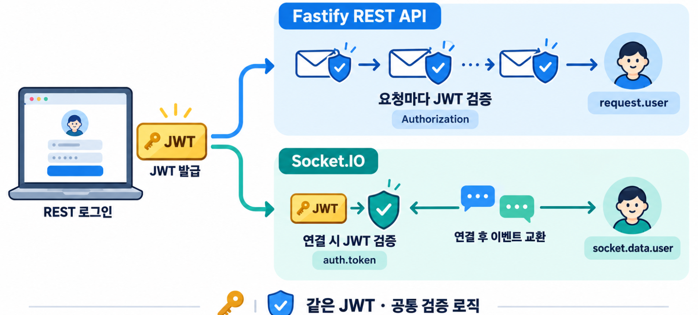
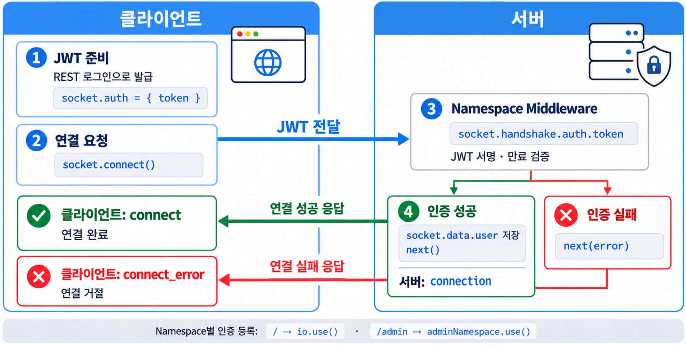
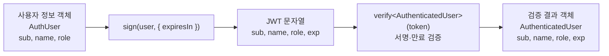

이번 글에서는 Fastify REST API에서 발급한 JWT를 Socket.IO 연결 인증에 함께 사용합니다.  
연결 단계의 인증, 이벤트마다 수행하는 인가, JWT 만료 후의 연결 관리까지 하나의 흐름으로 실습합니다.  

📂 **[[GitHub 코드 보러가기]](https://github.com/cericube/nodejs-workbook/tree/main/socketio-basics){: target="_blank" rel="noopener noreferrer" }**  

## 1. Fastify와 Socket.IO 인증 구조 비교 {#session-01}

### 🟦 HTTP 요청 인증과 Socket.IO 연결 인증

Fastify의 REST API는 요청과 응답이 한 번씩 완료되는 구조입니다.  
보호된 API를 호출할 때마다 `Authorization` 헤더의 JWT를 검증할 수 있습니다.  

Socket.IO는 한 번 연결한 뒤 같은 Socket으로 여러 이벤트를 주고받습니다.  
실습에서는 연결 Handshake에서 JWT를 검증하고 인증된 사용자 정보를 Socket에 저장합니다. 연결된 뒤에는 JWT 만료 시각에 맞춰 Socket을 종료합니다.  

| 구분 | Fastify REST API | Socket.IO |
| --- | --- | --- |
| 인증 시점 | 보호된 HTTP 요청마다 검사 | Namespace 연결 Handshake에서 검사 |
| 토큰 전달 | `Authorization: Bearer 토큰` | `handshake.auth.token` |
| 인증 진입점 | Fastify Hook | Socket.IO Namespace Middleware |
| 인증 사용자 저장 | `request.user` | `socket.data.user` |
| 인증 실패 | HTTP `401` 응답 | 연결 거절 후 `connect_error` |

### 🟦 Fastify Hook과 Socket.IO Middleware

Fastify Hook은 HTTP 요청 처리 흐름에 들어갑니다.  
실습에서는 보호할 Route의 `preHandler`에서 JWT를 검사하고, 인증에 실패하면 Route Handler를 실행하지 않습니다.  

Socket.IO의 `io.use()`는 기본 Namespace의 `connection` 이벤트 전에 실행됩니다.  
`next()`를 호출하면 연결을 승인하고, `next(error)`를 호출하면 연결을 거절합니다.  
사용자 정의 Namespace에는 Namespace별로 Middleware를 별도로 등록해야 합니다.  



두 인증 흐름의 진입점은 다르지만 JWT를 검증하는 기준은 같아야 합니다.  
같은 서명 키와 검증 함수를 사용해야 REST API와 Socket.IO가 동일한 사용자를 일관되게 판단할 수 있습니다.  

### 🟦 REST API와 Socket.IO의 인증 정보 공유

실습에서는 REST 로그인 API가 JWT를 발급합니다.  
클라이언트는 같은 JWT를 보호된 REST API의 Bearer 토큰과 Socket.IO의 `auth.token`에 각각 사용합니다.  

```text
POST /api/ch06/login
        ↓ JWT 발급
        ├─ GET /api/ch06/me
        │    └─ Authorization: Bearer JWT
        └─ Socket.IO 연결
             └─ handshake.auth.token: JWT
```

서버는 공통 `verifyAccessToken()` 함수로 두 토큰을 검증합니다.  
JWT Payload에 들어 있는 `sub`, `name`, `role`은 REST에서는 `request.user`, Socket.IO에서는 `socket.data.user`에 저장됩니다.  

## 2. Socket.IO 연결 인증과 Middleware {#session-02}

### 🟦 Handshake 인증 흐름


Socket.IO 연결 인증은 다음 순서로 진행됩니다.  

1. 클라이언트가 연결 전에 `socket.auth`에 JWT를 설정합니다.  
2. `socket.connect()`가 JWT를 Handshake 인증 정보로 보냅니다.  
3. 서버의 Namespace Middleware가 `socket.handshake.auth.token`을 읽습니다.  
4. JWT가 유효하면 사용자 정보를 `socket.data`에 저장하고 `next()`를 호출합니다.  
5. JWT가 없거나 유효하지 않으면 `next(error)`로 연결을 거절합니다.  
6. 연결이 승인되면 서버의 `connection`과 클라이언트의 `connect`가 발생합니다.  

Middleware가 실행되는 시점에는 아직 Socket.IO 연결이 완료되지 않았습니다. 따라서 인증 실패는 `disconnect`가 아니라 클라이언트의 `connect_error`에서 처리합니다.  

### 🟦 `handshake.auth`로 JWT 전달

클라이언트는 REST 로그인으로 받은 JWT를 두 Namespace의 `auth`에 저장합니다. `autoConnect: false`를 사용하므로 토큰을 준비한 뒤 사용자가 연결 버튼을 눌렀을 때 Handshake를 시작합니다.  

```javascript
// /src/ch06/client/socketio.js
const socket = io(SERVER_URL, { autoConnect: false });
const adminSocket = io(`${SERVER_URL}/admin`, { autoConnect: false });

function setAccessToken(token) {
  accessToken = token;
  // 다음 연결과 재연결 Handshake에서 사용할 JWT를 설정합니다.
  // Socket.IO Client의 Socket 객체에 이미 정의된 속성입니다.
  socket.auth = { token };
  adminSocket.auth = { token };
}

socket.connect();
adminSocket.connect();
```

`auth`는 Socket.IO 연결 인증용 데이터입니다.  
HTTP API의 `Authorization` 헤더와 전달 위치는 다르지만 같은 JWT를 담습니다.  

### 🟦 `io.use()`로 연결 인증

서버의 인증 Middleware는 토큰이 문자열인지 먼저 확인하고 `verifyAccessToken()`으로 서명과 만료 시간을 검사합니다.  

```typescript
// /src/ch06/socketio.server.ts
function createSocketAuthenticationMiddleware(fastify: FastifyInstance) {
  return (socket: AuthenticatedSocket, next: (error?: Error) => void) => {
    // 클라이언트의 연결 옵션 auth.token은 서버의 handshake.auth.token으로 전달됩니다.
    const token: unknown = socket.handshake.auth.token;
    if (typeof token !== 'string' || token === '') {
      next(new Error('인증 토큰이 필요합니다.'));
      return;
    }
    try {
      // 공통 검증 함수로 JWT의 서명과 만료 시각을 확인합니다.
      const user = verifyAccessToken(fastify, token);
      // 연결 이후의 이벤트에서 사용할 사용자와 원본 토큰을 저장합니다.
      socket.data.user = user;
      socket.data.accessToken = token;
      next();
    } catch {
      next(new Error('유효하지 않거나 만료된 토큰입니다.'));
    }
  };
}
```

기본 Namespace에는 `io.use()`로 등록합니다.  
`/admin`은 별도의 Namespace이므로 같은 인증 Middleware를 다시 등록합니다.  

```typescript
const authenticateSocket = createSocketAuthenticationMiddleware(fastify);
// 기본 Namespace의 연결을 인증합니다.
io.use(authenticateSocket);

// 사용자 정의 Namespace에는 Middleware를 별도로 등록합니다.
const adminNamespace = io.of('/admin');
adminNamespace.use(authenticateSocket);
```

### 🟦 `socket.data`로 사용자 정보 관리

`socket.data`는 현재 Socket에 애플리케이션 데이터를 저장하는 공간입니다.  
Middleware에서 저장한 인증 사용자는 같은 Socket의 이벤트 Listener에서 다시 사용할 수 있습니다.  

```typescript
// /src/ch06/socketio.server.ts
namespace.on('connection', (socket) => {
  // Middleware를 통과했으므로 인증된 사용자 정보가 들어 있습니다.
  const user = socket.data.user;
  // 연결 인증 결과를 확인할 수 있도록 현재 Socket ID와 사용자를 알립니다.
  socket.emit('auth:ready', {
    socketId: socket.id,
    user,
  });
});
```

실습에서는 `socket.data`에 저장할 인증 정보를 `AuthenticatedSocketData` 인터페이스로 정의합니다.  
검증된 사용자에는 JWT Payload의 `exp`가 포함되므로 만료 시각도 타입으로 표현합니다.  

```typescript
// /src/ch06/auth.ts
// 검증된 JWT 사용자에는 초 단위 만료 시각이 포함됩니다.
export interface AuthenticatedUser extends AuthUser {
  exp: number;
}

// Socket 연결이 유지되는 동안 이벤트 Handler가 공유할 인증 정보입니다.
export interface AuthenticatedSocketData {
  user: AuthenticatedUser;
  accessToken: string;
}
```

이 타입은 `Socket`, `Namespace`, `Server`의 네 번째 제네릭 인수로 전달합니다.  
전역 `SocketData` 타입을 바꾸지 않고 Chapter 6에서 사용하는 Socket에만 인증 데이터 타입을 적용할 수 있습니다.  

```typescript
// /src/ch06/socketio.server.ts
/**
 * 인증된 Socket.IO 클라이언트를 나타내는 Socket 타입입니다.
 * 이벤트 타입은 Socket.IO 기본값을 유지하고
 * socket.data만 인증 정보 타입으로 제한하여,
 * 연결 Middleware와 이벤트 핸들러가 같은 사용자와 액세스 토큰 구조를 공유하게 합니다.
 */
type AuthenticatedSocket = Socket<
  DefaultEventsMap, // 클라이언트에서 서버로 보내는 이벤트 타입
  DefaultEventsMap, // 서버에서 클라이언트로 보내는 이벤트 타입
  DefaultEventsMap, // Socket.IO 서버 간 전달하는 이벤트 타입
  AuthenticatedSocketData // socket.data에 저장할 사용자 인증 정보 타입
>;

/**
 * 인증된 클라이언트가 연결되는 Socket.IO Namespace 타입입니다.
 */
type AuthenticatedNamespace = Namespace<
  DefaultEventsMap,
  DefaultEventsMap,
  DefaultEventsMap,
  AuthenticatedSocketData
>;
```

`socket.data`는 현재 연결에 속한 메모리 데이터입니다.  
영구 사용자 저장소를 대신하지 않으며 연결이 끝나면 함께 사라집니다.  
비밀번호나 꼭 필요하지 않은 민감 정보도 저장하지 않는 편이 안전합니다.  

### 🟦 `connect_error`로 인증 실패 처리

서버 Middleware가 `next(error)`를 호출하면 연결은 만들어지지 않고 클라이언트에서 `connect_error`가 발생합니다.  

```javascript
socket.on('connect_error', (error) => {
  socketStateElement.textContent = 'CONNECT_ERROR';
  log('socket:connect_error', { message: error.message });
});
```

인증 정보가 잘못되어 거절된 연결은 자동 재연결만 반복해도 성공할 수 없습니다.  
새 JWT를 설정한 뒤 `socket.connect()`를 다시 호출해야 합니다.  

## 3. Fastify JWT 인증과 Socket.IO 연동 {#session-03}

### 🟦 `@fastify/jwt` 등록

`@fastify/jwt`를 등록하면 Fastify에서 JWT를 발급하는 `fastify.jwt.sign()`과 검증하는 `fastify.jwt.verify()`를 사용할 수 있습니다.  

```typescript
// /src/ch06/socketio.server.ts
import fastifyJwt from '@fastify/jwt';

// Fastify 인스턴스에 JWT 발급·검증 API를 추가합니다.
fastify.register(fastifyJwt, {
  // 실습용 기본값이며 실제 서비스에서는 환경 변수로 관리해야 합니다.
  secret: process.env.JWT_SECRET ?? 'ch06-practice-secret-change-in-production',
});
```

JWT는 Payload를 숨기는 암호화 방식이 아닙니다.  
누구나 Payload를 디코딩할 수 있으므로 비밀번호와 민감 정보를 넣으면 안 됩니다. 서버는 비밀키로 만든 서명을 검증해 토큰이 위조되지 않았는지 확인합니다.  

실제 서비스에서는 충분히 긴 비밀키를 소스 코드에 넣지 않고 환경 변수나 비밀 관리 서비스에서 읽어야 합니다.  
여러 서버가 같은 토큰을 검증해야 한다면 서명 키와 알고리즘, 발급자와 대상 같은 검증 기준도 일치시켜야 합니다.  

### 🟦 공통 JWT 사용자 타입과 검증 함수

JWT Payload에는 사용자를 식별하는 `sub`, 표시 이름인 `name`, 권한을 나타내는 `role`을 저장합니다.  
`@fastify/jwt`가 검증한 결과에는 토큰 만료 시각인 `exp`도 들어 있습니다.  

```typescript
// /src/ch06/auth.ts
//AuthUser는 JWT를 발급할 때 sign()에 전달하는 사용자 정보의 타입
export interface AuthUser {
  sub: string;
  name: string;
  role: 'user' | 'admin';
}

// AuthenticatedUser는 JWT 검증에 성공한 뒤 토큰에서 꺼낸 사용자 정보
export interface AuthenticatedUser extends AuthUser {
  exp: number;  // JWT가 만료되는
}

// REST와 Socket.IO가 같은 함수로 JWT의 서명과 만료 시간을 검사합니다.
export function verifyAccessToken(fastify: FastifyInstance, token: string) {
  // <AuthenticatedUser>는 제네릭 타입 인자로
  // JWT 검증 결과의 구조를 TypeScript에 알려주기 위해서입니다.
  return fastify.jwt.verify<AuthenticatedUser>(token);
}
```



공통 함수로 검증하면 REST와 Socket.IO에서 서로 다른 인증 규칙을 적용하는 실수를 줄일 수 있습니다.  
토큰 폐기 목록이나 사용자 상태 확인이 필요하다면 이 공통 인증 계층에서 함께 처리할 수 있습니다.  

`@fastify/jwt`가 발급할 Payload와 `request.user`의 타입도 현재 사용자 모델에 맞게 확장합니다.  
`declare module`은 실제 객체나 실행 동작을 변경하지 않고 기존 모듈의 타입 선언만 보완합니다.  

```typescript
// /src/ch06/auth.ts
declare module '@fastify/jwt' {
  interface FastifyJWT {
    payload: AuthUser; // fastify.jwt.sign()으로 JWT를 만들 때 저장하는 사용자 정보
    user: AuthUser;  // 토큰 검증 후 request.user에서 꺼내 쓰는 사용자 정보
  }
}
```

### 🟦 REST 로그인과 JWT 발급

실습 로그인 API는 사용자 이름과 비밀번호를 확인한 뒤 30초 동안 유효한 JWT를 발급합니다. 짧은 만료 시간은 토큰 만료 동작을 빠르게 확인하기 위한 실습용 설정입니다.  

```typescript
fastify.post<{ Body: LoginBody }>('/api/ch06/login', (request, reply) => {
  const account = users[request.body.username];

  if (!account || account.password !== request.body.password) {
    return reply.code(401).send({
      message: '사용자 이름 또는 비밀번호가 올바르지 않습니다.',
    });
  }

  // 인증된 사용자 정보를 담은 JWT를 30초 유효 기간으로 발급합니다.
  const accessToken = fastify.jwt.sign(account.user, { expiresIn: '30s' });
  return { accessToken, expiresIn: 30, user: account.user };
});
```

이 예제의 사용자와 평문 비밀번호는 인증 흐름에 집중하기 위한 실습 데이터입니다. 실제 서비스에서는 비밀번호 Hash와 사용자 저장소, 로그인 시도 제한을 적용해야 합니다.  

### 🟦 보호된 REST API 구현

클라이언트는 보호된 API를 호출할 때 JWT를 Bearer 토큰으로 보냅니다.  

```javascript
const result = await request('/api/ch06/me', {
  headers: {
    Authorization: `Bearer ${accessToken}`,
  },
});
```

서버의 `preHandler`는 Route Handler보다 먼저 토큰을 검증합니다. 성공하면 `request.user`에 인증된 사용자를 저장하고, 실패하면 `401` 응답을 반환합니다.  

```typescript
async function authenticateHttpRequest(request: FastifyRequest, reply: FastifyReply) {
  const token = getBearerToken(request.headers.authorization);
  if (!token) {
    await reply.code(401).send({ message: 'Bearer 토큰이 필요합니다.' });
    return;
  }
  try {
    request.user = verifyAccessToken(request.server, token);
  } catch {
    await reply.code(401).send({ message: '유효하지 않거나 만료된 토큰입니다.' });
  }
}

fastify.get('/api/ch06/me', { preHandler: authenticateHttpRequest }, (request) => {
  return { user: request.user };
});
```

### 🟦 JWT 연동 테스트

실습 계정은 다음 두 개입니다.  

| 역할 | 사용자 이름 | 비밀번호 |
| --- | --- | --- |
| 일반 사용자 | `alice` | `alice123` |
| 관리자 | `admin` | `admin123` |

```text
// src/app.ts
// Chapter 6 실습 시 아래 import의 주석을 해제하고 나머지를 주석 처리합니다.
import { registerChapter06SocketIoServer } from './ch06/socketio.server';

// Chapter 6 실습 시 아래 호출의 주석을 해제하고 나머지 호출을 주석 처리합니다.
registerChapter06SocketIoServer(app);
```

서버와 Chapter 6 클라이언트를 각각 실행합니다.  

```bash
# 터미널 1: Fastify와 Socket.IO 서버를 실행합니다.
npx tsx ./src/server.ts
```

```bash
# 터미널 2: Chapter 6 HTML 클라이언트를 실행합니다.
npx vite src/ch06/client
```

브라우저에서 `http://localhost:5173`을 열고 다음 순서로 확인합니다.  

1. `alice / alice123`으로 로그인하고 JWT가 표시되는지 확인합니다.  
2. **보호된 /me 호출**을 눌러 REST 인증 사용자 정보를 확인합니다.  
3. **기본 Namespace 연결**을 누르고 `socket:connect`, `auth:ready` 로그를 확인합니다.  
4. 로그인하지 않거나 토큰이 만료된 상태에서 연결하면 `connect_error`가 발생하는지 확인합니다.  

## 4. Socket.IO 인증 상태와 접근 권한 관리 {#session-04}

### 🟦 연결 인증과 이벤트별 인가

연결 인증은 Socket.IO 연결을 허용할지 판단합니다. 하지만 연결에 성공했다는 이유만으로 모든 Room과 이벤트에 접근하도록 허용하면 안 됩니다. 각 작업을 처리하는 시점에도 사용자의 역할과 현재 상태를 확인해야 합니다.  

실습의 `members` Room은 인증된 사용자라면 누구나 참여할 수 있고, `admins` Room은 관리자만 참여할 수 있습니다.  

```typescript
function canJoinRoom(user: AuthUser, room: RoomPayload['room']) {
  if (room === 'members') return true;
  return user.role === 'admin';
}

socket.on('room:join', async (payload: RoomPayload, acknowledge: Acknowledge) => {
  // 연결 인증과 별도로 현재 사용자의 Room 참여 권한을 검사합니다.
  if (!canJoinRoom(user, payload.room)) {
    acknowledge({ ok: false, message: '이 Room에 참여할 권한이 없습니다.' });
    return;
  }

  await socket.join(payload.room);
  acknowledge({ ok: true, room: payload.room, rooms: [...socket.rooms] });
});
```

Room 메시지를 보낼 때도 현재 참여 상태를 다시 검사합니다. 클라이언트가 보내는 Room 이름은 신뢰할 수 없는 입력이므로 서버가 반드시 권한과 상태를 판단해야 합니다.  

### 🟦 Namespace 접근 권한 검증

`/admin` Namespace는 JWT 인증 Middleware 다음에 관리자 역할 검사 Middleware를 실행합니다. 앞의 Middleware가 `socket.data.user`를 저장했기 때문에 다음 Middleware에서 역할을 확인할 수 있습니다.  

```typescript
const adminNamespace = io.of('/admin');

// 먼저 JWT를 검증하고 인증된 사용자를 socket.data에 저장합니다.
adminNamespace.use(authenticateSocket);

// 그다음 관리자 역할이 있는지 확인합니다.
adminNamespace.use((socket, next) => {
  if (socket.data.user.role !== 'admin') {
    next(new Error('관리자만 접근할 수 있는 Namespace입니다.'));
    return;
  }

  next();
});
```

일반 사용자는 기본 Namespace에는 연결할 수 있지만 `/admin` 연결은 `connect_error`로 거절됩니다. 관리자는 두 Middleware를 모두 통과한 뒤 `admin:message` 이벤트를 사용할 수 있습니다.  

### 🟦 JWT 만료와 기존 Socket 연결

Socket.IO Middleware는 Namespace에 연결할 때 실행됩니다.  
Middleware만 사용하면 연결 후 JWT가 만료되어도 기존 Socket은 자동으로 종료되지 않습니다.  
이 실습은 검증 결과의 `exp`를 이용해 만료 시점에 연결을 직접 종료합니다.  

```typescript
// /src/ch06/socketio.server.ts
const expiresAt = user.exp * 1000;
const remainingTime = expiresAt - Date.now();

// JWT가 만료되면 클라이언트에 알린 뒤 Socket 연결을 종료합니다.
const expirationTimer = setTimeout(() => {
  socket.emit('auth:expired');
  socket.disconnect(true);
}, Math.max(remainingTime, 0));

// 연결이 먼저 끝났다면 남아 있는 만료 Timer를 해제합니다.
socket.on('disconnect', () => {
  clearTimeout(expirationTimer);
});
```

기본 Namespace와 `/admin` Namespace는 각각 만료 Timer를 가집니다.  
클라이언트는 `auth:expired`를 받아 만료 사실을 기록하고, 이어지는 `disconnect`에서 연결 상태를 갱신합니다.  

만료 Timer는 JWT 만료 시각을 기준으로 연결을 끊지만, 연결 후 바뀐 사용자 권한이나 계정 상태까지 확인하지는 않습니다. 이런 변경을 즉시 반영해야 하는 중요한 이벤트는 처리 시점에 서버의 최신 사용자 상태를 별도로 확인해야 합니다.  

### 🟦 토큰 갱신과 재인증

실습의 `/api/ch06/refresh`는 아직 유효한 JWT를 새 30초 JWT로 교환합니다.  
새 토큰을 `socket.auth`에 저장하는 것만으로는 이미 연결된 Socket의 인증 정보가 바뀌지 않습니다.  
새로운 토큰을 적용하려면 Socket을 끊고 다시 연결해 Middleware를 통과해야 합니다.  

```javascript
const reconnectDefault = socket.connected;
const reconnectAdmin = adminSocket.connected;

const result = await request('/api/ch06/refresh', {
  method: 'POST',
  headers: { Authorization: `Bearer ${accessToken}` },
});

// 기존 연결을 종료한 뒤 새 토큰을 다음 Handshake에 사용합니다.
socket.disconnect();
adminSocket.disconnect();
setAccessToken(result.accessToken);

if (reconnectDefault) socket.connect();
if (reconnectAdmin) adminSocket.connect();
```

실제 서비스에서는 Access Token보다 오래 사용할 수 있는 Refresh Token을 별도로 운영하는 경우가 많습니다. 
Refresh Token은 HttpOnly, Secure Cookie 같은 보호 수단을 고려하고, 재사용 탐지와 폐기 정책도 함께 설계해야 합니다.  
