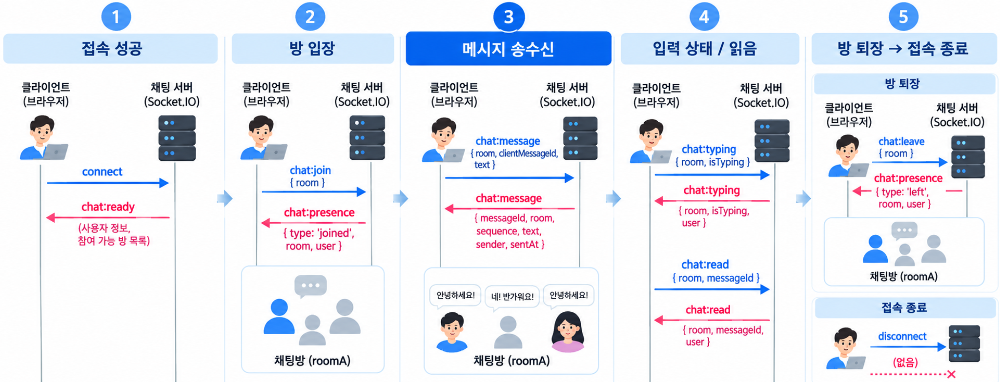
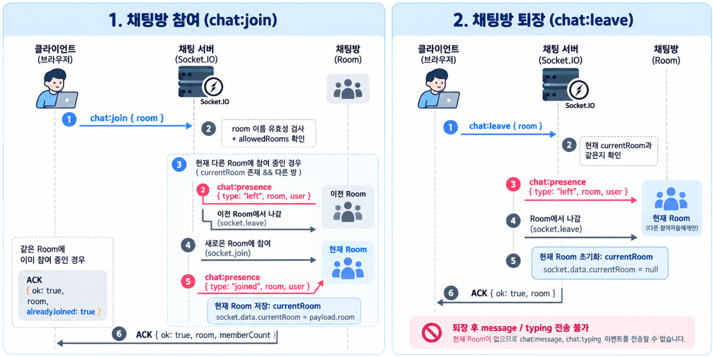
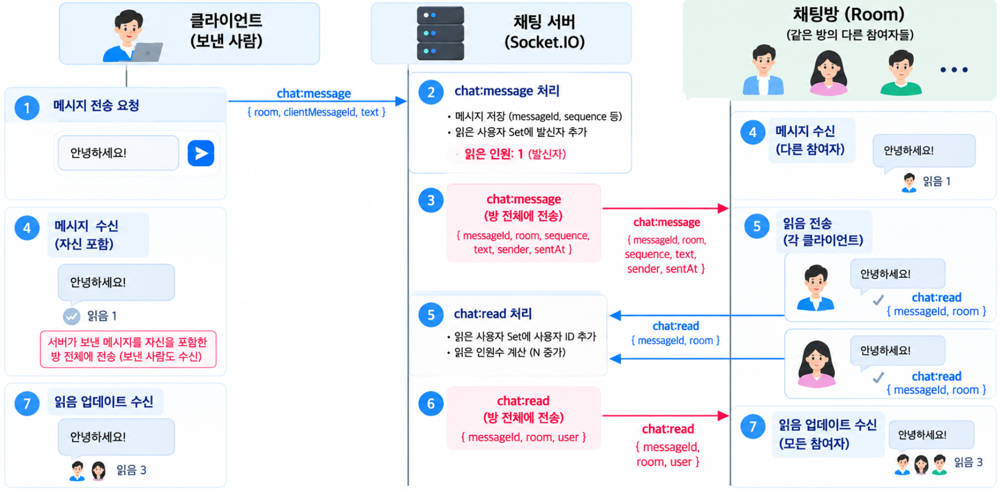
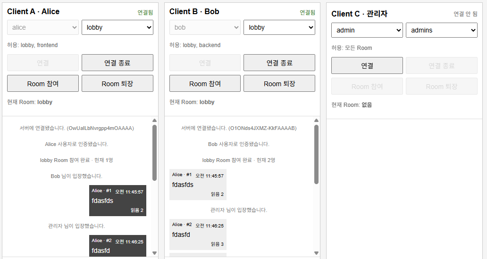

이번 글에서는 Socket.IO의 `/chat` Namespace와 Room을 이용해 실시간 채팅을 구현합니다.  
세 개의 독립적인 클라이언트를 한 화면에서 실행하며 채팅방 참여, 메시지 격리, 입퇴장 알림과 접근 권한을 확인합니다.  

Typing Indicator와 Acknowledgement, 읽음 상태, 메시지 순서와 중복 처리처럼 실제 채팅 서비스에서 필요한 기능도 함께 살펴봅니다.  

📂 **[[GitHub 코드 보러가기]](https://github.com/cericube/nodejs-workbook/tree/main/socketio-basics){: target="_blank" rel="noopener noreferrer" }**  

## 1. 실시간 채팅 시스템 구조 {#session-01}

### 🟦 채팅 서비스의 서버와 클라이언트 구성

Socket.IO 서버는 `/chat` Namespace에서 채팅 연결과 이벤트를 처리합니다.  

```text
브라우저의 독립 클라이언트 3개
        │
        │ Socket.IO 연결
        ▼
http://localhost:3000/chat
        │
        ├─ 연결 사용자 확인
        ├─ Room 참여와 퇴장
        ├─ 메시지와 입력 상태 전달
        └─ 읽음 상태와 중복 처리
```

Socket.IO 서버는 Fastify의 HTTP 서버를 함께 사용하고, `/chat` Namespace에 채팅 이벤트를 등록합니다.  
클라이언트 모듈은 Vite에서 제공하며, 별도 포트의 실습 페이지가 연결할 수 있도록 CORS를 설정합니다. 
Fastify 종료 시에는 `preClose` Hook에서 Socket.IO 연결과 내부 자원을 정리합니다.  

```typescript
// /src/ch07/socketio.server.ts
export function registerChapter07SocketIoServer(fastify: FastifyInstance) {
  const io = new Server<
    DefaultEventsMap, // 클라이언트에서 서버로 보내는 이벤트 타입
    DefaultEventsMap, // 서버에서 클라이언트로 보내는 이벤트 타입
    DefaultEventsMap, // Socket.IO 서버 간 전달하는 이벤트 타입
    ChatSocketData // 각 Socket의 socket.data에 저장되는 데이터 타입, 연결별 사용자와 현재 Room
  >(fastify.server, {
    //true일때: Socket.IO 서버가 클라이언트용 JavaScript 라이브러리 파일을 HTTP로 제공
    serveClient: false,
    // 별도 포트에서 실행하는 실습 페이지의 Socket.IO 연결을 허용합니다.
    cors: { origin: CLIENT_ORIGINS },
  });
  // 기본 Namespace와 분리된 채팅 전용 Namespace에 이벤트를 등록합니다.
  registerChatEvents(io.of('/chat'));
  // Fastify가 닫히기 전에 연결된 Socket과 Socket.IO 내부 자원을 정리합니다.
  fastify.addHook('preClose', async () => {
    await io.close();
  });
}
```

클라이언트는 사용자 카드마다 별도의 Socket을 만들어 `/chat` Namespace에 연결합니다.  
`autoConnect: false`로 자동 연결을 막고, `socket.auth`에 사용자 이름을 설정한 뒤 `socket.connect()`로 연결을 시작합니다.  
사용자 이름은 Handshake의 인증 데이터로 서버에 전달됩니다.  

```javascript
// /src/ch07/client/socketio.js
// 카드마다 별도의 Socket을 만들고, 연결할 사용자를 Handshake에 담습니다.
const socket = io('http://localhost:3000/chat', { autoConnect: false });
socket.auth = { username: 'alice' }; 
socket.connect();
```

여기서 `/chat`은 Namespace입니다. HTTP 전송 경로를 바꾸는 설정이 아니며, Socket.IO의 기본 통신 경로는 `/socket.io`입니다.  

이번 실습은 단일 서버의 메모리에 상태를 저장합니다. 과거 대화 조회와 연결이 끊긴 동안 놓친 메시지 복구는 구현 범위에 포함하지 않습니다.  

### 🟦 메시지 송수신 및 전달 흐름

실시간 채팅은 **접속 성공 → 방 입장 → 메시지 송수신 → 입력 상태와 읽음 공유 → 방 퇴장과 접속 종료** 흐름으로 동작합니다. 아래 그림은 각 단계에서 클라이언트와 서버가 주고받는 주요 이벤트를 보여 줍니다.  



1. **접속 성공**: 클라이언트가 연결하면 서버는 사용자를 확인하고 `chat:ready`로 연결 정보를 전달합니다.  
2. **방 입장**: 클라이언트가 `chat:join`으로 참여를 요청하면 서버는 권한을 확인하고, `chat:presence`로 Room에 입장을 알립니다.  
3. **메시지 송수신**: 클라이언트가 `chat:message`를 보내면 서버는 검증한 메시지를 발신자를 포함한 같은 Room의 모든 Socket에 전달합니다.  
4. **입력 상태와 읽음 공유**: `chat:typing`으로 입력 중인 상태를 다른 참여자에게 알리고, `chat:read`로 메시지의 읽음 상태를 공유합니다.  
5. **방 퇴장과 접속 종료**: `chat:leave`로 Room에서 나가거나 연결을 종료하면 서버는 남은 참여자에게 퇴장을 알립니다. Room에서 나가도 Socket 연결은 유지됩니다.  

ACK는 Room 전체에 보내는 이벤트가 아니라 요청한 클라이언트에 반환하는 응답이며, `chat:message`의 ACK는 다른 사용자의 수신이나 읽음을 의미하지 않습니다.  

실습에서 사용하는 주요 이벤트는 다음과 같습니다.  

| 방향 | 이벤트 | 역할 |
| --- | --- | --- |
| 서버 → 클라이언트 | `chat:ready` | 인증된 사용자와 연결 정보를 전달합니다. |
| 클라이언트 → 서버 | `chat:join` | Room 참여를 요청합니다. |
| 클라이언트 → 서버 | `chat:leave` | 현재 Room에서 퇴장합니다. |
| 서버 → 클라이언트 | `chat:presence` | 사용자 입장과 퇴장을 알립니다. |
| 클라이언트 → 서버 | `chat:message` | 메시지를 전송하고 ACK로 결과를 확인합니다. |
| 서버 → 클라이언트 | `chat:message` | 같은 Room의 모든 Socket에 메시지를 전달합니다. |
| 양방향 | `chat:typing` | 메시지 입력 상태를 전달합니다. |
| 양방향 | `chat:read` | 메시지를 읽은 사용자와 읽음 수를 전달합니다. |

그림의 메시지 송수신 단계에서 클라이언트가 보내는 데이터는 `MessagePayload`, 서버가 같은 Room에 전달하는 데이터는 `ChatMessage`로 정의합니다.  
서버는 검증한 요청에 서버 메시지 ID, Room별 순번, 발신자와 전송 시각을 추가합니다.  

```typescript
/** 클라이언트가 Room에 새 메시지를 보낼 때 전달하는 데이터입니다. */
interface MessagePayload extends RoomPayload {
  clientMessageId: string;
  text: string;
}

/** 서버가 순번과 발신 정보를 추가하여 Room에 전달하는 채팅 메시지입니다. */
interface ChatMessage {
  messageId: string; // Room 이름과 서버 순번으로 만든 서버 메시지 ID
  clientMessageId: string; // 중복 요청 확인에 사용하는 클라이언트 메시지 ID
  room: RoomName; // 메시지를 전달할 Room
  sequence: number; // Room 안에서 메시지 순서를 판단하는 증가 번호
  text: string; // 서버 검증을 통과한 메시지 내용
  sender: Pick<ChatUser, 'id' | 'name'>; // 화면 표시에 필요한 발신자 정보
  sentAt: string; // 서버가 메시지를 생성한 ISO 8601 형식의 시각
}
```

`clientMessageId`는 클라이언트가 메시지를 보내기 전에 만드는 ID입니다. 전송에 실패해 같은 메시지를 다시 보낼 때도 이 ID를 그대로 사용하면 서버가 중복 요청인지 확인할 수 있습니다.  
`messageId`는 서버가 처리한 메시지를 구별하고, `sequence`는 채팅방 안에서 메시지 순서를 판단하는 데 사용합니다.  

## 2. 채팅방 관리와 메시지 송수신 {#session-02}

### 🟦 채팅방 접근 권한 확인

서버에는 실습용 사용자와 참여 가능한 Room이 미리 정의되어 있습니다. 관리자는 모든 Room에 참여할 수 있지만 Alice와 Bob은 서로 다른 업무 Room에 접근합니다.  

| 사용자 | 참여 가능한 Room |
| --- | --- |
| `alice` | `lobby`, `frontend` |
| `bob` | `lobby`, `backend` |
| `admin` | `lobby`, `frontend`, `backend`, `admins` |

연결 Middleware는 클라이언트가 보낸 사용자 이름으로 서버의 사용자 정보를 찾습니다. 존재하지 않는 사용자는 `next(error)`로 연결을 거절합니다.  

```typescript
// /src/ch07/socketio.server.ts
namespace.use((socket: ChatSocket, next) => {
  const username: unknown = socket.handshake.auth.username;
  const user = typeof username === 'string' ? DEMO_USERS[username] : undefined;

  if (!user) {
    next(new Error('alice, bob, admin 중 하나의 사용자로 연결해 주세요.'));
    return;
  }
  // 이벤트 처리 함수가 같은 사용자와 Room 상태를 사용하도록 socket.data에 저장합니다.
  socket.data.user = user;
  socket.data.currentRoom = null;
  next();
});
```

Room 참여 단계에서는 서버가 저장한 `allowedRooms`를 다시 확인합니다.  
권한 검사는 기존 Room에서 나가기 전에 수행합니다. 접근할 수 없는 Room을 요청하면 오류 ACK를 반환하고 기존 Room 참여 상태를 유지합니다.  

### 🟦 Room을 이용한 채팅방 참여와 퇴장


실습에서 한 Socket은 한 번에 하나의 채팅 Room에 참여합니다.  
현재 Room은 `socket.data.currentRoom`에 저장하며, 새 Room에 참여하면 기존 Room에서 먼저 나갑니다.  

```typescript
// /src/ch07/socketio.server.ts
socket.on('chat:join', async (payload: RoomPayload, acknowledge: Acknowledge) => {
  if (!isRoomName(payload?.room)) {
    acknowledge({ ok: false, message: '올바른 채팅방을 선택해 주세요.' });
    return;
  }
  // 참여 가능한 room 확인
  if (!user.allowedRooms.includes(payload.room)) {
    acknowledge({
      ok: false,
      message: `${user.name} 사용자는 ${payload.room}에 참여할 수 없습니다.`,
    });
    return;
  }
 
  const previousRoom = socket.data.currentRoom;
  // 같은 Room에 다시 참여해도 입장 이벤트를 중복 전송하지 않고 현재 인원만 반환합니다.
  if (previousRoom === payload.room) {
    acknowledge({
      ok: true,
      room: payload.room,
      memberCount: await getRoomMemberCount(namespace, payload.room),
      alreadyJoined: true,
    });
    return;
  }

  if (previousRoom) {
    // 기존 Room의 다른 참여자에게 퇴장을 먼저 알린 뒤 Socket의 Room 구성을 변경합니다.
    socket.to(previousRoom).emit('chat:presence', {
      type: 'left',
      room: previousRoom,
      user,
      occurredAt: new Date().toISOString(),
    });
    await socket.leave(previousRoom);
  }
  // 방에 입장 후 현재 방 정보를 교체
  await socket.join(payload.room);
  socket.data.currentRoom = payload.room;

  // namespace.to()는 새로 참여한 Room 전체에 입장을 알립니다.
  namespace.to(payload.room).emit('chat:presence', {
    type: 'joined',
    room: payload.room,
    user,
    occurredAt: new Date().toISOString(),
  });
  // 사용자에게 방 입장 결과 ACT를 전송합니다.
  acknowledge({
    ok: true,
    room: payload.room,
    memberCount: await getRoomMemberCount(namespace, payload.room),
  });
});
```

명시적으로 퇴장할 때도 요청한 Room과 현재 Room이 같은지 확인합니다.  
퇴장이 끝나면 `currentRoom`을 `null`로 바꿔 메시지와 입력 상태를 보내지 못하게 합니다.  

```typescript
// /src/ch07/socketio.server.ts
socket.on('chat:leave', async (payload: RoomPayload, acknowledge: Acknowledge) => {
  if (!isRoomName(payload?.room) || socket.data.currentRoom !== payload.room) {
    acknowledge({ ok: false, message: '현재 참여 중인 채팅방이 아닙니다.' });
    return;
  }
  // 이 Namespace의 해당 Room에 있는 모든 Socket에 퇴장을 알립니다.
  socket.to(payload.room).emit('chat:presence', {
    type: 'left',
    room: payload.room,
    user,
    occurredAt: new Date().toISOString(),
  });

  // 퇴장을 하고 결과를 ACT로 반환합니다.
  await socket.leave(payload.room);
  socket.data.currentRoom = null;
  acknowledge({ ok: true, room: payload.room });
});
```

클라이언트는 요청을 보낸 즉시 Room을 바꾸지 않고, 성공 ACK를 받은 뒤 현재 Room을 갱신합니다. 
 `emitWithAck()`는 ACK를 기다리는 함수힙니다.  

```javascript
// 실패하면 기존 Room을 유지하고, 성공한 경우에만 화면 상태를 바꿉니다.
const result = await emitWithAck(socket, 'chat:join', { room: elements.room.value });
if (result.ok) {
  state.currentRoom = result.room;
  updateControls();
} else {
  appendSystemMessage(`Room 참여 실패: ${result.message}`);
}
```

### 🟦 클라이언트 메시지 전송

클라이언트는 새로운 메시지마다 `clientMessageId`를 생성합니다.  
같은 메시지를 재전송할 때는 새 ID를 만들지 않고 저장한 Payload를 다시 보냅니다.  

다음 코드는 전송 버튼의 `async` 클릭 처리 함수 안에서 실행하는 부분입니다.  

```javascript
// /src/ch07/client/socketio.js
// 사용자 별로 상태 정보
const state = {
  currentRoom: null, // 서버의 참여 성공 ACK로 확인한 현재 Room
  currentUser: null, // chat:ready 이벤트로 받은 인증 사용자
  lastPayload: null, // 중복 재전송 실습에 다시 사용할 마지막 메시지 데이터
  typingTimer: null, // 입력 중 상태를 700ms 뒤 해제하는 타이머
  seenMessageIds: new Set(), // 화면에 이미 추가한 서버 메시지 ID
  lastSequenceByRoom: new Map(), // Room별로 화면에 표시한 마지막 메시지 순번
  messageElements: new Map(), // 메시지 ID로 읽음 표시 요소를 찾기 위한 Map
};

// 전송 버튼을 누를 때 새 메시지를 만들고 마지막 요청을 보관합니다.
const payload = {
  room: state.currentRoom,
  clientMessageId: crypto.randomUUID(),
  text,
};
state.lastPayload = payload;
const result = await emitWithAck(socket, 'chat:message', payload);
log('chat:message:ack', result);
```

발신자도 다른 참여자와 마찬가지로 서버의 `chat:message` 이벤트를 받아 메시지를 화면에 표시합니다.  

### 🟦 서버 검증과 메시지 생성 및 Room 전송

서버는 메시지를 전달하기 전에 해당 Socket이 실제로 그 Room에 참여 중인지 확인합니다.  

```typescript
// /src/ch07/socketio.server.ts
socket.on('chat:message', (payload: MessagePayload, acknowledge: Acknowledge) => {
  if (!isRoomName(payload?.room) || socket.data.currentRoom !== payload.room) {
    acknowledge({ ok: false, message: '메시지를 보내기 전에 채팅방에 참여해 주세요.' });
    return;
  }
  const text = typeof payload.text === 'string' ? payload.text.trim() : '';
  if (text === '' || text.length > 500) {
    acknowledge({ ok: false, message: '메시지는 1자 이상 500자 이하로 입력해 주세요.' });
    return;
  }
  if (typeof payload.clientMessageId !== 'string' || payload.clientMessageId === '') {
    acknowledge({ ok: false, message: '클라이언트 메시지 ID가 필요합니다.' });
    return;
  }
  // 중복키를 조합하여 이미 처리한 메세지 인지 확인
  const deduplicationKey = `${user.id}:${payload.clientMessageId}`;
  const existingMessage = processedMessages.get(deduplicationKey);
  // 같은 사용자가 같은 ID로 재전송하면 기존 결과만 반환하고 Room에는 다시 보내지 않습니다.
  if (existingMessage) {
    acknowledge({ ok: true, duplicate: true, message: existingMessage });
    return;
  }
  const sequence = nextSequence(payload.room);
  const message: ChatMessage = { // 메세지 생성
    messageId: `${payload.room}-${sequence}`,
    clientMessageId: payload.clientMessageId,
    room: payload.room,
    sequence,
    text,
    sender: { id: user.id, name: user.name },
    sentAt: new Date().toISOString(),
  };

  // 재전송 요청의 중복 여부를 확인할 수 있도록 처리한 메시지를 저장합니다.
  rememberMessage(deduplicationKey, message);
  // 발신자를 이 메시지를 읽은 첫 사용자로 기록합니다.
  messageReaders.set(message.messageId, new Set([user.id]));
  // 발신자를 포함한 해당 Room의 모든 Socket에 메시지를 전송합니다.
  namespace.to(payload.room).emit('chat:message', message);
  // 요청한 클라이언트에 새 메시지 처리 성공 결과를 ACK로 반환합니다.
  acknowledge({ ok: true, duplicate: false, message });
});
```

### 🟦 클라이언트 수신과 화면 표시

클라이언트는 서버가 전달한 메시지를 표시한 뒤 읽음 이벤트를 보냅니다.  
`appendChatMessage()`는 중복과 순번을 검사하고, 발신자·본문·시각·읽음 수를 화면에 추가하는 함수입니다.  

```javascript
// /src/ch07/client/socketio.js
// 서버가 확정한 메시지를 표시한 경우에만 읽음 상태를 알립니다.
socket.on('chat:message', (message) => {
  if (!appendChatMessage(message)) return;
  log('chat:message', message);
  socket.emit('chat:read', {
    room: message.room,
    messageId: message.messageId,
  });
});
```

### 🟦 사용자 입장 및 퇴장 알림

사용자가 퇴장 버튼을 누르거나 다른 Room으로 이동할 때는 `socket.to(room)`으로 나머지 사용자에게만 퇴장을 알립니다.  
연결이 갑자기 종료된 경우에도 `disconnect` Listener에서 같은 알림을 보냅니다.  

```typescript
// /src/ch07/socketio.server.ts
socket.on('disconnect', () => {
  const room = socket.data.currentRoom;
  if (!room) return;

  // 연결이 종료된 Socket을 제외하고 기존 Room 사용자에게 알립니다.
  socket.to(room).emit('chat:presence', {
    type: 'left',
    room,
    user,
    occurredAt: new Date().toISOString(),
  });
});
```

## 3. 실시간 채팅 기능 확장 {#session-03}

### 🟦 Acknowledgement를 이용한 메시지 처리 결과 확인

이벤트를 보냈다는 사실만으로 서버 처리가 성공했다고 판단할 수는 없습니다.  
Socket.IO의 Acknowledgement를 사용하면 서버가 참여, 퇴장과 메시지 처리를 마친 결과를 요청한 클라이언트에 돌려줄 수 있습니다.  

클라이언트는 3초 안에 ACK가 오지 않으면 응답 시간 초과를 표시합니다. 서버가 처리했지만 ACK만 늦거나 유실되었을 수도 있으므로, 시간 초과는 서버가 처리하지 않았다는 확정 결과가 아닙니다.  

```javascript
// /src/ch07/client/socketio.js
// emit()도 마지막 인자로 콜백을 전달하면 ACK를 받을 수 있습니다.
// 서버 ACK를 기다리고 시간 초과를 화면에서 처리할 결과로 바꿉니다.
async function emitWithAck(socket, eventName, payload) {
  try {
    return await socket.timeout(3_000).emitWithAck(eventName, payload);
  } catch {
    return { ok: false, message: '서버 응답 시간이 초과됐습니다.' };
  }
}
```

### 🟦 동일 ID 재전송과 Room별 순번 처리

서버는 Room마다 증가하는 `sequence`를 부여합니다. 서로 다른 Room은 독립적인 순번을 가지므로 `lobby`의 10번 메시지와 `frontend`의 10번 메시지는 별개입니다.  

```typescript
// /src/ch07/socketio.server.ts
const roomSequences = new Map<RoomName, number>();
// Room별 마지막 순번을 증가시켜 새 메시지에 부여합니다.
function nextSequence(room: RoomName) {
  const sequence = (roomSequences.get(room) ?? 0) + 1;
  roomSequences.set(room, sequence);
  return sequence;
}
```

중복 판별에는 사용자 ID와 `clientMessageId`를 조합한 키를 사용합니다. 네트워크 문제로 같은 메시지를 다시 보내더라도 서버는 이미 처리한 결과를 ACK로 반환하고 Room에는 다시 전송하지 않습니다.  

```typescript
// /src/ch07/socketio.server.ts
const deduplicationKey = `${user.id}:${payload.clientMessageId}`;
const existingMessage = processedMessages.get(deduplicationKey);

if (existingMessage) {
  acknowledge({
    ok: true,
    duplicate: true,
    message: existingMessage,
  });
  return;
}
```

`processedMessages`는 사용자 ID와 클라이언트 메시지 ID를 키로 사용하는 `Map<string, ChatMessage>`입니다. 처음 처리한 요청은 다음 함수로 저장합니다.  

```typescript
// /src/ch07/socketio.server.ts
// 기록이 1,000건을 넘으면 가장 먼저 저장한 요청부터 제거합니다.
function rememberMessage(key: string, message: ChatMessage) {
  processedMessages.set(key, message);
  if (processedMessages.size > 1_000) {
    const oldestKey = processedMessages.keys().next().value;
    if (oldestKey) processedMessages.delete(oldestKey);
  }
}
```

중복 방지는 기록이 남아 있는 동안에만 유효합니다. 1,000건 제한으로 제거된 요청이나 서버 재시작 전의 요청은 다시 새 메시지로 처리될 수 있습니다. 클라이언트 ID는 새 메시지마다 고유하게 만들고, 동일 ID로 Room이나 본문을 바꾸어 보내지 않습니다.  

아래는 실습 코드의 화면 구성을 간소화하고 중복 검사와 읽음 표시 연결을 남긴 예제입니다. `seenMessageIds`는 `Set`, `lastSequenceByRoom`과 `messageElements`는 `Map`으로 초기화합니다.  

```javascript
// /src/ch07/client/socketio.js
function appendChatMessage(message) {
  // 이미 표시한 서버 메시지는 다시 추가하지 않습니다.
  if (state.seenMessageIds.has(message.messageId)) return false;

  const lastSequence = state.lastSequenceByRoom.get(message.room) ?? 0;
  // 현재 Room에서 마지막으로 본 순번보다 이전인 메시지는 버립니다.
  if (message.sequence <= lastSequence) return false;

  state.seenMessageIds.add(message.messageId);
  state.lastSequenceByRoom.set(message.room, message.sequence);

  // 발신자와 본문은 HTML이 아닌 텍스트로 표시합니다.
  const element = document.createElement('article');
  const text = document.createElement('p');
  text.textContent = `${message.sender.name}: ${message.text}`;
  const readState = document.createElement('div');
  readState.textContent = '읽음 1';
  element.append(text, readState);
  elements.messages.append(element);
  // 읽음 이벤트를 받았을 때 갱신할 요소를 메시지 ID로 찾습니다.
  state.messageElements.set(message.messageId, readState);
  return true;
}
```

Socket.IO는 전달되는 이벤트의 전송 순서를 보장합니다.  
예를 들어 12번을 표시한 뒤 도착한 11번은 버리므로, 과거 메시지 조회를 추가할 때는 별도의 병합 처리가 필요합니다.  
메시지, 순번, 중복 키와 읽음 정보는 서버 메모리에만 저장됩니다.  
실제 서비스에서는 메시지와 읽음 정보를 데이터베이스 등에 저장하고, 여러 서버가 사용할 순번과 중복 판별 기준도 공유해야 합니다. Redis Adapter는 서버 간 Room 이벤트를 전달하는 역할이며, 애플리케이션의 `Map`을 자동으로 공유하거나 대화 이력을 저장해 주지 않습니다.  

### 🟦 메시지 읽음 상태 관리

읽음 상태는 다음 흐름으로 갱신합니다.  


1. 서버는 `chat:message` 처리 시 발신자를 읽은 사용자 `Set`에 먼저 등록합니다.  
2. 서버가 발신자를 포함한 Room 전체에 메시지를 전달하면, 각 클라이언트는 메시지를 화면에 추가하고 처음에는 `읽음 1`로 표시합니다.  
3. 메시지를 수신하여 표시한 각 클라이언트는 서버로 `chat:read`를 보냅니다.  
4. 서버는 `Set`에 사용자 ID를 추가하고, `Set`의 크기로 읽은 인원수를 계산해 Room 전체에 `chat:read`를 전달합니다.  
5. 각 클라이언트는 해당 메시지의 표시를 `읽음 N`으로 갱신합니다.  

발신자는 이미 `Set`에 등록되어 있으므로, 발신자의 `chat:read`가 도착해도 읽음 수가 늘어나지 않습니다.  

```typescript
const messageReaders = new Map<string, Set<string>>();
// 메시지를 저장할 때 발신자를 첫 번째 읽은 사용자로 기록합니다.
messageReaders.set(message.messageId, new Set([user.id]));
```

서버는 `chat:read`를 받으면 읽은 사용자와 현재 읽음 수를 같은 Room에 전달합니다. 이 실습에서는 메시지를 화면에 표시한 시점을 읽음으로 간주합니다.  

```typescript
// /src/ch07/socketio.server.ts
socket.on('chat:read', (payload: ReadPayload) => {
  // 허용된 Room 이름인지, 요청한 Socket이 현재 그 Room에 참여 중인지 확인합니다.
  if (!isRoomName(payload?.room) || socket.data.currentRoom !== payload.room) return;
  // 메시지 ID로 읽은 사용자 집합을 조회하고, 기록이 없으면 요청을 무시합니다.
  const readers = messageReaders.get(payload.messageId);
  if (!readers) return;
  // 인증된 사용자 ID를 추가합니다. Set이므로 발신자나 같은 사용자를 중복 집계하지 않습니다.
  readers.add(user.id);
  // 발신자를 포함한 Room 전체에 읽은 사용자와 갱신된 읽음 수를 전달합니다.
  namespace.to(payload.room).emit('chat:read', {
    room: payload.room,
    messageId: payload.messageId,
    user: { id: user.id, name: user.name },
    readCount: readers.size, // Socket 수가 아닌 고유 사용자 수입니다.
    readAt: new Date().toISOString(),
  });
});
```

```javascript
// 서버가 계산한 사용자 수로 해당 메시지의 읽음 표시를 갱신합니다.
// /src/ch07/client/socketio.js
socket.on('chat:read', (data) => {
  const readState = state.messageElements.get(data.messageId);
  if (readState) readState.textContent = `읽음 ${data.readCount}`;
});
```

읽음 수는 Socket 수가 아니라 사용자 ID 수입니다. 같은 사용자가 여러 브라우저로 접속해도 사용자 기준으로 한 번만 집계됩니다.  

### 🟦 Typing Indicator를 이용한 입력 상태 표시

Typing Indicator는 상대방이 메시지를 작성하고 있음을 보여 주는 기능입니다.  
클라이언트는 입력이 발생하면 `isTyping: true`를 보내고, 700ms 동안 추가 입력이 없으면 `false`를 보냅니다.  

```javascript
// /src/ch07/client/socketio.js
// input: HTML 입력 요소의 값이 사용자에 의해 변경될 때마다 발생하는 이벤트
elements.input.addEventListener('input', () => {
  if (!state.currentRoom || !socket.connected) return;

  socket.emit('chat:typing', {
    room: state.currentRoom,
    isTyping: true,
  });

  // 입력할 때마다 기존 Timer를 초기화하여 마지막 입력부터 700ms를 기다립니다.
  if (state.typingTimer) clearTimeout(state.typingTimer);
  state.typingTimer = setTimeout(() => {
    socket.emit('chat:typing', {
      room: state.currentRoom,
      isTyping: false,
    });
    state.typingTimer = null;
  }, 700);
});
```

서버는 발신자가 현재 참여한 Room과 Payload의 Room이 같은지 확인한 뒤 `socket.to(room)`으로 발신자를 제외한 사용자에게 상태를 전달합니다.  

```typescript
socket.on('chat:typing', (payload: TypingPayload) => {
  if (!isRoomName(payload?.room) || socket.data.currentRoom !== payload.room) return;

  // socket.to(room).emit(): 송신자를 제외한 Socket
  socket.to(payload.room).emit('chat:typing', {
    room: payload.room,
    user: { id: user.id, name: user.name },
    isTyping: Boolean(payload.isTyping),
  });
});
```

실습 화면은 최근에 수신한 한 사용자의 입력 상태를 표시합니다. 여러 사용자의 동시 입력을 표시하려면 사용자 ID별 상태를 관리해야 합니다. 또한 `false` 이벤트를 받기 전에 상대방이 연결을 끊을 수 있으므로, 실제 서비스에서는 수신 측 만료 시간과 퇴장·연결 종료 시 상태 정리를 추가하는 것이 좋습니다.  

## 4. 실시간 채팅 테스트 {#session-04}

### 🟦 실습 실행

```text
// src/app.ts
// Chapter 7 실습 시 아래 import의 주석을 해제하고 나머지를 주석 처리합니다.
import { registerChapter07SocketIoServer } from './ch07/socketio.server';

// Chapter 7 실습 시 아래 호출의 주석을 해제하고 나머지 호출을 주석 처리합니다.
registerChapter06SocketIoServer(app);
```

```bash
# 터미널 1: Fastify와 Socket.IO 서버를 실행합니다.
npx tsx ./src/server.ts
```

```bash
# 터미널 2: Chapter 7 HTML 클라이언트를 실행합니다.
npx vite src/ch07/client
```

브라우저에서 `http://localhost:5173`을 열면 Alice, Bob, 관리자 카드가 한 화면에 나타납니다. 각 카드의 **연결** 버튼을 눌러 독립적인 Socket을 연결합니다.  

  