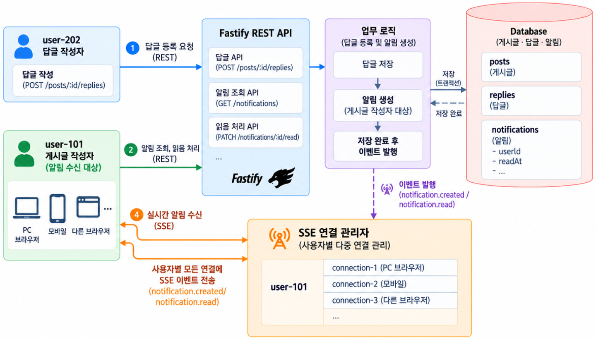
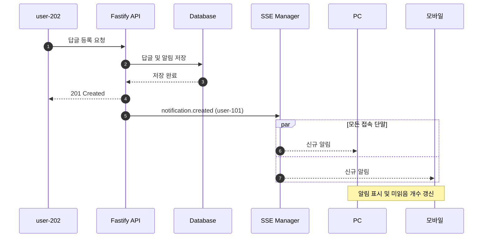
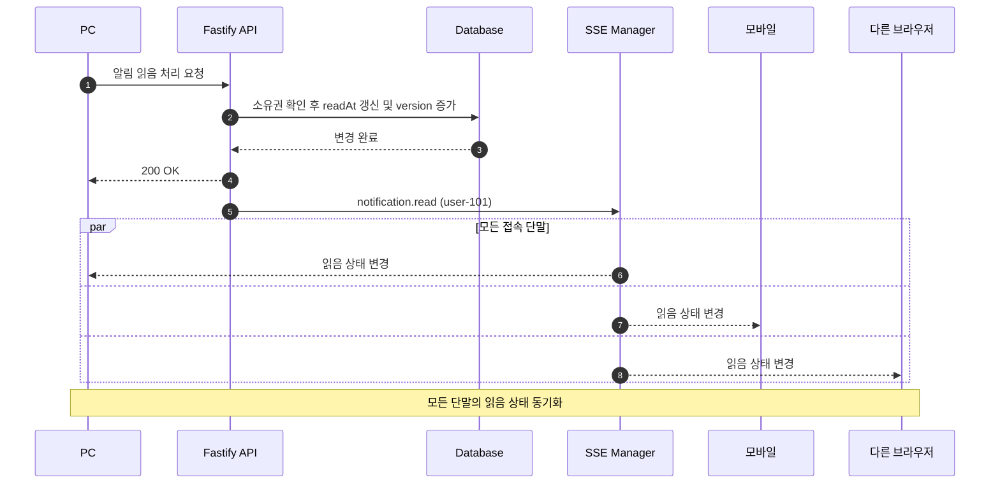
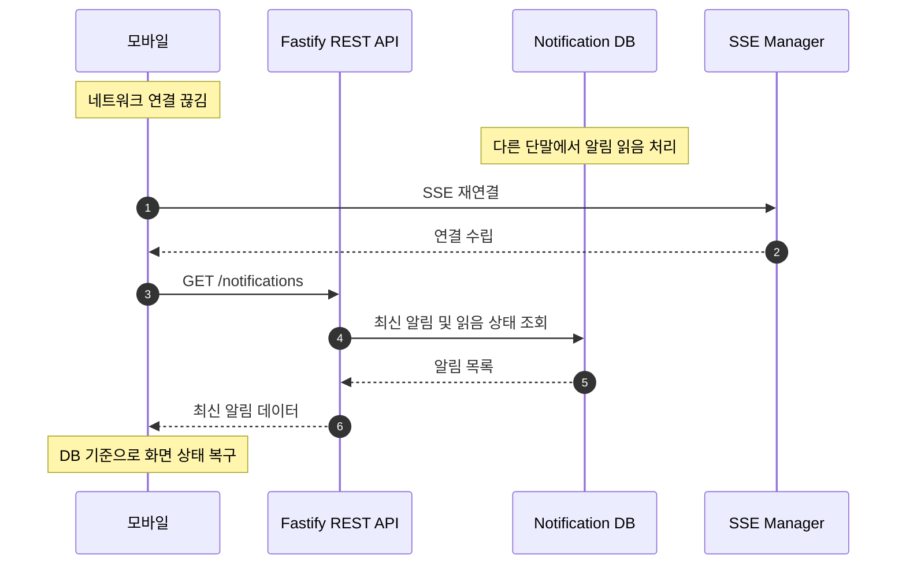

Fastify REST API는 답글과 알림을 저장하고, SSE는 접속 중인 PC와 모바일에 알림을 보냅니다. 어느 기기에서 읽어도 같은 계정의 다른 기기에 읽음 상태가 반영됩니다. 연결이 끊긴 기기는 다시 접속한 뒤 최신 상태를 조회합니다.  

## 1. 게시글 답글 알림 시스템 구조 {#session-01}

시스템은 요청을 처리하는 Fastify REST API, 답글과 알림을 만드는 업무 로직, 데이터를 저장하는 DB, 사용자별 연결을 관리하는 SSE 연결 관리자로 구성됩니다.  



**핵심은 하나의 사용자에게 여러 SSE 연결이 존재할 수 있다는 점입니다.**
`user-101`에게 알림이 발생하면 SSE 연결 관리자는 이 계정으로 접속한 모든 기기에 알림을 보냅니다.  

## 2. 사용자별 SSE 다중 연결 관리 {#session-02}

SSE 연결은 **브라우저나 기기에서 연결을 요청할 때마다 따로 만들어집니다.**  
같은 계정으로 PC와 모바일에 접속해도 연결은 서로 다릅니다. 서버는 인증으로 확인한 사용자 ID를 기준으로 이 연결들을 묶어 관리합니다.  

### 🟦 연결 타입과 Fastify 공유 저장소 등록

사용자 ID로 현재 연결된 SSE 연결들을 찾을 수 있도록 저장합니다.  
여러 라우트와 알림 서비스가 함께 사용하도록 **Fastify 인스턴스에 `sseConnections`라는 연결 저장소를 등록**합니다.  

`SseConnection`은 연결 하나의 ID와 이벤트 전송·연결 종료 함수를 정의한 타입입니다.  
`Map`의 키인 `string`에는 `"user-101"` 같은 사용자 ID가 들어갑니다. 값인 `Set<SseConnection>`에는 그 사용자의 PC·모바일 연결 객체가 들어갑니다.  

```typescript
import 'fastify';

type SseConnection = {
  id: string; // 개별 SSE 연결을 구별하는 ID입니다.
  send: (event: string, data: unknown) => void; // 이벤트 이름과 데이터를 받아 해당 연결로 전송합니다.
  close: () => void; // 해당 연결의 SSE 응답 스트림을 종료합니다.
};

// TypeScript에 Fastify 인스턴스의 추가 속성 타입을 알려 줍니다.
declare module 'fastify' {
  interface FastifyInstance {
    // 이 Fastify 서버에 연결된 모든 사용자의 SSE 연결을 저장합니다.
    sseConnections: Map<string, Set<SseConnection>>;
  }
}
```

`declare module`은 타입만 확장합니다.  
실제 연결 저장소는 서버를 시작할 때 `decorate()`로 한 번 만듭니다. 그다음 SSE 연결과 알림 API를 처리할 라우트를 등록합니다.  

```typescript
// 요청마다 생성하지 않고 Fastify 인스턴스에서 공유합니다.
fastify.decorate(
  'sseConnections',
  new Map<string, Set<SseConnection>>(),
);
```

### 🟦 요청별 연결 등록과 종료 처리

`reply.hijack()`을 호출하면 Fastify가 응답을 자동으로 보내지 않습니다.  
이후에는 Node.js 응답 객체인 `reply.raw`로 SSE 연결을 직접 관리합니다.  
`request.user.id`에는 JWT의 `sub`에서 확인한 사용자 ID가 들어 있다고 가정합니다.  
이 값을 저장하는 인증 코드와 `request.user`의 타입 선언은 생략했습니다.  

```typescript
// randomUUID는 node:crypto에서 가져오는 함수입니다.
// 인증과 필요한 Hook 처리를 마친 뒤 응답을 직접 관리합니다.
reply.hijack();
const response = reply.raw;
response.writeHead(200, {
  ...reply.getHeaders(), // 앞에서 설정한 CORS 등 필요한 응답 헤더를 유지합니다.
  'Content-Type': 'text/event-stream; charset=utf-8',
  'Cache-Control': 'no-cache',
});
const connection: SseConnection = {
  id: randomUUID(),
  send: (event, data) => {
    if (response.destroyed || response.writableEnded) return;
    const accepted = response.write(
      `event: ${event}\ndata: ${JSON.stringify(data)}\n\n`,
    );
    // 전송 대기 데이터가 쌓이면 연결을 닫고, 재연결 후 최신 상태를 조회합니다.
    if (!accepted) response.destroy();
  },
  close: () => { response.end(); },
};
const userId = request.user.id;
// 사용자의 기존 연결 집합을 조회합니다.
let userConnections = fastify.sseConnections.get(userId);
// 이 사용자의 첫 연결이면 새 집합을 만들어 공유 저장소에 등록합니다.
if (!userConnections) {
  userConnections = new Set<SseConnection>();
  fastify.sseConnections.set(userId, userConnections);
}
// 현재 요청의 연결을 이 사용자의 연결 집합에 추가합니다.
userConnections.add(connection);
// 이 HTTP 응답이 종료되면 해당 연결만 제거합니다.
response.once('close', () => {
  userConnections.delete(connection);
  if (userConnections.size === 0) {
    fastify.sseConnections.delete(userId);
  }
});
response.on('error', (error) => {
  fastify.log.warn({ err: error, connectionId: connection.id }, 'SSE 전송 오류');
  response.destroy();
});
// 헤더를 바로 보내 첫 알림이 없어도 브라우저가 연결 완료를 알 수 있게 합니다.
response.flushHeaders();
```

`response.write()`가 `false`를 반환하면 아직 보내지 못한 데이터가 메모리에 쌓여 있다는 뜻입니다.  
이 예제에서는 데이터가 계속 쌓이지 않도록 해당 연결을 종료합니다.  
전달되지 않은 알림은 재연결 후 REST API로 조회해 화면에 반영합니다.  

```text
user-101
 ├── Connection A (PC)
 ├── Connection B (모바일)
 └── Connection C (다른 브라우저)

user-202
 └── Connection D (PC)
```

`user-101`에게 알림이 발생하면 Connection A·B·C에 같은 `notification.created` 이벤트를 보냅니다.  
다른 사용자인 `user-202`의 Connection D에는 보내지 않습니다.  

```typescript
// 알림 저장 완료 후 수신 사용자의 활성 연결에만 전달합니다.
const userConnections = fastify.sseConnections.get(notification.userId);
for (const connection of userConnections ?? []) {
  connection.send('notification.created', notification);
}
```

이 저장소에는 현재 Fastify 서버가 관리하는 연결만 들어 있습니다.  
서버가 여러 개라면 Redis Pub/Sub처럼 서버 사이에서 이벤트를 전달하는 도구가 필요합니다. 자세한 내용은 5장에서 살펴봅니다.  

**연결 관리 흐름**

1. 클라이언트가 `GET /notifications/stream`으로 연결을 요청합니다.  
2. 서버가 JWT를 검증하고 사용자 ID를 확인합니다.  
3. 해당 사용자의 연결 집합에 고유 ID를 가진 SSE 연결을 등록합니다.  
4. 알림이 발생하면 해당 사용자에게 등록된 모든 활성 연결로 이벤트를 전달합니다.  
5. 특정 연결이 종료되면 그 연결만 제거하고, 다른 단말의 연결은 유지합니다.  
6. 연결이 끊긴 단말은 재연결 후 REST API로 최신 알림 상태를 조회합니다.  

**DB는 사용자 계정별 알림과 읽음 상태를 저장하고, SSE 연결 관리자는 기기별 연결을 관리합니다.**  
PC에서 알림을 읽으면 DB의 `readAt`에 읽은 시각을 저장하고, 같은 계정으로 접속 중인 모든 기기에 `notification.read`를 보냅니다.  
모바일에서 알림을 직접 열지 않았어도 읽음으로 표시됩니다.  

## 3. 알림 데이터 모델과 API·이벤트 정의 {#session-03}

### 🟦 Notification 테이블

답글과 알림을 DB에 먼저 저장한 뒤 SSE 이벤트를 보냅니다. 알림 데이터에는 다음 정보를 담습니다.  

| 필드 | 타입 예시 | 설명 |
| --- | --- | --- |
| `id` | INTEGER | 알림 식별자입니다. |
| `userId` | VARCHAR | 게시글 작성자인 알림 수신자의 계정 ID입니다. |
| `type` | VARCHAR | 이 예제에서는 `POST_REPLY`입니다. |
| `postId` | INTEGER | 답글이 등록된 게시글 ID입니다. |
| `replyId` | INTEGER | 새로 등록된 답글 ID입니다. |
| `message` | TEXT | 알림에 표시할 내용입니다. |
| `createdAt` | TIMESTAMP | 알림을 생성한 시각입니다. |
| `readAt` | TIMESTAMP, Nullable | 읽지 않았다면 `null`, 읽었다면 읽은 시각입니다. |
| `version` | INTEGER | 알림 상태를 변경할 때 증가하는 버전입니다. |

읽음 여부는 **`readAt`이 `null`이면 안 읽음, 시각이 저장되어 있으면 읽음**으로 판단합니다.  
기기별로 따로 기록하지 않고 사용자 계정별로 같은 읽음 상태를 사용합니다.  
`version`은 REST API로 조회한 데이터와 SSE로 받은 데이터 중 어느 쪽이 최신인지 판단하는 값입니다.  
같은 알림이라면 **지금 가진 버전보다 큰 버전만** 반영합니다.  

```typescript
// 화면에는 이미 버전 2의 읽음 상태가 반영되어 있습니다.
let current: { id: number; readAt: string | null; version: number } = {
  id: 1001, readAt: '2026-10-30T04:00:00Z', version: 2,
};
// 뒤늦게 도착한 REST 응답은 버전 1의 안 읽은 상태입니다.
const incoming = { id: 1001, readAt: null, version: 1 };

if (incoming.id === current.id && incoming.version > current.version) {
  current = { ...current, ...incoming };
}
// 오래된 버전 1은 무시하고 읽음 상태인 버전 2를 유지합니다.
```

알림을 만들 때는 버전 1, 처음 읽으면 버전 2가 됩니다. 버전 2를 반영한 뒤 도착한 버전 1이나 같은 버전 2는 무시합니다.  

### 🟦 REST API와 SSE 이벤트

| 구분 | REST API | SSE |
| --- | --- | --- |
| 답글 등록 | `POST /posts/:id/replies` | — |
| 알림 목록 조회 | `GET /notifications` | — |
| 읽지 않은 알림 개수 조회 | `GET /notifications/unread-count` | — |
| 알림 스트림 구독 | `GET /notifications/stream` | 이름별 알림 이벤트 수신 |
| 알림 읽음 처리 | `PATCH /notifications/:id/read` | — |
| 신규 알림 전달 | — | `notification.created` |
| 읽음 상태 동기화 | — | `notification.read` |
| 전체 읽음 상태 동기화 | `PATCH /notifications/read-all` | `notification.read-all` |
| 재연결 후 최신 상태 복구 | `GET /notifications` | 연결 복구 |

`notification.*`는 이 서비스에서 정한 이벤트 이름입니다. 전체 읽음 기능을 추가한다면 DB를 변경한 뒤 `notification.read-all`로 목록을 다시 조회하도록 알릴 수 있습니다. 아래에서는 알림 하나를 읽는 흐름을 살펴봅니다.  

SSE는 `event`에 이벤트 이름을, `data`에 JSON 문자열을 넣어 보냅니다. 마지막에 빈 줄을 보내면 이벤트 하나가 끝납니다.  

```text
event: notification.created
data: {"id":1001,"userId":"user-101","type":"POST_REPLY","postId":10,"replyId":501,"message":"작성한 게시글에 새 답글이 등록되었습니다.","readAt":null,"version":1}
```

## 4. 답글 알림 전달과 읽음 상태 동기화 {#session-04}

### 🟦 신규 답글 알림 전달

`user-202`가 `user-101`의 게시글에 답글을 작성하면 서버는 답글과 알림을 DB에 저장합니다.  
저장이 끝나면 `user-101`이 접속 중인 모든 기기에 `notification.created`를 보냅니다.  



**이벤트 예시**

```json
{
  "event": "notification.created",
  "data": {
    "id": 1001,
    "userId": "user-101",
    "type": "POST_REPLY",
    "postId": 10,
    "replyId": 501,
    "message": "작성한 게시글에 새 답글이 등록되었습니다.",
    "readAt": null,
    "version": 1
  }
}
```

### 🟦 한 단말에서 읽음 처리 시 전체 단말 동기화

`user-101`이 PC에서 알림을 읽으면 서버는 DB에 읽은 시각을 저장합니다. 이후 같은 계정으로 접속 중인 모든 기기에 `notification.read`를 보내 읽음 표시를 맞춥니다.  



**읽음 상태 예시**

| 구분 | 읽음 처리 전 | PC에서 읽음 처리 후 |
| --- | --- | --- |
| Notification DB | `readAt: null`, 버전 1 | 읽은 시각 저장, 버전 2 |
| PC 브라우저 | 안 읽음, 버전 1 | 읽음, 버전 2 |
| 모바일 | 안 읽음, 버전 1 | 읽음, 버전 2 |
| 다른 브라우저 | 안 읽음, 버전 1 | 읽음, 버전 2 |

서버는 요청한 사용자의 알림인지 확인한 뒤, 읽은 시각인 `readAt`과 새 `version`을 한 번의 DB 트랜잭션으로 저장합니다. 두 값이 함께 변경되도록 하기 위한 처리입니다.  
처음 읽을 때만 값을 바꾸고, 이미 읽은 알림을 다시 요청하면 기존 시각과 버전을 그대로 반환합니다.  

알림 `1001`을 처음 읽으면 REST 응답과 `notification.read` 이벤트에 다음 데이터를 똑같이 담습니다.  

```json
{
  "id": 1001,
  "readAt": "2026-10-30T04:00:00Z",
  "version": 2
}
```

PC는 REST 응답을 반영한 뒤 같은 SSE 이벤트를 다시 받을 수 있습니다.  
이미 반영한 버전과 같거나 더 작은 버전이면 무시하므로, 같은 변경을 두 번 적용하지 않습니다.  

모바일과 다른 브라우저는 읽음 API를 호출할 필요 없이 SSE 이벤트를 받아 화면을 바꿉니다.  

### 🟦 오프라인 단말의 재연결 복구

SSE는 이벤트를 전달할 뿐, 지난 알림을 저장하지는 않습니다.  

모바일의 연결이 끊긴 동안 PC에서 알림을 읽었다면, 모바일은 다시 연결된 뒤 DB에서 최신 상태를 조회해야 합니다.  



서버는 JWT를 확인하고 사용자별 연결 목록에 등록한 뒤 SSE 응답을 시작합니다.  
클라이언트는 연결이 열렸음을 알리는 `open` 이벤트에서 REST API로 알림 목록과 읽지 않은 알림 수를 조회합니다.  
조회하는 동안에도 SSE 이벤트를 받습니다. 알림 ID와 `version`을 비교해 조회 결과와 이벤트 중 더 최신 데이터를 화면에 반영합니다.  

목록을 다시 조회하면 조회 범위에 있는 알림의 현재 상태를 알 수 있습니다. 놓친 변경 이벤트까지 모두 받으려면 서버가 이벤트 이력을 저장하고, `Last-Event-ID`로 받은 마지막 이벤트 ID 이후의 내용을 다시 보내야 합니다. SSE의 자동 재연결과 놓친 데이터 복구는 별도로 구현합니다.  

## 5. 연결 관리와 운영 고려 사항 {#session-05}

### 🟦 연결 종료·Heartbeat·재연결

- **연결 종료:** 종료된 연결만 제거하고, 같은 사용자의 다른 연결은 유지합니다. 남은 연결이 없으면 해당 사용자 ID도 저장소에서 제거합니다.  
- **Heartbeat:** `: heartbeat` 같은 SSE 주석을 주기적으로 보내 연결이 오래 조용하다는 이유로 프록시가 끊는 것을 줄입니다. HTTP 연결 종료나 전송 오류가 발생하면 해당 연결과 타이머를 정리합니다.  
- **재연결:** `EventSource`의 자동 재연결을 활용하고, 연결이 복구되면 REST API로 알림 상태를 다시 조회합니다.  
- **중복 연결:** 재연결 시 이전 연결의 종료 처리가 늦어질 수 있으므로 연결마다 고유 ID를 부여합니다. 종료된 연결만 제거하고, 새 연결이나 다른 기기의 연결은 유지합니다.  

### 🟦 인증 및 접근 제어

브라우저의 기본 SSE 연결 API인 `EventSource`에는 `Authorization` 헤더를 직접 지정할 수 없습니다.  
이 글에서는 로그인 후 발급받은 Access Token(JWT)을 HttpOnly 쿠키에 담아 보냅니다. 서버는 JWT의 서명과 만료를 검사하고 `sub`에서 사용자 ID를 확인합니다. Refresh Token은 알림 연결 인증이 아닌, 별도의 토큰 갱신 API에서 사용합니다.  

인증 쿠키에는 JavaScript에서 읽을 수 없도록 `HttpOnly`를 적용합니다. HTTPS 환경에서는 `Secure`를 설정하고, `SameSite`와 유효 기간도 서비스 환경에 맞게 정합니다.  

### 🟦 다중 서버 환경

Fastify 서버가 하나라면 메모리의 `Map`으로 SSE 연결을 관리할 수 있습니다.  

서버가 여러 개라면 같은 계정의 PC와 모바일이 서로 다른 서버에 연결될 수 있습니다.  
각 서버는 자신에게 연결된 기기만 알고 있습니다. Redis Pub/Sub 같은 메시지 전달 도구로 이벤트를 여러 서버에 보내면, 각 서버가 해당 사용자의 연결을 찾아 알림을 전달할 수 있습니다.  

Redis Pub/Sub은 서버 사이에서 이벤트를 전달하고, 알림과 읽음 상태는 계속 Notification DB에 저장합니다.  
Redis Pub/Sub은 지난 메시지를 보관하지 않습니다. 연결이 끊겼던 기기는 REST API로 최신 상태를 조회하거나 별도로 저장한 이벤트 이력을 받아 복구합니다.  
