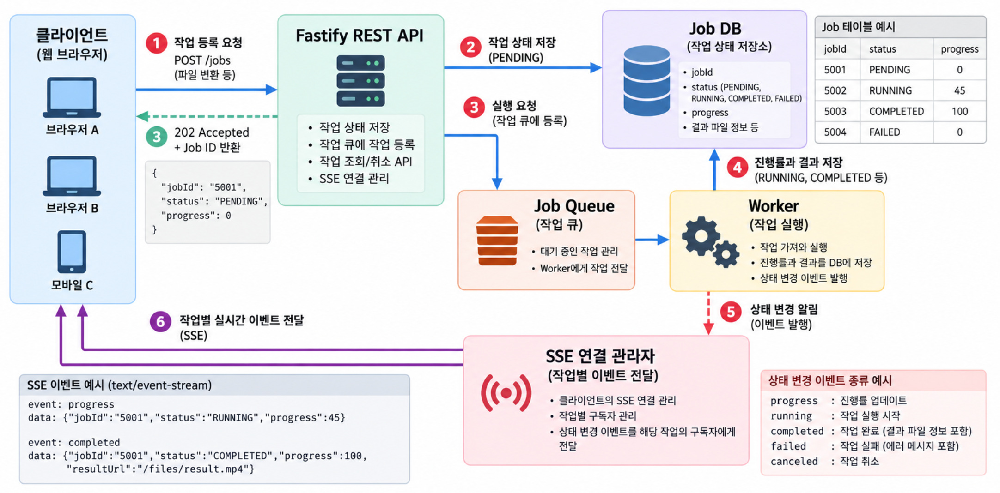
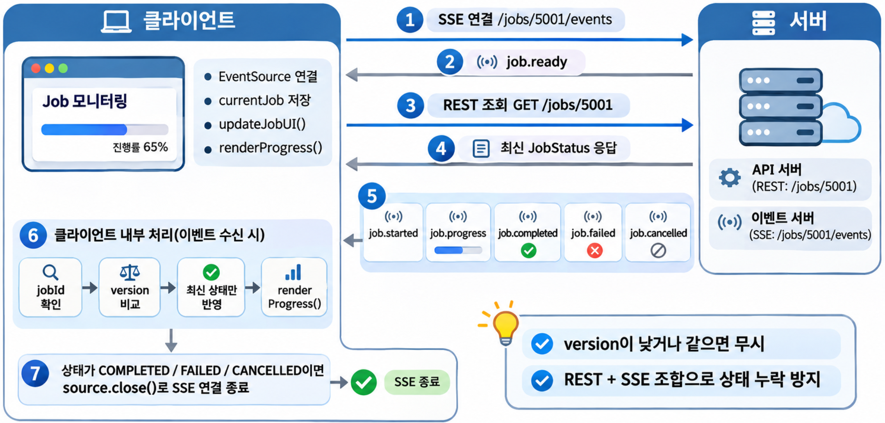
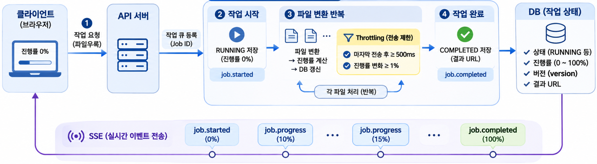
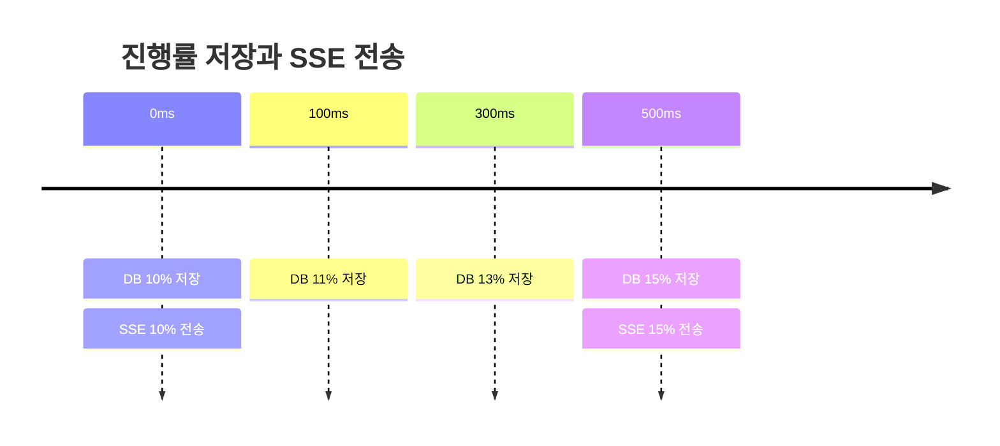
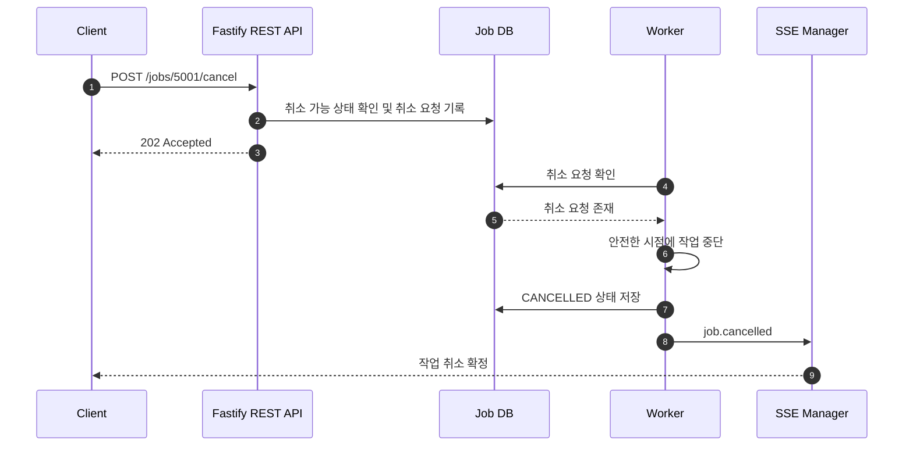
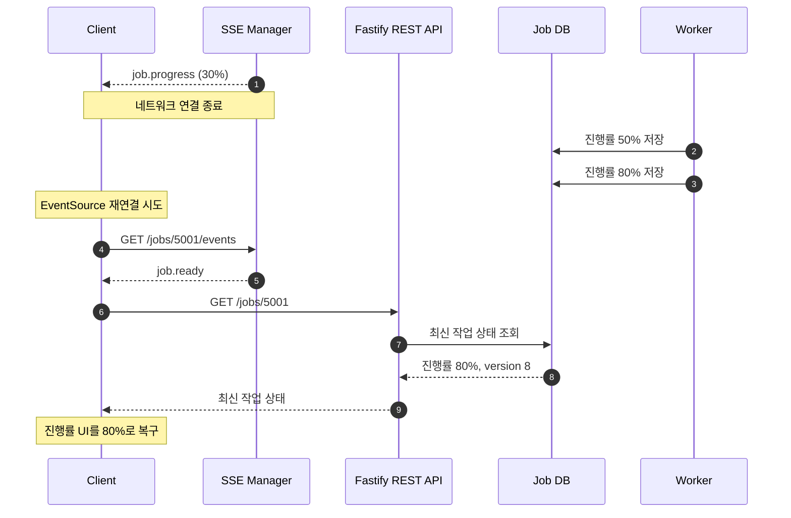

파일 변환이나 보고서 생성처럼 오래 걸리는 작업을 REST API 요청 안에서 모두 처리하면 응답 지연이나 시간 초과가 발생할 수 있습니다. 이런 작업은 요청 접수와 실제 실행을 분리하는 것이 좋습니다.  

Fastify REST API는 작업을 등록하고 Job ID를 반환합니다.  
Worker는 작업을 실행하면서 진행률을 DB에 저장하고, SSE(Server-Sent Events)는 변경된 상태를 클라이언트에 전달합니다. 이 글에서는 파일 변환 작업 `5001`을 예로 전체 흐름을 살펴봅니다.  

## 1. 비동기 작업 모니터링 구조 {#session-01}

시스템은 REST API, 작업 큐, Worker, Job DB, SSE 연결 관리자로 구성합니다.  



핵심은 작업 실행과 진행률 전달을 분리하는 것입니다.  
Worker는 클라이언트의 연결 여부와 관계없이 작업을 실행하고, SSE는 저장된 상태의 변경 사실만 전달합니다.  

### 🟦 작업 등록과 실행 흐름

Job은 **작업을 요청한 사용자만 조회할 수 있는 비공개 작업(Private Job)**입니다.  
예를 들어 사용자가 파일 변환을 요청하면 다음 순서로 처리합니다.  

1. 클라이언트가 `POST /jobs`로 파일 변환 작업을 요청합니다.  
2. Fastify 서버는 작업을 `PENDING` 상태로 저장합니다.  
3. Job Queue에 작업을 등록하고 클라이언트에 Job ID를 반환합니다.  
4. Worker가 작업을 가져와 실행 상태를 `RUNNING`으로 변경합니다.  
5. Worker는 변환 진행률과 작업 단계를 DB에 저장합니다.  
6. SSE 연결 관리자는 상태 변경 이벤트를 해당 작업의 구독자에게 전달합니다.  
7. 작업이 완료되면 결과 파일 정보를 저장하고 `COMPLETED` 이벤트를 전달합니다.  

작업 등록 API는 일반적으로 `202 Accepted`와 Job ID를 반환하도록 구성할 수 있습니다.  

주요 성공 상태 코드는 다음과 같이 구분합니다.  

| 상태 코드 | 이름 | 설명 | 사용 예시 |
| --- | --- | --- | --- |
| `200` | OK | 요청을 정상적으로 처리하고 결과를 반환합니다. | 데이터 조회·수정 |
| `201` | Created | 새로운 리소스를 생성했습니다. | 회원가입·게시글 생성 |
| `202` | Accepted | 요청을 접수했지만 처리는 완료되지 않았습니다. | 비동기 작업 등록·파일 변환 요청 |
| `204` | No Content | 요청을 처리했으며 반환할 응답 본문이 없습니다. | 데이터 삭제·응답이 필요 없는 수정 |

이 예제는 작업을 큐에 등록한 뒤 실제 실행을 별도로 처리하므로 `202 Accepted`가 적합합니다.  

```json
{
  "jobId": "5001",
  "status": "PENDING",
  "progress": 0
}
```

클라이언트는 반환된 `jobId`로 SSE를 연결합니다. 작업 등록·조회·취소는 REST API가 담당하고, 실행 중 발생하는 상태 변경은 SSE가 전달합니다.  

## 2. 작업별 SSE 연결 관리 {#session-02}

여러 작업의 진행률을 모든 클라이언트에 보내면 불필요한 이벤트가 발생하고 다른 사용자의 작업 정보가 노출될 수 있습니다. 서버는 사용자를 인증하고 작업 조회 권한을 확인한 뒤 Job ID별로 SSE 연결을 관리해야 합니다.  

예를 들어 작업 ID가 `5001`이면 클라이언트는 다음 엔드포인트에 연결합니다.  

```http
GET /jobs/5001/events
```

서버는 요청한 사용자가 해당 작업을 조회할 권한이 있는지 확인한 뒤 SSE 연결을 등록합니다.  

### 🟦 SSE 연결 타입과 Fastify 공유 저장소

SSE 요청마다 독립적인 HTTP 응답 스트림이 만들어집니다.  
같은 작업을 PC와 모바일에서 동시에 확인하면 하나의 Job ID에 여러 연결이 존재합니다.  
따라서 Job ID를 키로 사용하고 연결 객체를 `Set`으로 관리할 수 있습니다.  

```typescript
import 'fastify';
// 객체 타입(Object Type)을 정의하는 타입 별칭(Type Alias
type JobSseConnection = {
  id: string; // 개별 SSE 연결 ID입니다.
  // send와 close는 함수 타입으로 정의된 객체의 속성
  send: (
    event: string,
    data: unknown,
    eventId?: string,
  ) => void;

  close: () => void;
};

// Fastify 인스턴스에 작업별 SSE 연결 저장소 타입을 추가합니다.
declare module 'fastify' {
  interface FastifyInstance {
    jobSseConnections: Map<string, Set<JobSseConnection>>;
  }
}
```

`Map`의 키에는 `"5001"`과 같은 Job ID가 들어가고, 값에는 해당 작업을 보고 있는 연결 객체(클라이언트)가 들어갑니다. 저장소는 Fastify 서버를 시작할 때 한 번 등록합니다.  

```typescript
// Fastify 인스턴스에 jobSseConnections 속성을 실제로 등록하고, 초기값으로 빈 Map을 할당합니다
fastify.decorate(
  'jobSseConnections',
  new Map<string, Set<JobSseConnection>>(), 
);
```

연결 저장소는 요청마다 새로 생성하지 않고 Fastify 인스턴스에서 공유합니다.  

```text
5001
 ├── Connection A (PC)
 └── Connection B (모바일)

5002
 └── Connection C (PC)
```

작업 `5001`의 진행률이 변경되면 Connection A와 B에만 이벤트를 전달합니다.  

### 🟦 작업별 SSE 연결 등록

SSE 엔드포인트에서는 먼저 인증과 작업 조회 권한을 확인합니다.  

이 예제는 JWT 인증 과정에서 `request.user.id`가 설정되었다고 가정합니다. `jobRepository` 구현은 연결 흐름에 집중하기 위해 생략합니다.  

```typescript
import { randomUUID } from 'node:crypto';

fastify.get<{ Params: { jobId: string } }>(
  '/jobs/:jobId/events',
  async (request, reply) => {
    const { jobId } = request.params;
    const userId = request.user.id;

    // 작업 존재 여부와 조회 권한을 확인합니다.
    const job = await jobRepository.findById(jobId);
    if (!job) {
      return reply.code(404).send({
        message: '작업을 찾을 수 없습니다.',
      });
    }

    if (job.userId !== userId) {
      return reply.code(403).send({
        message: '작업 조회 권한이 없습니다.',
      });
    }

    // Fastify의 자동 응답 처리를 중단하고 SSE 스트림을 직접 관리합니다.
    reply.hijack();

    const response = reply.raw;

    // SSE 형식과 스트리밍에 필요한 응답 헤더를 설정합니다.
    response.writeHead(200, {
      ...reply.getHeaders(),
      'Content-Type': 'text/event-stream; charset=utf-8',
      'Cache-Control': 'no-cache, no-transform',
      'X-Accel-Buffering': 'no',
    });

    const connection: JobSseConnection = {
      // 같은 작업에 연결된 여러 클라이언트를 구별합니다.
      id: randomUUID(),

      send: (event, data, eventId) => {
        // 이미 종료된 응답에는 이벤트를 쓰지 않습니다.
        if (response.destroyed || response.writableEnded) return;

        // 각 SSE 메시지는 빈 줄(\n\n)로 구분합니다.
        const payload =
          `${eventId ? `id: ${eventId}\n` : ''}` +
          `event: ${event}\n` +
          `data: ${JSON.stringify(data)}\n\n`;

        const accepted = response.write(payload);

        // 느린 연결에 전송 데이터가 계속 쌓이는 것을 방지합니다.
        if (!accepted) response.destroy();
      },

      close: () => {
        response.end();
      },
    };
    
    //job에 등록된 연결 목록을 가져온다.
    let connections = fastify.jobSseConnections.get(jobId);

    // 이 작업의 첫 연결이면 연결 목록을 생성해 공유 저장소에 등록합니다.
    if (!connections) {
      connections = new Set<JobSseConnection>();
      fastify.jobSseConnections.set(jobId, connections);
    }

    // 같은 Job ID를 보는 PC·모바일 연결을 하나의 Set에서 관리합니다.
    connections.add(connection);

    // 주석 메시지를 주기적으로 전송해 유휴 연결이 끊기는 것을 줄입니다.
    const heartbeat = setInterval(() => {
      if (!response.destroyed && !response.writableEnded) {
        // 버퍼가 가득 찬 느린 연결은 종료하고 재연결하도록 합니다.
        if (!response.write(': heartbeat\n\n')) response.destroy();
      }
    }, 15000);

    response.once('close', () => {
      // 종료된 연결의 타이머와 저장소 항목을 함께 정리합니다.
      clearInterval(heartbeat);
      connections.delete(connection);

      if (connections.size === 0) {
        fastify.jobSseConnections.delete(jobId);
      }
    });

    response.on('error', (error) => {
      fastify.log.warn({ err: error, jobId }, 'SSE 연결 오류');
      response.destroy();
    });
    // 헤더를 즉시 전송한 뒤 연결 준비 이벤트를 보냅니다.
    response.flushHeaders();
    connection.send('job.ready', { jobId });
  },
);
```

`reply.hijack()` 이후에는 `reply.raw`로 응답 스트림을 직접 관리합니다.  
연결이 종료되면 해당 연결만 `Set`에서 제거하고, 남은 연결이 없을 때 Job ID 항목을 삭제합니다.  
`job.ready`는 연결 등록이 끝났음을 알리는 이벤트입니다.  

`response.write()`가 `false`를 반환하면 쓰기 버퍼가 가득 찼다는 의미입니다. 예제에서는 데이터가 계속 쌓이지 않도록 연결을 종료하고 클라이언트가 다시 연결하도록 합니다.  

> response.write()가 false를 반환한다는 것은 서버가 클라이언트로 데이터를 전송하는 속도보다 데이터를 생성하여 쓰는 속도가 빨라, 내부 쓰기 버퍼에 데이터가 많이 쌓였다는 의미입니다.

### 🟦 작업별 이벤트 전달

Worker가 작업 상태를 저장한 뒤 상태 변경 알림을 발생시키면 SSE 연결 관리자는 해당 Job ID의 연결에만 이벤트를 보냅니다.  

```typescript
function publishJobEvent(
  jobId: string,
  event: string,
  data: { version: number; [key: string]: unknown },
) {
  // 현재 Fastify 인스턴스에서 해당 Job ID를 구독 중인 SSE 연결 목록을 가져옵니다.
  const connections = fastify.jobSseConnections.get(jobId);

  // PC·모바일·브라우저 탭마다 등록된 연결을 순회하며 같은 이벤트를 각각 보냅니다.
  // 해당 작업을 구독하는 연결이 없으면 빈 배열을 사용하므로 전송하지 않습니다.
  for (const connection of connections ?? []) {
    connection.send(
      event,
      data,
      // 작업 상태 버전을 SSE 이벤트 ID로 전달합니다.
      String(data.version),
    );
  }
}
```

DB는 작업 상태를 저장하고, SSE 연결 관리자는 현재 연결된 클라이언트만 관리합니다. SSE 연결을 종료해도 Worker의 작업은 중단되지 않습니다.  

## 3. 작업 상태와 클라이언트 동기화 {#session-03}

실시간 이벤트만으로 작업 상태를 관리하면 연결이 끊긴 동안 발생한 변경을 복구하기 어렵습니다.  
Worker는 상태를 먼저 DB에 저장하고, 저장된 데이터를 기준으로 SSE 이벤트를 전달해야 합니다.  

### 🟦 Job 테이블

파일 변환 작업은 다음과 같은 데이터로 구성할 수 있습니다.  

| 필드 | 타입 예시 | 설명 |
| --- | --- | --- |
| `jobId` | VARCHAR | 작업을 식별하는 Job ID입니다. |
| `userId` | VARCHAR | 작업을 요청한 사용자 ID입니다. |
| `status` | VARCHAR | 작업의 현재 실행 상태입니다. |
| `progress` | INTEGER | 작업 진행률을 0~100으로 저장합니다. |
| `message` | TEXT | 현재 작업 단계에 대한 설명입니다. |
| `resultUrl` | TEXT, Nullable | 완료된 결과 파일의 위치입니다. |
| `errorCode` | VARCHAR, Nullable | 실패 시 오류 코드입니다. |
| `version` | INTEGER | 작업 상태 변경 시 증가하는 버전입니다. |
| `createdAt` | TIMESTAMP | 작업 생성 시각입니다. |
| `updatedAt` | TIMESTAMP | 마지막 상태 갱신 시각입니다. |
| `completedAt` | TIMESTAMP, Nullable | 작업 종료 시각입니다. |

작업 상태는 다음과 같이 구분합니다.  

| 상태 | 설명 |
| --- | --- |
| `PENDING` | 작업이 등록되어 실행을 기다리는 상태 |
| `RUNNING` | Worker가 작업을 실행하는 상태 |
| `COMPLETED` | 작업이 정상적으로 완료된 상태 |
| `FAILED` | 작업 실행 중 오류가 발생한 상태 |
| `CANCELLED` | 작업이 취소되어 종료된 상태 |

**진행률과 작업 상태는 별도로 관리해야 합니다.**

예를 들어 파일 변환이 100% 진행되었더라도 결과 파일 저장이나 후처리가 끝나지 않았다면 상태는 여전히 `RUNNING`일 수 있습니다.  
클라이언트는 진행률 100%만으로 작업 완료를 판단하지 않고 `COMPLETED` 상태를 확인해야 합니다.  

`version`은 작업 생성 시 1로 시작하고 진행률이나 상태를 DB에 저장할 때마다 증가시킵니다.  
이벤트를 다시 전송하거나 상태를 조회할 때는 증가시키지 않습니다.  
클라이언트는 이 값으로 REST 응답과 SSE 이벤트 중 최신 데이터를 판단합니다.  

### 🟦 REST API와 SSE 이벤트

| 구분 | REST API | SSE 이벤트 |
| --- | --- | --- |
| 작업 등록 | `POST /jobs` | — |
| 작업 상태 조회 | `GET /jobs/:jobId` | — |
| 진행률 구독 | `GET /jobs/:jobId/events` | `job.ready` |
| 작업 시작 | — | `job.started` |
| 진행률 갱신 | — | `job.progress` |
| 작업 완료 | — | `job.completed` |
| 작업 실패 | — | `job.failed` |
| 작업 취소 요청 | `POST /jobs/:jobId/cancel` | — |
| 작업 취소 확정 | — | `job.cancelled` |
| 재연결 후 상태 복구 | `GET /jobs/:jobId` | SSE 연결 재수립 |

`job.*`는 애플리케이션에서 정한 이벤트 이름입니다. SSE의 `event`에는 이벤트 이름을, `data`에는 JSON 문자열을 넣습니다. `id`에는 상태 버전을 사용할 수 있습니다.  

```text
id: 8
event: job.progress
data: {"jobId":"5001","status":"RUNNING","progress":80,"message":"파일 변환 중","version":8}

```

SSE 메시지는 빈 줄로 구분합니다. `Last-Event-ID`로 누락 이벤트를 재생하려면 서버가 이벤트 이력을 별도로 저장해야 합니다. 이 글에서는 이벤트를 재생하지 않고 REST API로 DB의 최신 상태를 조회합니다.  

### 🟦 클라이언트의 진행률 이벤트 수신

  
브라우저는 `EventSource`로 SSE에 연결합니다.  
`job.ready`를 받으면 REST API로 최신 상태를 조회하고, 이후 REST 응답과 SSE 이벤트를 같은 함수에서 처리합니다.  

```typescript
type JobStatus = {
  jobId: string;
  status: 'PENDING' | 'RUNNING' | 'COMPLETED' | 'FAILED' | 'CANCELLED';
  progress: number;
  version: number;
};
// 모니터링할 작업 ID
const jobId = '5001';
// SSE 연결을 생성하여 서버에서 전송하는 작업 상태 이벤트를 수신합니다.
// EventSource는 연결이 끊어지면 기본적으로 자동 재연결을 시도합니다.
const source = new EventSource(`/jobs/${jobId}/events`);
// 클라이언트가 마지막으로 반영한 작업 상태를 저장합니다.
let currentJob: JobStatus | null = null;

// 수신한 작업 상태를 검증하고 화면에 반영합니다.
function updateJobUI(incoming: JobStatus) {
  if (incoming.jobId !== jobId) return;
  // 수신한 상태의 버전이 현재 버전보다 작거나 같으면 오래되었거나 중복된 데이터이므로 무시합니다.
  if (currentJob && incoming.version <= currentJob.version) return;
  currentJob = incoming;
  // 현재 진행률과 작업 상태를 화면에 반영합니다.
  renderProgress(currentJob);
  // REST 조회로 최종 상태를 확인한 경우에도 SSE 연결을 종료합니다.
  if (['COMPLETED', 'FAILED', 'CANCELLED'].includes(currentJob.status)) {
    source.close();
  }
}

// 서버에 저장된 최신 작업 상태를 REST API로 조회합니다.
async function refreshJobStatus() {
  const response = await fetch(`/jobs/${jobId}`);
  if (!response.ok) {
    throw new Error('작업 상태 조회 실패');
  }
  updateJobUI(await response.json());
}

// 서버에서 SSE 연결 등록이 완료되었음을 알리는 이벤트입니다.
// 연결 등록 이후 REST 조회를 수행하여 현재 작업 상태를 동기화합니다.
// 이를 통해 연결 이전에 발생한 이벤트로 인한 상태 누락을 보완합니다.
source.addEventListener('job.ready', () => {
  void refreshJobStatus().catch(console.error);
});

// 작업 시작, 진행률 변경, 완료, 실패, 취소 이벤트를 등록합니다.
for (const eventName of [
  'job.started',
  'job.progress',
  'job.completed',
  'job.failed',
  'job.cancelled',
]) {
  source.addEventListener(eventName, (event) => {
    const message = event as MessageEvent<string>;
    updateJobUI(JSON.parse(message.data));
  });
}
```

현재 화면에 버전 8이 반영되어 있다면 뒤늦게 도착한 버전 7이나 중복된 버전 8은 무시합니다.  

## 4. 진행률 갱신과 전송 최적화 {#session-04}

Worker는 처리 단위가 끝날 때마다 진행률을 계산하고 DB에 저장합니다. 그러나 파일 하나를 처리할 때마다 SSE 이벤트를 보내면 짧은 시간에 많은 이벤트가 발생할 수 있습니다.  


### 🟦 Worker의 작업 상태 갱신

Worker가 파일 변환을 시작하면 먼저 작업 상태를 `RUNNING`으로 변경합니다.  
이후 처리한 파일 수를 기준으로 진행률을 계산합니다.  

```typescript
async function processJob(jobId: string, files: string[]) {
  // 작업 시작 상태를 저장합니다.
  const started = await jobRepository.updateStatus(jobId, {
    status: 'RUNNING',
    progress: 0,
    message: '파일 변환 시작',
  });

  await notifyJobChanged('job.started', started);

  // 변환 대상 파일을 순차적으로 처리합니다.
  for (let index = 0; index < files.length; index++) {
    // 현재 파일의 변환이 완료될 때까지 기다립니다.
    await convertFile(files[index]);
    // 전체 파일 수 대비 완료된 파일 수를 기준으로 진행률(%)을 계산합니다.
    const progress = Math.floor(
      ((index + 1) / files.length) * 100,
    );
    // 계산한 진행률과 상태 메시지를 DB에 저장합니다.
    const updated = await jobRepository.updateProgress(
      jobId,
      progress,
      '파일 변환 중',
    );
    // Throttling 등 전송 정책에 따라 진행률 이벤트를 전송합니다.
    await emitProgressIfNeeded(updated);
  }
  // 후처리와 결과 저장이 끝난 후에 완료 상태를 확정합니다.
  const resultUrl = await saveResult(jobId);
  const completed = await jobRepository.complete(
    jobId,
    resultUrl,
  );
  progressRecords.delete(jobId);
  await notifyJobChanged('job.completed', completed);
}
```

`updateProgress()`는 진행률과 버전을 DB에서 함께 갱신하고 저장된 작업 정보를 반환한다고 가정합니다. 오류 처리와 재시도, 취소 확인은 예제에서 생략합니다.  

### 🟦 Throttling을 이용한 전송 제한

Throttling은 일정 시간 동안 이벤트 전송 횟수를 제한하는 방식입니다. 다음 예제는 마지막 전송 후 500ms가 지나고 진행률도 1% 이상 바뀌었을 때만 이벤트를 보냅니다.  



다음 예제는 시간 간격과 진행률 변경 폭을 함께 확인합니다.  

```typescript
type ProgressRecord = {
  lastSentAt: number;
  lastProgress: number;
};

const progressRecords = new Map<string, ProgressRecord>();

async function emitProgressIfNeeded(job: {
  jobId: string;
  progress: number;
  status: string;
  version: number;
}) {
  const now = Date.now();
  const previous = progressRecords.get(job.jobId);
  const elapsed = previous ? now - previous.lastSentAt : Infinity;
  const difference = previous
    ? Math.abs(job.progress - previous.lastProgress)
    : Infinity;

  // 최소 500ms 간격과 1% 이상 변경 조건을 함께 적용합니다.
  if (elapsed < 500 || difference < 1) {
    return;
  }

  progressRecords.set(job.jobId, {
    lastSentAt: now,
    lastProgress: job.progress,
  });

  await notifyJobChanged('job.progress', job);
}
```

이 코드는 상태가 변경된 시점에 전송 조건을 확인합니다. 500ms마다 마지막 값을 반드시 보내는 타이머 방식은 아닙니다. 작업 특성에 따라 마지막 진행률을 지연 전송하는 로직을 추가할 수 있습니다.  

진행률 이벤트는 일부 생략되어도 다음 이벤트로 화면을 갱신할 수 있습니다. 완료·실패·취소 이벤트는 Throttling에서 제외하고 DB 저장 직후 전달해야 합니다. 이벤트 전달에 실패해도 복구할 수 있도록 DB를 작업 상태의 기준으로 유지합니다.  

## 5. 작업 종료와 상태 복구 {#session-05}

비동기 작업은 정상 완료뿐 아니라 실패, 사용자 취소, 네트워크 연결 종료도 처리해야 합니다. SSE 연결 상태와 Worker의 실행 상태를 분리하면 클라이언트 연결이 끊겨도 작업을 계속 실행할 수 있습니다.  

### 🟦 작업 완료와 실패 처리

작업이 정상적으로 완료되면 Worker는 결과 파일 정보와 최종 상태를 DB에 저장합니다.  

이후 `job.completed` 이벤트를 전달합니다.  

```json
{
  "jobId": "5001",
  "status": "COMPLETED",
  "progress": 100,
  "message": "파일 변환 완료",
  "resultUrl": "/downloads/5001",
  "version": 12
}
```

클라이언트는 `COMPLETED` 상태를 받으면 진행률 UI를 완료 상태로 변경하고 결과 파일 다운로드 기능을 활성화합니다.  

실패한 경우에는 다음과 같은 이벤트를 전달합니다.  

```json
{
  "jobId": "5001",
  "status": "FAILED",
  "progress": 65,
  "message": "파일 변환 실패",
  "errorCode": "CONVERSION_ERROR",
  "version": 9
}
```

오류 이벤트에는 클라이언트에서 처리할 수 있는 오류 코드와 사용자에게 표시할 메시지를 포함할 수 있습니다.  

내부 파일 경로나 예외 스택처럼 불필요한 서버 내부 정보는 전달하지 않는 것이 좋습니다.  

### 🟦 REST API를 이용한 작업 취소

작업 취소는 SSE가 아니라 REST API로 요청합니다.  

```http
POST /jobs/5001/cancel
```

서버는 작업 소유권을 확인한 뒤 취소 요청을 기록합니다.  

Worker는 처리 중 취소 요청 여부를 확인하고 안전한 시점에 작업을 종료합니다.  



취소 요청을 접수한 것과 실제 작업 취소가 완료된 것은 다릅니다.  
따라서 취소 요청 직후 바로 `CANCELLED`로 변경하지 않고 Worker가 실제 중단을 완료한 뒤 확정합니다.  
필요하다면 `CANCELLING` 상태를 추가하거나 `cancelRequestedAt` 필드로 취소 진행 여부를 관리할 수 있습니다.  
이미 완료된 작업은 취소할 수 없으므로 서버에서 상태를 다시 확인해야 합니다.  

### 🟦 SSE 재연결 후 최신 상태 복구

SSE 연결이 진행률 30%에서 끊겨도 Worker는 작업을 계속 실행할 수 있습니다. 연결이 다시 수립되어 `job.ready`를 받으면 클라이언트는 REST API로 최신 상태를 조회합니다.  



`EventSource`는 일반적인 연결 오류가 발생하면 자동 재연결을 시도하지만, 연결이 끊긴 동안의 이벤트를 자동으로 복구하지는 않습니다. REST 응답과 SSE 이벤트의 도착 순서도 일정하지 않으므로 앞에서 구현한 `updateJobUI()`가 `version`을 비교해 최신 상태만 반영합니다.  
