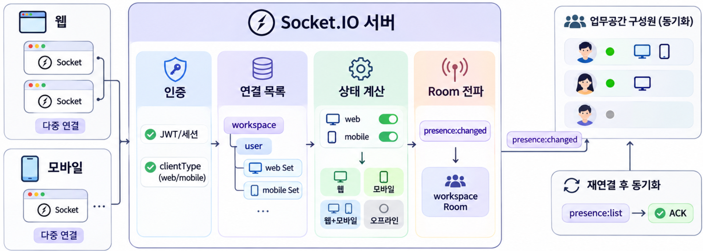
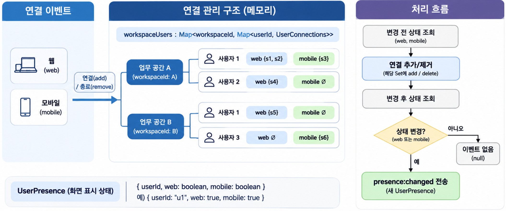
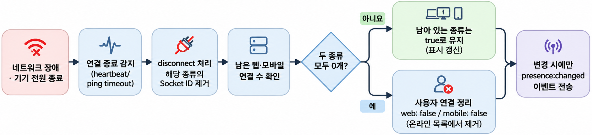
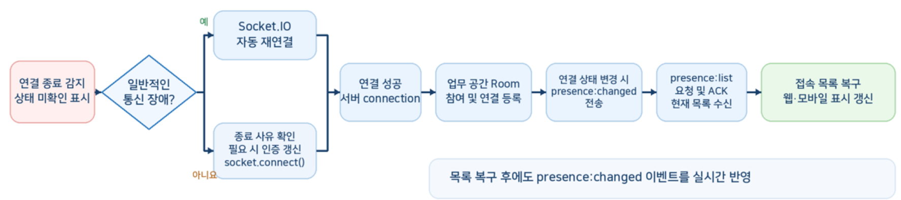

채팅이나 협업 화면에서는 다른 사용자의 접속 상태를 표시할 때가 많습니다. 같은 계정으로 PC와 모바일에 함께 접속할 수 있으므로, 연결 하나가 끊겼다고 바로 오프라인으로 표시하면 실제 상태와 달라질 수 있습니다.  

이 글에서는 사용자별 Socket.IO 연결 목록을 관리하고, **웹과 모바일의 연결 유무에 따라 접속 상태를 표시**하는 구조를 살펴봅니다.  

## 1. 사용자 접속 상태 관리 구조 {#session-01}


서버는 인증된 연결이 남아 있는지를 기준으로 사용자의 접속 상태를 판단합니다.  
브라우저가 갑자기 종료되거나 네트워크가 끊기면 클라이언트가 종료 이벤트를 보낼 수 없기 때문입니다.  

### 🟦 온라인과 오프라인의 기준

이 글에서 온라인은 **서버가 아직 유효하다고 판단하는 Socket.IO 연결이 하나 이상 있는 상태**입니다.  
연결이 남아 있다고 해서 사용자가 화면을 보고 있거나 키보드를 사용하고 있다는 뜻은 아닙니다.  
자리 비움이나 최근 활동 시각은 별도로 관리해야 합니다.  

| 웹 연결 수 | 모바일 연결 수 | 화면 표시 |
| --- | --- | --- |
| 1개 이상 | 1개 이상 | 웹+모바일 연결 |
| 0개 | 1개 이상 | 모바일 연결 |
| 1개 이상 | 0개 | 웹 연결 |
| 0개 | 0개 | 오프라인 |

웹·모바일의 연결 조합이 바뀌면 상태 변경 이벤트를 보냅니다.  
예를 들어 웹과 모바일을 함께 사용하다 마지막 웹 연결이 종료되면, 사용자는 온라인을 유지하면서 `모바일 연결`로 표시됩니다.  

```text
user-101
 ├── web: Socket A, Socket B
 └── mobile: Socket C

A 종료 → 웹 1개 + 모바일 1개 → 웹+모바일 연결 유지
B 종료 → 웹 0개 + 모바일 1개 → 모바일 연결로 변경
C 종료 → 웹 0개 + 모바일 0개 → 오프라인으로 변경
```

### 🟦 웹과 모바일의 분류 기준

이 글은 PC 브라우저를 `web`, 모바일 앱과 모바일 브라우저를 `mobile`로 분류합니다.  

클라이언트는 연결 시 `auth.clientType`으로 접속 종류를 전달하고, 서버는 `web` 또는 `mobile`인지 검사하여 `socket.data.clientType`에 저장합니다. 지원하지 않는 값은 연결을 거부합니다.  
`clientType`은 화면에 접속 종류를 표시하기 위한 값이며, 사용자 인증이나 접근 권한을 판단하는 근거로 사용하지 않습니다.  
클라이언트가 보낸 값만으로 실제 기기 종류를 확실하게 증명할 수는 없습니다.  

### 🟦 사용자 ID와 Socket ID의 관계

사용자 ID는 로그인한 계정을 식별하고, Socket ID는 개별 연결을 구별합니다.  
하나의 사용자 ID에 여러 Socket ID가 연결될 수 있습니다.  

| 구분 | 사용자 ID | Socket ID |
| --- | --- | --- |
| 예시 | `user-101` | `socket.id` |
| 용도 | 계정 식별과 권한 확인 | 현재 연결 식별 |
| 여러 탭 접속 | 같은 계정이면 동일 | 탭별로 다름 |
| 일반적인 재연결 | 동일한 계정 ID 사용 | 새 ID가 발급될 수 있음 |

Socket ID를 계정 ID나 영구 세션 키로 저장하면 재연결 시 사용자를 잘못 구분할 수 있습니다. 인증된 사용자 ID를 기준으로 연결을 묶어야 합니다.  

## 2. 다중 연결 및 세션 관리 {#session-02}

각 연결은 하나의 업무 공간에 속하며, 같은 업무 공간의 구성원끼리 접속 상태를 공유한다고 가정합니다.  

인증 미들웨어는 JWT나 세션을 검증하고, 사용자의 업무 공간 소속을 확인합니다.  
확인한 사용자 ID와 업무 공간 ID는 각각 `socket.data.userId`와 `socket.data.workspaceId`에 저장합니다.  
클라이언트가 보낸 사용자 ID나 Room 이름을 그대로 신뢰하지 않고 서버에서 확인한 값을 사용합니다.  

인증 미들웨어 다음에 접속 종류 검증 미들웨어를 등록합니다. `clientType`은 연결마다 한 번 결정합니다.  

```typescript
// JWT·세션 인증 미들웨어가 먼저 등록되어 있다고 가정합니다.
io.use((socket, next) => {
  const clientType = socket.handshake.auth.clientType;
  if (clientType !== 'web' && clientType !== 'mobile') {
    return next(new Error('지원하지 않는 접속 종류입니다.'));
  }
  socket.data.clientType = clientType;
  next();
});
```

### 🟦 사용자별 연결 목록 관리


업무 공간 ID로 사용자 목록을 찾고, 사용자 ID로 해당 사용자의 연결 목록을 찾습니다.  
웹과 모바일의 Socket ID는 각각 별도의 `Set`에 저장합니다.  
같은 사용자가 다른 업무 공간에 접속하더라도 상태가 섞이지 않습니다.  

```typescript
// 웹·모바일별 연결 목록을 저장하고, 연결 변경 전후의 표시 상태를 비교합니다.
type ClientType = 'web' | 'mobile';
// Record는 각 접속 종류를 키로 하고, Socket ID의 Set을 값으로 갖는 타입입니다.
// { web: Set<string>, mobile: Set<string> }과 같은 구조입니다.
// Set에는 Socket ID(socket.id) 문자열이 저장됩니다.
type UserConnections = Record<ClientType, Set<string>>;

// 이벤트와 전체 목록에서 함께 사용하는 상태 타입입니다.
type UserPresence = {
  userId: string;
  web: boolean; // 웹 연결이 하나 이상 남아 있으면 true입니다.
  mobile: boolean; // 모바일 연결이 하나 이상 남아 있으면 true입니다.
};

// 서버를 시작할 때 한 번 생성하고 모든 연결에서 공유합니다.
// 바깥 Map의 키는 업무 공간 ID, 안쪽 Map의 키는 사용자 ID입니다.
const workspaceUsers = new Map<string, Map<string, UserConnections>>();

// 종류별 연결 수를 확인해 웹·모바일 연결 유무를 반환합니다.
function getPresence(workspaceId: string, userId: string): UserPresence {
  // ?. 연산자는 업무 공간이 없으면 사용자 조회를 건너뛰고 undefined를 반환합니다.
  const connections = workspaceUsers.get(workspaceId)?.get(userId);
  return {
    userId,
    // 사용자 연결 정보가 없으면 ?? 0으로 연결 수를 0으로 간주합니다.
    web: (connections?.web.size ?? 0) > 0,
    mobile: (connections?.mobile.size ?? 0) > 0,
  };
}

// 연결을 추가·제거한 뒤, 표시가 바뀌면 새 상태를 반환하고 같으면 null을 반환합니다.
function updateConnection(
  workspaceId: string,
  userId: string,
  socketId: string,
  clientType: ClientType,
  action: 'add' | 'remove',
): UserPresence | null {
  // 변경 전 상태를 저장해 두고 갱신 후 웹·모바일 연결 유무를 비교합니다.
  const previous = getPresence(workspaceId, userId);
  // 현재 업무 공간의 사용자 목록과 해당 사용자의 종류별 연결 목록을 찾습니다.
  let users = workspaceUsers.get(workspaceId);
  let connections = users?.get(userId);

  if (action === 'add') {
    // 이 업무 공간의 첫 연결이면 사용자 목록부터 생성합니다.
    if (!users) {
      users = new Map<string, UserConnections>();
      workspaceUsers.set(workspaceId, users);
    }
    // 해당 사용자의 첫 연결이면 웹·모바일용 빈 Set을 각각 만듭니다.
    if (!connections) {
      connections = { web: new Set<string>(), mobile: new Set<string>() };
      users.set(userId, connections);
    }
    // 같은 접속 종류 안에서는 Socket ID가 중복 등록되지 않습니다.
    // clientType이 web이면 웹 Set에, mobile이면 모바일 Set에 추가합니다.
    // new Set<string>()으로 만든 Set 객체에 Socket ID 문자열을 추가합니다.
    connections[clientType].add(socketId);
  } else {
    // 종료 시에는 연결 등록 때 확정한 clientType을 그대로 사용합니다.
    // delete()는 실제로 제거했을 때만 true이므로 중복 종료 처리를 걸러냅니다.
    if (!users || !connections || !connections[clientType].delete(socketId)) {
      return null;
    }
    // 두 종류의 연결이 모두 없으면 온라인 사용자 목록에서 제거합니다.
    if (connections.web.size === 0 && connections.mobile.size === 0) {
      users.delete(userId);
      // 업무 공간에 남은 사용자도 없으면 바깥 Map에서도 정리합니다.
      if (users.size === 0) workspaceUsers.delete(workspaceId);
    }
  }

  // 사용자가 삭제되었다면 web과 mobile이 모두 false인 상태를 얻습니다.
  const current = getPresence(workspaceId, userId);
  // 웹·모바일의 연결 유무가 모두 같으면 화면 표시도 같으므로 전송하지 않습니다.
  if (previous.web === current.web && previous.mobile === current.mobile) {
    return null;
  }
  // 호출한 쪽에서는 이 상태를 presence:changed 이벤트로 전달합니다.
  return current;
}

// 특정 업무 공간의 온라인 사용자 목록을 접속 종류와 함께 조회합니다.
function getOnlineUsers(workspaceId: string): UserPresence[] {
  const users = workspaceUsers.get(workspaceId);
  // 연결이 하나라도 남아 있는 사용자와 접속 종류를 함께 반환합니다.
  // keys()의 사용자 ID들을 배열로 펼친 뒤 map()으로 각 사용자의 상태를 구합니다.
  // 업무 공간이 없으면 빈 배열을 반환합니다.
  return users
    ? [...users.keys()].map((userId) => getPresence(workspaceId, userId))
    : [];
}
```

### 🟦 연결과 로그인 세션의 구분

소켓 연결이 종료되어도 로그인 세션이 만료되었다는 뜻은 아닙니다. 반대로 로그인 상태라도 Socket.IO 연결이 없으면 이 예제에서는 오프라인입니다.  

| 상황 | 로그인 세션 | 접속 상태 |
| --- | --- | --- |
| 같은 계정으로 PC와 모바일 연결 | 유효 | 웹+모바일 연결 |
| PC만 연결 종료 | 유효할 수 있음 | 모바일 연결 |
| 모든 기기의 소켓 연결 종료 | 유효할 수 있음 | 오프라인 |
| 로그아웃 또는 세션 강제 만료 | 종료 | 해당 세션의 소켓도 별도로 종료해야 함 |

기기별 로그아웃을 구현하려면 사용자 ID와 Socket ID 외에 세션 ID도 관리해야 합니다.  
한 기기에서 로그아웃할 때는 해당 세션의 연결만 종료하고, 전체 로그아웃이라면 사용자의 모든 세션을 만료시키고 연결을 종료합니다.  

## 3. 접속 상태 브로드캐스트 {#session-03}

연결 목록을 갱신한 뒤 웹·모바일의 연결 유무가 달라졌는지 확인합니다.  
같은 종류의 탭을 추가로 열면 표시는 유지됩니다. 반면 첫 모바일 연결이 생기거나 마지막 웹 연결이 종료되면, 온라인을 유지하더라도 표시가 달라지므로 변경 이벤트를 보냅니다.  

### 🟦 Room과 이벤트 정의

업무 공간별로 `presence:workspace-01` 같은 Room을 만듭니다.  
서버가 소속을 확인한 소켓만 Room에 참여시키고, 같은 업무 공간에만 접속 상태를 전달합니다.  

| 이벤트 | 방향 | 용도 |
| --- | --- | --- |
| `presence:changed` | 서버 → 클라이언트 | 특정 사용자의 웹·모바일 연결 상태 변경 |
| `presence:list` | 클라이언트 → 서버 | 현재 온라인 사용자와 접속 종류 요청 |
| `presence:list`의 응답 | 서버 → 요청한 클라이언트 | 응답 콜백(ACK)으로 전체 목록 반환 |

Room은 이벤트를 받을 연결들을 묶는 기능입니다.  
Room 이름을 안다고 접근 권한이 생기는 것은 아니므로, 참여 권한은 서버에서 검증해야 합니다.  
`io.to(room).emit()`은 해당 Room에 속한 소켓 전체로 이벤트를 보냅니다.  

### 🟦 서버의 연결 등록과 상태 전달

`io`는 인증 미들웨어가 등록된 Socket.IO 서버이며, `socket.data`의 두 ID와 접속 종류는 미들웨어에서 검증되었다고 가정합니다.  

```typescript
// 연결을 등록·제거하고, 상태가 바뀌면 같은 업무 공간의 연결에 전달합니다.
type PresenceSnapshot = {
  users: UserPresence[];
};

io.on('connection', (socket) => {
  const userId: string = socket.data.userId;
  const workspaceId: string = socket.data.workspaceId;
  // 인증 미들웨어에서 web 또는 mobile인지 확인한 값입니다.
  const clientType: ClientType = socket.data.clientType;
  const room = `presence:${workspaceId}`;

  // 기본 메모리 Adapter에서는 Room 참여가 동기적으로 처리됩니다.
  socket.join(room);
  const changed = updateConnection(
    workspaceId, userId, socket.id, clientType, 'add',
  );

  // 클라이언트는 연결할 때마다 최신 목록을 요청할 수 있습니다.
  socket.on('presence:list', (reply: (data: PresenceSnapshot) => void) => {
    // 외부 입력이므로 ACK 콜백이 실제 함수인지 확인합니다.
    if (typeof reply !== 'function') return;
    reply({ users: getOnlineUsers(workspaceId) });
  });

  socket.on('disconnect', (reason) => {
    const changed = updateConnection(
      workspaceId, userId, socket.id, clientType, 'remove',
    );

    if (changed) {
      // 온라인 유지 중 접속 종류만 바뀐 경우도 전달합니다.
      io.to(room).emit('presence:changed', changed);
    }

    console.log('접속 종료', { userId, socketId: socket.id, reason });
  });

  if (changed) {
    // 본인 연결을 포함한 Room의 모든 연결에 새 상태를 보냅니다.
    io.to(room).emit('presence:changed', changed);
  }
});
```

`disconnect` 시 Socket.IO는 Room에서 소켓을 자동으로 제거합니다. 하지만 애플리케이션에서 만든 `workspaceUsers`는 직접 정리해야 합니다. 종료 시 Room 목록을 다시 읽는 대신 연결 시 확인한 `workspaceId`와 `userId`를 사용합니다.  

위 핸들러는 연결을 등록하고 종료 이벤트 리스너를 설정하는 과정에 `await`가 없습니다. 비동기 Adapter나 비동기 권한 조회를 추가한다면, 초기화 도중 연결이 종료되거나 Room 참여에 실패하는 경우에도 등록된 연결 정보를 정리하도록 보완해야 합니다.  

### 🟦 클라이언트의 목록 동기화

실시간 변경 이벤트만 받으면 접속 전에 이미 온라인이었던 사용자를 알 수 없습니다.  
처음 연결하거나 재연결할 때 전체 목록을 요청하고, 목록을 받은 뒤에는 변경 이벤트를 반영합니다.  

```typescript
import { io } from 'socket.io-client';

// 전체 목록으로 초기 상태를 맞춘 뒤 웹·모바일 연결 변경을 화면에 반영합니다.

// accessToken은 로그인 과정에서 받은 토큰입니다.
const socket = io('http://localhost:3000', {
  autoConnect: false,
  // 모바일 앱·모바일 브라우저에서는 서비스의 분류 기준에 따라 mobile을 사용합니다.
  auth: { token: accessToken, clientType: 'web' },
});

const onlineUsers = new Map<string, UserPresence>();

// 웹·모바일 연결 조합을 사용자에게 보여 줄 문구로 바꿉니다.
function getPresenceLabel(presence: UserPresence): string {
  if (presence.web && presence.mobile) return '웹+모바일 연결';
  if (presence.mobile) return '모바일 연결';
  if (presence.web) return '웹 연결';
  return '오프라인';
}

// 사용자별 상태를 화면 표시용 데이터로 변환합니다.
function renderPresenceList() {
  renderOnlineUsers([...onlineUsers.values()].map((presence) => ({
    userId: presence.userId,
    label: getPresenceLabel(presence),
  })));
}

// 전체 목록을 받아 초기 동기화를 마쳤는지 기록합니다.
let synchronized = false;

socket.on('presence:changed', (change: UserPresence) => {
  // 전체 목록을 받기 전에는 변경 이벤트로 목록을 확정하지 않습니다.
  if (!synchronized) return;
  if (change.web || change.mobile) {
    onlineUsers.set(change.userId, change);
  } else {
    onlineUsers.delete(change.userId);
  }
  renderPresenceList();
});

// 최초 연결과 재연결에 성공할 때마다 서버의 최신 온라인 목록을 요청합니다.
socket.on('connect', () => {
  // 전체 목록을 적용하기 전까지 presence:changed 이벤트의 반영을 막습니다.
  synchronized = false;

  // presence:list를 보내고 서버의 ACK 응답을 최대 5초 동안 기다립니다.
  socket.timeout(5000).emit(
    'presence:list',
    // ACK를 받으면 snapshot에 서버의 현재 목록이 전달됩니다.
    // 제한 시간 안에 ACK를 받지 못하면 error가 전달됩니다.
    (error: Error | null, snapshot: PresenceSnapshot) => {
      if (error) {
        // 목록을 확인하지 못했으므로 상태 미확인으로 표시하고 처리를 끝냅니다.
        renderPresenceUnknown();
        return;
      }

      // 끊긴 동안 오프라인이 된 사용자도 제거되도록 기존 목록을 비웁니다.
      onlineUsers.clear();
      // 서버에서 받은 사용자별 접속 상태를 사용자 ID를 키로 다시 저장합니다.
      for (const presence of snapshot.users) {
        onlineUsers.set(presence.userId, presence);
      }

      // 전체 목록을 적용했으므로 이후의 presence:changed 이벤트를 반영합니다.
      synchronized = true;
      // 교체한 목록을 바탕으로 화면의 웹·모바일 접속 표시를 갱신합니다.
      renderPresenceList();
    },
  );
});

socket.on('disconnect', () => {
  synchronized = false;
  // 내 연결이 끊겼다고 다른 사용자 전체를 오프라인으로 판단하지 않습니다.
  renderPresenceUnknown();
});

// 이벤트 리스너를 먼저 등록한 다음 연결합니다.
socket.connect();
```

### 🟦 비정상 종료 처리 흐름

네트워크 케이블이 빠지거나 기기의 전원이 꺼지면 서버가 연결 종료를 즉시 감지하지 못할 수 있습니다. Socket.IO는 heartbeat로 연결을 확인하고, 응답이 일정 시간 없으면 `ping timeout` 등의 사유로 연결을 종료합니다.  


서버의 `disconnect` 처리에서는 종료된 Socket ID를 해당 사용자의 웹 또는 모바일 연결 목록에서 제거합니다.  
그다음 남은 연결을 확인해 `web`과 `mobile` 값을 다시 계산합니다. 같은 종류의 다른 연결이 남아 있으면 해당 값은 `true`로 유지합니다.  

변경 전후의 웹·모바일 연결 조합이 달라졌을 때만 같은 업무 공간의 Room에 `presence:changed`를 보냅니다.  
두 종류의 연결이 모두 사라지면 사용자 연결 항목을 정리하고, `web: false`, `mobile: false`를 전달합니다. 이벤트를 받은 클라이언트는 해당 사용자를 온라인 목록에서 제거합니다.  

예를 들어 웹 연결이 2개에서 1개로 줄면 표시는 그대로입니다. 마지막 웹 연결이 종료되고 모바일만 남으면 `모바일 연결`로 바뀝니다. 모든 연결이 종료되면 오프라인 상태를 전달합니다.  

### 🟦 재연결과 목록 복구 흐름

일반적인 통신 장애 후에는 클라이언트가 자동 재연결을 시도합니다. 반면 클라이언트의 명시적 `socket.disconnect()`나 서버의 강제 종료는 같은 방식으로 자동 재연결되지 않으므로, 종료 사유에 맞춰 인증 정보를 갱신하거나 `socket.connect()`를 호출하는 처리가 필요합니다.  


연결이 다시 만들어지면 서버는 새 연결을 업무 공간의 Room과 종류별 연결 목록에 등록합니다. 웹·모바일 연결 조합이 달라졌다면 같은 업무 공간에 변경된 상태를 전달합니다.  

재연결한 클라이언트는 `connect` 이벤트에서 `presence:list`를 요청합니다.  
연결이 끊긴 동안 다른 사용자의 상태가 바뀌었을 수 있으므로, ACK로 받은 최신 전체 목록으로 기존 화면 목록을 교체합니다.   

전체 목록을 받기 전에는 `presence:changed`를 화면에 반영하지 않으며, 목록 적용 후부터 후속 변경을 반영합니다. 목록 응답이 시간 초과되면 상태 미확인 표시를 유지하고, 목록을 다시 요청해야 합니다.  

브라우저 새로고침 시에는 기존 연결이 종료되는 시점과 새 연결이 시작되는 시점에 따라 웹 연결 표시가 잠시 사라지거나, 전체 상태가 오프라인으로 바뀔 수 있습니다. 화면 깜빡임을 줄이려면 해당 종류의 마지막 종료 후 몇 초간 상태 변경을 유예할 수 있습니다. 이 경우 같은 종류의 새 연결이 들어오면 예약한 처리를 취소하고, 타이머 실행 시 종류별 연결 수를 다시 확인해야 합니다. 위 코드는 유예 없이 종류별 연결 유무가 바뀌면 바로 상태를 전환합니다.  
