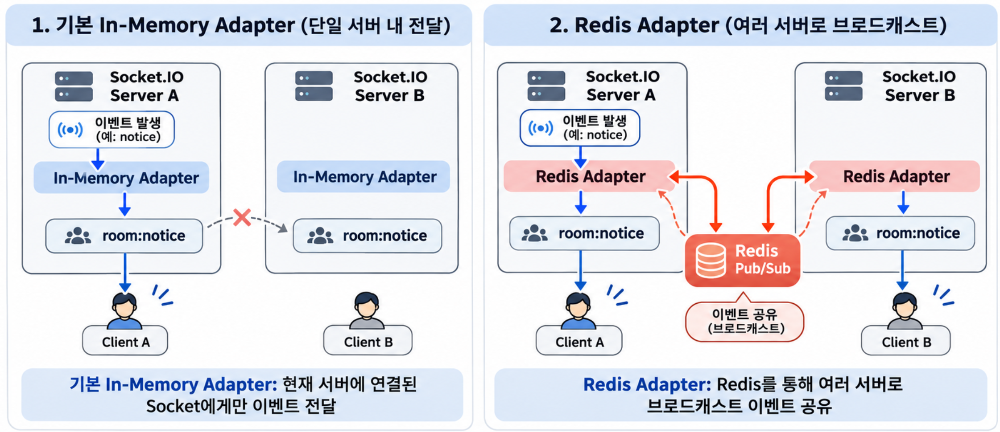
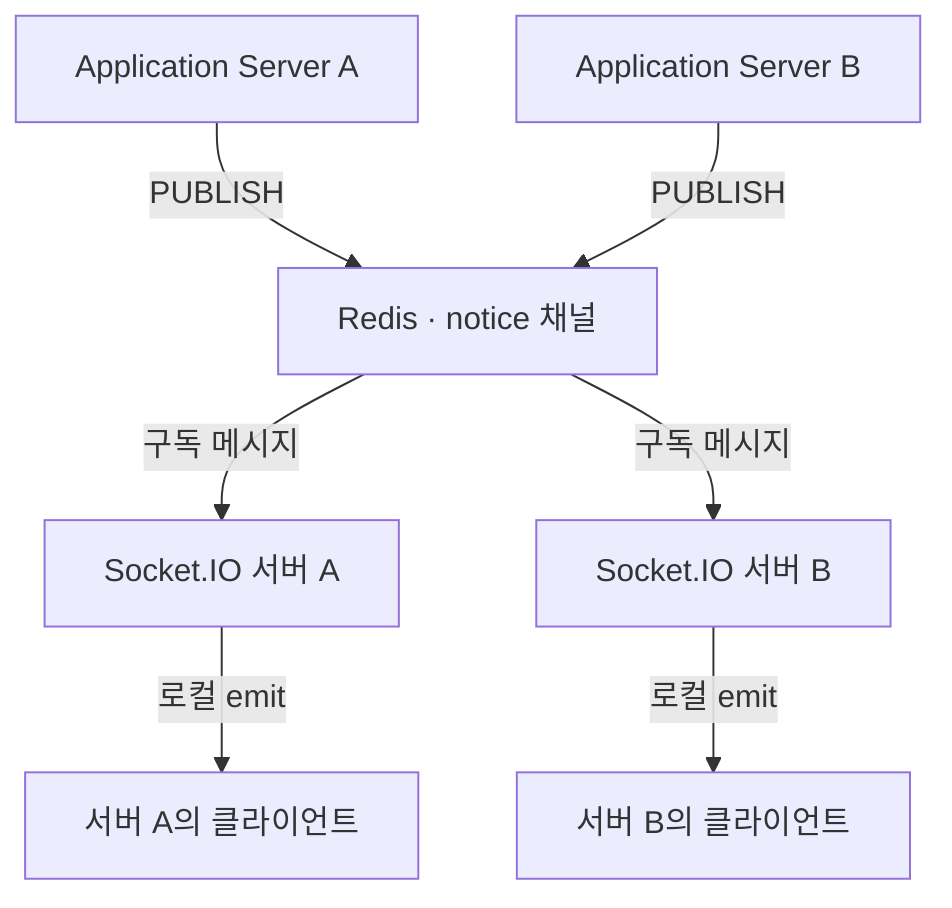
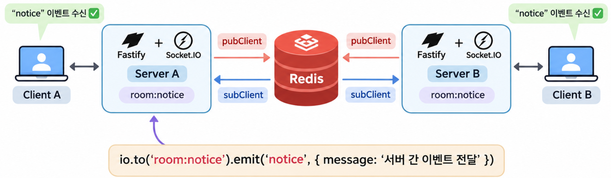
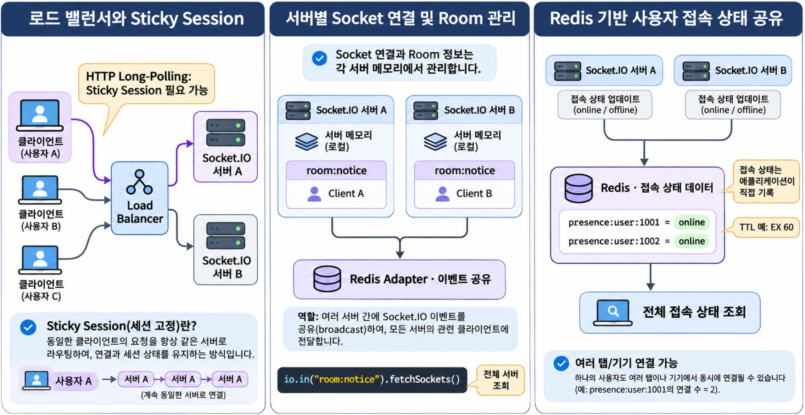
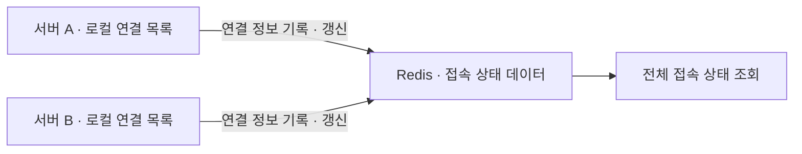

Socket.IO는 클라이언트와 서버 사이에서 실시간 양방향 통신을 구현하는 라이브러리입니다.  

Socket.IO는 각 서버의 메모리에서 클라이언트 연결과 Room 정보를 관리합니다. 서버가 여러 대라면 다른 서버에 연결된 클라이언트에게도 이벤트를 전달할 방법이 필요합니다.  

이 글에서는 **Redis Adapter**로 여러 서버에 브로드캐스트 이벤트를 전달하는 방법을 살펴봅니다. 브로드캐스트는 여러 클라이언트에게 이벤트를 보내는 동작이며, Redis Adapter는 서버 사이의 전달에 Redis Pub/Sub을 사용합니다.  

## 1. Socket.IO Adapter의 역할과 구조 {#session-01}

### 🟦 Socket.IO Adapter의 개념

Socket.IO Adapter는 서버에서 **Socket과 Room의 관계를 관리하고, 이벤트를 전달할 대상을 결정하는 구성 요소**입니다.  

예를 들어 여러 클라이언트가 `room:notice`라는 Room에 참여했다고 가정하겠습니다.  

```typescript
// 현재 연결을 공지 Room에 등록합니다.
socket.join("room:notice");

// 공지 Room에 참여한 연결에 알림을 전달합니다.
io.to("room:notice").emit("notice", {
  message: "새로운 알림입니다.",
});
```

Socket.IO는 Adapter를 통해 해당 Room에 속한 Socket을 확인하고 이벤트를 전달합니다.  

즉, Adapter는 클라이언트와 직접 통신하는 별도 서버가 아니라 Socket.IO 내부에서 이벤트 전달을 관리하는 구성 요소입니다.  

### 🟦 기본 In-Memory Adapter와 Redis Adapter의 차이

Socket.IO는 기본적으로 **In-Memory Adapter**를 사용합니다.  
In-Memory Adapter는 서버의 메모리에서 Socket과 Room 정보를 관리합니다.  
예를 들어 다음과 같이 두 대의 Socket.IO 서버가 있다고 가정하겠습니다.  

```text
Socket.IO Server A
  └── room:notice
        └── Client A

Socket.IO Server B
  └── room:notice
        └── Client B
```

두 클라이언트 모두 같은 이름의 Room에 참여했지만, Socket 연결은 서로 다른 서버에서 관리됩니다.  
Server A에서 `io.to("room:notice").emit()`을 실행하면, 기본 In-Memory Adapter에서는 Server A에 연결된 Client A에게만 이벤트가 전달됩니다.  
Server B의 Client B에게는 이벤트가 전달되지 않습니다.  

반면 Redis Adapter를 사용하면 Redis를 통해 다른 서버에도 브로드캐스트 이벤트를 전달할 수 있습니다.  

| 구분 | In-Memory Adapter | Redis Adapter |
| --- | --- | --- |
| Socket 관리 | 서버별 메모리 | 서버별 메모리 |
| Room 관리 | 서버별 메모리 | 서버별 메모리 |
| 이벤트 전달 범위 | 현재 서버 | 여러 서버 |
| Redis 사용 | 불필요 | 필요 |

Redis Adapter를 사용한다고 해서 모든 Socket과 Room 정보가 Redis에 저장되는 것은 아닙니다.  
각 서버는 자신의 Socket과 Room 정보를 메모리에서 관리하고, Redis를 통해 서버 간 이벤트를 공유합니다.  

### 🟦 Socket 연결 및 Room 관리 방식

Socket.IO에서는 클라이언트가 연결되면 Socket ID가 생성됩니다.  
하나의 Socket은 여러 Room에 참여할 수 있으며, Room은 클라이언트를 논리적으로 그룹화하는 기능입니다.  

```typescript
// 하나의 연결을 여러 Room에 등록합니다.
socket.join("room:notice");
socket.join("room:chat");

// 현재 Namespace의 모든 연결에 전송합니다.
io.emit("notice", message);

// 지정한 Room의 연결에만 전송합니다.
io.to("room:notice").emit("notice", message);
```

Adapter는 이러한 Socket과 Room의 관계를 관리합니다.  
여기서 Socket.IO Room과 Redis Pub/Sub 채널은 서로 다른 개념입니다.  

- **Socket.IO Room:** 이벤트를 전달할 클라이언트 그룹
- **Redis Pub/Sub 채널:** 서버 사이에서 메시지를 전달하는 통로

이 차이를 이해하면 Redis Adapter의 동작 방식도 쉽게 이해할 수 있습니다.  

### 🟦 Redis Adapter를 통한 서버 간 이벤트 공유

Redis Adapter는 Redis Pub/Sub을 이용하여 여러 Socket.IO 서버 사이에 브로드캐스트 이벤트를 전달합니다.  


예를 들어 Server A에서 다음 코드가 실행되었다고 가정하겠습니다.  

```typescript
io.to("room:notice").emit("notice", message);
```

Redis Adapter는 다음과 같이 동작합니다.  

1. Server A가 해당 Room의 로컬 클라이언트에게 이벤트를 전달하고, 다른 서버에도 알릴 준비를 합니다.  
2. Redis Pub/Sub 채널에 이벤트를 발행합니다.  
3. Server B의 Redis Adapter가 이벤트를 수신합니다.  
4. Server B가 자신에게 연결된 해당 Room의 클라이언트에게 이벤트를 전달합니다.  

로컬 전달과 Redis 발행은 하나의 브로드캐스트에서 이루어지는 작업이며, 위 번호는 전체 흐름을 설명하기 위한 것입니다. 이 과정은 Redis Adapter 내부에서 처리되므로 개발자가 서버 사이의 메시지 전달 로직을 직접 작성할 필요가 없습니다.  

따라서 기존의 `io.emit()`이나 `io.to(room).emit()` API를 그대로 사용할 수 있습니다.  

## 2. Redis Pub/Sub 기반 실시간 이벤트 전달 {#session-02}

### 🟦 Redis Publisher와 Subscriber의 역할

Redis Pub/Sub은 메시지를 발행하는 Publisher와 메시지를 구독하는 Subscriber로 구성됩니다.  
Publisher가 특정 채널에 메시지를 발행하면 Redis는 해당 채널을 구독하고 있는 모든 Subscriber에게 메시지를 전달합니다.  

```text
Publisher
    │
    │ PUBLISH
    ▼
  Redis
    │
    ├── Subscriber A
    ├── Subscriber B
    └── Subscriber C
```

Redis에서는 다음과 같은 명령을 사용합니다.  

```bash
# 터미널 A에서 먼저 채널을 구독합니다. 구독 중에는 메시지 수신을 기다립니다.
redis-cli SUBSCRIBE notice
```

```bash
# 별도의 터미널 B에서 메시지를 발행합니다.
redis-cli PUBLISH notice "새로운 알림"
```

Redis Pub/Sub의 특징은 **메시지를 저장하지 않고 현재 구독 중인 대상에게 전달한다는 것**입니다.  
따라서 Subscriber가 연결되어 있지 않은 동안 발행된 메시지는 나중에 다시 수신할 수 없습니다.  

### 🟦 Application Server와 Socket.IO 서버의 관계

실제 서비스에서는 Application Server와 Socket.IO 서버를 분리하여 운영할 수 있습니다.  

Application Server는 API 요청과 비즈니스 로직을 처리하고, Socket.IO 서버는 클라이언트와의 실시간 통신을 담당하는 방식입니다.  

예를 들어 게시글이 등록되면 다음과 같이 처리할 수 있습니다.  

1. Application Server가 게시글을 데이터베이스에 저장합니다.  
2. Application Server가 Redis에 게시글 등록 이벤트를 발행합니다.  
3. Socket.IO 서버가 Redis에서 이벤트를 수신합니다.  
4. Socket.IO 서버가 클라이언트에게 새 게시글 알림을 전달합니다.  

이 구조에서 Application Server는 각 클라이언트가 어느 Socket.IO 서버에 연결되어 있는지 알 필요가 없습니다.  

Redis를 통해 이벤트를 발행하면 구독하고 있는 Socket.IO 서버들이 이를 전달받을 수 있기 때문입니다.  

### 🟦 Redis Pub/Sub 기반 전체 이벤트 전달 구조

여러 Application Server와 여러 Socket.IO 서버가 있는 분산 환경을 살펴보겠습니다.  



일반 Redis Pub/Sub을 사용하는 경우 Application Server에서는 다음과 같이 이벤트를 발행할 수 있습니다.  

```typescript
// Application Server에서 공지 메시지를 발행합니다.
await redis.publish(
  "notice",
  JSON.stringify({
    message: "새로운 공지사항이 등록되었습니다.",
  }),
);
```

Socket.IO 서버에서는 해당 채널을 구독하고 수신한 메시지를 클라이언트에게 전달할 수 있습니다.  

```typescript
// Socket.IO 서버에서 공지 채널을 구독합니다.
await subscriber.subscribe("notice", (message) => {
  // 예제에서는 신뢰할 수 있는 발행자가 정해진 JSON 형식으로 보낸다고 가정합니다.
  // 실제 수신 처리에는 JSON 파싱 오류 처리와 메시지 구조 검증을 추가합니다.
  const data = JSON.parse(message);

  // 모든 서버가 이 채널을 구독하므로 각자의 로컬 연결에만 전달합니다.
  io.local.emit("notice", data);
});
```

이 구조에서는 각 Socket.IO 서버가 동일한 Redis 채널을 구독하고 있다고 가정합니다.  
이벤트가 발행되면 Redis는 구독 중인 Socket.IO 서버들에게 메시지를 전달합니다.  

각 Socket.IO 서버는 `io.local.emit()`으로 자신에게 연결된 클라이언트에게만 전달합니다.  
Redis Adapter를 함께 사용하는 환경에서 여기에도 `io.emit()`을 사용하면, 서버마다 수신한 같은 메시지가 다시 다른 서버로 전파되어 중복 알림이 발생할 수 있습니다.  

즉, **Redis는 서버 간 메시지 전달을 담당하고, Socket.IO 서버는 클라이언트에게 이벤트를 전송하는 역할**을 합니다.  

### 🟦 Redis Pub/Sub과 Socket.IO Redis Adapter의 차이

Redis Pub/Sub은 Redis에서 제공하는 메시지 발행(Publish) 및 구독(Subscribe) 기능입니다.  
Publisher가 특정 채널에 메시지를 발행하면 해당 채널을 구독하는 Subscriber에게 메시지가 전달됩니다.  

반면 Socket.IO Redis Adapter는 Redis Pub/Sub을 활용하여 여러 Socket.IO 서버 사이에서 브로드캐스트 이벤트를 공유하는 구성 요소입니다.  

| 구분 | Redis Pub/Sub | Socket.IO Redis Adapter |
| --- | --- | --- |
| 역할 | 메시지 발행 및 구독 | Socket.IO 서버 간 이벤트 전달 |
| 사용 대상 | 일반 애플리케이션 | Socket.IO 서버 |
| 메시지 전달 | Redis 채널 기준 | Socket.IO Room 및 Socket 기준 |
| Room 관리 | 지원하지 않음 | 각 Socket.IO 서버에서 관리 |
| 주요 용도 | 서버 간 메시지 공유 | 분산 Socket.IO 브로드캐스트 |

예를 들어 Server A에서 다음 코드를 실행했다고 가정하겠습니다.  

```typescript
io.to("room:notice").emit("notice", {
  message: "새로운 알림입니다.",
});
```

Redis Adapter는 Redis Pub/Sub을 통해 다른 Socket.IO 서버에 브로드캐스트 정보를 전달합니다.  
각 서버는 자신의 Room 정보를 확인하고 해당 Room에 참여한 클라이언트에게 이벤트를 전송합니다.  

즉, Redis Pub/Sub은 메시지를 전달하는 통신 기능이고, Socket.IO Redis Adapter는 이 기능을 이용해 여러 Socket.IO 서버의 이벤트 전달을 처리하는 구성 요소입니다.  

Redis 자체가 Socket.IO의 Room이나 Socket 연결을 관리하거나 클라이언트에게 직접 `emit()`을 실행하는 것은 아닙니다.  

## 3. Redis Adapter를 이용한 다중 서버 구성 {#session-03}

### 🟦 패키지 설치

Socket.IO에서 Redis Adapter를 사용하려면 `@socket.io/redis-adapter` 패키지가 필요합니다.  
Redis 연결을 위한 `redis` 패키지도 함께 설치합니다.  
다음 예제는 Fastify와 Socket.IO가 이미 설치된 프로젝트를 기준으로 합니다.  

```bash
npm install redis @socket.io/redis-adapter
```

### 🟦 여러 Fastify + Socket.IO 서버 구성

각 Fastify + Socket.IO 서버에 Redis Adapter를 등록하고 동일한 Redis에 연결하면, 서버 사이에서 브로드캐스트 이벤트를 공유할 수 있습니다.  

다음은 Redis 연결부터 서버 실행까지의 핵심 구성을 하나로 정리한 예제입니다. 최상위 `await`를 사용할 수 있는 ES 모듈 환경을 기준으로 합니다.  

```typescript
// Redis 연결을 준비한 뒤 Socket.IO에 Adapter를 등록하고 서버를 실행합니다.
import Fastify from "fastify";
import { Server } from "socket.io";
import { createClient } from "redis";
import { createAdapter } from "@socket.io/redis-adapter";

const app = Fastify();

// Fastify의 HTTP 서버를 Socket.IO와 함께 사용합니다.
const io = new Server(app.server);

// 모든 Socket.IO 서버가 동일한 Redis에 연결하도록 설정합니다.
const pubClient = createClient({
  url: process.env.REDIS_URL ?? "redis://localhost:6379",
});

// 같은 접속 설정을 사용하되 구독 전용 연결은 별도로 만듭니다.
const subClient = pubClient.duplicate();

// 연결 전에 두 클라이언트의 오류 리스너를 등록합니다.
pubClient.on("error", (error) => console.error("Redis publisher error:", error));
subClient.on("error", (error) => console.error("Redis subscriber error:", error));

// 발행·구독 연결이 모두 준비된 뒤 Adapter를 등록합니다.
await Promise.all([
  pubClient.connect(),
  subClient.connect(),
]);

// 이 서버의 브로드캐스트를 다른 서버에도 전달하도록 설정합니다.
io.adapter(createAdapter(pubClient, subClient));

// 새 연결이 들어오면 접근 가능한 공지 Room에 등록합니다.
io.on("connection", (socket) => {
  // 인증 미들웨어에서 사용자 정보와 공지 Room 접근 권한을 확인했다고 가정합니다.
  // 클라이언트가 임의의 Room 이름을 보내 참여하도록 허용하지 않습니다.
  socket.join("room:notice");
});

// 같은 컴퓨터에서 여러 서버를 실행할 때는 서로 다른 포트를 사용합니다.
const port = Number(process.env.PORT ?? 3000);
await app.listen({ port });
```

같은 코드를 두 개의 프로세스로 실행하되, 서버 A에는 `PORT=3000`, 서버 B에는 `PORT=3001`을 설정합니다.  
두 서버의 `REDIS_URL`은 동일하게 설정합니다.  

Redis Adapter에 전달하는 두 클라이언트의 역할은 다음과 같습니다.  

- `pubClient`: 다른 Socket.IO 서버에 이벤트를 발행합니다.  
- `subClient`: 다른 Socket.IO 서버에서 발행한 이벤트를 수신합니다.  

구독 메시지를 수신하는 연결을 발행용 연결과 분리하기 위해 `duplicate()`로 별도의 클라이언트를 생성합니다.  

각 서버는 자신에게 연결된 클라이언트와 Room 정보를 독립적으로 관리합니다.  
Redis Adapter는 Redis Pub/Sub을 통해 서버 간 브로드캐스트 정보를 전달하며, 각 서버는 이를 받아 자신의 클라이언트에게 이벤트를 전송합니다.  


### 🟦 서버 간 이벤트 및 Room 브로드캐스트

두 대의 Socket.IO 서버에 서로 다른 클라이언트가 연결되어 있다고 가정하겠습니다.  

- Client A → Socket.IO Server A
- Client B → Socket.IO Server B

두 클라이언트는 각 서버에서 같은 이름의 `room:notice`에 참여합니다.  

```typescript
// 각 서버에서 해당 연결을 같은 이름의 Room에 등록합니다.
socket.join("room:notice");
```

이후 Server A에서 다음과 같이 이벤트를 전송합니다.  

```typescript
io.to("room:notice").emit("notice", {
  message: "서버 간 이벤트 전달",
});
```

Redis Adapter는 Server A의 이벤트를 Redis에 발행하고, Server B의 Redis Adapter는 해당 이벤트를 수신합니다.  
그 결과 Client A와 Client B 모두 `notice` 이벤트를 받을 수 있습니다.  
개발자는 Server B에 별도의 HTTP 요청을 보내거나 Server B의 Socket 정보를 직접 조회할 필요가 없습니다.  

**Redis Adapter가 서버 간 브로드캐스트 처리를 담당하기 때문입니다.**

## 4. 분산 환경에서의 연결 및 상태 관리 {#session-04}

 

### 🟦 로드 밸런서와 Sticky Session

여러 Socket.IO 서버를 운영할 때는 **로드 밸런서(Load Balancer)**로 클라이언트 요청을 여러 서버에 나누어 전달할 수 있습니다.  

Socket.IO는 WebSocket과 HTTP Long-Polling 전송 방식을 지원합니다.  
HTTP Long-Polling은 HTTP 요청을 반복해서 보내 데이터를 받는 방식이므로, 하나의 Socket.IO 세션에서도 여러 HTTP 요청이 발생합니다.  
이때 같은 클라이언트의 요청이 서로 다른 서버로 전달되면 세션 정보를 찾지 못하는 문제가 발생할 수 있습니다.  
이때 사용하는 **Sticky Session(세션 고정)**은 로드 밸런서가 특정 클라이언트의 요청을 항상 동일한 서버로 전달하도록 유지하는 방식입니다.  
반면 WebSocket 전송 방식만 사용하도록 설정하면 하나의 TCP 연결을 유지하므로 일반적으로 Sticky Session이 필요하지 않습니다.  

### 🟦 서버별 Socket 연결 및 Room 관리

분산 환경에서 각 Socket.IO 서버는 자신에게 연결된 Socket을 관리합니다.  

예를 들어 다음과 같은 구조를 가정하겠습니다.  

```text
Server A
  └── room:notice
        └── Client A

Server B
  └── room:notice
        └── Client B
```

Server A와 Server B는 각각 자신의 Room 정보를 메모리에서 관리합니다.  
Redis Adapter는 Server A의 브로드캐스트 이벤트를 Server B에 전달하고, Server B는 자신의 Room 정보를 기준으로 이벤트를 전달합니다.  

즉, Redis Adapter가 모든 Socket 연결을 중앙에서 관리하는 것은 아닙니다.  

여러 서버에 걸친 Socket 정보가 필요하다면 `fetchSockets()` API로 조회할 수 있습니다.  

```typescript
// 모든 서버에 걸쳐 공지 Room에 속한 연결 정보를 조회합니다.
const sockets = await io
  .in("room:notice")
  .fetchSockets();
```

이 조회는 서버 간 통신을 사용합니다. 호출이 잦아지면 부담이 커질 수 있으므로 필요한 시점에 조회하는 것이 좋습니다.  

### 🟦 Redis 기반 사용자 접속 상태 공유

실제 서비스에서는 현재 접속 중인 사용자를 확인해야 할 수 있습니다.  

예를 들어 사용자 A가 Server A에 연결되고 사용자 B가 Server B에 연결되어 있다면 특정 서버의 메모리만으로 전체 사용자 상태를 확인할 수 없습니다.  

이러한 경우 각 서버에서 사용자의 접속 상태를 Redis에 별도로 기록하고, 다른 서버에서도 조회하도록 구성할 수 있습니다.  
이는 Redis Adapter가 자동으로 처리하는 기능이 아니라 애플리케이션에서 직접 구현하는 기능입니다.  



예를 들어 서버 A에 연결된 사용자가 1001이고 서버 B에 연결된 사용자가 1002라면, Redis에는 다음과 같이 접속 상태를 기록할 수 있습니다.  
저장하는 것은 사용자 ID에 대응하는 상태 값이며, 실제 Socket 연결과 Room 정보는 각 Socket.IO 서버의 메모리에 유지됩니다.  

```text
presence:user:1001 = online
presence:user:1002 = online
```

다음 코드는 사용자 접속 상태를 기록하면서 60초의 유효 시간(TTL)을 설정하는 예제입니다.  

```typescript
// 접속 상태를 기록하고 60초 뒤 자동으로 만료되도록 설정합니다.
// TTL 동작만 보여 주는 예제이며, 다중 연결 상태 관리의 완성 코드는 아닙니다.
// redis는 연결된 일반 명령용 클라이언트, userId는 인증된 사용자 ID입니다.
await redis.set(
  `presence:user:${userId}`,
  "online",
  { EX: 60 },
);
```

`EX: 60`을 지정하면 별도로 갱신하지 않은 기록은 60초 뒤에 만료됩니다. 접속이 유지되는 동안에는 만료 시간을 주기적으로 갱신해야 합니다.  

한 사용자가 여러 탭이나 기기로 접속할 수도 있습니다. 따라서 연결 하나가 끊겼다는 이유만으로 사용자 전체를 오프라인으로 처리하지 않도록, 연결별 상태나 남아 있는 연결 수를 함께 관리해야 합니다.  
