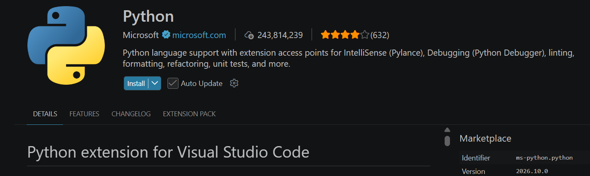
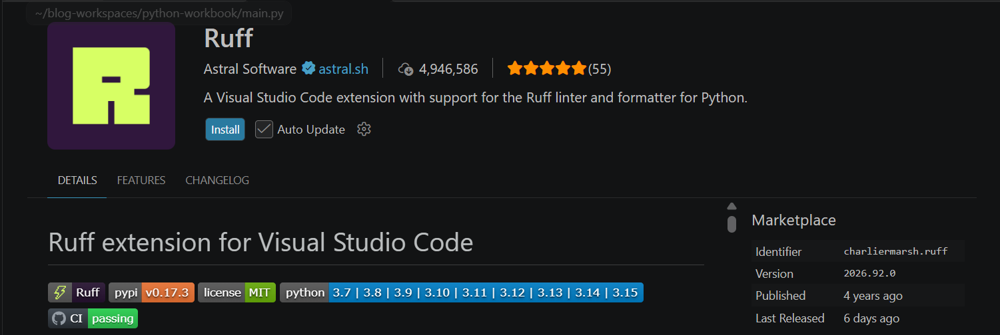

## 1. pyenv 설치 및 Python 버전 관리 {#session-01}

`pyenv`는 하나의 운영체제에서 여러 Python 버전을 설치하고 전환하는 도구입니다.  
Ubuntu에 설치된 시스템 Python을 변경하지 않고 별도의 Python 버전을 관리할 수 있다는 특징이 있습니다.  

### 🟦 시스템 Python 확인 및 빌드 도구 준비

기본 Python 환경을 확인합니다.  

```bash
python3 --version
which python3
```

Ubuntu에서 기본적으로 제공하는 Python은 일반적으로 `/usr/bin/python3` 경로에 위치합니다.  
이 Python은 운영체제의 여러 프로그램에서 사용될 수 있으므로, 시스템 Python을 직접 교체하기보다는 pyenv로 별도 버전을 설치하는 방법을 권장합니다.  

pyenv는 일반적으로 Python 소스 코드를 다운로드하고 컴파일하여 설치합니다.  
따라서 컴파일러와 개발 라이브러리가 필요합니다.  

```bash
# 패키지 목록을 갱신하고 Python 빌드에 필요한 도구를 설치합니다.
sudo apt update
sudo apt install -y \
    build-essential \
    make \
    curl \
    git \
    libssl-dev \
    zlib1g-dev \
    libbz2-dev \
    libreadline-dev \
    libsqlite3-dev \
    libffi-dev \
    liblzma-dev \
    libncurses-dev \
    xz-utils \
    tk-dev
```

주요 패키지는 다음과 같습니다.  

| 패키지 | 역할 |
|---|---|
| build-essential | Python 컴파일에 필요한 GCC 등의 도구 |
| libssl-dev | SSL 및 HTTPS 지원 |
| zlib1g-dev | 데이터 압축 기능 |
| libsqlite3-dev | SQLite 데이터베이스 지원 |
| libreadline-dev | Python 대화형 셸 기능 |
| libffi-dev | 외부 함수 인터페이스 지원 |
| liblzma-dev | LZMA 압축 기능 |

### 🔷 pyenv 설치

공식 설치 스크립트를 이용합니다.  

```bash
# 공식 설치 스크립트를 받아 pyenv를 설치합니다.
curl -fsSL https://pyenv.run | bash
```

설치가 완료되면 기본적으로 다음 경로에 pyenv가 구성됩니다.  

```text
~/.pyenv/
├── bin/
├── libexec/
├── plugins/
├── shims/
└── versions/
```

`versions`에는 pyenv로 설치한 Python 버전이 저장됩니다. `shims`는 `python` 같은 명령을 현재 선택한 버전의 실행 파일로 연결합니다.  
> shim은 입력한 명령을 실제 프로그램으로 연결해 주는 중간 실행 파일입니다.

### 🔷 환경변수 설정

WSL2 Ubuntu에서 기본 Bash 셸을 사용하는 경우, pyenv가 제공하는 셸 초기화 명령을 실행합니다.  

```bash
# Bash에서 pyenv를 사용할 수 있도록 초기화 설정을 추가합니다.
~/.pyenv/bin/pyenv init --install
```

설정된 내용을 확인하려면 다음 명령을 사용합니다.  

```bash
grep -n 'pyenv' ~/.bashrc
```

설정 예시:

```bash
export PYENV_ROOT="$HOME/.pyenv"
[[ -d $PYENV_ROOT/bin ]] && export PATH="$PYENV_ROOT/bin:$PATH"
eval "$(pyenv init - bash)"
```

`PYENV_ROOT`는 pyenv의 설치 경로이며, `pyenv init`은 Python 버전 전환에 필요한 셸 설정을 적용합니다.  

설정을 반영하기 위해 Bash 셸을 다시 실행합니다.  

```bash
exec bash
```

### 🔷 설치 확인

```bash
pyenv --version
pyenv root
```

출력 예시(버전은 설치 시점에 따라 다릅니다):

```text
pyenv 2.8.14
/home/ubuntu/.pyenv
```

### 🟦 Python 3.12.16 설치

먼저 설치 가능한 버전 목록에서 해당 버전을 확인합니다.  

```bash
pyenv install --list | grep -E '^[[:space:]]*3\.12\.16$'
```

```bash
# 실습에 사용할 Python 3.12.16을 설치합니다.
pyenv install -s 3.12.16
```

`-s` 옵션은 이미 설치된 버전을 건너뜁니다.  
`pyenv install 3.12`처럼 패치 버전을 생략하면 pyenv가 알고 있는 최신 패치 버전을 설치합니다.  
설치된 Python 버전을 확인합니다.  

```bash
pyenv versions
```

출력 예시

```text
* system (set by /home/ubuntu/.pyenv/version)
  3.12.16
```

### 🟦 Python 버전 변경

Python 3.12.16을 기본 버전으로 설정해 보겠습니다.  
가상환경이 활성화되어 있다면 `deactivate`로 종료하고, `pyenv shell --unset`으로 셸 설정을 해제합니다. 별도 `.python-version` 설정이 없는 디렉터리에서 실행합니다.  

```bash
pyenv global 3.12.16
python --version
```

예상 결과:

```text
Python 3.12.16
```

실행 파일의 경로도 확인합니다.  

```bash
which python
pyenv which python
```

예상 결과:

```text
/home/ubuntu/.pyenv/shims/python
/home/ubuntu/.pyenv/versions/3.12.16/bin/python
```

`which python`은 pyenv의 shim 경로를 보여주고, `pyenv which python`은 실제 Python 실행 파일 경로를 확인하는 데 사용할 수 있습니다.  

### 🟦 global, local, shell을 이용한 Python 버전 관리

Python 버전의 적용 범위에 따라 다음 명령을 사용합니다. 이번 예제에서는 모두 설치한 `3.12.16`을 지정하여 설정 범위와 해제 방법을 확인합니다.  

| 명령어 | 적용 범위 | 설정 저장 위치 |
|---|---|---|
| `pyenv global` | 사용자 기본 Python 버전 | `~/.pyenv/version` |
| `pyenv local` | 현재 디렉터리 및 하위 디렉터리 | 현재 디렉터리의 `.python-version` |
| `pyenv shell` | 현재 셸 세션 | `PYENV_VERSION` 환경변수 |

```bash
# 사용자 기본 버전을 지정합니다.
pyenv global 3.12.16

# 특정 디렉터리에서 사용할 버전을 지정합니다.
# 로그아웃하거나 재부팅해도 유지됩니다. 해당 디렉터리에 들어가면 다시 적용됩니다.
mkdir -p ~/pyenv-test
cd ~/pyenv-test
pyenv local 3.12.16
python --version  # Python 3.12.16
# 설정을 해제합니다.
pyenv local --unset

# 홈 디렉터리로 돌아가면 기본 버전이 적용됩니다.
cd ~
python --version  # Python 3.12.16

# 현재 셸에 사용할 버전을 지정하고, 확인 후 해제합니다.
# 현재 셸 세션에만 적용되므로 로그아웃하거나 터미널을 닫으면 해제됩니다.
pyenv shell 3.12.16
python --version  # Python 3.12.16
# 설정을 해제합니다.
pyenv shell --unset
```

적용 우선순위는 **`shell` → `local` → `global`**입니다.  
프로젝트 실습 전에는 `pyenv shell --unset`으로 셸 설정을 해제해 두는 것이 좋습니다.  

## 2. 프로젝트 Python 가상환경 구성 {#session-02}

`pyenv`는 디렉터리별 Python 버전 설정을 지원합니다.  
`python-workbook`과 하위 프로젝트에서 같은 Python **3.12.16**을 사용하고, `venv`로 각 프로젝트의 패키지 환경을 분리할 수 있습니다.  
Python 설치본은 공유하더라도 `.venv`를 각각 생성하면 설치 패키지는 독립적으로 관리됩니다.  

아래는 루트에 Python **3.12.16** 가상환경을 만들고, 같은 버전을 사용하는 하위 프로젝트를 추가할 수 있는 구조 예시입니다.  
하위 프로젝트 이름은 용도에 맞게 `api-practice`와 `syntax-practice`로 지정합니다.  

```text
python-workbook/                  # 루트 프로젝트: Python 3.12.16
├── .python-version               # 3.12.16
├── .venv/                        # 루트 전용 가상환경
├── .gitignore
├── README.md
├── main.py
├── requirements.txt
│
├── api-practice/                 # API 실습: Python 3.12.16
│   ├── .python-version           # 3.12.16
│   ├── .venv/                    # API 실습 전용 가상환경
│   ├── main.py
│   └── requirements.txt
│
└── syntax-practice/              # 문법 실습: Python 3.12.16
    ├── .python-version           # 3.12.16
    ├── .venv/                    # 문법 실습 전용 가상환경
    ├── main.py
    └── requirements.txt
```

하위 디렉터리에 `.python-version`이 없으면 상위 디렉터리의 설정을 사용하고, 자체 파일이 있으면 해당 버전을 사용합니다.  
단, 활성화된 `.venv`는 디렉터리를 이동해도 자동으로 전환되지 않습니다. 다른 프로젝트로 이동할 때에는 먼저 `deactivate`를 실행하고 이동한 프로젝트의 가상환경을 활성화합니다.  

### 🟦 루트 프로젝트 생성 및 Python 버전 지정

앞에서 설치한 Python 3.12.16을 루트 프로젝트 버전으로 지정합니다.  
기존 가상환경이 활성화되어 있다면 먼저 `deactivate`로 종료합니다.  

```bash
mkdir -p ~/workspace/python-workbook
cd ~/workspace/python-workbook

# 셸 설정을 해제하고 루트 프로젝트의 Python 버전을 기록합니다.
pyenv shell --unset
pyenv local 3.12.16
python --version
```

예상 결과:

```text
Python 3.12.16
```

루트의 `.python-version` 파일에 `3.12.16`이 기록되며, 로그아웃하거나 재부팅해도 유지됩니다.  

### 🟦 가상환경 생성 및 활성화

Python 버전을 확인한 뒤 프로젝트 폴더 안에 `.venv`를 생성합니다.  

> Python에서 python -m은 특정 Python 모듈(Module)을 프로그램처럼 실행하는 옵션입니다.  

```bash
# 현재 선택된 Python 3.12.16으로 가상환경을 생성합니다.
python -m venv .venv

# 현재 터미널에서 가상환경을 활성화합니다.
source .venv/bin/activate
python --version
which python
```

예상 결과:

```text
Python 3.12.16
/home/ubuntu/workspace/python-workbook/.venv/bin/python
```

터미널에 `(.venv)`가 표시되고 실행 경로가 프로젝트의 `.venv/bin/python`이면 가상환경이 적용된 것입니다.  
`pyenv local`은 Python 버전을 지정하며, `.venv` 활성화는 별도로 진행합니다.  

작업을 마치면 다음 명령으로 가상환경을 비활성화합니다.  

```bash
deactivate
```

터미널을 닫아도 활성화 상태는 해제되지만 `.venv` 폴더와 설치한 패키지는 유지됩니다.  
다음 작업 때에는 프로젝트 폴더에서 `source .venv/bin/activate`를 다시 실행합니다.  

## 3. VS Code에서 프로젝트 가상환경 설정 {#session-03}

프로젝트를 WSL 환경에서 열고 Python 확장을 설치한 뒤, 가상환경을 선택해 코드를 실행합니다.  

### 🟦 프로젝트 열기 및 Python 확장 설치

WSL2 Ubuntu 터미널에서 프로젝트를 엽니다.  

```bash
cd ~/workspace/python-workbook
code .
```

VS Code 좌측 하단에 `WSL: Ubuntu`와 같은 원격 연결 표시가 있는지 확인합니다.  
Microsoft의 Python 확장은 Python 인터프리터 선택과 코드 실행·디버깅을 지원합니다. WSL 환경에도 설치되어 있는지 확인합니다.  



### 🟦 Python 가상환경 선택

명령 팔레트(`Ctrl + Shift + P`)에서 다음 명령을 실행합니다.  

```text
Python: Select Interpreter
```

루트 프로젝트에 생성한 가상환경의 Python 실행 파일을 선택합니다.  

```text
/home/ubuntu/workspace/python-workbook/.venv/bin/python
```

이 글의 Ubuntu 계정 이름은 `ubuntu`로 가정합니다. 목록에 없다면 `Enter interpreter path`로 직접 지정합니다.  
인터프리터 선택 후 VS Code에서 새 터미널을 엽니다. 자동 활성화되지 않았다면 다음 명령으로 가상환경을 활성화합니다.  

```bash
source .venv/bin/activate
```

현재 터미널에서 사용하는 Python 버전과 경로를 확인합니다.  

```bash
python --version
which python
```

예상 결과:

```text
Python 3.12.16
/home/ubuntu/workspace/python-workbook/.venv/bin/python
```

Python 버전이 `3.12.16`이고 경로가 프로젝트의 `.venv/bin/python`인지 확인합니다.  

하위 프로젝트를 작업할 때에는 `api-practice` 또는 `syntax-practice` 폴더를 별도 VS Code 창으로 열고, 해당 폴더의 `.venv/bin/python`을 선택합니다. `api-practice`의 경로는 다음과 같습니다.  

```text
/home/ubuntu/workspace/python-workbook/api-practice/.venv/bin/python
```

루트 폴더를 열어 둔 채 인터프리터 하나를 선택하는 것만으로 하위 프로젝트의 가상환경까지 자동 전환되지는 않습니다.  

### 🟦 실행 확인

프로젝트에 `main.py` 파일을 작성합니다.  

```python
# 가상환경에서 실행 중인 Python 버전과 실행 파일 경로를 확인합니다.
import sys

print("Python Version:", sys.version.split()[0])
print("Python Executable:", sys.executable)
```

가상환경이 활성화된 VS Code 터미널에서 실행합니다.  

```bash
python main.py
```

예상 결과:

```text
Python Version: 3.12.16
Python Executable: /home/ubuntu/workspace/python-workbook/.venv/bin/python
```

## 4. Ruff로 Python 코드 품질 관리하기 {#session-04}

Python에서도 JavaScript의 ESLint, Prettier처럼 코드의 문제를 검사하고 작성 스타일을 통일하는 도구를 사용합니다.  
코드의 잠재적인 오류나 규칙 위반을 찾는 작업을 **린팅(Linting)**, 공백과 줄바꿈 등의 모양을 정리하는 작업을 **포맷팅(Formatting)**이라고 합니다.  

이번에는 두 기능을 함께 제공하는 Ruff를 설치하고 VS Code에 연결합니다. 앞에서 만든 WSL2 Ubuntu 환경과 루트 프로젝트의 `.venv`를 그대로 사용합니다.  

### 🟦 Python 코드 품질 관리 도구 비교

| 도구 | 주요 역할 | 특징 |
|---|---|---|
| Ruff | Linter + Formatter | 빠른 실행 속도, import 정렬 및 자동 수정 지원 |
| Flake8 | Linter | PEP 8 스타일과 기본 오류 검사, 플러그인 확장 지원 |
| Pylint | Linter | 코드 구조와 설계 등을 포함한 상세한 정적 분석 |
| Black | Formatter | 일관된 규칙에 따른 Python 코드 자동 포맷팅 |

`Flake8 + Black + isort`처럼 검사, 포맷팅, import 정렬 도구를 조합할 수도 있습니다.  
Ruff를 사용하면 이러한 기능의 상당 부분을 하나의 도구로 처리할 수 있습니다.  
다만 Ruff가 Pylint의 모든 분석 기능까지 대체하는 것은 아닙니다.  

### 🟦 가상환경에 Ruff 설치

앞에서 만든 루트 프로젝트로 이동한 뒤 가상환경을 활성화합니다. 다른 가상환경을 사용 중이라면 먼저 `deactivate`로 종료합니다.  

```bash
cd ~/workspace/python-workbook
source .venv/bin/activate

# 루트 프로젝트의 Python을 사용 중인지 확인합니다.
which python
python --version
```

Python 실행 경로가 `~/workspace/python-workbook/.venv/bin/python`에 해당하는지 확인한 뒤 Ruff를 설치합니다.  

```bash
# 현재 가상환경에 Ruff를 설치하고 버전을 확인합니다.
python -m pip install ruff
ruff --version
```

설치된 Ruff 버전이 출력되면 정상입니다.  

### 🟦 Ruff 기본 명령어

아래 명령의 `.`은 현재 디렉터리를 뜻합니다. 루트 프로젝트에서 실행하면 해당 디렉터리 아래의 Python 파일을 대상으로 작업합니다.  

| 명령어 | 설명 |
|---|---|
| `ruff check .` | 현재 프로젝트의 코드 검사 |
| `ruff check . --fix` | 자동 수정 가능한 문제 수정 |
| `ruff format .` | 프로젝트 전체 코드 포맷팅 |
| `ruff format --check .` | 파일을 수정하지 않고 포맷 검사 |
| `ruff check main.py` | 특정 Python 파일 검사 |

`ruff check . --fix`는 기본적으로 안전한 자동 수정을 적용하며, 모든 문제를 자동으로 고쳐 주지는 않습니다. 수정 후 남은 메시지는 직접 확인합니다.  
코드를 고친 뒤에는 `ruff check .`와 `ruff format --check .`를 실행하여 검사와 포맷팅을 모두 통과하는지 확인합니다.  

### 🟦 pyproject.toml에 공통 규칙 설정

Ruff는 `pyproject.toml`, `ruff.toml`, `.ruff.toml` 설정 파일을 지원합니다.  
여기서는 Python 프로젝트의 여러 도구 설정을 함께 관리할 수 있는 `pyproject.toml`을 사용합니다.  

`python-workbook` 루트에 파일을 생성합니다. 하위 프로젝트까지 구성했다면 다음과 같은 구조가 됩니다.  

```text
python-workbook/
├── pyproject.toml           # 루트와 하위 프로젝트가 사용할 Ruff 설정
├── .python-version
├── .venv/
├── main.py
├── api-practice/
│   ├── .python-version
│   ├── .venv/
│   └── main.py
└── syntax-practice/
    ├── .python-version
    ├── .venv/
    └── main.py
```

`pyproject.toml`에 다음 내용을 입력합니다. 이미 파일이 있다면 기존 내용을 유지하고 아래 설정을 추가합니다.  

```toml
[tool.ruff]
# .python-version에 맞춰 Python 3.12 문법을 기준으로 검사합니다.
target-version = "py312"
line-length = 88
indent-width = 4

[tool.ruff.lint]
# 스타일 정리는 formatter에 맡기고, 오류와 유지보수에 필요한 규칙을 검사합니다.
select = [
    "E4",  # import 관련 스타일 오류
    "E7",  # 문장 관련 스타일 오류
    "E9",  # 구문 및 실행 관련 오류
    "F",   # 미사용 import, 정의되지 않은 이름 등 (Pyflakes)
    "I",   # import 정렬 (isort)
    "UP",  # Python 버전에 맞는 최신 문법 (pyupgrade)
    "B",   # 흔한 버그와 실수 방지 (flake8-bugbear)
    "SIM", # 불필요하게 복잡한 코드 단순화 (flake8-simplify)
]

[tool.ruff.format]
quote-style = "double"
indent-style = "space"
```

| 설정 | 설명 |
|---|---|
| `target-version = "py312"` | Python 3.12를 기준으로 검사하고 포맷팅합니다. |
| `line-length = 88` | 포맷팅 시 기준으로 삼는 줄 길이이며, 모든 줄을 반드시 88자 이하로 만드는 것은 아닙니다. |
| `indent-width = 4` | 들여쓰기 너비를 4칸으로 설정합니다. |
| `E4`, `E7`, `E9` | 일부 코드 스타일 및 구문 관련 문제를 검사합니다. |
| `F` | Pyflakes 기반으로 미사용 import, 정의되지 않은 이름 등을 검사합니다. |
| `I` | import 정렬 규칙을 검사합니다. |
| `UP` | 대상 Python 버전에서 사용할 수 있는 최신 문법을 제안합니다. |
| `B` | 흔한 버그와 실수로 이어질 수 있는 코드를 검사합니다. |
| `SIM` | 불필요하게 복잡한 코드를 단순화하도록 제안합니다. |
| `quote-style = "double"` | 포맷팅 시 문자열에 큰따옴표를 사용합니다. |
| `indent-style = "space"` | 들여쓰기에 탭 대신 공백을 사용합니다. |

Ruff는 검사할 Python 파일에서 가까운 상위 설정 파일을 찾습니다. 따라서 하위 프로젝트에 별도 설정이 없다면 루트의 규칙을 함께 사용할 수 있습니다.  
하위 프로젝트에 별도 설정을 만들면 가장 가까운 설정이 적용되며, 상위 설정과 자동으로 병합되지는 않습니다. 상속이 필요하면 `extend`를 사용합니다.  
공통 설정을 공유하는 것과 Ruff 설치 위치는 별개입니다. 하위 프로젝트의 `.venv`에서도 터미널 명령을 사용하려면 해당 가상환경에 Ruff를 설치하거나 공용 CLI 설치 방식을 사용합니다.  

### 🟦 VS Code에 Ruff 확장 설치



Ruff 확장은 자체 실행 파일을 제공하므로, VS Code 안에서 검사와 포맷팅만 사용할 때에는 프로젝트마다 Ruff를 `pip`로 설치하지 않아도 됩니다. 앞의 설치 단계는 터미널에서도 `ruff` 명령을 실행하기 위한 과정입니다.  

### 🟦 저장할 때 자동 수정 및 포맷팅 설정

명령 팔레트(`Ctrl + Shift + P`)에서 `Preferences: Open Remote Settings (JSON)`을 실행합니다.  
기존 설정에 다음 항목을 추가합니다. 이미 `[python]` 항목이 있다면 새로 만들지 말고 그 안에 설정을 합칩니다.  

```json
{
  "editor.fontFamily": "D2Coding, Consolas, 'Courier New', monospace",
  "terminal.integrated.defaultProfile.linux": "bash",
  "[python]": {
    "editor.defaultFormatter": "charliermarsh.ruff",
    "editor.formatOnSave": true,
    "editor.codeActionsOnSave": {
      "source.fixAll.ruff": "explicit",
      "source.organizeImports.ruff": "explicit"
    }
  }
}
```

`editor.defaultFormatter`는 Python 파일의 포맷터를 Ruff로 지정하고, `editor.formatOnSave`는 저장 시 포맷팅을 실행합니다.  
`source.fixAll.ruff`는 자동 수정 가능한 린트 문제를 처리하고, `source.organizeImports.ruff`는 import를 정렬합니다.  
`"explicit"`은 `Ctrl + S`처럼 직접 저장할 때 코드 작업을 실행한다는 뜻입니다. 자동 저장만으로도 동일하게 실행된다고 생각하지 않도록 구분합니다.  

원격 설정은 해당 WSL 환경의 여러 프로젝트에 적용됩니다. 프로젝트에서만 사용할 설정이라면 `.vscode/settings.json`에 작성할 수도 있습니다.  

### 🟦 Ruff 동작 테스트

이번 테스트는 앞에서 작성한 루트의 `main.py` 내용을 임시로 바꾸어 진행합니다. 기존 실행 확인 코드를 보관하려면 먼저 복사해 둡니다.  
VS Code의 저장 시 자동 수정이 켜져 있으면 저장하는 순간 코드가 정리될 수 있습니다. 터미널에서 수정 전후를 비교하려면 아래 코드 블록의 명령으로 파일을 작성합니다.  

```bash
cd ~/workspace/python-workbook

# 사용하지 않는 import와 공백 문제가 있는 테스트 파일을 작성합니다.
# main.py
import os
import sys
import math


def add(a,b):
    result=a+b
    return result


print(add(10,20))
```

먼저 코드 검사를 실행합니다.  

```bash
ruff check main.py
```

사용하지 않는 import에 대한 `F401`과 import 정렬에 대한 `I001` 등의 메시지가 출력됩니다. 이어서 자동 수정과 포맷팅을 실행합니다.  

```bash
# 사용하지 않는 import 등 자동 수정 가능한 문제를 처리합니다.
ruff check main.py --fix

# 공백과 줄바꿈을 정리합니다.
ruff format main.py
```

수정된 `main.py`는 다음과 같습니다.  

```python
def add(a, b):
    result = a + b
    return result


print(add(10, 20))
```

사용하지 않는 import가 제거되고 함수 인자와 연산자 주변의 공백이 정리됩니다. 마지막으로 검사와 실행 결과를 확인합니다.  

```bash
ruff check .
ruff format --check .
python main.py
```

`python main.py`의 실행 결과는 `30`입니다. VS Code에서도 공백을 다시 흐트러뜨린 뒤 `Ctrl + S`로 저장하여 자동으로 정리되는지 확인합니다.  

이제 Python 버전은 pyenv로, 프로젝트별 패키지는 venv로, 코드 검사와 포맷팅은 Ruff로 관리할 수 있습니다.  
