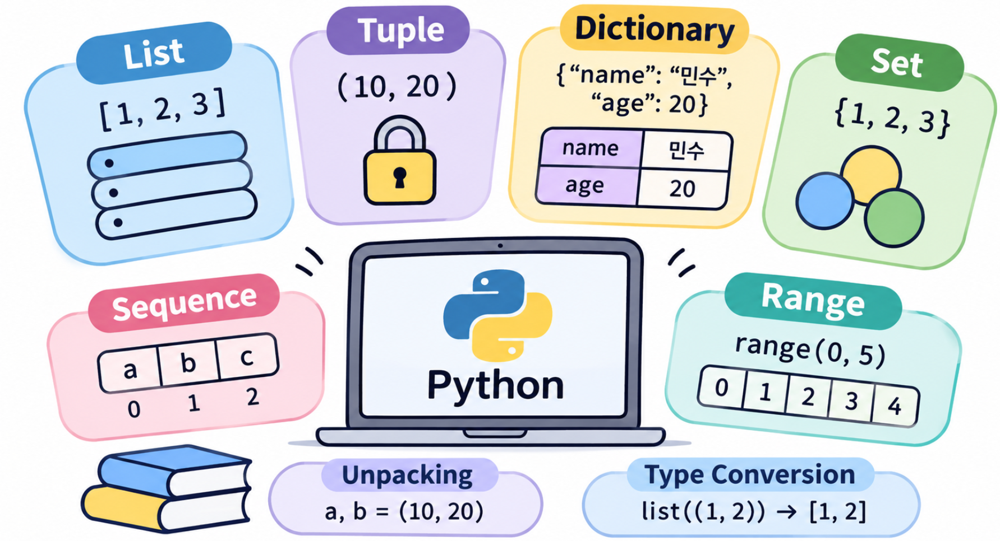

📂 **[[GitHub 코드 보러가기]](https://github.com/cericube/python-workbook/tree/main/python-basics){: target="_blank" rel="noopener noreferrer" }**



## 1. 리스트(List): 순서가 있는 가변 자료형 {#session-01}

### 🟦 생성·조회와 원소 변경

리스트(`list`)는 여러 원소를 순서대로 저장합니다. 같은 값을 여러 번 넣을 수 있으며, 원소를 추가·수정·삭제할 수 있는 **가변(Mutable) 자료형**입니다.  

```python
# 실습 과목을 추가하고, 첫 번째 과목을 수정합니다.
subjects = ["Python", "SQL", "Python"]
subjects.append("Git")
subjects[0] = "Python 기초"

print(subjects)  # ['Python 기초', 'SQL', 'Python', 'Git']
print(len(subjects))  # 4
```

`len()`은 원소의 개수를 반환하고, `[0]`은 첫 번째 원소를 가리킵니다. 리스트의 인덱스는 0부터 시작합니다.  

| 메서드 | 역할 |
|---|---|
| `append(x)` | 끝에 객체 하나를 추가합니다. |
| `extend(iterable)` | 반복 가능한 객체에서 원소를 하나씩 가져와 추가합니다. |
| `insert(i, x)` | 지정한 위치에 원소를 삽입합니다. |
| `remove(x)` | 값이 같은 첫 번째 원소를 삭제하며, 없으면 ValueError가 발생합니다. |
| `pop(i)` | 지정한 위치의 원소를 삭제하고 반환하며, 위치를 생략하면 마지막 원소를 꺼냅니다. |
| `index(x)` | 값이 같은 첫 번째 원소의 위치를 반환하며, 없으면 ValueError가 발생합니다. |
| `count(x)` | 값이 같은 원소의 개수를 반환합니다. |
| `sort()`, `reverse()` | 원본 리스트를 정렬하거나 역순으로 바꿉니다. |
| `copy()`, `clear()` | 얕은 복사본을 만들거나 모든 원소를 삭제합니다. |

```python
# append는 목록 자체를 하나의 원소로, extend는 목록의 원소를 각각 추가합니다.
appended = [1, 2]
appended.append([3, 4])
print(appended)  # [1, 2, [3, 4]]

extended = [1, 2]
extended.extend([3, 4])
print(extended)  # [1, 2, 3, 4]
```

원본을 바꾸는 메서드와 새 결과를 반환하는 함수는 구분해야 합니다.  

```python
# sorted는 새 리스트를 만들고, sort는 원본을 수정합니다.
numbers = [3, 1, 2]
ordered = sorted(numbers)
print(numbers)  # [3, 1, 2]
print(ordered)  # [1, 2, 3]

result = numbers.sort()
print(numbers)  # [1, 2, 3]
print(result)   # None

last = numbers.pop()
print(last)     # 3
print(numbers)  # [1, 2]
```

`numbers = numbers.sort()`라고 쓰면 `numbers`가 `None`을 참조하게 됩니다. `sort()`와 달리 `pop()`은 삭제한 원소를 반환합니다.  

## 2. 튜플(Tuple): 변경할 수 없는 순서형 자료형 {#session-02}

### 🟦 생성·조회와 주요 메서드

튜플(`tuple`)도 순서와 중복을 허용하지만, 생성 후 원소를 다른 객체로 교체하거나 원소를 추가·삭제할 수 없는 **불변(Immutable) 자료형**입니다.  
좌표나 고정된 구성의 값을 묶을 때 사용할 수 있습니다.  

```python
# 원소 하나인 튜플을 만들 때에도 쉼표가 필요합니다.
point = (10, 20)
single = (10,)
not_tuple = (10)

print(point[0])               # 10
print(type(single).__name__)   # tuple
print(type(not_tuple).__name__)  # int
print((1, 2, 1).count(1))      # 2
print((1, 2, 1).index(2))      # 1
```

튜플을 만드는 핵심은 괄호보다 **쉼표**입니다. `point = 10, 20`도 튜플을 만들며, 빈 튜플은 `()`로 표현합니다.  
`count(값)`은 해당 값이 튜플에 몇 개 있는지 반환합니다. 예제의 `(1, 2, 1).count(1)`은 숫자 `1`이 두 개 있으므로 `2`를 반환합니다. 찾는 값이 없으면 `0`을 반환합니다.  
`index(값)`는 해당 값이 처음 등장하는 위치(인덱스)를 반환합니다. 인덱스는 `0`부터 시작하므로, `(1, 2, 1).index(2)`는 숫자 `2`가 두 번째 원소에 있어 `1`을 반환합니다. 찾는 값이 없으면 `ValueError`가 발생합니다.  
`point[0] = 30`은 `TypeError`를 발생시킵니다.  

### 🟦 불변성과 내부 가변 객체

튜플의 불변성은 각 원소가 참조하는 객체를 교체할 수 없다는 뜻입니다.  
튜플 안에 가변 객체가 있다면 그 객체의 내용은 바뀔 수 있습니다.  

```python
# 튜플의 두 번째 원소는 같은 리스트를 계속 참조합니다.
record = ("민수", [80, 90])
record[1].append(100)

print(record)  # ('민수', [80, 90, 100])
```

## 3. 딕셔너리(Dictionary): Key-Value 자료형 {#session-03}

### 🟦 생성·조회와 항목 추가·수정

딕셔너리(`dict`)는 **키(Key)와 값(Value)**을 짝지어 저장합니다.  
키는 중복될 수 없고, 같은 키에 대입하면 기존 값을 바꿉니다. 값은 중복될 수 있습니다.  

```python
# 키로 값을 조회·수정하고 새 항목을 추가합니다.
user = {"name": "민수", "age": 20}
user["age"] = 21
user["city"] = "서울"

print(user["name"])               # 민수
print(user.get("email", "미등록"))  # 미등록
print("age" in user)               # True

for key, value in user.items():
    print(f"{key}: {value}")
```

`user["email"]`처럼 없는 키를 조회하면 `KeyError`가 발생합니다.  
`get()`은 키가 없을 때 기본값을 반환하고, 기본값을 생략하면 `None`을 반환합니다.  
`in user`는 값이 아닌 키의 존재 여부를 검사합니다. 
`keys()`는 키, `values()`는 값, `items()`는 `(키, 값)` 쌍을 제공합니다.  

### 🟦 항목 삭제와 주요 조회 메서드

`pop(key)`는 항목을 삭제하고 해당 값을 반환합니다.  
기본값 없이 없는 키를 지정하면 `KeyError`가 발생합니다.  
`del data[key]`도 항목을 삭제하지만 값을 반환하지 않습니다.  

```python
# 항목을 삭제한 뒤 남아 있는 키, 값, 키와 값의 쌍을 확인합니다.
user = {"name": "민수", "age": 20, "city": "서울"}
age = user.pop("age")
del user["city"]

print(age)                 # 20
print(list(user.keys()))   # ['name']
print(list(user.values()))  # ['민수']
print(list(user.items()))   # [('name', '민수')]
```

### 🟦 삽입 순서 보장

Python 3.12의 딕셔너리는 키가 삽입된 순서를 유지합니다. 이는 Python 3.7부터 언어 차원에서 보장되는 동작입니다.  
정렬된 순서라는 뜻은 아니며, 기존 키의 값만 수정하면 위치는 그대로입니다. 삭제한 키를 다시 추가하면 마지막으로 이동합니다.  

```python
# 기존 키를 갱신할 때와 삭제 후 다시 추가할 때의 순서를 비교합니다.
settings = {"theme": "light", "language": "ko"}
settings["theme"] = "dark"

# 키, 값, (키, 값) 쌍을 삽입 순서대로 확인합니다.
print(list(settings))  # ['theme', 'language'] 
print(list(settings.keys()))  # ['theme', 'language']
print(list(settings.values()))  # ['dark', 'ko']
print(list(settings.items()))  # [('theme', 'dark'), ('language', 'ko')]

# 키를 삭제한 뒤 다시 추가하면 마지막 위치로 이동합니다.
del settings["theme"]
settings["theme"] = "light"
print(list(settings))  # ['language', 'theme']
```

`list(settings)`는 딕셔너리의 키를 리스트로 만들므로 `list(settings.keys())`와 결과가 같습니다. `values()`는 값만, `items()`는 `(키, 값)` 튜플을 제공하며, 모두 키의 삽입 순서를 따릅니다.  

### 🟦 키의 해시 가능성

딕셔너리의 키는 **해시 가능한(Hashable) 객체**여야 합니다. 해시는 객체를 빠르게 찾기 위해 사용하는 정수 값이며, 해시 가능한 객체는 수명 동안 해시 값이 변하지 않고 동등성 비교 규칙과 일관되어야 합니다.  
해시 값이 같다고 반드시 같은 객체나 같은 값인 것은 아닙니다. 딕셔너리와 집합은 해시뿐 아니라 동등성 비교도 사용합니다.  

`int`, `str`, 정수로만 구성된 튜플은 키로 사용할 수 있습니다.  
반면 `list`, `dict`, `set`은 해시 불가능하므로 키로 사용할 수 없습니다.  
튜플도 내부에 리스트처럼 해시 불가능한 원소가 있으면 키로 사용할 수 없습니다.  

```python
# 모든 원소가 해시 가능한 좌표 튜플을 키로 사용합니다.
locations = {(10, 20): "출발점"}
print(locations[(10, 20)])  # 출발점
```

딕셔너리의 **값**에는 리스트나 딕셔너리도 넣을 수 있습니다. 해시 가능성 제약은 키에 적용됩니다.  

## 4. 집합(Set): 중복을 허용하지 않는 자료형 {#session-04}

### 🟦 생성·조회와 원소 추가·삭제, 집합 연산

집합(`set`)은 중복 원소를 저장하지 않는 가변 자료형입니다.  
삽입 순서를 보장하지 않으며 인덱싱과 슬라이싱을 지원하지 않습니다.  

```python
# 중복된 숫자를 제거하고 원소를 추가·삭제합니다.
numbers = {3, 1, 3, 2}
numbers.add(4)
numbers.discard(1)
numbers.discard(99)  # 원소 삭제시 없는 값은 무시합니다.

# 집합 자체의 출력 순서에 의존하지 않도록 정렬한 리스트로 확인합니다.
print(sorted(numbers))  # [2, 3, 4]
print(3 in numbers)     # True
print(type({}).__name__)  # dict
print(type(set()).__name__)  # set
```

`{}`는 빈 딕셔너리입니다. 빈 집합은 `set()`으로 만듭니다.  
`remove(x)`는 원소가 없으면 `KeyError`를 발생시키지만, `discard(x)`는 없는 원소를 무시합니다.  

| 구분 | `remove(x)` | `discard(x)` |
|---|---|---|
| 원소가 존재할 때 | 삭제 | 삭제 |
| 원소가 없을 때 | `KeyError` 발생 | 오류 없이 무시 |
| 정상 종료 시 반환값 | `None` | `None` |

두 메서드 모두 삭제한 원소를 반환하지 않습니다. `remove(x)`에서 `KeyError`가 발생하면 정상적으로 반환하지 않고 예외로 처리됩니다.  

```python
# 두 과목의 수강생 목록으로 집합 연산을 수행합니다.
python_students = {"민수", "지수"}
sql_students = {"지수", "영희"}

print(sorted(python_students | sql_students))  # ['민수', '영희', '지수']
print(sorted(python_students & sql_students))  # ['지수']
print(sorted(python_students - sql_students))  # ['민수']
print(sorted(python_students ^ sql_students))  # ['민수', '영희']
```

`|`는 합집합, `&`는 교집합, `-`는 차집합, `^`는 한쪽에만 있는 원소를 모으는 대칭 차집합입니다.  

### 🟦 집합 원소의 조건과 frozenset

`set`의 원소는 반드시 **해시 가능(Hashable)**해야 합니다.  

- 사용 가능: `int`, `str`, 내부 원소가 모두 해시 가능한 `tuple`, `frozenset`
- 사용 불가: `list`, `set`, `dict`

`frozenset()`은 변경할 수 없는 집합을 만드는 생성자입니다.  
일반 `set`과 달리 원소를 추가하거나 삭제할 수 없으며, 다른 집합의 원소나 딕셔너리의 키로 사용할 수 있습니다.  

```python
# 일반 집합은 원소를 추가할 수 있습니다.
a = {1, 2, 3}
a.add(4)
print(sorted(a))  # [1, 2, 3, 4]

# frozenset은 원소를 추가하거나 삭제할 수 없습니다.
b = frozenset({1, 2, 3})
# b.add(4)  # 주석을 해제하면 AttributeError가 발생합니다.

# frozenset으로 묶은 집합 하나를 다른 집합의 원소로 넣습니다.
groups = {frozenset({1, 2})}
print(frozenset({2, 1}) in groups)  # True
```

`groups`에는 숫자 `1`, `2`가 각각 들어가는 것이 아니라, 두 숫자를 묶은 `frozenset` 하나가 들어 있습니다.  
집합은 순서와 관계없이 원소가 같으면 같은 값으로 판단하므로, `{2, 1}`로 순서를 바꾸어도 포함 여부는 `True`입니다.  

## 5. 시퀀스(Sequence): 순서형 자료형의 공통 특성 {#session-05}

### 🟦 시퀀스 개념과 Iterable의 차이

시퀀스(Sequence)는 **원소가 순서대로 놓여 있어, 첫 번째나 두 번째처럼 위치를 지정해 값을 꺼낼 수 있는 자료형을 통틀어 부르는 말**입니다.  
대표적으로 `list`, `tuple`, `str`, `range`가 있으며, `values[0]`처럼 인덱스로 원소를 조회할 수 있습니다.  
시퀀스 프로토콜의 핵심은 길이를 제공하는 `__len__()`과 인덱스로 원소를 조회하는 `__getitem__()`입니다.  
이 이름들은 Python이 `len(obj)`나 `obj[index]` 같은 문법을 처리할 때 사용하는 특별 메서드입니다.  
기본 시퀀스들은 인덱싱과 슬라이싱, 순회, 포함 여부 검사 등을 제공합니다. 다만 연결이나 반복 연산처럼 지원 범위가 자료형에 따라 다른 기능도 있습니다.  

```python
# 튜플도 리스트처럼 길이, 인덱싱, 슬라이싱, 순회를 지원합니다.
colors = ("red", "green", "blue")
print(len(colors))    # 3
print(colors[1])      # green
print(colors[:2])     # ('red', 'green')
print("blue" in colors)  # True

for color in colors:
    print(color)
```

**반복 가능(Iterable)**과 **시퀀스**는 같은 뜻이 아닙니다.  
딕셔너리와 집합도 `for`로 순회할 수 있지만, 시퀀스처럼 정수 위치로 원소를 조회하는 자료형은 아닙니다.  
`collections.abc.Sequence`라는 추상 기반 클래스도 있지만, 여기서는 우선 시퀀스를 공통 동작을 가리키는 개념으로 이해하면 충분합니다.  

### 🟦 인덱싱: 위치 하나로 조회

리스트와 튜플, 문자열 등의 시퀀스는 정수 인덱스로 원소를 조회합니다.  
`0`은 첫 번째, `-1`은 마지막 원소입니다.  

```python
# 앞에서는 0부터, 뒤에서는 -1부터 위치를 셉니다.
letters = ["a", "b", "c", "d", "e"]

print(letters[0])    # a
print(letters[-1])   # e
print(len(letters))  # 5
```

위 리스트에서 `letters[5]`는 범위를 벗어나므로 `IndexError`가 발생합니다.  
딕셔너리의 `data[key]`는 위치 조회가 아니라 키 조회입니다.  

### 🟦 슬라이싱: 범위와 간격으로 조회

`대상[시작:끝:간격]`으로 여러 원소를 선택합니다. 
**끝 위치는 포함하지 않으며**, 간격은 인덱스가 이동하는 방향과 크기를 의미합니다.
슬라이싱의 간격(step)이 -1이면 인덱스를 1씩 감소시키면서 역방향으로 조회합니다.  

```python
# 원본은 유지하고 선택한 범위의 새 리스트를 만듭니다.
values = [0, 1, 2, 3, 4, 5]

print(values[1:4])    # [1, 2, 3]           → 인덱스 1부터 4 직전까지 추출
print(values[:3])     # [0, 1, 2]           → 처음부터 인덱스 3 직전까지 추출
print(values[3:])     # [3, 4, 5]           → 인덱스 3부터 끝까지 추출
print(values[::2])    # [0, 2, 4]           → 처음부터 끝까지 2칸 간격으로 추출
print(values[::-1])   # [5, 4, 3, 2, 1, 0]  → 역순으로 추출
print(values[10:])    # []                  → 범위를 벗어나 빈 리스트 반환
print(values)         # [0, 1, 2, 3, 4, 5]  → 원본 리스트는 변경되지 않음
print(values[3:1:-1]) # [3, 2]              → 인덱스 3부터 1 직전까지 역순 추출
print(values[3::-1])  # [3, 2, 1, 0]        → 인덱스 3부터 처음까지 역순 추출
print(values[::-1])   # [5, 4, 3, 2, 1, 0]  → 전체 역순 추출
```

인덱싱과 달리 슬라이스 경계가 범위를 벗어나면 가능한 범위로 조정합니다.  
간격에 `0`을 넣으면 `ValueError`가 발생합니다.  
리스트의 `values[:]`는 얕은 복사본을 만듭니다. 튜플과 문자열도 슬라이싱을 지원하지만, 모든 슬라이싱이 반드시 새로운 객체를 만든다고 가정하면 안 됩니다.  

### 🟦 슬라이스 대입과 del

리스트는 슬라이스에 다른 원소들을 대입하여 길이를 바꿀 수도 있습니다.  

```python
# 선택한 구간을 다른 원소들로 교체하고, 인덱스와 슬라이스로 삭제합니다.
values = [0, 1, 2, 3, 4]
values[1:3] = [10, 20, 30]
print(values)  # [0, 10, 20, 30, 3, 4]

del values[0]
del values[1:3]
print(values)  # [10, 3, 4]
```

간격이 `1`이 아닌 슬라이스에 대입할 때에는 선택된 원소 수와 대입할 원소 수가 같아야 합니다. 튜플과 문자열에는 슬라이스 대입이나 원소 삭제를 할 수 없습니다.  
`del`은 이름에 대해서도 사용할 수 있지만, 이때는 객체의 내용을 비우는 것이 아니라 이름과 객체의 연결을 제거합니다.  

```python
# 이름 하나를 제거해도 다른 이름이 참조하는 리스트는 남아 있습니다.
items = [1, 2]
alias = items
del items

print(alias)  # [1, 2]
# 이후 items를 조회하면 NameError가 발생합니다.
```

## 6. 범위(Range): 정수 범위를 표현하는 불변 시퀀스 {#session-06}

### 🟦 range 생성과 조회, 리스트와의 차이

`range(start, stop, step)`은 일정한 간격의 정수 범위를 나타냅니다.  
시작 기본값은 `0`, 간격 기본값은 `1`이며 **끝값은 포함하지 않습니다**.

```python
# 전체 원소를 리스트로 저장하지 않고 정수 범위를 표현합니다.
numbers = range(1, 10, 2)
print(numbers)        # range(1, 10, 2)
print(list(numbers))  # [1, 3, 5, 7, 9]
print(len(numbers))   # 5
print(numbers[-1])    # 9
print(5 in numbers)   # True

# range를 슬라이싱한 결과도 range입니다.
print(numbers[1:4])        # range(3, 9, 2)
print(list(numbers[1:4]))  # [3, 5, 7]
```

`range`는 범위의 원소들을 미리 모두 저장하지 않으므로 큰 정수 범위를 표현할 때 유용합니다.  
`list(range(...))`로 변환하면 그때 모든 원소를 담은 리스트를 만듭니다.  
`range`는 한 번 사용하면 소진되는 이터레이터와 달리 여러 번 순회할 수 있습니다.  
불변이므로 원소 대입이나 삭제는 지원하지 않으며, 리스트처럼 `+`로 연결하거나 `*`로 반복할 수도 없습니다.  

```python
# 감소하는 범위에서는 음수 간격을 지정합니다.
print(list(range(5, 0, -2)))  # [5, 3, 1]
print(list(range(5, 0)))      # []
```

시작과 끝이 진행 방향에 맞지 않으면 빈 범위가 됩니다. `step=0`이면 `ValueError`가 발생하며, `range`는 소수 간격을 표현하는 용도로 사용할 수 없습니다.  

## 7. 언패킹(Unpacking): 여러 값을 변수에 할당 {#session-07}

### 🟦 기본 언패킹: 값을 이름에 나누어 대입

반복 가능한 객체의 원소들을 여러 변수에 나누어 대입하는 것을 언패킹이라고 합니다.  
기본 언패킹에서는 변수 수와 원소 수가 정확히 같아야 합니다.  

```python
# 튜플과 리스트의 원소를 각각의 변수에 연결합니다.
name, age = ("민수", 20)
x, y = [10, 20]

print(name, age)  # 민수 20
print(x, y)      # 10 20

# 오른쪽의 기존 값을 먼저 구하므로 값 교환에도 사용할 수 있습니다.
x, y = y, x
print(x, y)  # 20 10
```

`a, b = [1, 2, 3]`처럼 개수가 다르면 `ValueError`가 발생합니다. 언패킹은 튜플 전용 기능이 아니며, 문자열이나 `range` 등 반복 가능한 객체에도 사용할 수 있습니다.  

### 🟦 확장 언패킹: 남은 원소를 별표로 받기

변수 앞에 `*`를 붙이면 나머지 원소를 **리스트**로 모아 받습니다.  
원본이 튜플이어도 별표가 붙은 변수가 받는 결과는 리스트입니다.  

```python
# 앞뒤 원소를 따로 받고 중간의 나머지를 리스트로 모읍니다.
first, *middle, last = (10, 20, 30, 40, 50)
print(first)   # 10
print(middle)  # [20, 30, 40]
print(last)    # 50

# 모을 원소가 없어도 빈 리스트를 받습니다.
head, *tail = [10]
print(head)  # 10
print(tail)  # []
```

같은 단계의 대입 대상에는 별표 대상을 하나만 둘 수 있습니다. `first, *middle, last`는 앞뒤에 하나씩 필요하므로 원소가 최소 2개 있어야 합니다.  
사용하지 않을 값을 `*_`로 받을 수도 있습니다. 이때 `_`는 특별한 버림 문법이 아니라, 사용하지 않을 변수라는 의도로 붙인 일반 이름입니다.  

```python
# 앞의 두 값만 사용하고 나머지는 사용하지 않습니다.
name, age, *_ = ["민수", 20, "서울", "개발자"]
print(name, age)  # 민수 20

# 새 컨테이너를 만들 때의 *는 원소를 펼치는 역할입니다.
combined = [0, *[1, 2], *range(3, 5)]
print(combined)  # [0, 1, 2, 3, 4]
```

왼쪽의 `*rest`는 나머지를 모으고, 오른쪽 목록 표현식의 `*values`는 원소를 펼칩니다. 

## 8. 자료형 비교 및 변환 {#session-08}

### 🟦 자료형별 특성과 선택 기준

| 자료형 | 순서 | 중복 | 변경 가능 | 주로 사용하는 상황 |
|---|---|---|---|---|
| `list` | 위치 순서 유지 | 허용 | 가능 | 계속 추가·수정할 목록 |
| `tuple` | 위치 순서 유지 | 허용 | 불가능 | 좌표 등 고정된 구성의 묶음 |
| `dict` | 키 삽입 순서 유지 | 키는 불가, 값은 허용 | 가능 | 이름이나 ID로 값 조회 |
| `set` | 순서 보장 없음 | 불가 | 가능 | 중복 제거, 포함 여부, 집합 연산 |
| `frozenset` | 순서 보장 없음 | 불가 | 불가능 | 변경할 수 없는 집합, 키로 쓸 집합 |
| `range` | 정수 진행 순서 | 없음 | 불가능 | 일정한 간격의 정수 범위 |

딕셔너리에 순서가 있다고 해서 리스트처럼 위치로 조회할 수 있는 것은 아닙니다. 집합에 중복이 없다고 해서 정렬되어 있는 것도 아닙니다.  
또한 튜플이 불변이라고 해서 모든 튜플을 딕셔너리 키로 사용할 수 있는 것은 아닙니다. 내부 원소의 해시 가능성도 확인해야 합니다.  

### 🟦 자료형 간 변환

생성자에 반복 가능한 객체를 전달하면 자료형을 변환할 수 있습니다. 변환할 때에는 중복이나 순서처럼 원래 정보가 사라질 수 있는지 확인합니다.  

```python
# 리스트를 튜플로 바꾸거나, 집합으로 중복을 제거합니다.
values = [3, 1, 3, 2]
print(tuple(values))          # (3, 1, 3, 2)
print(sorted(set(values)))    # [1, 2, 3]
print(list("Python"))         # ['P', 'y', 't', 'h', 'o', 'n']

# 두 원소씩 묶인 항목들을 딕셔너리로 변환합니다.
pairs = [("name", "민수"), ("age", 20)]
user = dict(pairs)
print(list(user))          # ['name', 'age']
print(list(user.values()))  # ['민수', 20]
```

`dict(pairs)`는 각 항목이 키와 값으로 구성되어 있어야 합니다. 키가 중복되면 뒤의 값이 앞의 값을 덮어씁니다.  
`list(set(values))`는 중복을 제거하지만 원래 순서를 보장하지 않습니다. 해시 가능한 원소의 최초 등장 순서를 유지하며 중복을 제거하려면 딕셔너리의 삽입 순서를 활용할 수 있습니다.  

```python
# 키는 중복되지 않고 최초 삽입 위치를 유지합니다.
values = [3, 1, 3, 2, 1]
unique_values = list(dict.fromkeys(values))
print(unique_values)  # [3, 1, 2]
```
