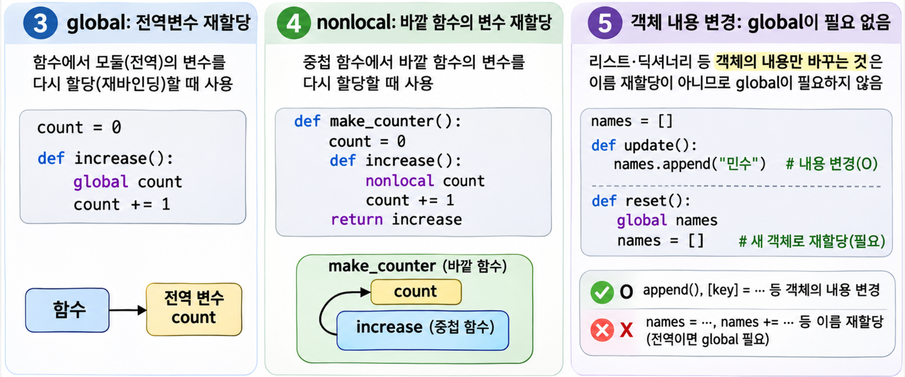
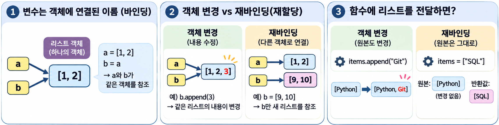
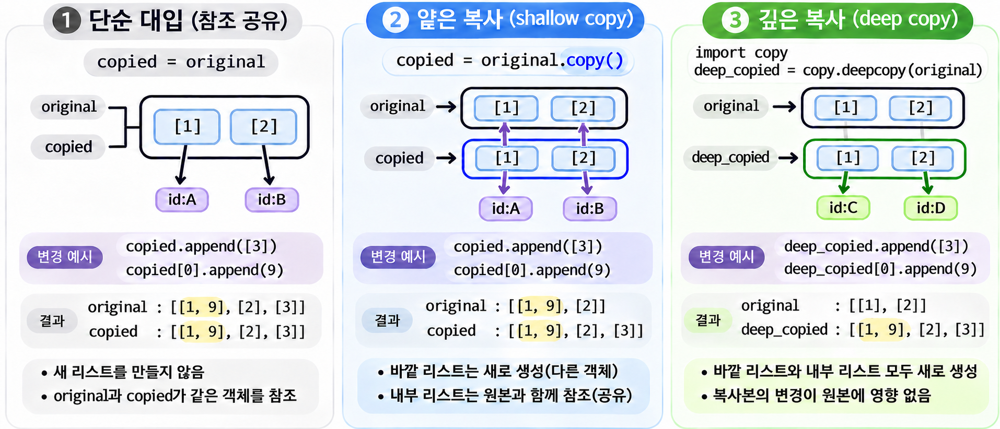

## 1. 변수 스코프와 이름을 찾는 순서 {#session-01}

### 🟦 지역변수와 전역변수

**스코프(Scope)는 변수 이름에 접근할 수 있는 범위**입니다.  
모듈 수준, 즉 함수나 클래스 밖에서 정의한 변수는 **전역변수**, 함수 안의 매개변수와 변수는 **지역변수**입니다. 여기서는 Python 파일 하나를 모듈 하나로 생각하면 됩니다.  

```python
name = "민수"  # 현재 모듈의 전역변수입니다.

def introduce():
    age = 20  # introduce 함수의 지역변수입니다.
    print(name)  # 민수: 함수 밖의 전역변수를 읽습니다.
    print(age)   # 20

introduce()
print(name)  # 민수

# 오류를 잡아 실행 결과를 확인합니다. try-except는 9편에서 다룹니다.
try:
    print(age)
except NameError:
    print("age는 함수 밖에서 직접 사용할 수 없습니다.")
```

`age`는 `introduce()`의 지역변수이므로 모듈에서 `age`라는 이름으로 직접 접근할 수 없습니다. 함수마다 지역 스코프가 따로 있으므로, 다른 함수에 같은 이름의 변수가 있어도 서로 다른 변수입니다.  

### 🟦 이름을 찾는 순서: LEGB

일반적인 함수 코드에서 Python은 **Local → Enclosing → Global → Built-in** 순서로 이름을 찾습니다. 가까운 범위에서 이름을 찾으면 바깥 범위까지 계속 찾지 않습니다.  

| 순서 | 범위 | 찾는 이름 |
|---|---|---|
| L | Local | 현재 함수의 매개변수와 지역변수 |
| E | Enclosing | 현재 함수를 감싸는 바깥 함수의 변수 |
| G | Global | 현재 함수가 정의된 모듈의 전역변수 |
| B | Built-in | `print`, `len` 등 Python 내장 이름 |

```python
message = "Global"

def outer():
    message = "Enclosing"

    def show_local():
        message = "Local"
        print(message)  # 현재 함수에서 찾습니다.

    def show_enclosing():
        print(message)  # 현재 함수에 없으므로 바깥 함수에서 찾습니다.

    show_local()
    show_enclosing()

outer()
print(message)        # Global
print(len([10, 20]))  # 2: len은 Built-in에서 찾습니다.
# outer()의 출력:
# Local
# Enclosing
```

Enclosing은 **함수를 어디에서 호출했는지가 아니라, 코드상 어느 함수 안에 정의했는지**로 결정됩니다. Global도 프로그램의 모든 파일이 공유하는 범위가 아니라 현재 모듈의 범위입니다.  
`list`, `str`, `len` 같은 내장 이름을 변수 이름으로 사용하면 원래 기능을 가릴 수 있으므로 피하는 편이 좋습니다.  

## 2. 별도 스코프를 만드는 구문 구분하기 {#session-02}

### 🟦 들여쓴 블록마다 스코프가 생기지는 않습니다

Python에서 들여쓰기는 코드 블록을 구분합니다. 하지만 **들여쓴 모든 블록이 별도 스코프를 만드는 것은 아닙니다.**  

| 구문 | 변수 범위의 특징 |
|---|---|
| `def`, `lambda` | 함수의 지역 스코프 생성 |
| `class` | 클래스 이름과 속성을 관리하는 별도 네임스페이스 생성 |
| `if`, `else`, `for`, `while` | 둘러싼 함수 또는 모듈의 스코프 사용 |
| `try`, `except`, `finally`, `with` | 둘러싼 함수 또는 모듈의 스코프 사용 |
| 컴프리헨션·제너레이터 표현식 | 반복 변수는 바깥 스코프와 분리 |

```python
def show_result():
    if True:
        status = "완료"

    for number in range(3):
        last_number = number

    # if와 for는 별도 스코프를 만들지 않아 함수 안에서 계속 사용할 수 있습니다.
    print(status)       # 완료
    print(number)       # 2
    print(last_number)  # 2

show_result()

try:
    print(status)
except NameError:
    print("status는 show_result 함수의 지역변수입니다.")
```

`status`는 `if`의 변수가 아니라 `show_result()`의 지역변수입니다. 따라서 `if` 밖에서는 사용할 수 있지만 함수 밖에서는 직접 사용할 수 없습니다.  

### 🟦 이름을 사용하려면 대입이 실제로 실행되어야 합니다

별도 스코프가 없다는 것과 변수에 값이 있다는 것은 다릅니다.  
조건이 거짓이거나 반복 대상이 비어 있거나, 대입 도중 예외가 발생하면 값이 할당되지 않을 수 있습니다.  

```python
try:
    before = "작업 시작"
    result = 10 / 0  # 계산에 실패하므로 result에는 값이 대입되지 않습니다.
except ZeroDivisionError as error:
    recovered = "오류 처리 완료"
    print(type(error).__name__)  # ZeroDivisionError

print(before)     # 작업 시작
print(recovered)  # 오류 처리 완료

try:
    print(result)
except NameError:
    print("result에는 값이 대입되지 않았습니다.")
```

`try`와 `except`에서 대입한 `before`·`recovered`는 모듈의 변수로 남습니다.  
단, **`except ... as error`의 예외 변수는 처리 블록이 끝나면 삭제**됩니다.  
별도 스코프가 생기는 것은 아니지만, 예외 변수에는 이런 정리 규칙이 있습니다.  

### 🟦 컴프리헨션의 반복 변수는 바깥 변수와 분리됩니다

일반 `for`와 달리, 컴프리헨션의 반복 변수는 바깥 변수에 영향을 주지 않습니다. 자세한 문법은 8편에서 다룹니다.  

```python
number = 100
squares = [number ** 2 for number in range(3)]

print(squares)  # [0, 1, 4]
print(number)   # 100: 컴프리헨션의 반복 변수와 별개입니다.
```

### 🟦 클래스의 이름은 메서드에서 속성으로 접근합니다

클래스는 별도의 **네임스페이스(Namespace)**, 즉 이름과 객체를 연결해 관리하는 공간을 만듭니다. 클래스 안의 이름은 메서드에서 일반적인 Enclosing 변수처럼 자동 검색되지 않습니다.  

```python
name = "모듈의 이름"

class Member:
    name = "민수"  # 클래스 속성입니다.

    def introduce(self):
        message = "안녕하세요"  # 메서드의 지역변수입니다.
        print(message)
        print(name)       # 모듈의 이름: 클래스의 name을 자동으로 찾지 않습니다.
        print(self.name)  # 민수: 인스턴스를 통해 속성에 접근합니다.

member = Member()
member.introduce()
print(Member.name)  # 민수: 클래스 이름으로도 접근할 수 있습니다.
```

클래스 속성은 `self.name`이나 `Member.name`처럼 접근합니다. 이 부분은 일반 함수의 LEGB 규칙과 구분하고, 클래스 문법은 6편에서 자세히 살펴봅니다.  

## 3. global과 nonlocal로 바깥 변수에 대입하기 {#session-03}



### 🟦 읽기와 대입은 다르게 동작합니다

함수 안에서 같은 이름에 대입하지 않는다면, 전역변수는 별도 선언 없이 읽을 수 있습니다.  

```python
tax_rate = 0.1

def calculate_tax(price):
    return price * tax_rate

print(calculate_tax(100))  # 10.0
```

반면 **함수 안에서 이름에 대입하면 기본적으로 그 함수의 지역변수로 판단**합니다.  
대입 전에 읽는 코드가 있어도 함수 전체에 이 규칙이 적용됩니다.  

```python
count = 0

def increase():
    # count를 지역변수로 판단하지만, 아직 값이 없어 읽을 수 없습니다.
    count += 1

try:
    increase()
except UnboundLocalError:
    print("지역변수 count에 값을 대입하기 전에 읽었습니다.")

print(count)  # 0: 전역변수는 바뀌지 않았습니다.
```

`count += 1`은 값을 읽은 뒤 대입하는 문장입니다. 함수 안의 지역변수로 판단된 `count`에는 아직 값이 없으므로 `UnboundLocalError`가 발생합니다. 함수 밖에 같은 이름이 있어도 대신 사용하지 않습니다.  

### 🟦 global: 현재 모듈의 전역변수에 대입하기

함수에서 전역변수에 새 값을 대입하려면 `global`을 사용합니다. 해당 이름을 읽거나 대입하기 전에 선언합니다.  

```python
count = 0

def increase():
    global count  # 이 함수의 count는 모듈의 전역 이름을 가리킵니다.
    count += 1

increase()
increase()
print(count)  # 2
```

`global`은 모든 파일에서 공유할 변수를 만드는 명령이 아닙니다. **이 함수에서 해당 이름을 현재 모듈의 전역변수로 사용하겠다**는 선언입니다.  

### 🟦 nonlocal: 바깥 함수의 변수에 대입하기

중첩 함수에서 바깥 함수의 변수에 새 값을 대입하려면 `nonlocal`을 사용합니다.  
전역변수가 아니라, **가장 가까운 바깥 함수에 이미 있는 해당 이름**을 찾습니다.  

```python
def outer():
    count = 0

    def increase():
        nonlocal count
        count += 1

    increase()
    print(count)  # 1: 바깥 함수의 count가 바뀌었습니다.

outer()
```

| 구분 | `global` | `nonlocal` |
|---|---|---|
| 대입 대상 | 현재 모듈의 전역변수 | 바깥 함수의 변수 |
| 같은 이름이 여러 범위에 있을 때 | 모듈의 이름 사용 | 해당 이름이 있는 가장 가까운 바깥 함수 사용 |
| 기존 이름 필요 여부 | 없어도 대입으로 생성 가능 | 바깥 함수에 이미 정의되어 있어야 함 |

바깥 함수에 해당 이름이 없는데 `nonlocal`을 선언하면 `SyntaxError`가 발생합니다. 바깥 함수의 변수를 기억하는 클로저는 5편에서 이어서 다룹니다.  

## 4. 변수 재할당과 객체 내용 변경 구분하기 {#session-04}



### 🟦 이름에 대입하는 것과 객체를 바꾸는 것은 다릅니다

Python에서 변수는 객체에 연결된 이름입니다. `b = a`는 객체를 복사하지 않고 **두 이름이 같은 객체를 참조**하게 합니다. 이름을 다른 객체에 다시 연결하는 것을 **재바인딩(Rebinding)**이라고 하며, 재할당이 대표적인 예입니다.  

```python
a = [1, 2]
b = a

b.append(3)  # 두 이름이 가리키는 기존 list의 내용을 바꿉니다.
print(a)     # [1, 2, 3]
print(a is b)  # True

b = [9, 10]  # b만 새 list를 가리키도록 재할당합니다.
print(a)     # [1, 2, 3]
print(b)     # [9, 10]
print(a is b)  # False
```

### 🟦 객체 내용 변경에는 global이나 nonlocal이 필요하지 않습니다

`append()`나 `settings["theme"] = ...`는 바깥 이름에 새 객체를 대입하지 않고, 그 이름이 가리키는 객체의 내용만 바꿉니다.  

```python
names = []
settings = {"theme": "light"}

def update_state():
    names.append("민수")
    settings["theme"] = "dark"

update_state()
print(names)     # ['민수']
print(settings)  # {'theme': 'dark'}
```

반면 `names = [...]`로 전역변수를 재할당하려면 `global names`가 필요합니다. `names += [...]`도 이름에 대입하는 문장이므로, 함수 안에서 선언 없이 사용하면 지역변수 문제가 발생합니다. 바깥 함수의 변수에도 같은 구분이 적용됩니다.  

함수의 매개변수도 지역변수이지만, 전달받은 가변 객체를 변경하면 호출한 쪽에 영향을 줄 수 있습니다. **스코프가 분리되어 있다고 객체까지 복사되는 것은 아닙니다.**  

### 🟦 원본을 유지하려면 필요한 범위만 복사합니다



다음 표는 중첩된 `list`인 `[[1], [2]]`를 기준으로 비교합니다.

| 방식 | 바깥 list | 내부 list |
|---|---|---|
| `shared = original` | 공유 | 공유 |
| `original.copy()` | 새로 생성 | 공유 |
| `copy.deepcopy(original)` | 새로 생성 | 복사 |

`original.copy()`는 **얕은 복사(Shallow Copy)**이므로 내부 객체는 공유합니다. 내부의 가변 객체도 따로 복사해야 한다면 **깊은 복사(Deep Copy)**를 사용할 수 있습니다.  

```python
import copy

original = [[1], [2]]
shallow = original.copy()
deep = copy.deepcopy(original)

shallow[0].append(9)  # 공유하는 내부 list를 변경합니다.
print(original)  # [[1, 9], [2]]
print(deep)      # [[1], [2]]: 내부 list까지 복사해 영향이 없습니다.
```

깊은 복사도 모든 객체를 무조건 새로 만들지는 않습니다. 위 예시처럼 분리해야 할 가변 객체가 어디까지인지 먼저 확인합니다.  
가능하면 함수가 필요한 값을 인자로 받고 결과를 반환하도록 작성하면, 전역 상태를 바꾸는 코드보다 데이터의 흐름을 따라가기 쉽습니다.  
