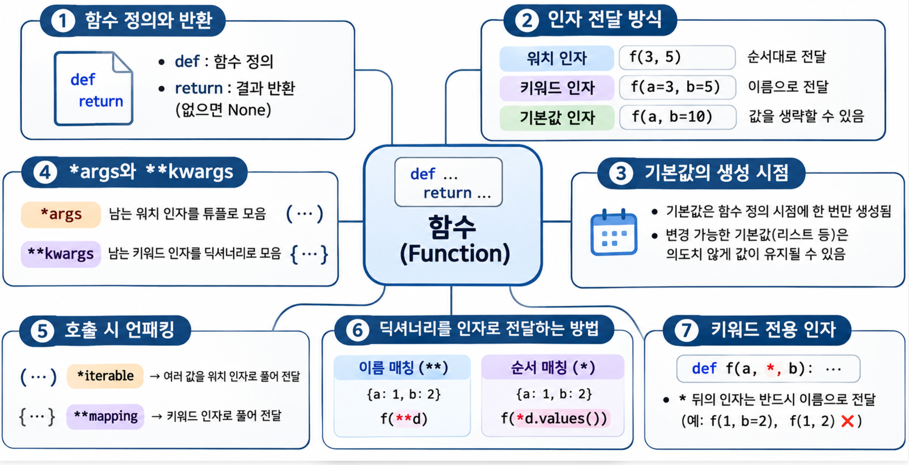
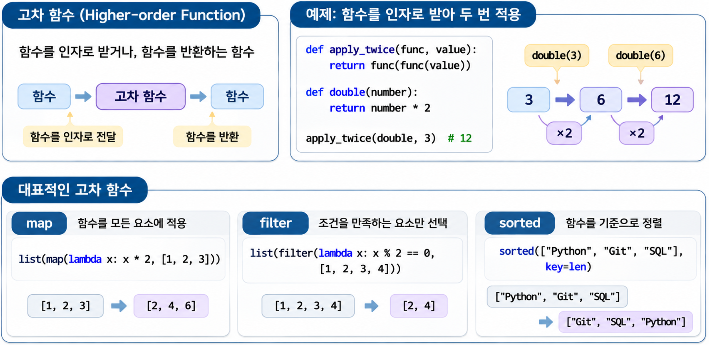
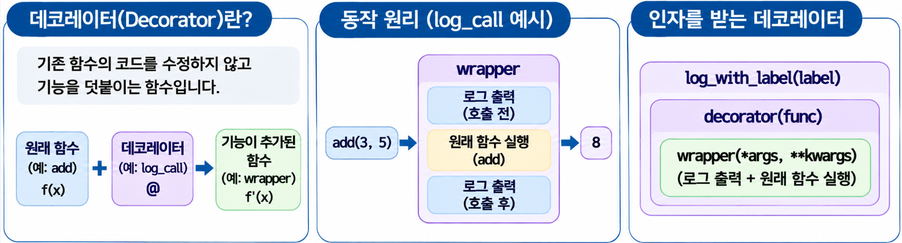

Python에서는 숫자나 문자열처럼 함수도 변수에 저장할 수 있습니다. 다른 함수에 인자로 전달하거나 반환값으로 돌려줄 수도 있습니다.  
이처럼 변수에 저장하고, 인자로 전달하고, 반환값으로 사용할 수 있는 객체를 **일급 객체(First-class Object)**라고 합니다.  

## 1. 함수 구조와 인자 전달 {#session-01}



### 🟦 def와 return

`def`로 함수를 정의하고, `return`으로 결과를 반환합니다. `return`이 실행되면 함수의 실행도 끝납니다. `return` 뒤에 값을 쓰지 않거나 `return` 없이 함수가 끝나면 `None`을 반환합니다.  

```python
# 두 수의 합을 계산해 반환합니다.
def add(left, right):
    return left + right

print(add(3, 5))  # 8
```

함수를 정의할 때 괄호 안에 적은 `left`, `right`는 **매개변수(Parameter)**이고, 호출할 때 전달한 `3`, `5`는 **인자(Argument)**입니다.  

### 🟦 위치 인자, 키워드 인자, 기본값 인자

인자를 전달하는 방법에는 두 가지가 있습니다. 위치 인자는 매개변수 순서에 맞춰 값을 전달하고, 키워드 인자는 `name="민수"`처럼 이름을 지정해 값을 전달합니다.  
매개변수에 기본값이 있으면 해당 인자는 생략할 수 있습니다.  

```python
def greet(name, greeting="안녕하세요"):
    return f"{name}님, {greeting}!"

print(greet("민수"))                     # 민수님, 안녕하세요!
print(greet("민수", "반갑습니다"))       # 민수님, 반갑습니다!
print(greet(greeting="반갑습니다", name="민수")) # 민수님, 반갑습니다!
```

일반적인 매개변수 선언에서는 `name`처럼 기본값이 없는 매개변수를 `greeting`처럼 기본값이 있는 매개변수보다 앞에 적습니다. 함수를 호출할 때 위치 인자와 키워드 인자를 함께 사용한다면 `greet("민수", greeting="반갑습니다")`처럼 위치 인자를 먼저 적습니다.  

### 🟦 기본값은 함수가 정의될 때 만들어집니다

리스트를 기본값으로 지정하면 그 리스트는 함수가 정의될 때 한 번만 만들어집니다.  
아래 예제에서 `subjects` 인자를 생략하면 매번 같은 리스트를 사용하므로, 이전에 추가한 항목이 그대로 남습니다.  

```python
# 이전 호출에서 추가한 항목이 다음 호출에도 남습니다.
def add_subject(subject, subjects=[]):
    subjects.append(subject)
    return subjects

print(add_subject("Python"))  # ['Python']
print(add_subject("Git"))     # ['Python', 'Git']
```

호출할 때마다 새 리스트가 필요하다면 기본값을 `None`으로 두고 함수 안에서 만듭니다.  

```python
def add_subject(subject, subjects=None):
    # 리스트를 전달하지 않았을 때만 새로 만듭니다.
    if subjects is None:
        subjects = []
    subjects.append(subject)
    return subjects

print(add_subject("Python"))  # ['Python']
print(add_subject("Git"))     # ['Git']
```

다만 `subjects`에 리스트를 직접 전달하면 그 리스트에 항목이 추가됩니다.  
위 코드에서 새 리스트를 만드는 경우는 `subjects`가 `None`일 때뿐입니다.  

### 🟦 *args와 **kwargs

함수를 정의할 때 `*args`는 남은 위치 인자를 튜플로, `**kwargs`는 남은 키워드 인자를 딕셔너리로 모읍니다. 이름은 `args`, `kwargs` 대신 다른 이름을 써도 됩니다.  

```python
def show_order(customer, *items, **options):
    print(customer)  # 민수
    print(items)     # ('커피', '빵')
    print(options)   # {'takeout': True}

show_order("민수", "커피", "빵", takeout=True)
```

반대로 함수를 호출할 때 `*`와 `**`를 쓰면 값을 개별 인자로 풀어 전달합니다.  

```python
def add(left, right):
    return left + right

numbers = (3, 5)
values = {"left": 3, "right": 5}

print(add(*numbers))  # add(3, 5) → 8
print(add(**values))  # add(left=3, right=5) → 8
```

### 🔷 딕셔너리의 값을 전달하는 두 가지 방법

`**options`는 **키 이름**에 맞춰, `*options.values()`는 **값의 순서**에 맞춰 전달합니다.  

```python
def show_aa(one, two):
    print(one, two)

# 키 이름이 매개변수 이름과 일치해야 합니다. 키 순서는 상관없습니다.
options = {"one": True, "two": False}
show_aa(**options)  # show_aa(one=True, two=False) → True False

# 키 이름과 관계없이 삽입 순서대로 값을 전달합니다.
options = {"takeout": True, "cash": False}
show_aa(*options.values())  # show_aa(True, False) → True False
```

`*options`만 쓰면 값이 아닌 키를 전달하므로, 값을 전달하려면 `values()`를 붙입니다.  

### 🟦 키워드 전용 인자

매개변수 목록에서 단독으로 쓴 `*` 뒤의 매개변수에는 반드시 이름을 지정해 인자를 전달해야 합니다. 이런 매개변수를 **키워드 전용 매개변수**라고 합니다.  

```python
def connect(host, *, timeout=5):
    return f"{host}, 제한 시간 {timeout}초"

print(connect("localhost", timeout=10))
# localhost, 제한 시간 10초

# connect("localhost", 10)은 TypeError가 발생합니다.
```

`timeout=10`처럼 이름을 함께 쓰면 숫자가 무엇을 뜻하는지 쉽게 알 수 있습니다.  
`*args`가 있는 함수에서는 그 뒤에 선언한 매개변수가 키워드 전용이 됩니다.  

## 2. 람다 함수와 고차 함수 {#session-02}



### 🟦 함수도 변수에 저장할 수 있습니다

```python
def double(number):
    return number * 2

# 괄호를 붙이지 않으면 실행 결과가 아니라 함수 자체를 저장합니다.
operation = double
print(operation(4))  # 8
```

`double`은 함수 객체이고, `double(4)`는 함수를 호출한 결과입니다. 함수를 다른 함수에 전달할 때도 이 차이를 구분해야 합니다.  

### 🟦 lambda로 짧은 함수 만들기

`lambda 매개변수: 표현식`으로 이름 없는 짧은 함수를 만들 수 있습니다.  
표현식의 계산 결과를 자동으로 반환하므로 `return`을 쓰지 않습니다.  

```python
# 각 단어의 글자 수를 기준으로 정렬합니다.
words = ["Python", "Git", "SQL"]
print(sorted(words, key=lambda word: len(word)))
# ['Git', 'SQL', 'Python']
```

`key`에 전달한 함수는 각 항목에서 정렬에 사용할 값을 구합니다.  
위 예제에서는 각 단어의 글자 수를 구해 짧은 단어부터 정렬합니다.  
글자 수만 필요하다면 `sorted(words, key=len)`으로 더 간단하게 쓸 수 있습니다.  
`sorted()`는 원본을 바꾸지 않고 새 리스트를 반환합니다.  

처리 과정이 길거나 함수의 역할을 설명해야 한다면 `def`로 함수를 정의하고 알맞은 이름을 붙이는 편이 읽기 좋습니다.  

### 🟦 map과 filter

`map()`은 각 항목을 함수로 처리한 결과를 반환하고, `filter()`는 함수로 조건을 검사해 조건을 만족하는 항목만 골라냅니다.  
둘 다 결과를 하나씩 꺼낼 수 있는 이터레이터를 반환합니다. 아래 예제에서는 결과를 확인하기 위해 `list()`를 사용해 리스트로 변환합니다.  

```python
numbers = [1, 2, 3, 4]

print(list(map(lambda number: number * 2, numbers)))
# [2, 4, 6, 8]

print(list(filter(lambda number: number % 2 == 0, numbers)))
# [2, 4]

# 같은 작업을 리스트 컴프리헨션으로 작성할 수도 있습니다.
print([number * 2 for number in numbers])         # [2, 4, 6, 8]
print([number for number in numbers if number % 2 == 0])  # [2, 4]
```

### 🟦 함수를 인자로 받는 고차 함수

함수를 인자로 받거나 함수를 반환하는 함수를 **고차 함수(Higher-order Function)**라고 합니다.  
앞에서 사용한 `map`, `filter`, `sorted`도 함수를 인자로 받으므로 고차 함수에 해당합니다.  

```python
def apply_twice(func, value):
    # 첫 번째 호출 결과를 다시 같은 함수에 전달합니다.
    return func(func(value))

def double(number):
    return number * 2

print(apply_twice(double, 3))  # 12
```

위 예제는 `double(double(3))`을 계산하므로 `3 → 6 → 12` 순서로 값이 바뀝니다. `double` 대신 다른 함수를 전달하면 그 함수를 두 번 적용합니다.  

## 3. 클로저(Closure) {#session-03}

### 🟦 바깥 함수의 변수를 사용하는 안쪽 함수

함수 안에 정의한 함수를 **중첩 함수**라고 합니다.  
안쪽 함수가 바깥 함수의 변수를 계속 참조할 수 있도록 만들어진 것을 **클로저**라고 합니다.  
클로저는 바깥 함수의 실행이 끝난 뒤에도 그 변수를 사용할 수 있습니다.  

```python
def make_multiplier(factor):
    def multiply(number):
        return number * factor

    # multiply()를 실행하지 않고 함수 자체를 반환합니다.
    return multiply

double = make_multiplier(2)
triple = make_multiplier(3)

print(double(5))  # 10
print(triple(5))  # 15
```

`double`이 가리키는 함수는 전달받은 수에 `2`를 곱하고, `triple`이 가리키는 함수는 `3`을 곱합니다. `make_multiplier()`를 호출할 때마다 `factor`가 따로 만들어지므로 두 함수는 서로 다른 값을 사용합니다.  

### 🟦 nonlocal로 바깥 함수의 변수에 다시 할당하기

바깥 함수의 변수를 읽기만 할 때는 `nonlocal`이 필요하지 않습니다.  
그 변수에 새 값을 할당하려면 `nonlocal`을 사용해 바깥 함수의 변수임을 명시합니다.  

```python
def make_counter():
    count = 0

    def increase():
        nonlocal count
        count += 1
        return count

    return increase

counter = make_counter()
other_counter = make_counter()

print(counter())        # 1
print(counter())        # 2
print(other_counter())  # 1
```

`counter()`를 호출할 때마다 `count`가 1씩 증가하며, 이전 호출의 값이 유지됩니다. `other_counter`는 별도의 `count`를 사용하므로 첫 호출에서 `1`을 반환합니다.  

### 🟦 클로저는 변수의 값을 미리 복사하지 않습니다

클로저는 바깥 변수를 참조할 뿐, 함수가 만들어질 때 그 변수의 값을 따로 복사해 두지는 않습니다. 아래 함수들은 모두 같은 `number`를 참조하고, 호출할 때 그 값을 읽습니다.  

```python
def make_functions():
    functions = []
    for number in range(3):
        # lambda는 number의 현재 값을 복사하지 않고 변수를 참조 
        # number를 반환하는 함수를 리스트에 추가
        functions.append(lambda: number)
    return functions

functions = make_functions()
print([func() for func in functions])  # [2, 2, 2]
```

반복이 끝나면 `number`는 `2`입니다. 그 뒤 함수를 호출하므로 세 함수 모두 `2`를 반환합니다. 이를 **지연 바인딩(Late Binding)**이라고 부릅니다. `lambda`만의 특징은 아니며, `def`로 만든 중첩 함수에서도 같은 일이 일어납니다.  

반복할 때마다 현재 값을 따로 저장하려면 매개변수의 기본값을 활용할 수 있습니다.  

```python
def make_functions():
    functions = []
    for number in range(3):
        # 각 함수가 만들어질 때 현재 number의 값을 기본값으로 저장합니다.
        functions.append(lambda value=number: value)
    return functions

functions = make_functions()
print([func() for func in functions])  # [0, 1, 2]
```

이렇게 작성하면 각 함수의 `value`에 기본값으로 `0`, `1`, `2`가 각각 저장됩니다. 이후 인자 없이 호출하면 바깥의 `number` 대신 각자의 기본값을 반환합니다.  

## 4. 데코레이터(Decorator) {#session-04}



### 🟦 원래 함수에 기능 덧붙이기

데코레이터는 함수에 기능을 덧붙일 때 사용합니다.  
보통 원래 함수를 인자로 받아, 추가 작업과 원래 함수의 호출을 함께 처리하는 함수를 반환합니다.  
이렇게 하면 원래 함수의 코드를 고치지 않고도 호출 전후에 로그 출력 같은 작업을 추가할 수 있습니다.  

```python
from functools import wraps

# 원래 함수를 받아 로그 출력 기능을 추가한 함수를 반환합니다.
def log_call(func):
    @wraps(func)  # 원래 함수의 이름과 문서 문자열을 유지합니다.
    # 원래 함수 호출 시 실제로 실행되는 함수
    def wrapper(*args, **kwargs):
        # 원래 함수를 호출하기 전에 로그를 출력합니다.
        print(f"{func.__name__} 호출 전")
        # 전달받은 인자로 원래 함수를 호출합니다.
        result = func(*args, **kwargs)
        # 원래 함수가 정상적으로 실행을 마치면 로그를 출력합니다.
        print(f"{func.__name__} 호출 후")
        return result
    return wrapper  # 이후 호출에 사용할 wrapper를 반환합니다.

# add를 정의한 뒤 add = log_call(add)를 실행하는 것과 같습니다.
@log_call
def add(left, right):
    """두 수의 합을 반환합니다."""
    return left + right

print(add(3, right=5))
# add 호출 전
# add 호출 후
# 8

print(add.__name__)  # add
print(add.__doc__)   # 두 수의 합을 반환합니다.
```

`wrapper`는 원래 함수를 호출하기 전과 후에 로그를 출력합니다.  
`*args`, `**kwargs`로 받은 인자를 원래 함수에 전달하고, 실행 결과를 그대로 반환합니다.  

### 🟦 @decorator는 언제 실행될까요?

`@log_call`은 `add`를 정의한 뒤 `add = log_call(add)`를 실행하는 것과 같습니다.  
`log_call`이 반환하는 함수는 `wrapper`이므로, 이후 `add()`를 호출하면 `wrapper`가 실행됩니다.  

예를 들어 `add(3, right=5)`를 호출하면 다음 순서로 처리합니다.  

1. `add 호출 전`을 출력합니다.  
2. 원래 `add`를 호출해 `3 + 5`를 계산합니다.  
3. `add 호출 후`를 출력하고 `8`을 반환합니다.  

즉, `add`를 정의할 때 `log_call`이 실행되어 호출할 함수를 바꿉니다. 로그 출력과 덧셈은 나중에 `add()`를 호출할 때 실행됩니다.  

### 🟦 인자를 받는 데코레이터

앞의 `log_call`은 원래 함수인 `func`만 받았습니다. 이번에는 데코레이터 자체에도 로그 문구인 `label`을 전달하므로, 이를 받는 바깥 함수가 하나 더 필요합니다.  
바깥의 `log_with_label(label)`은 로그 문구를 받고, 안쪽의 `decorator(func)`는 원래 함수를 받습니다. 가장 안쪽의 `wrapper`는 실제 호출 시 로그를 출력하고 원래 함수를 실행합니다.  

```python
from functools import wraps

# 데코레이터에 전달할 설정값(label)을 받는 함수
def log_with_label(label):
    # 원래 함수(func)를 전달받는 데코레이터
    def decorator(func): 
        @wraps(func)  # 원래 함수의 이름과 문서 문자열 유지
        # 원래 함수 호출 시 실제로 실행되는 함수
        def wrapper(*args, **kwargs):  # 원래 함수 호출 시 실제로 실행되는 함수
            print(f"[{label}] {func.__name__} 호출")
            return func(*args, **kwargs)
        return wrapper
    return decorator

@log_with_label("인사")
def greet(name):
    return f"{name}님, 안녕하세요!"

print(greet("민수"))
# [인사] greet 호출
# 민수님, 안녕하세요!
```

`@log_with_label("인사")`에서는 먼저 `log_with_label("인사")`가 실행되어 `decorator`를 반환합니다. 이어서 `decorator`가 원래 `greet`를 받아 `wrapper`를 반환합니다. 이후 `greet("민수")`를 호출하면 이 `wrapper`가 실행됩니다.  
