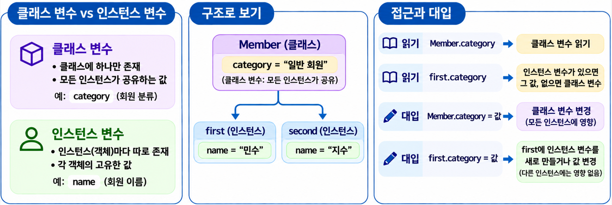
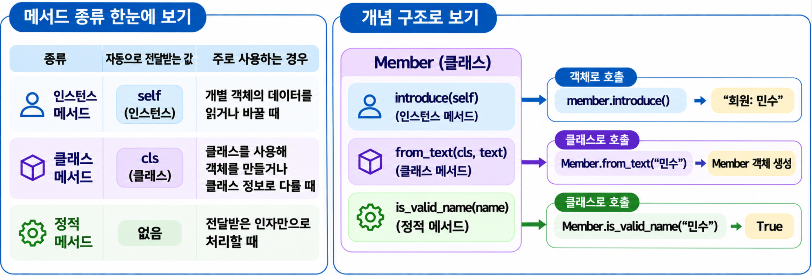
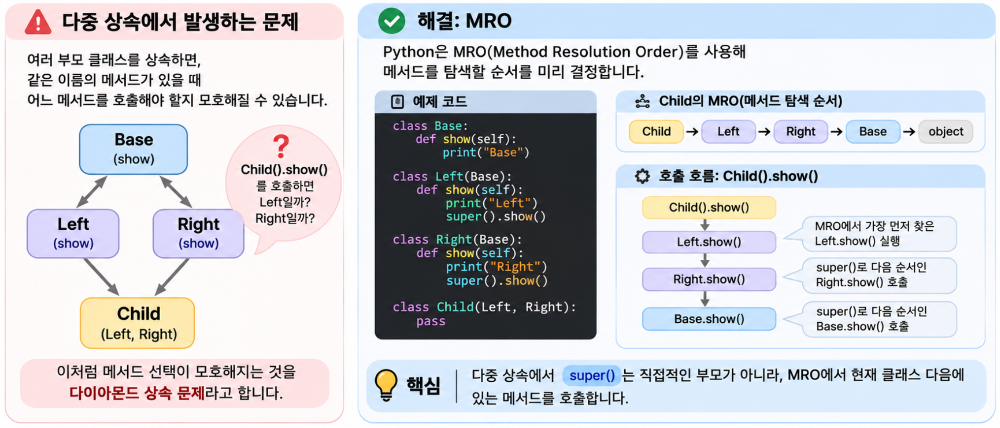
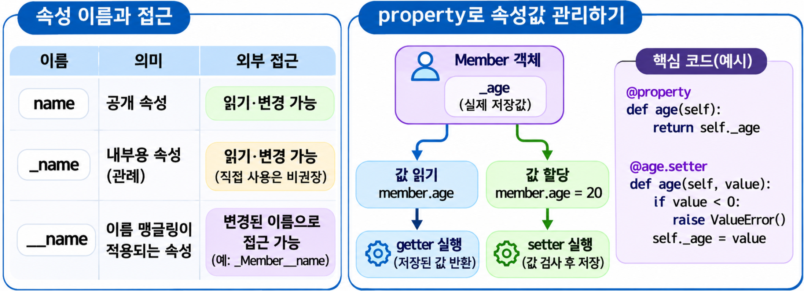

## 1. 클래스와 객체 구조 {#session-01}

### 🟦 class로 회원 정보와 기능 묶기

클래스는 관련된 데이터와 기능을 하나로 묶습니다. 아래의 `Member` 클래스는 회원의 이름과 인사하는 기능을 함께 정의합니다.  
`Member("민수")`를 실행하면 이름이 `"민수"`인 회원 객체가 만들어집니다.  
클래스로 만든 객체를 그 클래스의 **인스턴스(Instance)**라고 합니다.  

```python
class Member:
    def __init__(self, name):
        self.name = name

    def introduce(self):
        return f"안녕하세요, {self.name}입니다."

member = Member("민수")
print(member.name)         # 민수
print(member.introduce())  # 안녕하세요, 민수입니다.
```

`member.name`은 회원의 이름을 읽고, `member.introduce()`는 인사말을 반환합니다. 여기서 `name`은 **속성(Attribute)**이고, 클래스에 정의한 함수인 `introduce()`는 **메서드(Method)**입니다.  

### 🟦 self와 __init__의 역할

`self`는 메서드가 사용하는 객체 자신을 가리킵니다. `member.introduce()`를 호출하면 Python이 `member`를 `self`로 전달하므로, 메서드 안의 `self.name`은 `member.name`을 뜻합니다.  

`__init__`은 객체가 만들어진 뒤 처음 사용할 값을 설정하는 메서드입니다.  
`Member("민수")`를 실행하면 새 객체와 `"민수"`가 각각 `self`, `name`으로 전달됩니다.  

`self`는 Python이 특별히 정해 놓은 예약어는 아니지만, 관례에 따라 이 이름을 사용합니다. `__init__`에는 `return 값`을 쓰지 않습니다.  

### 🟦 클래스 변수와 인스턴스 변수

회원의 이름처럼 객체마다 따로 관리할 값은 **인스턴스 변수**에 저장합니다.  
회원 분류처럼 여러 객체가 함께 사용할 값은 **클래스 변수**로 정의할 수 있습니다.  
아래 예제에서 `self.name`은 인스턴스 변수이고, 메서드 밖에 정의한 `category`는 클래스 변수입니다.  


클래스 변수는 **클래스 이름으로도, 인스턴스 이름으로도 읽을 수 있습니다.**  
이때 단순히 읽는 것만으로 인스턴스 변수가 생기지는 않습니다.  
아래 예제처럼 일반적인 속성을 사용할 때는 **읽기와 대입을 구분**해야 합니다.  

- `Member.category`: 클래스 변수를 읽습니다.
- `first.category`: 같은 이름의 인스턴스 변수가 있으면 그 값을 읽고, 없으면 클래스 변수를 읽습니다.
- `Member.category = 값`: 클래스 변수의 값을 바꿉니다.
- `first.category = 값`: `first`에 같은 이름의 인스턴스 변수를 만들거나, 이미 있으면 그 값을 바꿉니다.

```python
class Member:
    category = "일반 회원"  # 클래스 변수입니다.

    def __init__(self, name):
        self.name = name  # 인스턴스 변수입니다.

first = Member("민수")
second = Member("지수")

print(first.name, second.name)          # 민수 지수
print(Member.category)                 # 일반 회원: 클래스 이름으로 읽습니다.
print(first.category, second.category)  # 일반 회원 일반 회원

Member.category = "등록 회원"
print(first.category, second.category)  # 등록 회원 등록 회원

# first에 같은 이름의 인스턴스 변수를 새로 만듭니다.
first.category = "우수 회원"
print(first.category, second.category)  # 우수 회원 등록 회원
print(Member.category)                 # 등록 회원: 클래스 변수는 그대로입니다.
```

### 🟦 인스턴스별 리스트는 __init__에서 만들기

회원 목록을 클래스 변수로 만들면 모든 모임이 같은 리스트를 사용하게 됩니다. 모임마다 별도의 회원 목록이 필요하므로, 아래처럼 `__init__`에서 `self.members = []`로 만듭니다.  

```python
class StudyGroup:
    def __init__(self, name):
        self.name = name
        self.members = []  # 인스턴스를 만들 때마다 새 리스트를 만듭니다.

python_group = StudyGroup("Python")
git_group = StudyGroup("Git")
python_group.members.append("민수")

print(python_group.members)  # ['민수']
print(git_group.members)     # []
```

## 2. 메서드와 상속 {#session-02}

### 🟦 인스턴스·클래스·정적 메서드



| 종류 | 자동으로 전달받는 값 | 주로 사용하는 경우 |
|---|---|---|
| 인스턴스 메서드 | 인스턴스인 `self` | 개별 객체의 데이터를 읽거나 바꿀 때 |
| 클래스 메서드 | 클래스인 `cls` | 클래스를 사용해 객체를 만들거나 클래스 정보를 다룰 때 |
| 정적 메서드 | 없음 | 전달받은 인자만으로 처리할 때 |

```python
class Member:
    # 객체를 생성할 때 전달받은 이름을 인스턴스 속성에 저장합니다.
    def __init__(self, name):
        self.name = name
    # 인스턴스 메서드: self를 통해 해당 회원의 이름을 사용합니다
    def introduce(self):
        return f"회원: {self.name}"
    # 클래스 메서드: 문자열을 받아 회원 객체를 만드는 대체 생성자입니다.
    @classmethod
    def from_text(cls, text):
        # cls는 이 메서드를 호출한 클래스입니다.
        return cls(text.strip())
    # 정적 메서드: 인스턴스(self)나 클래스(cls) 없이 전달받은 값만 검사합니다.
    @staticmethod
    def is_valid_name(name):
        return bool(name.strip())

# 클래스 메서드로 공백을 제거한 이름이 "민수"인 Member 객체를 생성합니다.
member = Member.from_text("  민수  ")
print(member.introduce())            # 회원: 민수
print(Member.is_valid_name("민수"))  # True
print(Member.is_valid_name("  "))    # False
```

**인스턴스 메서드**는 `self`로 전달받은 인스턴스의 정보를 사용합니다. `member.introduce()`는 `self.name`에 저장된 회원 이름으로 소개 문구를 만듭니다.  

**클래스 메서드**는 `@classmethod`를 붙이며, 호출한 클래스를 `cls`로 전달받습니다. `Member.from_text("  민수  ")`는 이름 양쪽의 공백을 제거하고 새 회원 객체를 만듭니다. 자식 클래스에서 호출하면 `cls`도 그 자식 클래스가 됩니다.  

**정적 메서드(static method)**는 `@staticmethod`를 붙이며, `self`나 `cls`를 자동으로 전달받지 않습니다. 클래스와 관련된 간단한 기능을 묶어 둘 때 사용합니다. `Member.is_valid_name("민수")`는 전달받은 이름에 공백 외의 문자가 있는지 검사합니다.  

### 🟦 상속과 메서드 재정의

상속은 기존 클래스의 기능을 물려받아 새 클래스를 만드는 방법입니다. 아래의 `PremiumMember`는 `Member`를 상속받고, 포인트 정보를 추가합니다.  
자식 클래스에서 부모와 같은 이름의 메서드를 새로 작성하는 것을 **메서드 재정의(Overriding)**라고 합니다. 아래에서는 `introduce()`를 재정의해 인사말에 포인트를 덧붙입니다.  

```python
class Member:
    def __init__(self, name):
        self.name = name

    def introduce(self):
        return f"회원: {self.name}"

class PremiumMember(Member):
    def __init__(self, name, points):
        super().__init__(name)
        self.points = points

    def introduce(self):
        # 기존 소개 문구에 포인트 정보를 덧붙입니다.
        return f"{super().introduce()}, 포인트: {self.points}"


member = Member("멤버")
premium = PremiumMember("프리미엄", [1, 2])

print(member.introduce())   # 회원: 멤버
print(premium.introduce())  # 회원: 프리미엄, 포인트: [1, 2]
```

`member`는 일반 회원이므로 `Member`의 `introduce()`가 이름만 출력할 소개 문구를 만듭니다. 
`premium`은 프리미엄 회원이므로 `PremiumMember`에서 재정의한 `introduce()`가 이름과 포인트를 함께 담은 소개 문구를 만듭니다.  

### 🟦 다중 상속의 문제와 MRO


**다중 상속(Multiple Inheritance)**은 여러 부모 클래스의 기능을 물려받는 것입니다. 부모들에 같은 이름의 메서드가 있으면 어느 쪽을 먼저 사용할지 정해야 합니다.  

아래에서 `Child`는 `Left`와 `Right`를 상속하고, 두 클래스는 같은 `Base`를 상속합니다.  
이렇게 공통 부모로 가는 경로가 둘이면 메서드의 실행 순서나 중복 호출이 문제가 될 수 있습니다.  
이를 **다이아몬드 상속 문제(Diamond Problem)**라고 합니다.  

```text
    Base
   /    \
 Left  Right
   \    /
    Child
```

Python은 **MRO(Method Resolution Order, 메서드 탐색 순서)**로 메서드를 찾을 순서를 정합니다.  
이 예제에서는 `Child → Left → Right → Base` 순서로 찾으며, 공통 부모인 `Base`는 탐색 순서에 한 번만 포함됩니다.  

```python
class Base:
    def show(self):
        print("Base")

class Left(Base):
    def show(self):
        print("Left")
        super().show()

class Right(Base):
    def show(self):
        print("Right")
        super().show()

class Child(Left, Right):
    pass

# __mro__로 메서드를 찾는 클래스 순서를 확인합니다.
print([cls.__name__ for cls in Child.__mro__])
# ['Child', 'Left', 'Right', 'Base', 'object']

Child().show()
# Left
# Right
# Base
```

`Child`의 MRO는 `Child → Left → Right → Base → object`입니다.  
`Child().show()`를 호출하면 `Child`에는 `show()`가 없으므로 다음 순서에서 찾은 `Left.show()`가 실행됩니다.  
이어서 `Left`의 `super().show()`가 `Right.show()`를, `Right`의 `super().show()`가 `Base.show()`를 호출합니다.  
따라서 출력은 `Left → Right → Base` 순서입니다.  

**`super()`는 직접적인 부모를 무조건 호출하는 것이 아니라, 객체의 MRO에서 현재 클래스 다음부터 해당 메서드를 찾습니다.** 이 예제에서 `Left`의 부모는 `Base`이지만, `Child` 객체의 MRO에서 `Left` 다음은 `Right`이므로 `Right.show()`가 실행됩니다.  

MRO는 메서드를 찾는 순서이며, 그 순서에 있는 모든 메서드를 자동으로 실행하지는 않습니다. 이 예제처럼 각 메서드가 `super()`로 다음 메서드를 호출해야 실행이 이어집니다. 중간에 `super().show()`가 없으면 그 지점에서 호출이 끝납니다.  

## 3. 캡슐화와 접근 제어 {#session-03}



### 🟦 캡슐화란?

**캡슐화(Encapsulation)**는 데이터인 속성과 이를 처리하는 메서드를 클래스로 묶고, 외부에서 데이터를 다루는 방법을 정하는 것입니다.  

### 🟦 공개 속성과 내부용 속성

속성 이름 앞의 밑줄은 다음과 같은 의미를 가집니다.  

| 이름 | 의미 | 외부 접근 |
|---|---|---|
| `name` | 공개 속성 | 읽기·변경 가능 |
| `_name` | 내부용 속성이라는 관례 | 읽기·변경 가능 |
| `__name` | 이름 맹글링이 적용되는 속성 | 변경된 이름으로 접근 가능 |

**공개 속성 `name`**은 외부에서 자유롭게 읽고 바꿀 수 있습니다.  

```python
class Member:
    def __init__(self, name):
        self.name = name
member = Member("민수")
print(member.name)  # 민수
member.name = "철수"
print(member.name)  # 철수
```

**내부용 속성 `_name`**은 클래스 내부에서 사용하므로 외부에서는 직접 다루지 말자는 약속입니다. 실제 접근을 차단하지는 않습니다.  

```python
class Member:
    def __init__(self, name):
        self._name = name
member = Member("민수")
print(member._name)  # 민수: 접근은 가능하지만 직접 사용하지 않는 것이 좋습니다.
member._name = "철수"
```

### 🟦 __name과 이름 맹글링

**이름 맹글링(Name Mangling)**은 클래스 안의 `__name` 같은 이름을 `_클래스명__name` 형태로 바꾸는 기능입니다.  
__name은 클래스를 정의하는 코드를 Python이 컴파일할 때 _클래스명__name으로 변경됩니다.  
`__init__`처럼 이름 뒤에도 밑줄 두 개가 붙은 이름은 대상이 아닙니다.  

```python
class Member:
    def __init__(self, name):
        self.__name = name  # 내부적으로 self._Member__name이 됩니다.

    def get_name(self):
        return self.__name

member = Member("민수")
print(member.get_name())     # 민수
print(member._Member__name)  # 민수: 바뀐 이름으로는 외부에서도 접근할 수 있습니다.

# print(member.__name)  # AttributeError: 이 이름으로는 찾을 수 없습니다.
```

이름 맹글링의 주된 목적은 **상속 관계에서 속성 이름이 겹치는 일을 줄이는 것**입니다. 완전한 비공개 속성을 만드는 기능은 아닙니다.  

```python
class Parent:
    def __init__(self):
        self.__name = "부모"

class Child(Parent):
    def __init__(self):
        super().__init__()
        self.__name = "자식"

    def show(self):
        # 이름이 다르게 바뀌므로 부모의 값이 덮어써지지 않습니다.
        print(self._Parent__name)
        print(self.__name)

child = Child()
child.show()
# 부모
# 자식
```

### 🟦 property로 속성 값 관리하기

`_name`이나 `__name`만으로는 잘못된 값이 저장되는 것을 막을 수 없습니다.  
**`property`를 사용하면 속성을 읽거나 값을 할당할 때 메서드가 실행되도록 할 수 있습니다.** 아래 예제는 나이를 저장하기 전에 음수인지 검사합니다.  

```python
class Member:
    def __init__(self, name, age):
        self.name = name
        self.age = age  # 처음 저장할 때도 setter의 검사를 거칩니다.

    @property
    def age(self):
        # getter: member.age를 읽을 때 실행됩니다.
        return self._age

    @age.setter
    def age(self, value):
        # setter: member.age에 값을 할당할 때 실행됩니다.
        if value < 0:
            raise ValueError("나이는 0 이상이어야 합니다.")
        self._age = value

member = Member("민수", 20)
print(member.age)  # 20: getter가 저장된 값을 반환합니다.

member.age = 21  # setter가 검사한 뒤 저장합니다.
print(member.age)  # 21

try:
    member.age = -1
except ValueError as error:
    print(error)  # 나이는 0 이상이어야 합니다.
```

**getter는 값을 읽고, setter는 값을 검사한 뒤 저장합니다.** 외부에서는 `age`를 사용하고, 실제 값은 내부 속성인 `_age`에 보관합니다.  

```text
Member("민수", 20)
    → self.age = 20
    → setter가 음수인지 검사
    → self._age = 20으로 저장

member.age
    → getter 실행
    → self._age의 값인 20 반환
```

객체를 만들 때도 `self.age = age`를 사용하므로 같은 검사를 거칩니다. 다만 이 예제는 음수 여부만 검사합니다. 외부에서 `member._age = -1`처럼 직접 저장하면 검사를 우회하므로, 외부에서는 `_age` 대신 `age`를 사용해야 합니다.  

`@property`만 정의하고 setter를 추가하지 않으면 `member.age = 21`처럼 값을 할당할 수 없는 **읽기 전용 속성**이 됩니다.  

### 🟦 property 관련 데코레이터

| 데코레이터 | 역할 | 정의한 메서드가 실행되는 경우 |
|---|---|---|
| `@property` | getter를 정의하고 property 생성 | `member.age` |
| `@age.setter` | setter 지정 | `member.age = 20` |

참고로 삭제 동작을 정하는 `@age.deleter`와 기존 getter를 교체하는 `@age.getter`도 있습니다.  

## 4. 특수 메서드(Dunder Method) {#session-04}

### 🟦 특수 메서드란?

**특수 메서드**는 `__init__`, `__str__`처럼 이름 앞뒤에 밑줄 두 개가 붙는 메서드입니다.  
객체를 만들거나 출력하고, 비교하거나 반복할 때의 동작을 정합니다.  
예를 들어 `__str__`을 정의하면 `print(book)`으로 출력할 내용을 지정할 수 있습니다.  

| 메서드 | 사용하는 경우 | 역할 |
|---|---|---|
| `__new__` | `Member(...)`로 객체 생성 | 새 객체 생성 |
| `__init__` | 객체 생성 후 초기화 | 처음 사용할 속성 설정 |
| `__del__` | 객체 소멸 과정 | 정리 동작 수행, 실행 시점은 보장되지 않음 |
| `__str__` | `str(obj)`, `print(obj)` | 읽기 쉬운 문자열 반환 |
| `__repr__` | `repr(obj)` | 객체 상태를 확인할 문자열 반환 |
| `__eq__` | `obj == other` | 같은 값인지 비교 |
| `__lt__` | `obj < other`, 정렬 | 순서 비교 |
| `__len__` | `len(obj)` | 길이 반환 |
| `__iter__` | `iter(obj)`, `for` | 반복에 사용할 이터레이터 반환 |

### 🟦 객체 생성과 초기화: __new__, __init__

일반적인 객체 생성은 **`__new__`로 객체를 만들고, `__init__`으로 그 안에 값을 채우는 순서**로 진행됩니다.  

```python
class Member:
    def __new__(cls, name):
        print("1. 객체 생성")
        return super().__new__(cls)  # 새 Member 객체를 만들어 반환합니다.

    def __init__(self, name):
        print("2. 속성 초기화")
        self.name = name

member = Member("민수")
print(member.name)
# 1. 객체 생성
# 2. 속성 초기화
# 민수
```

`__new__`의 `cls`는 만들 객체의 클래스이고, `__init__`의 `self`는 이미 만들어진 객체입니다.  
보통은 기본 `__new__`를 그대로 사용하고 **`__init__`만 작성하면 됩니다.**  
`__init__`은 초기화 메서드이므로 값을 반환하지 않습니다.  
`__new__`가 해당 클래스의 인스턴스를 반환하지 않으면 `__init__`도 실행되지 않습니다.  

### 🟦 객체 출력: __str__, __repr__

**`__str__`은 사용자에게 보여줄 문자열**, **`__repr__`은 개발자가 객체 상태를 확인할 문자열**을 만듭니다.  

```python
class Book:
    def __init__(self, title, pages):
        self.title = title
        self.pages = pages

    def __str__(self):
        return f"{self.title} ({self.pages}쪽)"

    def __repr__(self):
        return f"Book(title={self.title!r}, pages={self.pages!r})"

book = Book("Python 기초", 300)
print(book)        # Python 기초 (300쪽)
print(repr(book))  # Book(title='Python 기초', pages=300)
```

`!r`은 값을 `repr()` 형식으로 표시하므로 문자열인 제목에 따옴표가 붙습니다. `__str__`을 정의하지 않으면 `str()`과 `print()`도 `__repr__`을 사용합니다.  

### 🟦 객체 비교: __eq__, __lt__

**`__eq__`은 같은 값인지, `__lt__`는 어떤 객체를 앞에 둘지** 정합니다.  
아래에서는 제목과 쪽수가 같으면 같은 책으로 보고, 쪽수가 적은 책부터 정렬합니다.  

```python
class Book:
    def __init__(self, title, pages):
        self.title = title
        self.pages = pages

    def __eq__(self, other):
        if type(other) is not type(self):
            return NotImplemented
        return (self.title, self.pages) == (other.title, other.pages)

    def __lt__(self, other):
        if type(other) is not type(self):
            return NotImplemented
        # 쪽수가 같으면 제목 순서로 비교합니다.
        return (self.pages, self.title) < (other.pages, other.title)

first = Book("Python 기초", 300)
second = Book("Git 기초", 150)
copy = Book("Python 기초", 300)

print(first == copy)   # True: 제목과 쪽수가 같습니다.
print(first is copy)   # False: 서로 다른 객체입니다.
print(first < second)  # False: first의 쪽수가 더 많습니다.
print([book.title for book in sorted([first, second])])
# ['Git 기초', 'Python 기초']
```

`==`는 정의한 기준으로 값이 같은지 비교하고, `is`는 같은 객체인지 확인합니다.  
`sorted()`는 `__lt__`의 기준으로 순서를 정합니다.  
`NotImplemented`는 이 메서드로는 상대 객체와 비교할 수 없다는 뜻입니다. 예외가 아니며, Python이 상대 객체의 비교 메서드 등을 시도하도록 합니다.  

`__lt__`만 정의해도 `<=` 같은 다른 비교 연산이 모두 지원되는 것은 아닙니다. 또한 위 `Book`은 `__eq__`를 정의하고 `__hash__`는 정의하지 않았으므로 딕셔너리의 키나 집합의 원소로 사용할 수 없습니다.  

### 🟦 객체의 길이와 반복: __len__, __iter__

**`__len__`은 항목 개수를, `__iter__`는 항목을 하나씩 읽는 방법을 제공**합니다.  
이 메서드가 있으면 직접 만든 객체도 `len()`과 `for`에 사용할 수 있습니다.  

```python
class Bookshelf:
    def __init__(self, titles):
        self._titles = list(titles)

    def __len__(self):
        return len(self._titles)

    def __iter__(self):
        # 반복할 때마다 내부 리스트의 새 이터레이터를 반환합니다.
        return iter(self._titles)

shelf = Bookshelf(["Python 기초", "Git 기초"])
print(len(shelf))  # 2

for title in shelf:
    print(title)
# Python 기초
# Git 기초
```

`len(shelf)`는 `__len__`이 반환한 개수를 사용하며, 반환값은 0 이상의 정수여야 합니다. `for`는 `__iter__`가 반환한 이터레이터에서 제목을 하나씩 꺼냅니다.  

특수 메서드는 보통 직접 호출하기보다 **`print()`, `len()`, `==`, `for`처럼 익숙한 문법으로 객체를 사용하기 위해 정의합니다.**  
