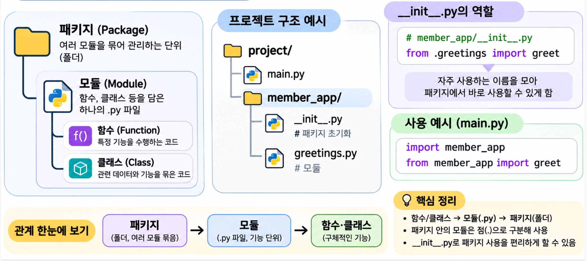
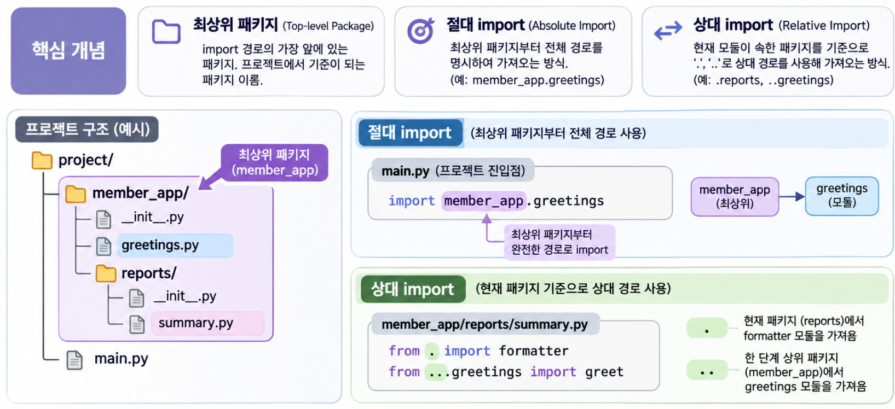
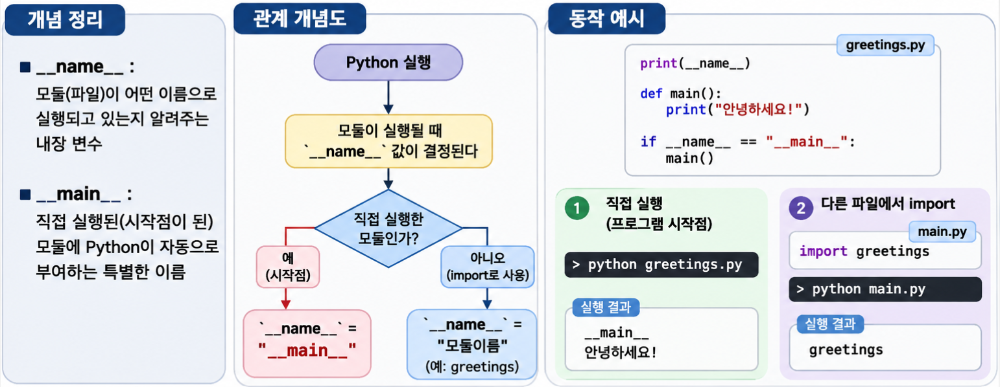
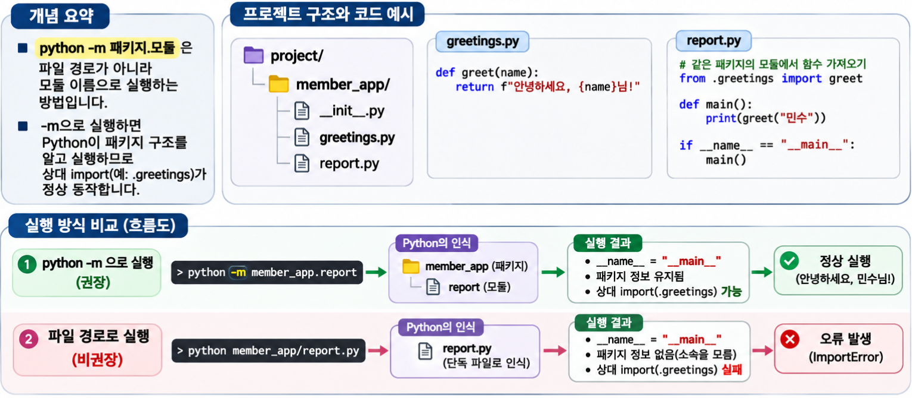

## 1. 모듈과 import {#session-01}

### 🟦 파일로 코드 나누기

**모듈(Module)**은 Python 코드를 구성하는 단위로, 일반적으로 하나의 .py 파일에 해당합니다.  
모듈에는 함수, 클래스, 변수 등을 정의할 수 있으며, 다른 Python 파일에서 import하여 재사용할 수 있습니다.  
기능별로 모듈을 분리하고, 관련 모듈들을 패키지(Package)로 묶어 관리할 수 있습니다.

다음은 인사말 함수와 그 함수를 사용하는 코드를 나눈 예시입니다.  

```text
project/
├── greetings.py   # 인사말을 만드는 모듈입니다.
└── main.py        # 인사말 함수를 사용하는 파일입니다.
```

```python
# greetings.py
# 다른 파일에서 가져다 쓸 함수를 정의합니다.
def greet(name):
    return f"안녕하세요, {name}님!"
```

```python
# main.py
import greetings  # 확장자 .py 없이 모듈 이름으로 가져옵니다.
print(greetings.greet("민수"))  # 안녕하세요, 민수님!
```

`import greetings`는 현재 파일에서 `greetings`라는 이름으로 모듈을 사용할 수 있게 합니다.  
모듈 안의 함수는 **`모듈.함수()`** 형태로 호출합니다.  

### 🟦 import와 from의 차이

같은 `greet()` 함수도 가져오는 방식에 따라 호출할 때 사용하는 이름이 달라집니다.  
다음 코드는 위 구조의 `main.py`에서 사용할 수 있는 예시입니다.  

```python
# main.py
import greetings
from greetings import greet

# 모듈 이름을 통해 함수에 접근합니다.
print(greetings.greet("민수"))  # 안녕하세요, 민수님!

# 가져온 함수 이름을 바로 사용합니다.
print(greet("지수"))  # 안녕하세요, 지수님!

print(greetings.greet is greet)  # True: 같은 함수 객체를 가리킵니다.
```

`import greetings`는 모듈 이름을, `from greetings import greet`는 함수 이름을 현재 파일에 연결합니다. **`from`도 모듈을 불러오는 과정을 거치며, 함수 코드를 따로 복사하지 않습니다.**  

### 🟦 as로 별칭 붙이기

`as`는 현재 파일에서 사용할 별명을 붙입니다. 원래 모듈이나 함수의 이름이 바뀌는 것은 아닙니다.  

```python
# main.py
import greetings as hello
from greetings import greet as say_hello

print(hello.greet("민수"))  # 안녕하세요, 민수님!
print(say_hello("지수"))   # 안녕하세요, 지수님!
```

| 작성 방법 | 사용하는 이름 |
|---|---|
| `import greetings` | `greetings.greet(...)` |
| `from greetings import greet` | `greet(...)` |
| `import greetings as hello` | `hello.greet(...)` |
| `from greetings import greet as say_hello` | `say_hello(...)` |

`from greetings import *`처럼 여러 이름을 한꺼번에 가져올 수도 있지만, 이름의 출처가 불분명해지고 기존 이름과 겹칠 수 있습니다. 필요한 이름을 명시하는 편이 좋습니다.  

## 2. 패키지와 __init__.py {#session-02}

### 🟦 폴더로 모듈 묶기

**패키지(Package)**는 관련 모듈을 묶어 관리하는 단위입니다. 다음은 회원 관련 기능을 `member_app`이라는 일반 패키지로 묶은 예시입니다.  

```text
project/
├── main.py
└── member_app/
    ├── __init__.py   # 일반 패키지의 초기화 파일입니다.
    └── greetings.py  # 패키지 안의 모듈입니다.
```

```python
# member_app/greetings.py
def greet(name):
    return f"안녕하세요, {name}님!"
```

```python
# main.py
from member_app.greetings import greet

print(greet("민수"))  # 안녕하세요, 민수님!
```

`member_app.greetings`는 **`member_app` 패키지 안의 `greetings` 모듈**을 뜻합니다.  
패키지와 모듈 사이를 점으로 구분합니다. 이 예시의 `__init__.py`는 비어 있어도 됩니다.  

### 🟦 __init__.py의 역할과 활용

`__init__.py`는 **폴더를 일반 Python 패키지로 만들고, 패키지를 처음 import할 때 실행되는 파일**입니다. 별도 설정이 필요 없다면 빈 파일로 두면 됩니다.  

자주 사용하는 함수나 클래스를 여기서 가져오면 **import 경로를 줄일 수 있습니다.**  

```python
# member_app/__init__.py
# 현재 패키지의 greetings 모듈에서 greet를 가져옵니다.
from .greetings import greet
```

```python
# main.py
# __init__.py에서 가져오기 전에는 모듈 경로까지 적습니다.
from member_app.greetings import greet

# 가져온 후에는 패키지 이름만으로 접근할 수 있습니다.
from member_app import greet

print(greet("민수"))  # 안녕하세요, 민수님!
```

버전 같은 간단한 정보도 정의할 수 있습니다.  

```python
# member_app/__init__.py
__version__ = "1.0.0"
```

| 사용 목적 | 작성 방법 |
|---|---|
| 일반 패키지로 구성 | 빈 `__init__.py`를 둡니다. |
| import 경로 단축 | 외부에 제공할 함수·클래스만 가져옵니다. |
| 간단한 초기 설정 | 버전 정보 등을 정의합니다. |
| 복잡한 초기화 | 별도 모듈이나 함수로 분리합니다. |

`member_app.greetings`를 import해도 먼저 `member_app/__init__.py`가 실행됩니다.  
이미 불러온 패키지는 일반적으로 재사용하므로 매번 실행되지는 않습니다.  
`python -m`으로 실행할 모듈을 여기서 미리 import하면 경고가 발생할 수 있으므로 주의합니다.  

Python 3.3부터는 `__init__.py`가 없는 **네임스페이스 패키지**도 지원합니다. 이 글에서는 `__init__.py`를 두는 일반 패키지를 사용합니다.  

## 3. 모듈을 불러오는 경로 {#session-03}

### 🟦 절대 import와 상대 import


**절대 import**는 최상위 패키지나 모듈 이름부터 적습니다.  
**상대 import**는 현재 모듈이 속한 패키지를 기준으로 적습니다.  

> 최상위 패키지는 Python이 모듈을 검색하는 경로(sys.path)에서 가장 먼저 접근하는 패키지를 의미합니다.  

아래 구조에서는 `member_app/reports/summary.py`에서 인사말 함수를 가져온다고 가정합니다. 각 `__init__.py`는 빈 파일입니다.  

```text
project/
└── member_app/
    ├── __init__.py
    ├── greetings.py
    └── reports/
        ├── __init__.py
        ├── formatter.py
        └── summary.py
```

```python
# member_app/greetings.py
def greet(name):
    return f"안녕하세요, {name}님!"
```

```python
# member_app/reports/formatter.py
def add_title(text):
    return f"[회원 안내] {text}"
```

```python
# member_app/reports/summary.py
# 절대 import: 최상위 패키지인 member_app부터 경로를 적습니다.
from member_app.greetings import greet as absolute_greet

# 상대 import: 점 두 개는 한 단계 위 패키지인 member_app을 뜻합니다.
from ..greetings import greet as relative_greet

# 점 하나는 현재 패키지인 member_app.reports를 뜻합니다.
from .formatter import add_title

print(absolute_greet is relative_greet)  # True: 같은 함수를 가져옵니다.
print(add_title(relative_greet("민수")))
# [회원 안내] 안녕하세요, 민수님!
```

상대 import의 점은 파일 시스템의 폴더가 아니라 **패키지 계층**을 기준으로 합니다.  
위 예시에서 `.`은 `member_app.reports`, `..`는 `member_app`입니다.  
최상위 패키지보다 위로 올라가면 오류가 발생합니다.  

이 모듈을 실행하는 명령은 `project` 폴더 기준으로 `python -m member_app.reports.summary`입니다. `-m`이 상대 import를 유지하는 이유는 다음 절에서 설명합니다.  

### 🟦 모듈 검색 경로 확인하기

**`sys.path`는 Python이 모듈을 찾을 때 사용하는 경로 목록**입니다. 다음 코드로 확인할 수 있습니다.  

```python
# main.py
import sys

# 모듈 검색 경로를 하나씩 출력합니다.
for path in sys.path:
    print(path)
```

가상환경에서 실행한 예시입니다.  

```console
((.venv) ) ubuntu:~/blog-workspaces/python-workbook/python-basics$ python main.py
/home/ubuntu/blog-workspaces/python-workbook/python-basics
/home/ubuntu/.pyenv/versions/3.12.16/lib/python312.zip
/home/ubuntu/.pyenv/versions/3.12.16/lib/python3.12
/home/ubuntu/.pyenv/versions/3.12.16/lib/python3.12/lib-dynload
/home/ubuntu/blog-workspaces/python-workbook/.venv/lib/python3.12/site-packages
```

출력된 다섯 경로의 의미는 다음과 같습니다.

| 출력 경로 | 찾는 대상 |
|---|---|
| `.../python-basics` | `main.py`와 같은 폴더에 있는 모듈 |
| `.../python312.zip` | ZIP 파일로 제공되는 표준 라이브러리 |
| `.../lib/python3.12` | 표준 라이브러리 |
| `.../lib-dynload` | C 등으로 작성된 확장 모듈 |
| `.../.venv/lib/python3.12/site-packages` | 가상환경에 설치한 외부 패키지 |

이 예시에서는 **표준 라이브러리는 기본 Python에서, 외부 패키지는 `.venv`에서** 찾습니다.  
경로 목록은 실행 방식과 환경에 따라 달라질 수 있습니다.  
`ModuleNotFoundError`가 발생하면 모듈이 있는 폴더가 `sys.path`에 포함되는지, 올바른 가상환경을 사용 중인지 확인합니다.  

## 4. 실행과 import 구분하기 {#session-04}

### 🟦 __name__과 실행 전용 코드



Python은 실행 방식에 따라 **`__name__` 변수에 모듈의 이름을 자동으로 설정**합니다.  

- 직접 실행하면: `__name__`은 `"__main__"`입니다.  
- 다른 파일에서 import하면: `__name__`은 `"greetings"` 같은 모듈 이름입니다.  

다음 예시에서는 `greetings.py`와 `main.py`가 같은 폴더에 있습니다.  

```python
# greetings.py
# 최상위 코드는 이 모듈을 처음 가져올 때도 실행됩니다.
print(f"모듈 이름: {__name__}")

def greet(name):
    return f"안녕하세요, {name}님!"

def main():
    print(greet("민수"))

# 이 파일이 프로그램의 시작점일 때만 실행합니다.
if __name__ == "__main__":
    main()
```

```python
# main.py
import greetings

print(greetings.greet("지수"))
```

두 파일을 각각 실행하면 다음과 같이 달라집니다. 명령은 두 파일이 있는 폴더를 기준으로 합니다.  

```bash
python greetings.py
# 모듈 이름: __main__
# 안녕하세요, 민수님!

python main.py
# 모듈 이름: greetings
# 안녕하세요, 지수님!
```

`if __name__ == "__main__":` 안의 코드는 **직접 실행할 때만 동작**합니다. 맨 위의 `print()`처럼 조건문 밖에 있는 코드는 처음 import할 때도 실행됩니다.  

`"__main__"`과 `main()`은 서로 다릅니다.

| 구분 | `"__main__"` | `main()` |
|---|---|---|
| 의미 | 직접 실행한 모듈을 나타내는 특별한 문자열 | 개발자가 정의한 일반 함수의 호출 |
| 이름 변경 | 특별한 의미가 있으므로 그대로 사용합니다. | 함수 이름은 원하는 대로 바꿀 수 있습니다. |
| 실행 | 함수 호출이 아닌 문자열 값입니다. | 직접 호출해야 실행됩니다. |

`main`은 실행할 코드를 모아 두는 관례적인 함수 이름입니다.  

### 🟦 python -m으로 패키지 안의 모듈 실행하기


패키지 안의 모듈을 실행할 때는 **`python -m 패키지.모듈`**을 사용합니다.  
Python이 해당 모듈이 속한 패키지를 알 수 있어 상대 import도 동작합니다.  

```text
project/
└── member_app/
    ├── __init__.py   # 이 예시에서는 빈 파일입니다.
    ├── greetings.py
    └── report.py
```

```python
# member_app/greetings.py
def greet(name):
    return f"안녕하세요, {name}님!"
```

```python
# member_app/report.py
# 같은 패키지에 있는 greetings.py에서 함수를 가져옵니다.
from .greetings import greet

def main():
    print(greet("민수"))

if __name__ == "__main__":
    main()
```

`project` 폴더에서 실행합니다. **`-m` 뒤에는 `/`나 `.py` 없이 점으로 연결한 모듈 이름**을 적습니다.  

```bash
# member_app 패키지의 report 모듈을 실행합니다.
python -m member_app.report
# 안녕하세요, 민수님!
```

같은 파일을 경로로 실행하면 이 예시에서는 오류가 발생합니다.  

```bash
python member_app/report.py
# ImportError: attempted relative import with no known parent package
```

파일 경로로 실행하면 Python은 `report.py`가 `member_app`에 속한 모듈이라는 정보를 갖지 못합니다.  
따라서 **`.greetings`의 점이 가리키는 패키지를 알 수 없어** 상대 import가 실패합니다.  

| 사용하는 방식 | `report.py`의 `__name__` | 상대 import |
|---|---|---|
| `import member_app.report` | `"member_app.report"` | 가능 |
| `python -m member_app.report` | `"__main__"` | 가능 |
| `python member_app/report.py` | `"__main__"` | 이 예시에서는 실패 |

두 실행 명령 모두 `__name__`은 `"__main__"`이지만, **`-m`으로 실행해야 패키지 정보가 유지**됩니다.  
