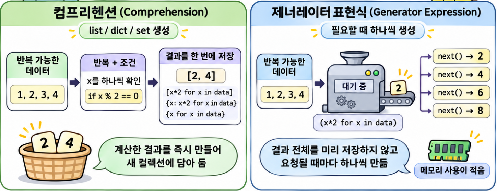

## 1. 컴프리헨션과 제너레이터 표현식 비교 {#session-01}

### 🟦 괄호와 결과 타입으로 구분하기



**컴프리헨션(Comprehension)**은 반복 가능한 객체에서 값을 꺼내 원하는 형태로 바꾸어 새 `list`·`dict`·`set`을 만드는 간결한 문법입니다.  
**제너레이터(Generator)**는 다음 값을 요청할 때마다 실행을 이어 가며 값을 만드는 이터레이터입니다.  
**제너레이터 표현식(Generator Expression)**은 제너레이터 객체를 한 줄로 만드는 문법입니다.  

제너레이터는 표현식으로 만들 수도 있고, `yield`를 사용하는 함수로 만들 수도 있습니다.  

| 종류 | 문법 | 결과 타입 |
|---|---|---|
| List Comprehension | `[x for x in iterable]` | `list` |
| Dictionary Comprehension | `{x: x * 2 for x in iterable}` | `dict` |
| Set Comprehension | `{x for x in iterable}` | `set` |
| Generator Expression | `(x for x in iterable)` | `generator` |

`iterable`은 `list`처럼 반복할 수 있는 대상입니다. `for`로 값을 하나씩 꺼내 **`for` 앞의 표현식으로 각 결과를 계산**합니다.  
Dictionary Comprehension에서는 이 표현식을 `키: 값` 형태로 작성합니다.  

**소괄호 `()` 자체가 제너레이터를 만드는 것은 아닙니다.** `(표현식 for 변수 in 대상)` 형태로 작성해야 제너레이터 표현식이 됩니다.  

### 🟦 같은 데이터로 네 가지 방식 비교하기

`2`가 두 번 들어 있는 `list`로 각 방식의 차이를 확인합니다.  

```python
numbers = [1, 2, 2, 3, 4]

# list: 각 숫자를 두 배로 만들며, 원래 순서와 중복을 유지합니다.
doubled_list = [x * 2 for x in numbers]
print(type(doubled_list)) # <class 'list'>
print(doubled_list)  # [2, 4, 4, 6, 8]

# dict: 원래 숫자를 키로 사용하고, 두 배로 계산한 결과를 저장합니다.
doubled_dict = {x: x * 2 for x in numbers}
print(type(doubled_dict)) # <class 'dict'>
print(doubled_dict)  # {1: 2, 2: 4, 3: 6, 4: 8}

# set: 두 배로 만든 값에서 중복이 제거됩니다.
doubled_set = {x * 2 for x in numbers}
print(type(doubled_set)) # <class 'set'>
print(sorted(doubled_set))  # [2, 4, 6, 8]: 출력 확인을 위해 정렬합니다.

# 제너레이터: 값을 요청할 때마다 다음 숫자를 두 배로 계산합니다.
doubled_generator = (x * 2 for x in numbers)
print(type(doubled_generator))  # <class 'generator'>
print(next(doubled_generator))  # 2
print(next(doubled_generator))  # 4
print(list(doubled_generator))  # [4, 6, 8]: 남은 값을 모두 꺼냅니다.
print(list(doubled_generator))  # []: 이미 끝까지 꺼냈습니다.
```

제너레이터를 만들 때는 `x * 2`를 계산하지 않습니다.  
`next()`를 호출하면 다음 숫자 하나를 계산하고, `list()`를 호출하면 남은 숫자를 모두 계산해 담습니다.  
이를 **지연 평가**라고 합니다.  

| 종류 | 핵심 차이 |
|---|---|
| `list` | 순서와 중복을 유지합니다. |
| `dict` | 키와 값을 저장하며, 키가 중복되면 나중 값이 남습니다. |
| `set` | 중복을 제거하며, 순서는 보장하지 않습니다. |
| `generator` | 값을 요청받을 때 하나씩 계산합니다. |

`dict`는 키가 처음 추가된 순서를 유지합니다. 기존 키의 값을 바꿔도 위치는 바뀌지 않습니다.  

`set`의 출력 순서는 보장되지 않으므로 `sorted()`로 정렬한 결과를 확인했습니다.  
제너레이터의 값도 이 예시에서는 입력 순서대로 나오지만, **한 번 꺼낸 값은 다시 꺼낼 수 없습니다.**  

### 🟦 제너레이터 표현식을 함수에 전달하기

합계를 구하는 것처럼 각 값을 한 번씩만 사용한다면 중간 결과를 `list`에 담을 필요가 없습니다. 제너레이터 표현식을 함수의 유일한 인자로 전달할 때는 표현식을 감싸는 소괄호를 생략할 수 있습니다.  

```python
# 짝수의 제곱을 하나씩 만들어 합산합니다.
total = sum(number ** 2 for number in range(1, 6) if number % 2 == 0)
print(total)  # 20: 2² + 4²
```

## 2. 조건에 맞는 항목으로 결과 만들기 {#session-02}

### 🟦 for 문을 컴프리헨션으로 바꾸기

다음 두 코드는 모두 **짝수만 골라 각각 두 배로 계산한 값**을 새 `list`에 담습니다.  

```python
numbers = [1, 2, 3, 4, 5]

# for 문으로 짝수만 골라 두 배로 계산한 결과를 담습니다.
doubled_evens = []
for number in numbers:
    if number % 2 == 0:
        doubled_evens.append(number * 2)

# 같은 작업을 List Comprehension으로 표현합니다.
doubled_evens = [number * 2 for number in numbers if number % 2 == 0]
print(doubled_evens)  # [4, 8]
print(numbers)  # [1, 2, 3, 4, 5]: 원본은 바뀌지 않습니다.
```

### 🟦 if의 위치에 따라 달라지는 동작

`for` 뒤의 `if`는 **항목을 거르고**, 앞의 `if ... else`는 **넣을 값을 고릅니다.**  

```python
numbers = [1, 2, 3, 4, 5]

# 짝수만 골라 두 배로 만듭니다.
doubled_evens = [number * 2 for number in numbers if number % 2 == 0]
print(doubled_evens)  # [4, 8]

# 모든 항목을 포함하되, 조건에 따라 넣을 값을 바꿉니다.
labels = ["짝수" if number % 2 == 0 else "홀수" for number in numbers]
print(labels)  # ['홀수', '짝수', '홀수', '짝수', '홀수']
```

| 목적 | 작성 위치 | 결과 |
|---|---|---|
| 항목 필터링 | `for` 뒤의 `if 조건` | 조건에 맞는 항목만 포함 |
| 값 선택 | `for` 앞의 `참일_값 if 조건 else 거짓일_값` | 각 항목에 넣을 값을 선택 |

### 🟦 `dict`와 `set` 만들기

`dict`에서도 조건으로 항목을 거를 수 있습니다. `set`은 값을 변환하면서 중복을 없앨 때 유용합니다.  

```python
scores = {"민수": 80, "지수": 95, "준호": 55}

# items()로 이름과 점수를 꺼내 60점 이상인 항목만 새 dict에 담습니다.
passed = {name: score for name, score in scores.items() if score >= 60}
print(passed)  # {'민수': 80, '지수': 95}

words = [" Python ", "Git", "Python", " Git "]

# 각 문자열의 양쪽 공백을 제거한 뒤 set에 담아 중복을 없앱니다.
unique_words = {word.strip() for word in words}
print(sorted(unique_words))  # ['Git', 'Python']
```

조건이 복잡하거나 반복문이 여러 겹으로 중첩된다면 일반 `for` 문이 읽기 쉽습니다. 출력이나 파일 저장이 목적일 때도 `for` 문으로 작성하는 편이 자연스럽습니다.  

## 3. 반복에 유용한 enumerate·zip·map·filter {#session-03}

다음 함수는 반복할 때 번호를 붙이고, 여러 대상의 값을 묶거나, 값을 변환하고 조건에 맞게 고르는 데 유용합니다. 모두 결과를 하나씩 꺼낼 수 있는 **이터레이터**를 반환합니다. 이 동작은 4절에서 설명합니다.  

| 함수 | 역할 | 활용 예 |
|---|---|---|
| `enumerate()` | 순번과 값을 함께 제공 | 목록에 번호 붙이기 |
| `zip()` | 여러 대상에서 꺼낸 값을 묶기 | 이름과 점수 연결하기 |
| `map()` | 각 값을 함수로 변환 | 문자열을 정수로 변환하기 |
| `filter()` | 조건에 맞는 값만 통과 | 합격 점수만 고르기 |

### 🟦 enumerate()와 zip(): 함께 꺼내기

`enumerate()`를 사용하면 별도의 카운터 없이 순번을 붙일 수 있습니다.  
`start`는 표시할 순번의 시작값이며, 원본의 인덱스를 바꾸지는 않습니다.  

```python
names = ["민수", "지수"]
scores = [80, 95]

# 같은 위치에 있는 이름과 점수를 한 쌍으로 묶습니다.
members = zip(names, scores, strict=True)

# 각 쌍에 1부터 번호를 붙입니다.
for number, (name, score) in enumerate(members, start=1):
    print(f"{number}. {name}: {score}점")
# 1. 민수: 80점
# 2. 지수: 95점
```

`zip()`의 기본 동작은 **가장 짧은 대상의 값을 모두 꺼내면 멈추는 것**입니다.  
각 대상의 항목 수가 같아야 한다면 `strict=True`를 지정합니다.  
길이가 다르면 순회 중 `ValueError`가 발생합니다.  

```python
names = ["민수", "지수"]
scores = [80]

# 기본 동작에서는 짝이 없는 '지수'가 결과에 포함되지 않습니다.
print(list(zip(names, scores)))  # [('민수', 80)]

try:
    print(list(zip(names, scores, strict=True)))
except ValueError:
    print("이름과 점수의 개수가 다릅니다.")
```

### 🟦 map()과 filter(): 변환하고 거르기

`map(함수, 반복할_대상)`은 각 값을 함수에 전달하고 그 반환값을 제공합니다.  
`filter(함수, 반복할_대상)`는 각 값을 함수로 검사하고, 검사 결과가 참으로 평가되는 항목만 남깁니다.  

```python
raw_scores = ["80", "95", "55"]

# 문자열을 하나씩 int로 변환합니다. 실제 변환은 값을 꺼낼 때 진행됩니다.
scores = map(int, raw_scores)

# scores에서 점수를 꺼내 60 이상인 값만 남깁니다.
passed = filter(lambda score: score >= 60, scores)

# list()가 결과를 끝까지 꺼내므로 이때 변환과 조건 검사가 진행됩니다.
print(list(passed))  # [80, 95]
print(list(passed))  # []: 이미 끝까지 꺼낸 결과는 다시 나오지 않습니다.
```

이미 정의된 함수로 값을 변환한다면 `map(int, ...)`처럼 간결하게 쓸 수 있습니다. 간단한 조건이나 계산식을 직접 작성할 때는 컴프리헨션을 사용해도 읽기 좋습니다.  

```python
raw_scores = ["80", "95", "55"]
scores = [int(score) for score in raw_scores]
passed = [score for score in scores if score >= 60]
print(passed)  # [80, 95]
```

## 4. Iterable과 Iterator: 값을 꺼내는 원리 {#session-04}

### 🟦 반복할 수 있는 대상과 다음 값을 꺼내는 객체

`list`뿐 아니라 `dict`와 `set`도 `for`로 값을 하나씩 꺼낼 수 있습니다.  
이런 객체를 **이터러블(Iterable, 반복 가능한 객체)**이라고 합니다.  
**이터레이터(Iterator)**는 **다음 값을 반환하고, 어디까지 순회했는지 기억하는 객체**입니다.  
`iter()`로 이터레이터를 얻고, `next()`로 다음 값을 꺼냅니다.  

```python
names = ["민수", "지수"]  # list는 이터러블입니다.
iterator = iter(names)     # list를 순회할 이터레이터를 만듭니다.

print(next(iterator))  # 민수
print(next(iterator))  # 지수

# 더 꺼낼 값이 없으면 기본값을 반환합니다.
print(next(iterator, "끝"))  # 끝
print(names)  # ['민수', '지수']: 원본의 항목이 삭제되는 것은 아닙니다.
```

더 꺼낼 값이 없을 때 `next(iterator, "끝")`는 `"끝"`을 반환합니다.  
기본값 없이 `next(iterator)`를 호출하면 **`StopIteration` 예외**가 발생합니다.  
`for` 문은 이 신호를 받아 반복을 끝냅니다.  

`for name in names:`도 내부적으로 다음 과정을 거칩니다.  

1. `iter(names)`로 이터레이터를 얻습니다.  
2. 다음 값을 꺼내 변수 `name`에 대입하고 반복문 본문을 실행합니다.  
3. 더 꺼낼 값이 없어 `StopIteration`을 만나면 종료합니다.  

### 🟦 다시 순회할 수 있는지 구분하기

`list` 같은 이터러블에 `iter()`를 호출하면 매번 새 이터레이터가 생성됩니다.  
**각 이터레이터는 순회한 위치를 따로 기억하므로 서로의 진행 상태에 영향을 주지 않습니다.**  

- `iter(numbers)`: `list`인 `numbers`를 순회할 새 이터레이터를 만듭니다.  
- `iter(first)`: 이미 이터레이터인 `first` 자신을 반환합니다.  

```python
numbers = [10, 20, 30]
first = iter(numbers)
second = iter(numbers)  # first와는 별개의 이터레이터입니다.

print(first is second)  # False
print(next(first))   # 10
print(next(first))   # 20
print(next(second))  # 10: first의 진행 위치에 영향을 받지 않습니다.
print(iter(first) is first)  # True

# first의 남은 값만 꺼냅니다.
print(list(first))  # [30]
print(list(first))  # []

# list에서는 새 이터레이터로 다시 처음부터 꺼낼 수 있습니다.
print(list(numbers))  # [10, 20, 30]
```

즉, `iter(numbers)`로 만든 이터레이터들은 독립적으로 동작합니다.  
반면 **`iter(first)`는 새 이터레이터를 만들거나 진행 위치를 처음으로 되돌리지 않습니다.**  

| 구분 | `list` 같은 이터러블 | 이터레이터 |
|---|---|---|
| 역할 | 순회할 대상 | 다음 값을 반환하며 진행 상태를 기억 |
| `iter()` 호출 | 새 이터레이터를 제공 | 자기 자신을 반환 |
| 끝까지 순회한 뒤 | 새 이터레이터로 다시 순회 가능 | 소진되어 다음 값이 없음 |

## 5. 제너레이터 함수: yield로 값 만들기 {#session-05}

### 🟦 yield가 있는 함수를 호출하면?

**제너레이터는 값을 하나씩 생성하는 객체이고, `yield`는 제너레이터 함수를 만드는 문법입니다.** `def`로 정의한 함수 본문에 `yield`를 쓰면 제너레이터 함수가 됩니다.  
제너레이터 함수를 호출하면 **함수 본문을 실행하지 않고 제너레이터 객체를 반환**합니다.  
`next()`나 `for`로 값을 요청할 때 함수 본문이 실행됩니다.  

```python
# 요청받을 때마다 다음 번호를 하나씩 만듭니다.
def generate_numbers(limit):
    for number in range(1, limit + 1):
        print(f"생성: {number}")
        yield number

numbers = generate_numbers(2)  # 아직 함수 본문은 실행되지 않습니다.
print("제너레이터 준비")
print(next(numbers))          # 첫 yield까지 실행합니다.
print(next(numbers))          # 멈춘 지점부터 다음 yield까지 실행합니다.
print(next(numbers, "끝"))    # 함수가 끝나면 기본값을 받습니다.
```

출력 결과:

```text
제너레이터 준비
생성: 1
1
생성: 2
2
끝
```

출력에서 `제너레이터 준비`가 먼저 나오는 이유는 함수 호출 시점에는 아직 본문이 실행되지 않았기 때문입니다.  
`yield`를 만나면 값을 전달하고 잠시 멈춥니다. 다음 `next()` 호출에서는 **`yield` 바로 다음부터 실행을 이어 갑니다.** 이때 지역변수의 값도 유지됩니다.  

| 문법 | 값을 전달한 뒤의 동작 |
|---|---|
| 일반 함수의 `return 값` | 함수를 끝냅니다. |
| 제너레이터의 `yield 값` | 잠시 멈추고 다음 요청을 기다립니다. |

제너레이터도 함수 끝에 도달하거나 `return`을 만나면 종료됩니다.  

### 🟦 표현식과 함수 중 어떤 것을 사용할까요?

두 방식 모두 제너레이터 객체를 만듭니다. **값을 만드는 과정이 얼마나 복잡한지**에 따라 선택하면 됩니다.  

| 생성 방법 | 작성 형태 | 적합한 상황 |
|---|---|---|
| 제너레이터 표현식 | `(표현식 for 변수 in 대상)` | 간단한 변환이나 필터링 |
| 제너레이터 함수 | `def`로 정의하고 함수 안에 `yield` 사용 | 여러 문장, 조건 분기, 중간 처리가 필요한 작업 |

위의 `generate_numbers()`는 값을 전달하기 전에 로그를 출력합니다. 이처럼 생성 과정에 여러 작업이 필요하면 함수로 작성하는 편이 읽기 쉽습니다.  

### 🟦 지연 평가: 필요한 시점에 계산하기

**지연 평가(Lazy Evaluation)**는 결과가 필요해질 때 계산하는 방식입니다. 제너레이터는 결과 전체를 미리 계산해 저장하지 않으므로, 많은 값을 차례로 처리하거나 일부 값만 확인할 때 유용합니다.  

```python
# yield로 제곱한 값을 하나씩 전달합니다.
def generate_squares(limit):
    for number in range(1, limit + 1):
        yield number ** 2

# 함수 호출만으로 모든 값을 계산하지는 않습니다.
squares = generate_squares(1_000_000)

for square in squares:
    print(square)
    if square >= 9:
        break
# 1
# 4
# 9
```

이 반복에서는 `1`, `4`, `9`까지만 계산합니다.  
지연 평가는 계산을 없애는 것이 아니라 **필요한 시점까지 미루는 것**입니다. `list(squares)`로 변환하면 남은 값을 모두 계산해 `list`에 저장하므로 그만큼 메모리를 사용합니다.  
다만 원본이 이미 큰 `list`에 담겨 있다면, 제너레이터를 사용해도 원본 `list`가 차지하는 메모리는 그대로입니다.  

| 필요한 동작 | 선택 |
|---|---|
| 결과를 저장하고 여러 번 순회 | List Comprehension |
| 키와 값으로 결과 구성 | Dictionary Comprehension |
| 중복 없는 결과 구성 | Set Comprehension |
| 각 결과를 한 번씩만 처리 | 제너레이터 표현식 |
| 여러 단계의 작업을 거쳐 값을 생성 | `yield`를 사용하는 제너레이터 함수 |

같은 결과를 다시 얻으려면 **새 제너레이터를 만들어야 합니다.**  
여러 번 순회하거나 인덱스로 조회해야 한다면 처음부터 `list`에 담는 편이 적합합니다.  
