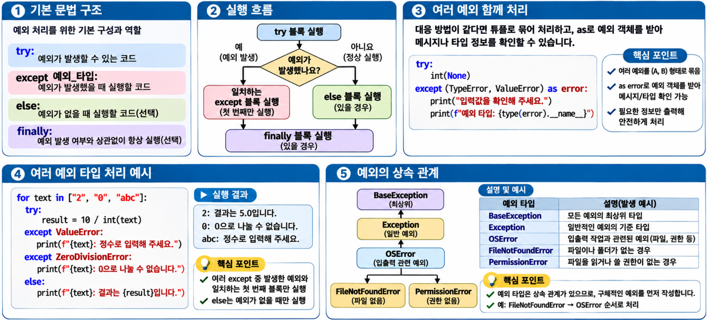
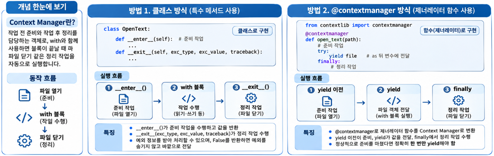

## 1. 예외 잡기: try-except와 예외 종류별 처리 {#session-01}

### 🟦 예외가 발생하면 실행 흐름이 바뀝니다

**예외(Exception)**는 실행 중 문제가 발생했음을 알리는 객체입니다.  
예외가 발생하면 현재 작업을 중단하고, 해당 예외를 처리할 `except`를 찾습니다.  
처리할 곳이 없으면 예외가 호출한 쪽으로 전달되며, 끝까지 처리되지 않으면 프로그램이 종료됩니다.  

```python
try:
    number = int("abc")  # 정수로 변환할 수 없어 ValueError가 발생합니다.
    print("변환 완료")   # 예외가 발생했으므로 이 줄은 실행하지 않습니다.
except ValueError:
    print("정수로 바꿀 수 없는 값입니다.")

print("다음 작업을 진행합니다.")
# 정수로 바꿀 수 없는 값입니다.
# 다음 작업을 진행합니다.
```

- `try`: 예외가 발생할 수 있는 코드를 작성합니다.  
- `except 예외_타입`: 해당 예외가 발생했을 때 실행할 코드를 작성합니다.  

예외 처리가 끝나면 `try` 안의 실패한 줄로 돌아가지 않고, 전체 `try-except` 문 다음으로 넘어갑니다.  

### 🟦 예외 클래스의 상속 구조

Python의 내장 예외 클래스는 상속 관계로 연결되어 있습니다. 주요 예외만 추리면 다음과 같습니다.

```text
BaseException
├── SystemExit
├── KeyboardInterrupt
├── GeneratorExit
└── Exception
    ├── ValueError
    ├── TypeError
    ├── LookupError
    │   ├── IndexError
    │   └── KeyError
    ├── ArithmeticError
    │   └── ZeroDivisionError
    └── OSError
        ├── FileNotFoundError
        └── PermissionError
```

`BaseException`은 예외 클래스 계층의 최상위 클래스이며, `Exception`은 일반적인 프로그램 오류를 나타내는 예외들의 기본 클래스입니다. 대부분의 사용자 정의 예외도 `Exception`을 상속하여 만듭니다.

`SystemExit`, `KeyboardInterrupt`, `GeneratorExit`는 `Exception`의 하위 클래스가 아닙니다. 따라서 `except Exception:`으로는 잡히지 않습니다. 프로그램 종료나 사용자 중단 같은 신호를 일반적인 오류 처리와 구분하기 위한 구조입니다.

### 🟦 예외 종류에 따라 다르게 처리하기

예외 타입을 구분하면 원인에 맞는 안내나 복구 작업을 할 수 있습니다.  

| 예외 타입 | 발생하는 상황의 예 |
|---|---|
| `ValueError` | `int("abc")`처럼 타입은 맞지만 값이 부적절한 경우 |
| `TypeError` | `"3" + 1`처럼 지원하지 않는 타입끼리 연산하는 경우 |
| `ZeroDivisionError` | 숫자를 0으로 나누는 경우 |
| `IndexError` | `list` 등에서 범위를 벗어난 인덱스로 조회하는 경우 |
| `KeyError` | `dict`에서 없는 키를 `data[key]`로 조회하는 경우 |
| `FileNotFoundError` | 읽으려는 파일이나 상위 폴더가 없는 경우 |
| `PermissionError` | 파일을 읽거나 쓸 권한이 없는 경우 |

```python
# 입력을 숫자로 바꾼 뒤 나눗셈을 수행합니다.
for text in ["2", "0", "abc"]:
    try:
        result = 10 / int(text)
    except ValueError:
        print(f"{text}: 정수로 입력해 주세요.")
    except ZeroDivisionError:
        print(f"{text}: 0으로 나눌 수 없습니다.")
    else:
        print(f"{text}: 결과는 {result}입니다.")
# 2: 결과는 5.0입니다.
# 0: 0으로 나눌 수 없습니다.
# abc: 정수로 입력해 주세요.
```

`else`는 `try`가 예외 없이 끝났을 때 실행됩니다.  
여러 `except` 중에서는 **발생한 예외의 클래스 또는 그 상위 클래스와 일치하는 첫 번째 블록만** 실행됩니다.  

### 🟦 여러 예외를 함께 처리하기

대응 방법이 같다면 여러 예외 타입을 `tuple`로 묶을 수 있습니다.  
`as error`를 붙이면 발생한 예외 객체를 받아 메시지 등을 확인할 수 있습니다.  

```python
try:
    int(None)
except (TypeError, ValueError) as error:
    print(f"입력값을 확인해 주세요. ({type(error).__name__})")
# 입력값을 확인해 주세요. (TypeError)
```

### 🟦 상속 관계를 고려해 구체적인 예외부터 처리하기

예외 타입에도 상속 관계가 있습니다.  
예를 들어 `FileNotFoundError`는 `OSError`의 하위 타입이므로 **구체적인 예외를 먼저** 적습니다.  

```python
# 실행 흐름을 확인하기 위해 예외를 직접 발생시킵니다.
try:
    raise FileNotFoundError("설정 파일을 찾을 수 없습니다.")
except FileNotFoundError as error:
    print(error)
except OSError:
    print("그 밖의 파일 관련 오류입니다.")
# 설정 파일을 찾을 수 없습니다.
```

순서를 반대로 쓰면 `OSError`가 먼저 잡으므로 `FileNotFoundError` 전용 처리는 실행되지 않습니다.  
예외 타입을 생략한 `except:`는 `KeyboardInterrupt`나 `SystemExit`까지 잡습니다.  
예상하는 예외를 명시하고, `except Exception:`처럼 넓게 잡더라도 오류를 숨긴 채 넘어가지 않도록 처리 목적을 분명히 합니다.  

### 🟦 예외 객체의 타입과 메시지 확인하기

`except ValueError as error`에서 `error`는 **실제로 발생한 `ValueError` 인스턴스를 참조하는 변수**입니다. 예외 객체에는 메시지뿐 아니라 오류를 확인하고 원인을 추적하는 데 필요한 정보도 담겨 있습니다.

```python
try:
    int("abc")  # 정수로 변환할 수 없어 ValueError가 발생합니다.
except ValueError as error:
    print(type(error).__name__)
    print(error)
    print(error.args)
```

출력 예시:

```text
ValueError
invalid literal for int() with base 10: 'abc'
("invalid literal for int() with base 10: 'abc'",)
```

- `type(error).__name__`: 예외 객체의 클래스 이름인 `ValueError`를 가져옵니다.
- `print(error)`: 예외 객체를 문자열로 바꾸어 오류 메시지를 출력합니다.
- `error.args`: 예외 객체에 저장된 인자들을 튜플로 확인합니다. 이 예제에서는 메시지 하나가 들어 있습니다.

`error.args` 출력 끝의 쉼표는 **항목이 하나인 튜플**임을 나타냅니다. 예외에 따라 인자가 여러 개이거나 없을 수도 있습니다. 오류 메시지의 문구는 Python 버전이나 실행 환경에 따라 달라질 수 있으므로, 예외 종류는 메시지 문자열보다 예외 클래스를 기준으로 구분합니다.

### 🟦 예외 객체의 주요 속성

| 속성 | 설명 |
|---|---|
| `args` | 예외 객체를 생성할 때 전달한 인자들을 담은 튜플 |
| `__traceback__` | 예외가 발생하고 전달된 실행 경로를 담은 traceback 객체. 없으면 `None` |
| `__cause__` | `raise ... from`으로 명시한 원인 예외. 없으면 `None` |
| `__context__` | 다른 예외를 처리하던 중 새 예외가 발생했을 때 자동으로 연결되는 이전 예외. 없으면 `None` |

`args`는 오류 내용을 확인할 때, 나머지 속성은 오류가 어디서 발생했고 어떤 예외에서 이어졌는지 추적할 때 사용합니다. `__cause__`와 `__context__`가 연결되는 예외 체이닝은 목차 3에서 살펴봅니다.

## 2. 예외 처리 흐름: else, finally와 실행 순서 {#session-02}

### 🟦 성공한 경우와 정리 작업을 구분하기

| 블록 | 실행 조건 | 주로 작성하는 내용 |
|---|---|---|
| `try` | 먼저 실행 | 실패할 수 있는 작업 |
| `except` | 일치하는 예외가 발생한 경우 | 오류 안내나 복구 |
| `else` | `try`가 예외 없이 정상적으로 끝난 경우 | 성공 후 이어서 할 작업 |
| `finally` | `try` 문을 빠져나가기 전 | 자원 해제 등 정리 작업 |

`else`는 선택 사항이며, `except`와 함께 사용합니다. `finally`는 `except` 없이 `try-finally` 형태로도 사용할 수 있습니다.  

```python
# 같은 코드에서 성공과 실패의 실행 순서를 비교합니다.
for text in ["10", "abc"]:
    print(f"입력: {text}")
    try:
        print("try")
        number = int(text)
    except ValueError:
        print("except: 변환 실패")
    else:
        print(f"else: 변환 결과 {number}")
    finally:
        print("finally: 정리")
    print("다음 코드")
```

출력 결과:

```text
입력: 10
try
else: 변환 결과 10
finally: 정리
다음 코드
입력: abc
try
except: 변환 실패
finally: 정리
다음 코드
```

실행 순서는 다음과 같습니다.

- 성공: `try` → `else` → `finally` → 다음 코드
- 처리한 예외: `try` → 일치하는 `except` → `finally` → 다음 코드
- 처리하지 못한 예외: `try` → `finally` → 예외가 호출한 쪽으로 전달

`else` 안에서 발생한 예외는 같은 `try`의 `except`가 잡지 않습니다. **예외를 잡아야 하는 코드만 `try`에 넣으면** 관계없는 오류까지 같은 원인으로 처리하는 실수를 줄일 수 있습니다.  

### 🟦 return이 있어도 finally가 먼저 실행됩니다

```python
# 반환값이 정해져도 함수를 빠져나가기 전에 finally를 실행합니다.
def get_number():
    try:
        return 10
    finally:
        print("반환 전 정리")

print(get_number())
# 반환 전 정리
# 10
```

`finally`는 예외가 발생하거나 `return`, `break`, `continue`로 블록을 빠져나갈 때도 실행됩니다. 다만 프로세스가 강제로 종료되는 상황까지 정리를 보장하는 것은 아닙니다.  
`finally` 안의 `return`은 원래 반환값을 덮어쓰거나 전달 중인 예외를 숨길 수 있으므로, 정리 작업만 작성하는 편이 좋습니다.  

## 3. 예외 발생시키기: raise와 사용자 정의 예외 {#session-03}

### 🟦 raise로 잘못된 입력 알리기

`raise`는 예외를 직접 발생시키는 문법입니다. 함수가 작업을 수행할 수 없다면, 임의의 결과를 반환하는 대신 예외로 이유를 전달할 수 있습니다.  

```python
# 음수 금액은 처리하지 않고 호출한 쪽에 이유를 알립니다.
def calculate_total(price, quantity):
    if price < 0:
        raise ValueError("가격은 0 이상이어야 합니다.")
    if quantity <= 0:
        raise ValueError("수량은 1 이상이어야 합니다.")
    return price * quantity

try:
    print(calculate_total(1000, 0))
except ValueError as error:
    print(error)
# 수량은 1 이상이어야 합니다.
```

함수는 예외를 발생시키고, 호출한 쪽은 상황에 맞게 처리합니다. 이렇게 나누면 같은 함수를 CLI, 웹 서비스 등 여러 환경에서 재사용하기 쉽습니다.  

### 🟦 잡은 예외를 다시 전달하기

`except` 안에서 인자 없이 `raise`를 쓰면 현재 처리 중인 예외를 다시 발생시킵니다. 로그는 남기되 최종 처리는 호출한 쪽에 맡길 때 사용합니다.  

```python
def parse_count(text):
    try:
        return int(text)
    except ValueError:
        print("parse_count: 변환 실패")
        raise  # 원래 예외를 호출한 쪽으로 다시 전달합니다.

try:
    parse_count("abc")
except ValueError:
    print("호출한 쪽에서 입력을 다시 요청합니다.")
# parse_count: 변환 실패
# 호출한 쪽에서 입력을 다시 요청합니다.
```

### 🟦 사용자 정의 예외로 업무 규칙 표현하기

Python이 제공하는 예외만으로 상황을 구분하기 어렵다면 **`Exception`을 상속한 클래스**를 만듭니다.  

```python
# 잔액 부족이라는 상황을 별도의 예외 타입으로 구분합니다.
class InsufficientBalanceError(Exception):
    pass

def withdraw(balance, amount):
    if amount <= 0:
        raise ValueError("출금액은 0보다 커야 합니다.")
    if amount > balance:
        raise InsufficientBalanceError("잔액이 부족합니다.")
    return balance - amount

try:
    withdraw(1000, 2000)
except InsufficientBalanceError as error:
    print(f"출금 실패: {error}")
except ValueError as error:
    print(f"입력 오류: {error}")
# 출금 실패: 잔액이 부족합니다.
```

단순히 타입을 구분하려면 빈 클래스만으로 충분합니다. 예외 클래스 이름은 보통 `Error`로 끝나도록 작성합니다.  

### 🟦 raise ... from으로 원인 연결하기

내부 오류를 호출한 쪽이 이해하기 쉬운 예외로 바꾸면서, 원래 원인도 남길 수 있습니다.  

```python
class InvalidConfigError(Exception):
    pass

def parse_port(text):
    try:
        return int(text)
    except ValueError as error:
        # 설정 오류로 바꾸되, 변환에 실패한 원래 예외를 원인으로 연결합니다.
        raise InvalidConfigError("포트 설정은 정수여야 합니다.") from error

try:
    parse_port("abc")
except InvalidConfigError as error:
    print(error)
    print(f"원인: {type(error.__cause__).__name__}")
# 포트 설정은 정수여야 합니다.
# 원인: ValueError
```

## 4. with와 Context Manager: 파일과 자원 관리 {#session-04}

### 🟦 Context Manager는 무엇일까요?


**Context Manager는 작업 전 준비와 작업 후 정리를 담당하는 객체**입니다. `with`와 함께 사용하면 블록이 끝날 때 파일 닫기 같은 정리 작업을 자동으로 실행합니다.  

```text
파일 열기 → with 블록에서 읽기·쓰기 → 파일 닫기
```

다음은 파일에 내용을 쓴 뒤 읽는 예제입니다. `"w"`는 파일 생성·덮어쓰기, `"r"`은 읽기 모드입니다.  

```python
# 블록이 끝나면 파일이 자동으로 닫힙니다.
with open("python-basics-09-example.txt", "w", encoding="utf-8") as file:
    file.write("Python 예외 처리\n")

with open("python-basics-09-example.txt", "r", encoding="utf-8") as file:
    print(file.read().strip())
    print(file.closed)  # False: 블록 안에서는 열려 있습니다.

print(file.closed)  # True: 블록을 나왔으므로 닫혀 있습니다.
```

블록 안에서 예외가 발생하거나 `return`으로 함수를 끝내도 정리 작업은 실행됩니다. 단, 준비 단계에서 실패해 블록에 들어가지 못했다면 종료 처리는 실행되지 않습니다.  

Context Manager를 직접 만드는 방법은 두 가지입니다.  
**클래스의 특수 메서드를 사용하거나, 제너레이터 함수에 `@contextmanager`를 적용**합니다.  

### 🟦 방법 1: __enter__()와 __exit__()로 클래스 구현하기

- `__enter__()`: 준비 작업을 수행하고, `as` 뒤 변수에 넣을 값을 반환합니다.  
- `__exit__()`: 블록이 끝날 때 정리 작업을 수행합니다. 예외가 발생했다면 예외 정보도 받습니다.  

```python
class OpenText:
    def __init__(self, path):
        self.path = path

    def __enter__(self):
        self.file = open(self.path, "w", encoding="utf-8")
        print("파일 열기")
        return self.file  # 반환한 파일 객체가 as 뒤의 file에 대입됩니다.

    def __exit__(self, exc_type, exc_value, traceback):
        self.file.close()
        print("파일 정리 완료")
        return False  # 예외가 있었다면 숨기지 않고 바깥으로 전달합니다.

# 사용 예시
with OpenText("python-basics-09-example.txt") as file:
    file.write("Hello Python\n")
    print("파일 쓰기 완료")
```

출력 결과:

```text
파일 열기
파일 쓰기 완료
파일 정리 완료
```

1. `__enter__()`가 파일을 열고, 반환한 파일 객체를 `file`에 대입합니다.  
2. `with` 블록에서 파일에 내용을 씁니다.  
3. 블록이 끝나면 `__exit__()`가 파일을 닫습니다.  

`__exit__()`의 세 매개변수는 예외 타입, 예외 객체, 예외가 발생한 경로를 담은 traceback입니다. 예외 없이 끝났다면 모두 `None`입니다.  
위 예제는 `False`를 반환하므로 예외가 발생해도 파일만 닫고, 예외는 바깥으로 전달합니다. `True`처럼 참으로 평가되는 값을 반환하면 예외가 바깥으로 전달되지 않고 `with` 문 다음으로 넘어갑니다.  

### 🟦 방법 2: @contextmanager와 yield로 함수 구현하기

`contextlib.contextmanager`는 **제너레이터 함수로 Context Manager를 만들 수 있게 하는 데코레이터**입니다. `yield`를 기준으로 준비와 정리 코드를 나눕니다.  

```python
from contextlib import contextmanager

@contextmanager
def open_text(path):
    file = open(path, "w", encoding="utf-8")
    print("파일 열기")
    try:
        yield file  # 이 값이 as 뒤의 file에 대입됩니다.
    finally:
        file.close()  # with 블록에서 예외가 발생해도 파일을 닫습니다.
        print("파일 정리 완료")

# 사용 예시
with open_text("python-basics-09-example.txt") as file:
    file.write("Hello Python\n")
    print("파일 쓰기 완료")
```

출력 결과는 클래스 방식과 같습니다.

```text
파일 열기
파일 쓰기 완료
파일 정리 완료
```

1. `yield` 이전 코드에서 파일을 엽니다.  
2. `yield file`이 파일 객체를 전달하고 잠시 멈추면, `with` 블록이 실행됩니다.  
3. 블록이 끝나면 제너레이터 실행을 이어 가며 `finally`에서 파일을 닫습니다.  

`@contextmanager`를 적용한 함수는 정상적으로 준비를 마쳤다면 **정확히 한 번 `yield`해야 합니다.**  
`with` 블록에서 예외가 발생하면 `yield` 위치에서 그 예외가 발생한 것처럼 실행됩니다. 따라서 정리 코드를 단순히 `yield` 다음에 두지 않고 **`finally` 안에 작성**해야 예외가 발생해도 실행됩니다.  
이 예제는 예외를 잡는 `except`가 없으므로, 정리가 끝나면 예외가 바깥으로 전달됩니다.  
예외를 잡아 로그만 남기는 경우에는 `raise`로 다시 전달해야 의도치 않게 예외를 숨기지 않습니다.  

### 🟦 두 방식 비교하기

두 방식 모두 **준비 → 블록 실행 → 정리**라는 흐름을 따릅니다. 차이는 이 동작을 클래스에 작성할지, 함수에 작성할지입니다.  

| 구분 | 클래스 방식 | @contextmanager 방식 |
|---|---|---|
| 구현 | 클래스 정의 | 제너레이터 함수 정의 |
| 핵심 요소 | `__enter__()`, `__exit__()` | `@contextmanager`, `yield` |
| 준비 작업 | `__enter__()` | `yield` 이전 코드 |
| `as` 뒤 변수에 전달할 값 | `__enter__()`의 반환값 | `yield`에 전달한 값 |
| 정리 작업 | `__exit__()` | `yield`를 감싼 `finally` |
| 예외 정보 전달 | `__exit__()`의 매개변수로 전달 | `yield` 위치에서 예외 발생 |
| 적합한 상황 | 속성이나 여러 메서드로 상태를 관리할 때 | 준비와 정리가 간단한 작업 |

**자원을 정리하는 것과 예외를 처리하는 것은 별개**입니다. 위의 두 구현은 파일을 닫지만 예외를 숨기지는 않습니다. 오류 안내나 복구가 필요하다면 `with` 바깥에서 `try-except`로 처리합니다.  
