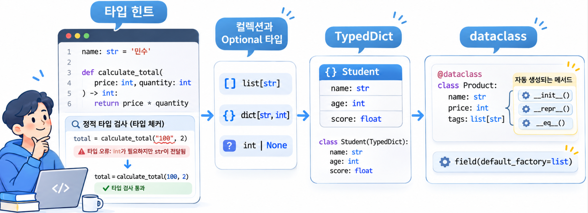
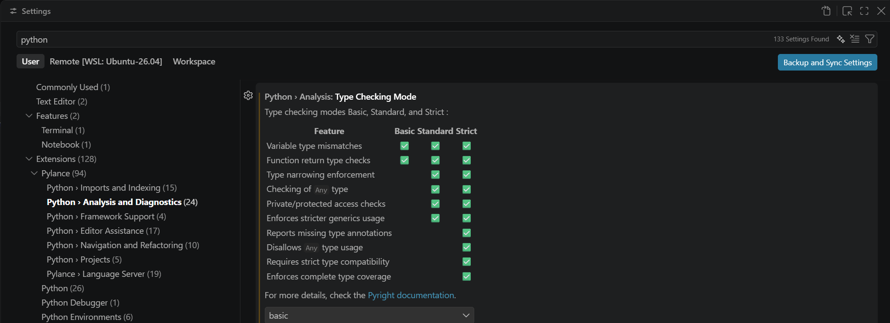
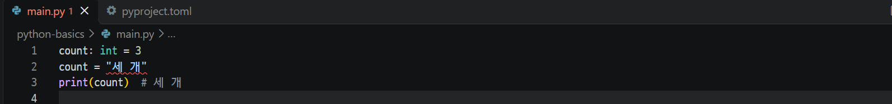
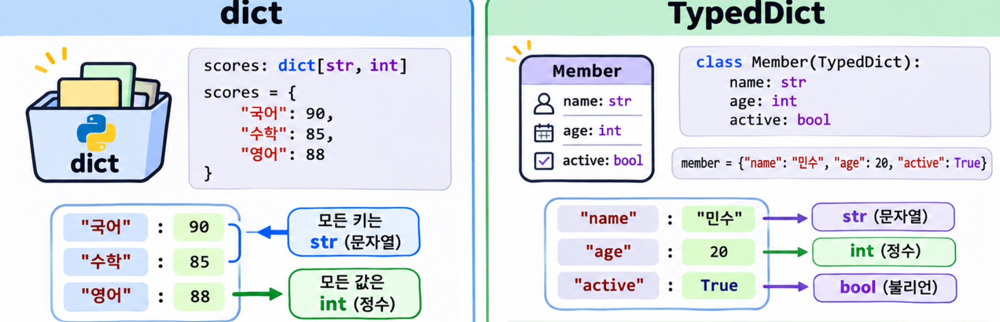

## 1. 타입 힌트 기본 문법과 정적 타입 검사 {#session-01}

### 🟦 변수·매개변수·반환값에 타입 표시하기

**타입 힌트(Type Hint)**는 변수나 함수가 어떤 타입을 사용하는지 알려 주는 표기입니다.  
변수와 매개변수는 `이름: 타입`, 반환값은 `-> 타입`으로 작성합니다.  

```python
# 변수 이름 뒤에 타입을 적습니다.
name: str = "민수"
price: int = 1000
is_active: bool = True
member_id: int | str = 1001  # A | B: 두 타입 중 하나를 허용합니다.

# 매개변수와 반환값의 타입을 함께 적습니다.
def calculate_total(price: int, quantity: int) -> int:
    return price * quantity

# 반환할 값이 없는 함수는 -> None으로 표시합니다.
def greet(name: str) -> None:
    print(f"안녕하세요, {name}님!")

print(calculate_total(price, 2))  # 2000
greet(name)  # 안녕하세요, 민수님!
```

| 대상 | 예시 | 의미 |
|---|---|---|
| 변수 | `name: str = "민수"` | 문자열을 저장하는 변수 |
| 매개변수 | `quantity: int` | 정수를 받는 매개변수 |
| 반환값 | `-> int` | 정수를 반환하는 함수 |
| 반환값 없음 | `-> None` | 별도 결과값을 반환하지 않는 함수 |

타입 힌트는 값을 변환하는 문법이 아닙니다. 문자열을 정수로 바꾸려면 여전히 `int(text)`처럼 변환 코드를 작성해야 합니다.  

### 🟦 타입 힌트는 실행 중 검증을 자동으로 하지 않습니다

Python은 타입 힌트만 보고 잘못된 대입이나 함수 호출을 막지 않습니다.  

```python
# 타입 힌트와 다른 값을 대입해도 실행은 가능합니다.
count: int = 3
count = "세 개"
print(count)  # 세 개
```

코드를 실행하지 않고 타입 오류를 찾는 과정을 **정적 타입 검사(Static Type Checking)**라고 합니다.  
VS Code에서는 **Pyright 기반의 언어 서버인 Pylance**가 타입 힌트와 실제 사용을 비교해, 코드를 작성하는 동안 오류를 표시합니다.  

### 🟦 VS Code에서 Pylance 타입 검사 설정하기

VS Code에 Microsoft의 Python·Pylance 확장이 설치되고 활성화되어 있는지 확인한 뒤, 설정 화면에서 검사 수준을 선택합니다.  

1. `Ctrl + ,`를 눌러 설정(Settings) 화면을 엽니다.
2. 검색창에 `python.analysis.typeCheckingMode`를 입력합니다.
3. **Python › Analysis: Type Checking Mode** 항목에서 `basic`을 선택합니다.

| 설정 | 설명 |
|---|---|
| `off` | 기본값. 대부분의 타입 검사는 하지 않지만, 정의되지 않은 변수 등의 기본 오류는 표시 |
| `basic` | 잘못된 대입·인자 타입 등 일반적인 타입 오류 검사 |
| `standard` | `basic`보다 더 많은 검사 규칙 적용 |
| `strict` | 가장 엄격한 기본 검사 규칙 적용 |



JSON으로 설정하려면 `Ctrl + Shift + P`에서 **Preferences: Open User Settings (JSON)**을 실행하고, 기존 설정 객체 안에 다음 항목을 추가합니다.  

```json
{
  "python.analysis.typeCheckingMode": "basic"
}
```

프로젝트에 `pyrightconfig.json` 또는 `pyproject.toml`의 `[tool.pyright]` 설정이 있다면, 검사 수준은 해당 설정이 우선할 수 있습니다.  

```text
[tool.pyright]
typeCheckingMode = "basic"
```

설정 후 앞의 예제를 작성하면 `count = "세 개"`에서 `int` 변수에 `str`을 대입했다는 오류가 표시됩니다. 코드의 밑줄이나 **Problems(문제)** 패널에서 확인할 수 있습니다.  

Ruff는 코드 스타일과 흔한 실수를 검사하는 린터입니다. Pylance의 정적 타입 검사를 대신하지 않으며, 두 도구를 함께 사용할 수 있습니다.  

## 2. 컬렉션과 선택적 타입 표현하기 {#session-02}

### 🟦 list·dict·set·tuple 안에 담을 타입 지정하기

컬렉션 타입 뒤에 `[]`를 붙여 내부 값의 타입을 적습니다.  

```python
names: list[str] = ["민수", "지수"]
scores: dict[str, int] = {"민수": 80, "지수": 95}
tags: set[str] = {"Python", "Git"}

# 회원 ID처럼 두 타입을 허용하는 값도 컬렉션에 담을 수 있습니다.
member_ids: list[int | str] = [1001, "member-1002"]

# 고정 길이 tuple: 각 위치에 들어갈 타입을 순서대로 적습니다.
member: tuple[str, int] = ("민수", 20)

# 가변 길이 tuple: 같은 타입의 값이 여러 개 들어갈 수 있습니다.
points: tuple[int, ...] = (10, 20, 30)

print(names[0])       # 민수
print(scores["지수"])  # 95
print(member)         # ('민수', 20)
print(sum(points))    # 60
print(member_ids)     # [1001, 'member-1002']
```

| 타입 표기 | 의미 |
|---|---|
| `list[str]` | 각 항목이 문자열인 `list` |
| `list[int | str]` | 각 항목이 정수 또는 문자열인 `list` |
| `dict[str, int]` | 키는 문자열, 값은 정수인 `dict` |
| `set[str]` | 각 항목이 문자열인 `set` |
| `tuple[str, int]` | 첫 값은 문자열, 둘째 값은 정수인 길이 2의 `tuple` |
| `tuple[int, ...]` | 정수로 구성되며 길이가 정해지지 않은 `tuple` |

Python 3.12에서는 `typing.List`·`typing.Dict` 대신 내장 타입인 `list`·`dict`를 그대로 사용할 수 있습니다.  

### 🟦 T | None: 값이 없을 수 있음을 표시하기

`A | B`는 두 타입 중 하나라는 뜻입니다. **`T | None`은 특정 타입의 값 또는 `None`**을 뜻하며, `T` 자리에 `str`·`int` 같은 타입을 적습니다.  

```python
def find_score(name: str, scores: dict[str, int]) -> int | None:
    return scores.get(name)

score = find_score("준호", {"민수": 80})

# None인 경우를 먼저 구분한 뒤 정수 연산을 합니다.
if score is None:
    print("점수가 없습니다.")
else:
    print(score + 5)
# 점수가 없습니다.
```

`score is None`으로 분기하면 타입 검사기도 각 분기에서 가능한 타입을 좁혀 판단합니다.  
`if score:`로 검사하면 `0`점도 거짓으로 처리되므로, 값이 없는지 확인하려면 `is None`을 사용합니다.  

**`None`을 허용하는 것과 인자를 생략할 수 있는 것은 다릅니다.** 인자를 생략하려면 기본값도 지정해야 합니다.  

```python
def show_name(name: str | None) -> str:
    return "이름 없음" if name is None else name

def show_optional_name(name: str | None = None) -> str:
    return "이름 없음" if name is None else name

print(show_name(None))      # 이름 없음: 인자는 전달해야 합니다.
print(show_optional_name())  # 이름 없음: 기본값이 있어 생략할 수 있습니다.
```

### 🟦 Any: 타입 검사를 유연하게 허용하기

`Any`는 어떤 타입의 값도 허용하며, 그 값에 대한 타입 검사 제약을 크게 줄입니다.  
타입을 명확히 표현하기 어려운 외부 데이터 등을 다룰 때 제한적으로 사용합니다.  

```python
from typing import Any

# 서로 다른 타입을 담을 수 있지만, 꺼낸 값의 타입도 Any로 취급됩니다.
data: dict[str, Any] = {"name": "민수", "age": 20}

print(data["name"])  # 민수
print(data["age"])   # 20

# data["name"] + 1은 정적 검사에서 허용될 수 있지만,
# 실제 실행하면 str과 int를 더할 수 없어 TypeError가 발생합니다.
```

`Any`를 사용해도 실행 중 오류를 막아 주지는 않습니다.  
필드 구조가 정해져 있다면 다음 절의 `TypedDict`처럼 구체적으로 표현하는 편이 좋습니다.  

## 3. TypedDict로 dict 구조 정의하기 {#session-03}

### 🟦 dict와 TypedDict의 차이

**`dict`는 키와 값의 공통 타입을 지정하고, `TypedDict`는 키 이름별로 값의 타입을 지정합니다.**  

| 타입 표기 | 지정하는 내용 |
|---|---|
| `dict[str, int]` | 모든 키는 `str`, 모든 값은 `int` |
| `TypedDict` | 사용할 키 이름과 각 키에 들어갈 값의 타입 |



```python
from typing import TypedDict

# 모든 키는 문자열, 모든 값은 정수입니다.
scores: dict[str, int] = {"korean": 90, "english": 85}

# 키 이름을 명시하고, 키마다 값의 타입을 다르게 지정합니다.
class Student(TypedDict):
    name: str     # "name" 키의 값은 str입니다.
    age: int      # "age" 키의 값은 int입니다.
    score: float  # "score" 키의 값은 float입니다.

student: Student = {"name": "민수", "age": 20, "score": 90.5}

print(scores["korean"])  # 90
print(student["name"])   # 민수
print(student["score"])  # 90.5
print(type(student))     # <class 'dict'>

# 정적 타입 검사에서 오류로 표시되는 예시입니다.
# wrong_type: Student = {"name": "민수", "age": "스무 살", "score": 90.5}
# missing_key: Student = {"name": "민수", "age": 20}
```

여기서 **`name`·`age`·`score`는 키 이름**이고, `str`·`int`·`float`는 각 키에 들어갈 값의 타입입니다. 기본적으로 정의한 키는 모두 필수입니다.  
`dict[str, int]`만으로는 `"korean"`·`"english"` 같은 특정 키가 있어야 한다고 지정하거나, 키 이름에 따라 값의 타입을 구분할 수 없습니다.  

**`TypedDict`의 실제 객체는 일반 `dict`이며, 실행 중에 타입이나 필수 키를 검사하지 않습니다.** Pylance나 mypy 같은 정적 타입 검사 도구가 잘못된 값이나 누락된 키를 찾도록 구조를 설명합니다.  

### 🟦 NotRequired로 생략 가능한 키 정의하기

생략할 수 있는 키는 `NotRequired`로 표시합니다. 다음 예시에서 `name`과 `age`는 필수이고, `email`은 선택입니다.  

```python
from typing import NotRequired, TypedDict

class MemberData(TypedDict):
    name: str
    age: int
    email: NotRequired[str]

# email은 생략할 수 있습니다.
member: MemberData = {"name": "민수", "age": 20}
print(member.get("email", "이메일 미등록"))  # 이메일 미등록
```

`email`을 추가한다면 값은 `str`이어야 합니다.  
키가 없을 수 있으므로 `.get()`이나 `"email" in member`로 확인한 뒤 사용합니다.  
**`NotRequired[str]`는 키를 생략할 수 있다는 뜻이고, `str | None`은 키의 값으로 `None`을 허용한다는 뜻**입니다. 두 가지는 서로 다릅니다.  

## 4. dataclass로 데이터 클래스 만들기 {#session-04}

### 🟦 dataclass 개념과 자동 생성 메서드

dataclass는 데이터를 저장하고 관리하는 클래스를 간단하게 작성할 수 있도록 도와주는 데코레이터입니다.  
일반 클래스에서는 생성자(__init__())와 객체 출력(__repr__()) 등의 메서드를 직접 작성해야 하지만, @dataclass를 사용하면 자동으로 생성됩니다.

```python
from dataclasses import dataclass

@dataclass
class Member:
    name: str
    age: int

# 자동 생성된 __init__()으로 속성을 초기화합니다.
first = Member("민수", 20)
second = Member(name="민수", age=20)

print(first.name)       # 민수
print(first)            # Member(name='민수', age=20)
print(first == second)  # True
print(first is second)  # False: 별개의 인스턴스입니다.
```

| 자동 생성 메서드 | 역할 |
|---|---|
| `__init__()` | 인자로 받은 값을 필드에 저장 |
| `__repr__()` | 클래스 이름과 필드 값을 보여 주는 문자열 생성 |
| `__eq__()` | 같은 클래스의 인스턴스를 필드 값으로 비교 |

dataclass는 데이터 저장에 필요한 반복적인 코드를 자동으로 생성하여 클래스를 간결하게 작성할 수 있도록 합니다.  
`dataclass`도 타입 힌트를 실행 중에 자동 검증하지는 않습니다.  

### 🟦 필드 기본값과 field() 설정하기

dataclass에서는 필드에 기본값을 지정할 수 있습니다. 기본값이 있는 필드는 객체 생성 시 해당 인자를 생략할 수 있습니다.  
또한 field()를 사용하면 필드의 기본값이나 출력 여부 등을 세부적으로 설정할 수 있습니다.

```python
from dataclasses import dataclass, field

@dataclass
class Member:
    name: str
    age: int = 0
    # repr=False: 자동 생성되는 출력 문자열에서 이 필드를 제외합니다.
    email: str = field(default="", repr=False)

member = Member("민수", email="minsu@example.com")
print(member)        # Member(name='민수', age=0)
print(member.email)  # minsu@example.com
```

email은 repr=False로 설정했기 때문에 print(member) 결과에는 표시되지 않지만, member.email로 접근할 수 있습니다.  

주의: 기본값이 없는 필드는 기본값이 있는 필드보다 먼저 작성해야 합니다.

### 🟦 default_factory로 인스턴스마다 새 list 만들기

`list`·`dict`·`set`은 내용을 추가하거나 변경할 수 있는 **가변 객체(Mutable Object)**입니다. 여러 인스턴스가 같은 가변 객체를 공유하면, 한쪽에서 변경한 내용이 다른 쪽에도 영향을 줍니다.  
`dataclass`에서는 **`field(default_factory=list)`로 기본값이 필요한 인스턴스마다 새 `list`를 만들 수 있습니다.**  

```python
from dataclasses import dataclass, field

@dataclass
class StudyGroup:
    name: str
    # members 인자를 생략하면 list()를 호출해 새 list를 만듭니다.
    members: list[str] = field(default_factory=list)

first = StudyGroup("Python 기초")
second = StudyGroup("Python 실습")
first.members.append("민수")

print(first.members)                   # ['민수']
print(second.members)                  # []
print(first.members is second.members)  # False
```

#### 🔷 코드 구성 요소와 동작 과정

| 코드 | 의미 |
|---|---|
| `members` | 필드 이름 |
| `list[str]` | 문자열을 담는 `list` 타입 |
| `field()` | 필드의 기본값 등 세부 설정을 지정하는 함수 |
| `default_factory` | 기본값을 생성할 함수나 타입을 지정하는 인자 |
| `list` | `list()`로 호출하면 새 빈 `list`를 만드는 내장 타입 |

1. `first`를 생성할 때 `members`를 생략했으므로 `list()`를 호출해 새 빈 `list`를 만듭니다.  
2. `second`를 생성할 때도 `list()`를 호출해 별도의 빈 `list`를 만듭니다.  
3. `first.members.append("민수")`를 실행하면 `first`의 `list`에만 값이 추가됩니다.  

따라서 `second.members`는 빈 상태로 유지됩니다. 반대로 `StudyGroup("Python 기초", members=["민수"])`처럼 값을 직접 전달하면 그 값을 사용하므로 `default_factory`는 호출되지 않습니다.  

#### 🔷 list와 list()의 차이

`default_factory=list`는 **기본값이 필요할 때 `list()`를 호출하라는 설정**입니다. 따라서 `list()`의 실행 결과인 `[]`가 아니라, 호출할 대상인 `list`를 전달해야 합니다.  

```python
from dataclasses import dataclass, field

@dataclass
class StudyGroup:
    name: str
    members: list[str] = field(default_factory=list)  # 올바른 사용입니다.

# 잘못된 사용: 빈 list는 호출할 수 없으므로 기본값 생성 시 TypeError가 발생합니다.
# members: list[str] = field(default_factory=list())
```

- `default_factory=list`: `members`를 생략한 인스턴스를 만들 때마다 새 빈 `list`를 생성합니다.  
