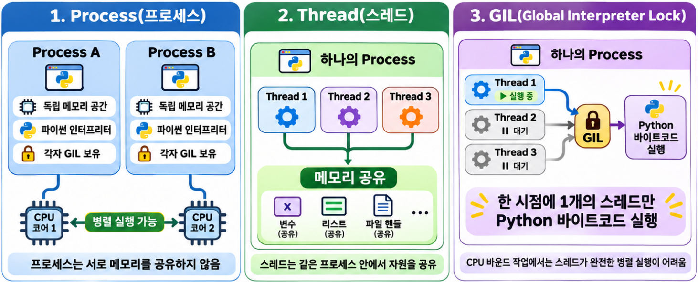
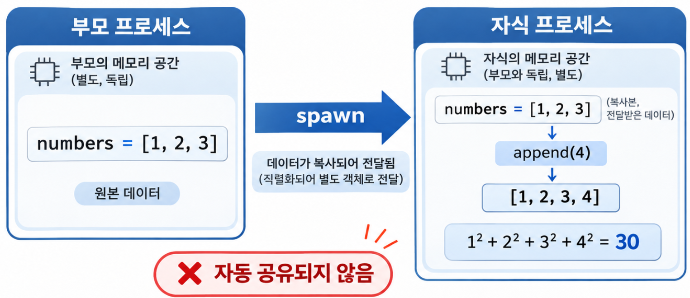
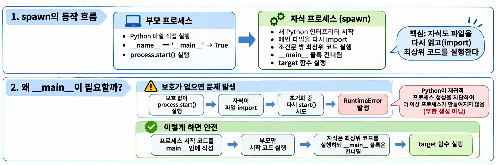
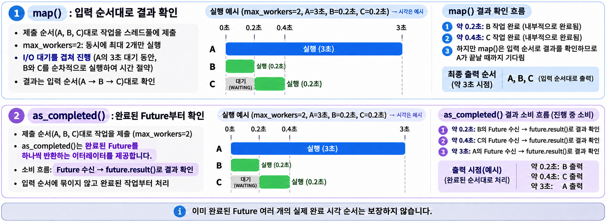

## 1. 동시성과 병렬성: 작업 종류와 GIL의 영향 {#session-01}



### 🟦 동시성과 병렬성의 차이

- **동시성(Concurrency)**: 한 작업이 끝나기 전에 다른 작업도 진행하는 방식입니다. 예를 들어 A의 응답을 기다리는 동안 B를 처리합니다.  
- **병렬성(Parallelism)**: 여러 작업을 실제로 같은 순간에 실행하는 것입니다. 예를 들어 CPU 코어 두 개가 A와 B를 각각 계산합니다.  

```text
순차 처리: A를 끝낸 뒤 B 시작
동시 처리: A의 응답을 기다리는 동안 B 진행
병렬 처리: 코어 1은 A 계산, 코어 2는 B 계산
```

**동시성은 여러 작업을 함께 진행하는 데, 병렬성은 여러 작업을 동시에 실행하는 데 초점을 둡니다.**  
CPU 코어가 하나여도 작업을 번갈아 진행해 동시성을 구현할 수 있습니다.  

### 🟦 계산이 많은 작업과 대기가 많은 작업

| 작업 종류 | 시간이 오래 걸리는 이유 | 예 |
|---|---|---|
| CPU-bound | CPU가 계산하느라 바쁨 | Python 반복문으로 많은 숫자를 계산 |
| I/O-bound | 데이터를 보내거나 받은 뒤 완료를 기다림 | HTTP 응답, 파일·DB 읽기 대기 |

I/O 대기가 많다면 **기다리는 시간을 다른 작업에 활용**하는 것이 효과적입니다. 계산이 많다면 **여러 CPU 코어에 계산을 나누는 방법**을 고려합니다.  

### 🟦 스레드와 프로세스의 차이

**프로세스(Process)**는 실행 중인 프로그램의 단위입니다.  
**스레드(Thread)**는 그 프로세스 안에서 코드를 실행하는 흐름이며, 한 프로세스에 여러 스레드를 만들 수 있습니다.  

| 구분 | 스레드 | 프로세스 |
|---|---|---|
| 메모리 | 같은 프로세스의 객체를 공유 | 기본적으로 각자 별도 메모리 사용 |
| 데이터 주고받기 | 공유 객체를 사용하며, 동시 접근에 주의 | Queue 등 별도 전달 수단 사용 |
| 생성·통신 비용 | 프로세스보다 대체로 작음 | 스레드보다 대체로 큼 |
| 주로 활용하는 상황 | I/O 대기가 많은 작업 | 순수 Python 계산이 많은 작업 |

### 🟦 GIL이 스레드 실행에 미치는 영향

일반적인 CPython 3.12에서는 **GIL(Global Interpreter Lock)** 때문에 한 인터프리터 안에서 한 번에 하나의 스레드만 Python 코드를 실행할 수 있습니다.  
따라서 계산 위주의 Python 코드를 여러 스레드로 나눠도 여러 코어에서 동시에 계산하기는 어렵습니다.  

반면 I/O를 기다릴 때는 GIL이 해제되는 경우가 많습니다.  
이때 다른 스레드가 실행될 수 있어 **대기가 많은 작업에는 스레드가 유용**합니다.  
CPU 계산을 여러 코어에서 실행하려면 각자 인터프리터와 GIL을 사용하는 **별도 프로세스**로 나눌 수 있습니다.  

이 설명은 일반적인 **CPython 3.12 기준**입니다. GIL을 해제하는 일부 C 확장 라이브러리는 스레드로도 계산을 병렬 실행할 수 있으며, Python 구현·버전·빌드에 따라 GIL의 동작이 다를 수 있습니다.  

## 2. threading: 스레드 생성과 공유 데이터 보호 {#session-02}

### 🟦 Thread 생성 → start() → join()

`Thread` 객체에 실행할 함수와 인자를 지정한 뒤 `start()`로 시작합니다. `join()`은 해당 스레드가 끝날 때까지 **호출한 스레드가 기다리도록** 합니다.  

```python
from threading import Thread
from time import sleep

def wait_for_response(name):
    print(f"{name}: 요청 시작")
    sleep(0.2)  # 초 단위
    print(f"{name}: 응답 완료")

if __name__ == "__main__":
    threads = [
        # threading.Thread에서 args는 기본적으로 튜플(tuple) 또는 리스트(list)로 전달해야 합니다 
        Thread(target=wait_for_response, args=("A",)),
        Thread(target=wait_for_response, args=("B",)),
    ]

    # 먼저 모든 스레드를 시작해 대기 시간이 겹칠 수 있게 합니다.
    for thread in threads:
        thread.start()

    # 시작한 스레드가 모두 끝난 뒤 다음 작업을 진행합니다.
    for thread in threads:
        thread.join()

    print("모든 요청 완료")
```

출력 예시:

```text
A: 요청 시작
B: 요청 시작
A: 응답 완료
B: 응답 완료
모든 요청 완료
```

스레드 사이의 출력 순서는 실행할 때마다 달라질 수 있습니다. 다만 마지막 문장은 두 스레드의 `join()`이 모두 끝난 뒤 출력됩니다. `sleep()`은 실제 통신이 아니라 대기를 재현하기 위한 예시입니다.  

| 코드 | 의미 |
|---|---|
| `target=wait_for_response` | 호출할 함수 자체를 전달 |
| `args=("A",)` | 함수에 전달할 인자. 하나짜리 `tuple`이라 쉼표 필요 |
| `start()` | 새 스레드에서 함수 실행 시작 |
| `join()` | 해당 스레드의 종료 대기 |

`target=wait_for_response("A")`처럼 괄호를 붙이면 현재 스레드에서 함수를 먼저 호출하므로 의도와 다릅니다. 스레드를 하나 시작하자마자 바로 `join()`하고 다음 스레드를 시작하면 작업이 순차적으로 진행됩니다.  

### 🟦 공유 데이터는 Lock으로 보호하기

여러 스레드도 같은 데이터에 접근할 수 있으므로, **읽기 → 계산 → 저장**이 겹치면 의도하지 않은 결과가 생길 수 있습니다. 이를 경쟁 상태(Race Condition)라고 합니다.  

```python
from threading import Lock, Thread

counter = 0
lock = Lock()

def increase():
    global counter
    for _ in range(10_000):
        # 이 Lock을 사용하는 다른 스레드는 현재 작업이 끝날 때까지 기다립니다.
        with lock:
            counter += 1

if __name__ == "__main__":
    threads = [Thread(target=increase) for _ in range(2)]
    for thread in threads:
        thread.start()
    for thread in threads:
        thread.join()

    print(counter)  # 20000
```

`with lock:`은 Lock을 획득하고, 블록을 나올 때 해제합니다. 
여러 스레드가 같은 데이터를 변경할 때는 동일한 Lock을 사용해야 합니다.  

GIL이 있어도 여러 단계로 이루어진 데이터 변경 작업의 안전성이 보장되는 것은 아닙니다.  
성능을 위해 시간이 오래 걸리는 작업이나 대기 작업은 Lock 밖에서 실행하고, 공유 데이터를 읽거나 변경하는 부분만 Lock으로 보호하는 것이 좋습니다.  

## 3. multiprocessing: 프로세스 생성과 데이터 전달 {#session-03}

### 🟦 프로세스 생성 방식: spawn·fork·forkserver

`multiprocessing`은 **새 프로세스를 시작하는 방법**을 선택할 수 있습니다.  

| 구분 | `spawn` | `fork` | `forkserver` |
|---|---|---|---|
| 생성 원리 | 새 Python 인터프리터 실행 | 부모 프로세스 복제 | 별도 서버가 자식 프로세스 생성 |
| 메인 파일 다시 읽기 | 자식이 import | 다시 읽지 않고 기존 상태 상속 | 서버 사전 로드 또는 자식 초기화 과정에서 import |
| 메모리 상태 | 새로 초기화하고 필요한 데이터 전달 | 부모 상태 상속. 변경 시 메모리 페이지 복사 | 서버 상태를 상속하고 필요한 데이터 전달 |
| `__main__` 보호 | 필수 | 권장 | 필수 |
| Windows 지원 | 지원 | 미지원 | 미지원 |
| 일반적인 Linux 환경 | 지원 | 지원 | 지원 |

**`spawn`과 `forkserver`에서는 메인 파일을 다시 읽는 과정이 있으므로, 프로세스 시작 코드를 `__main__` 조건문으로 보호해야 합니다.** `forkserver`는 자식마다 파일을 무조건 다시 읽는 것은 아니며, 서버가 미리 불러온 상태를 상속할 수도 있습니다.  

`fork`가 부모의 메모리 상태를 상속해도 일반 변수의 변경 내용까지 서로 공유하지는 않습니다. 어떤 방식이든 데이터 전달과 동기화는 별도로 고려해야 합니다.  

### 🟦 운영체제·버전별 기본값

| 운영체제 | Python 3.8~3.13 | Python 3.14 이상 |
|---|---|---|
| Windows | `spawn` | `spawn` |
| Linux의 일반적인 환경 | `fork` | `forkserver` |
| macOS | `spawn` | `spawn` |

주요 변경은 **Python 3.14부터 Linux 등 지원되는 POSIX 환경에서 `forkserver`가 기본값이 된 것**입니다.  
현재 환경에서 지원하는 방식과 기본값은 다음 코드로 확인할 수 있습니다.

```python
import multiprocessing as mp

if __name__ == "__main__":
    print("지원 방식:", mp.get_all_start_methods())
    print("기본 방식:", mp.get_start_method())
```

### 🟦 spawn을 명시하고 Process 실행하기


이 글의 예제는 운영체제나 버전의 기본값에 영향을 받지 않도록 **`mp.get_context("spawn")`으로 생성 방식을 지정**합니다. `start()`로 시작하고 `join()`으로 종료를 기다리는 흐름은 스레드와 비슷합니다.  

```python
import multiprocessing as mp

# 자식 프로세스에서 실행할 함수
def calculate(numbers):
    # 자식 프로세스는 부모와 메모리가 분리되어 있으므로
    # 여기서 리스트를 변경해도 부모 프로세스의 원본 리스트는 변경되지 않음
    numbers.append(4)
    # 1² + 2² + 3² + 4² = 30
    print(f"자식의 계산 결과: {sum(number ** 2 for number in numbers)}")

if __name__ == "__main__":
    # spawn은 새로운 Python 인터프리터를 실행하여 자식 프로세스를 생성
    context = mp.get_context("spawn")
    numbers = [1, 2, 3]
    process = context.Process(target=calculate, args=(numbers,))

    process.start()
    process.join()

    # 부모 프로세스의 리스트 출력
    # 자식 프로세스에서 numbers.append(4)를 실행했더라도
    # 부모의 원본 리스트는 변경되지 않음
    print(f"부모의 데이터: {numbers}")
    print(f"종료 코드: {process.exitcode}")
# 자식의 계산 결과: 30
# 부모의 데이터: [1, 2, 3]
# 종료 코드: 0
```

`context.Process`는 선택한 시작 방식으로 `Process`를 만듭니다.  
`spawn`에서는 전달한 `list`도 별도의 객체로 복원되므로, 자식이 수정해도 부모의 `numbers`는 바뀌지 않습니다. **일반 전역변수나 `list`는 프로세스 사이에서 자동으로 공유되지 않습니다.**  
`join()`은 종료를 기다릴 뿐, 함수의 반환값을 가져오거나 자식의 예외를 부모에서 다시 발생시키지는 않습니다. `exitcode`가 `0`이면 정상 종료한 것이며, 처리되지 않은 예외로 종료하면 보통 `1`입니다.  

### 🟦 __main__ 조건문이 필요한 이유



`spawn`은 새 Python 인터프리터를 실행한 뒤 메인 파일을 다시 불러옵니다. **`process.start()`가 `__main__` 조건문 없이 파일 최상위에 있으면** 다음 순서로 문제가 발생합니다.  

1. 부모 프로세스가 Python 파일을 실행합니다.  
2. `process.start()`를 호출해 자식 프로세스를 생성합니다.  
3. 자식 프로세스가 같은 파일을 다시 불러오며 최상위 코드를 실행합니다.  
4. 자식도 `process.start()`를 만나 또 다른 프로세스를 생성하려고 합니다.  
5. Python은 자식의 초기화가 끝나기 전에 다시 프로세스를 생성하려는 시도를 감지하고, 일반적으로 `RuntimeError`를 발생시킵니다.  

이를 막으려면 **프로세스를 만들고 시작하는 코드를 `if __name__ == "__main__":` 안에 작성**합니다.  
이 블록은 파일을 직접 실행한 부모에서만 실행되고, 자식이 import할 때는 건너뜁니다.  

반대로 자식이 실행할 `calculate()` 같은 함수는 **다른 함수나 `__main__` 조건문 안이 아닌, 파일 최상위에 정의**합니다.  
자식이 import한 뒤 함수를 찾을 수 있어야 하기 때문입니다.  
인자를 보내려면 전송 가능한 형태로 바꾸는 **직렬화**가 가능해야 합니다.  
예제의 숫자와 `list`는 직렬화해 자식 프로세스에서 복원할 수 있습니다.  
중첩 함수나 `lambda`는 실행할 함수로 사용하지 않습니다.  

### 🟦 Queue로 자식의 결과를 부모에 전달하기

별도 메모리를 사용하는 프로세스 사이에서는 **`Queue`에 결과를 넣고 꺼내는 방식**으로 데이터를 주고받을 수 있습니다.  

```python
import multiprocessing as mp

# 자식 프로세스에서 실행할 함수
def square(number, results):
    # 전달받은 숫자의 제곱을 계산
    # (원본 숫자, 제곱 결과)를 튜플로 만들어 Queue에 저장
    # Queue를 통해 자식 프로세스의 결과를 부모 프로세스로 전달
    results.put((number, number ** 2))

if __name__ == "__main__":
    # spawn 방식으로 자식 프로세스를 생성하도록 설정
    context = mp.get_context("spawn")
    # 프로세스 간 데이터를 전달하기 위한 Queue 생성
    results = context.Queue()
    # 동일한 Queue를 공유하여 각 자식의 계산 결과를 전달받음
    processes = [
        # 숫자 2와 3을 각각 처리할 자식 프로세스 생성
        context.Process(target=square, args=(number, results)) for number in [2, 3]
    ]

    for process in processes:
        process.start()

    # Queue에서 자식 프로세스의 계산 결과를 하나씩 가져옴
    # get()은 데이터가 도착할 때까지 대기하며, 최대 10초까지 기다림
    # 자식 프로세스의 실행 순서에 따라 결과 도착 순서는 달라질 수 있음
    received = [results.get(timeout=10) for _ in processes]

    for process in processes:
        process.join()

    results.close()
    results.join_thread()
    print(sorted(received))  # [(2, 4), (3, 9)]
```

`put()`은 Queue에 데이터를 넣고, `get()`은 하나씩 꺼냅니다. 예제에서는 자식이 2개이므로 `get(timeout=10)`을 차례로 두 번 호출합니다.  
**각 호출은 데이터가 도착하면 즉시 반환하고, 없으면 최대 10초 기다립니다.**  
그 안에 받지 못하면 `queue.Empty`가 발생하며 리스트 생성이 중단됩니다. 실제 작업에서는 자식의 실패나 결과 누락도 처리해야 합니다.  

Queue의 데이터를 부모가 먼저 받은 뒤 자식의 종료를 기다립니다. 많은 데이터를 보낼 때는 부모가 받지 않은 상태로 `join()`부터 하면 자식이 전송을 끝내지 못해 서로 기다릴 수 있습니다.  

### 🟦 Queue·Value·Array·Manager 비교

결과를 주고받을 때는 `Queue`, 여러 프로세스가 같은 데이터를 읽고 수정해야 할 때는 `Value`·`Array`·`Manager`를 사용할 수 있습니다.  

| 구분 | 용도 | 특징 |
|---|---|---|
| `Queue` | 데이터 전달 | `put()`·`get()`으로 데이터를 보내고 받음 |
| `Value` | 단일 값 공유 | 공유 메모리에 정수·실수 등의 값 저장 |
| `Array` | 배열 공유 | 공유 메모리에 고정 크기의 동일 타입 배열 저장 |
| `Manager` | 다양한 객체 공유 | 별도 서버의 `list`·`dict` 등을 프록시 객체로 접근 |

`Manager`의 프록시는 서버에 있는 객체를 대신 다루는 연결 창구입니다. 공유 메모리를 직접 사용하는 방식보다 통신 비용이 큽니다.  
공유 객체를 사용해도 **읽기 → 계산 → 저장** 같은 여러 단계의 갱신이 자동으로 안전해지는 것은 아닙니다. 필요하면 프로세스용 Lock으로 보호합니다.  

## 4. concurrent.futures: 작업 실행과 결과 처리 {#session-04}

### 🟦 Executor가 작업자를 관리합니다

앞에서는 `Thread`나 `Process`를 직접 만들었습니다. **Executor는 정해진 수의 작업자로 여러 작업을 처리**하므로, 생성·시작·종료를 작업마다 직접 관리하는 코드를 줄일 수 있습니다.  

| 실행 도구 | 작업자 | 주로 적합한 작업 |
|---|---|---|
| `ThreadPoolExecutor` | 스레드 | I/O 대기가 많은 작업 |
| `ProcessPoolExecutor` | 프로세스 | 순수 Python의 CPU 계산 |

`max_workers`는 작업자 수의 상한이지, 전체 작업 수가 아닙니다. `with`를 사용하면 블록을 나올 때 제출한 작업의 완료를 기다리고 실행 자원을 정리합니다.  

### 🟦 map()으로 입력 순서대로 결과 받기

```python
from concurrent.futures import ThreadPoolExecutor
from time import sleep

def wait_for_response(name):
    sleep(0.2)
    return f"{name}: 응답 완료"

if __name__ == "__main__":
    with ThreadPoolExecutor(max_workers=2) as executor:
        # 작업이 끝난 순서와 관계없이 입력 순서대로 결과를 제공합니다.
        results = executor.map(wait_for_response, ["A", "B", "C"])
        for result in results:
            print(result)
# A: 응답 완료
# B: 응답 완료
# C: 응답 완료
```

`executor.map()`은 여러 입력에 같은 함수를 적용할 때 편리합니다. 결과를 순회하다가 해당 작업에서 발생한 예외를 만나면 호출한 쪽에도 그 예외가 발생합니다.  

CPU 작업은 다음처럼 `ProcessPoolExecutor`로 실행할 수 있습니다.  
`spawn`을 지정하고 `__main__` 조건문을 사용하는 규칙도 같습니다.  

```python
from concurrent.futures import ProcessPoolExecutor
import multiprocessing as mp

def sum_squares(limit):
    return sum(number ** 2 for number in range(limit))

if __name__ == "__main__":
    context = mp.get_context("spawn")
    with ProcessPoolExecutor(max_workers=2, mp_context=context) as executor:
        results = executor.map(sum_squares, [1000, 2000])
        print(list(results))  # [332833500, 2664667000]
```

ProcessPoolExecutor는 내부적으로 프로세스 간 작업과 결과를 전달하기 위해 multiprocessing.Queue 계열의 큐를 사용합니다  
예제는 실행 흐름을 확인하기 위한 작은 계산입니다.  
**작은 작업은 프로세스 생성과 데이터 전달 비용 때문에 순차 실행보다 느릴 수 있습니다.** 여러 작업자로 나눴다고 항상 빨라지는 것은 아닙니다.  

### 🟦 submit()과 as_completed()로 완료된 작업부터 처리하기

`submit()`은 작업을 제출하고 **Future**를 반환합니다. Future는 진행 중이거나 완료된 작업을 나타내는 객체입니다. `result()`로 반환값을 받으며, 아직 끝나지 않았다면 기다립니다. 작업에서 예외가 발생했다면 그 예외를 다시 발생시킵니다.  

```python
from concurrent.futures import ThreadPoolExecutor, as_completed

# 스레드에서 실행할 작업입니다. number가 0이면 예외가 발생합니다.
def divide(number):
    return 10 / number

if __name__ == "__main__":
    # 최대 2개의 스레드로 작업을 처리하고, 블록을 나올 때 완료를 기다려 정리합니다.
    with ThreadPoolExecutor(max_workers=2) as executor:
        # divide(2), divide(0), divide(5)를 제출합니다.
        # submit()이 반환한 Future를 키로, 해당 입력값을 값으로 저장합니다.
        tasks = {executor.submit(divide, number): number for number in [2, 0, 5]}

        # 입력 순서와 관계없이 완료된 작업부터 확인합니다.
        for future in as_completed(tasks):
            number = tasks[future]  # 이 작업에 전달했던 입력값을 찾습니다.
            try:
                # 반환값을 가져옵니다. 작업이 실패했다면 여기서 예외가 다시 발생합니다.
                result = future.result()
            except ZeroDivisionError:
                print(f"{number}: 0으로 나눌 수 없습니다.")
            else:
                # 결과를 정상적으로 가져온 경우에만 실행합니다.
                print(f"{number}: {result}")
```

출력 예시이며, 줄의 순서는 달라질 수 있습니다.

```text
2: 5.0
0: 0으로 나눌 수 없습니다.
5: 2.0
```

`as_completed()`는 결과값이 아니라 **완료된 Future를 하나씩 반환**합니다. 실제 반환값은 `future.result()`로 가져옵니다. 순회를 시작하기 전에 여러 작업이 이미 완료됐다면, 그 작업들의 실제 완료 시각 순서까지 보장하지는 않습니다.  

아래 그림은 작업자 2개에 A·B·C를 순서대로 제출한 예시입니다. 대기 시간을 A는 3초, B·C는 각각 0.2초로 가정했으며, **C는 B가 끝나 작업자가 비면 시작**합니다. 실제 실행 시간은 환경에 따라 달라집니다.  


