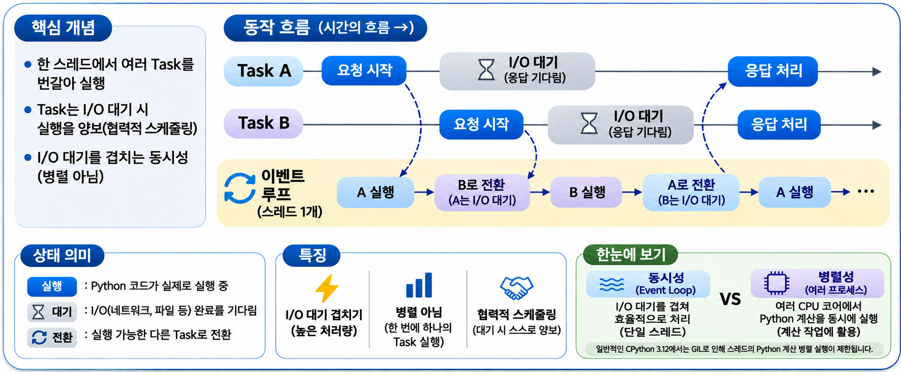

## 1. 비동기 프로그래밍: 동기·비동기와 이벤트 루프 {#session-01}

### 🟦 동기·비동기와 블로킹·논블로킹

두 쌍의 용어는 관련이 있지만, 구분하는 기준이 다릅니다.  

| 구분 | 살펴보는 기준 | 의미 |
|---|---|---|
| 동기(Synchronous) | 작업의 완료를 다루는 방식 | 호출한 흐름에서 결과를 받은 뒤 다음 단계로 진행 |
| 비동기(Asynchronous) | 작업의 완료를 다루는 방식 | 작업을 시작한 뒤 완료 여부나 결과를 나중에 확인 |
| 블로킹(Blocking) | 기다리는 동안 실행 스레드의 상태 | 호출이 끝날 때까지 해당 스레드의 진행이 막힘 |
| 논블로킹(Non-blocking) | 기다리는 동안 실행 스레드의 상태 | 완료를 기다리느라 해당 스레드를 붙잡지 않음 |

`asyncio`에서는 비동기 I/O를 기다릴 때 **현재 작업만 잠시 멈추고, 같은 스레드에서 다른 작업을 실행**할 수 있습니다. 반면 블로킹 함수를 직접 호출하면 이벤트 루프가 사용하는 스레드까지 멈춥니다.  

### 🟦 이벤트 루프가 실행할 작업을 고릅니다

**이벤트 루프(Event Loop)**는 실행할 준비가 된 작업을 실행하고, 대기 중인 작업을 완료 시점에 다시 이어 주는 역할을 합니다.  

Python의 asyncio는 기본적으로 단일 스레드(Single Thread)에서 이벤트 루프를 실행하는 비동기 프로그래밍 방식입니다.  



예를 들어 A가 서버 응답을 기다리는 동안 B의 요청을 보낼 수 있습니다.  
**한 스레드에서 여러 작업을 번갈아 진행하며, 기다리는 시간을 활용하는 방식**입니다.  
여러 CPU 코어가 동시에 계산하는 방식은 아닙니다.  
다만 작업이 실행을 넘겨줘야 다른 작업도 진행할 수 있습니다. 한 작업이 긴 계산을 하거나 `time.sleep()`으로 스레드를 멈추면, 같은 이벤트 루프의 다른 작업도 기다려야 합니다.  

## 2. async·await로 코루틴 작성하기 {#session-02}

### 🟦 async def와 await의 역할

**`async def`는 코루틴 함수를 정의하고, `await`는 비동기 작업의 완료를 기다립니다.** 코루틴 함수는 실행 중 잠시 기다렸다가 멈춘 지점부터 이어 갈 수 있는 함수입니다.  

| 구분 | `async def` | `await` |
|---|---|---|
| 역할 | 코루틴 함수 정의 | Awaitable을 실행하거나 완료를 기다림 |
| 작성 위치 | 함수 정의 부분 | 일반적인 Python 파일에서는 코루틴 함수 내부 |
| 동작 | 함수를 호출하면 본문 대신 코루틴 객체 반환 | 결과를 받을 때까지 현재 코드의 다음 줄로 넘어가지 않음 |

코루틴 객체·`asyncio.Task`·`asyncio.Future`처럼 **`await`할 수 있는 객체를 Awaitable**이라고 합니다. 결과를 기다려야 한다면 현재 Task가 잠시 멈추고 다른 Task가 실행될 수 있습니다. 결과를 바로 받을 수 있다면 실행을 넘기지 않고 이어 갑니다.  
12편의 `concurrent.futures.Future`는 직접 `await`할 수 없습니다. 필요한 경우 `asyncio.wrap_future()`로 `asyncio.Future`로 변환해 사용합니다.  

### 🟦 정의부터 실행까지 살펴보기

```python
import asyncio

# async def로 코루틴 함수를 정의합니다.
async def fetch_message():
    print("요청 시작")
    # 현재 작업만 0.1초 기다립니다. 다른 Task가 있다면 그동안 실행할 수 있습니다.
    await asyncio.sleep(0.1)
    print("응답 완료")
    return "응답 도착"

if __name__ == "__main__":
    coroutine = fetch_message()  # 객체만 생성하며, 본문은 아직 실행하지 않습니다.
    result = asyncio.run(coroutine)  # 이벤트 루프에서 실행하고 반환값을 받습니다.
    print(result)
```

출력 결과:

```text
요청 시작
응답 완료
응답 도착
```

1. `async def`로 함수를 정의합니다.  
2. `fetch_message()`를 호출하면 코루틴 객체가 만들어집니다.  
3. `asyncio.run(coroutine)`이 이벤트 루프를 생성하고 코루틴을 실행합니다.  
4. `await asyncio.sleep(0.1)`에서 잠시 기다립니다.  
5. 대기가 끝나면 실행을 이어 가고, 반환값이 `result`에 저장됩니다. 실행을 마친 루프는 닫힙니다.  

`asyncio.run()`은 비동기 프로그램의 진입점에서 보통 한 번 호출합니다. 같은 스레드에서 이벤트 루프가 이미 실행 중인 노트북 등의 환경에서는 `await fetch_message()`처럼 해당 환경의 실행 방식을 사용합니다.  

### 🟦 await를 빠뜨리면 대기하지 않습니다

```python
import asyncio

async def hello():
    print("시작")
    await asyncio.sleep(0.1)  # 대기가 끝난 뒤 다음 줄로 넘어갑니다.
    print("완료")

if __name__ == "__main__":
    asyncio.run(hello())
# 시작
# 약 0.1초 뒤: 완료
```

다음은 **`await`를 빠뜨린 잘못된 예제**입니다.

```python
import asyncio

async def hello():
    print("시작")
    asyncio.sleep(0.1)  # 코루틴 객체만 만들고, 실행하거나 기다리지 않습니다.
    print("완료")

if __name__ == "__main__":
    asyncio.run(hello())
```

이 경우 실제 대기 없이 `완료`가 출력되며, 일반적으로 `coroutine 'sleep' was never awaited`라는 `RuntimeWarning`도 발생합니다. 코루틴은 `await`하거나, 다음 절의 `asyncio.create_task()` 등으로 실행을 예약해야 합니다.  
`create_task()`를 사용하면 다른 작업과 함께 실행할 수 있지만, 현재 위치에서 해당 결과가 필요하다면 그 Task를 `await`해야 합니다.  

### 🟦 await를 차례로 쓰면 작업도 차례로 진행됩니다

```python
import asyncio

async def fetch(name):
    print(f"{name}: 시작")
    await asyncio.sleep(0.1)
    print(f"{name}: 완료")
    return name

async def main():
    first = await fetch("A")
    second = await fetch("B")
    print([first, second])

if __name__ == "__main__":
    asyncio.run(main())
# A: 시작
# A: 완료
# B: 시작
# B: 완료
# ['A', 'B']
```

이 코드는 A가 끝난 뒤 B를 시작합니다. `async def`와 `await`를 사용했다고 여러 작업이 자동으로 동시에 진행되는 것은 아닙니다. 대기를 겹치려면 다음 절처럼 여러 작업을 실행하도록 등록해야 합니다.  

## 3. Task와 gather로 여러 작업 실행하기 {#session-03}

### 🟦 create_task()로 실행 예약하기

**Task는 코루틴의 실행 상태와 결과를 관리하는 객체**입니다.  
`asyncio.create_task()`는 코루틴을 Task로 감싸 이벤트 루프에서 실행하도록 예약합니다. 새 스레드를 만드는 것은 아닙니다.  

```python
import asyncio

async def fetch(name):
    print(f"{name}: 시작")
    await asyncio.sleep(0.1)
    print(f"{name}: 완료")
    return f"{name} 결과"

async def main():
    task_a = asyncio.create_task(fetch("A"))
    task_b = asyncio.create_task(fetch("B"))

    # 두 Task를 모두 예약했으므로 대기를 겹칠 수 있습니다.
    result_a = await task_a
    result_b = await task_b
    print([result_a, result_b])

if __name__ == "__main__":
    asyncio.run(main())
```

출력 예시:

```text
A: 시작
B: 시작
A: 완료
B: 완료
['A 결과', 'B 결과']
```

2절과 달리 두 Task를 먼저 예약했습니다. 따라서 `await task_a`로 A를 기다리는 동안 B도 진행할 수 있습니다. **작업을 언제 예약했는지**가 중요합니다.  
Task는 변수 등에 보관하고 완료까지 기다리는 편이 좋습니다. 예약만 하고 `main()`을 끝내면 `asyncio.run()`이 종료하면서 남은 Task를 취소하므로, 작업 완료를 보장할 수 없습니다.  

### 🟦 gather()로 여러 결과를 한 번에 받기

`asyncio.gather()`는 여러 Awaitable을 함께 실행하고 결과를 모읍니다. 코루틴을 전달하면 Task로 예약하며, 결과는 **완료 순서가 아닌 전달한 순서**로 반환합니다.  

```python
import asyncio

async def fetch(name, delay):
    await asyncio.sleep(delay)
    return f"{name} 결과"

async def main():
    results = await asyncio.gather(
        fetch("A", 0.2),
        fetch("B", 0.1),
        fetch("C", 0.1),
    )
    print(results)  # ['A 결과', 'B 결과', 'C 결과']

if __name__ == "__main__":
    asyncio.run(main())
```

여러 Task의 대기 시간을 겹칠 수 있지만, 실제 소요 시간은 실행 환경에 따라 달라집니다. `create_task()`는 개별 Task를 관리할 때, `gather()`는 여러 결과를 묶어 받을 때 편리합니다.  

## 4. 비동기 작업 제어: 대기, 타임아웃, 예외 처리 {#session-04}

### 🟦 asyncio.sleep()과 블로킹 함수 구분하기

| 호출 | 기다리는 동안의 동작 |
|---|---|
| `time.sleep(1)` | 현재 스레드를 멈춰 이벤트 루프의 다른 Task도 진행하지 못함 |
| `await asyncio.sleep(1)` | 현재 Task만 대기하고 다른 Task는 진행 가능 |

`asyncio.sleep()`은 대기를 재현하거나 일정 간격으로 작업할 때 사용합니다.  
`await asyncio.sleep(0)`은 의도적으로 다른 Task에 실행 기회를 넘길 때 사용할 수 있습니다.  
일반 파일 I/O나 동기 라이브러리 호출은 `async def` 안에 넣어도 비동기가 되지 않습니다.  
비동기 API를 사용하거나, 블로킹 I/O를 **`asyncio.to_thread()`로 별도 스레드에 맡길 수 있습니다.**  

```python
import asyncio
import time

def blocking_read():
    time.sleep(0.1)  # 동기 라이브러리의 I/O 대기를 재현합니다.
    return "읽기 완료"

async def main():
    result = await asyncio.to_thread(blocking_read)
    print(result)  # 읽기 완료

if __name__ == "__main__":
    asyncio.run(main())
```

`to_thread()`는 블로킹 함수를 이벤트 루프 밖의 스레드에서 실행합니다. 순수 Python의 무거운 계산을 여러 코어에 분산하는 용도라면 `ProcessPoolExecutor`를 먼저 검토합니다.  

### 🟦 타임아웃으로 기다리는 시간 제한하기

`asyncio.timeout()`으로 감싼 작업이 정해진 시간 안에 끝나지 않으면 취소를 요청하고, 블록 바깥에서 `TimeoutError`를 처리할 수 있습니다.  

```python
import asyncio

async def slow_request():
    try:
        # 응답을 받는 데 1초 걸리는 상황을 흉내 냅니다.
        await asyncio.sleep(1)
        return "응답 완료"
    finally:
        # 정상 완료뿐 아니라 타임아웃으로 취소될 때도 정리합니다.
        print("요청 정리")

async def main():
    try:
        # 이 블록의 대기 시간을 0.1초로 제한합니다.
        async with asyncio.timeout(0.1):
            # 1초가 필요한 작업이므로, 완료 전에 타임아웃으로 취소됩니다.
            result = await slow_request()
            print(result)  # 타임아웃이 발생하면 이 줄은 실행되지 않습니다.
    except TimeoutError:
        # slow_request()의 finally가 실행된 뒤 여기서 타임아웃을 처리합니다.
        print("응답 대기 시간이 초과되었습니다.")


if __name__ == "__main__":
    asyncio.run(main())
# 요청 정리
# 응답 대기 시간이 초과되었습니다.
```

`async with`는 비동기 Context Manager를 사용하는 문법입니다.  
한 작업만 제한하려면 `await asyncio.wait_for(slow_request(), timeout=0.1)`도 사용할 수 있습니다.  
취소와 정리를 기다리므로 실제 종료 시각이 지정한 시간보다 늦을 수 있습니다.  
블로킹 코드나 취소를 무시하는 코드를 강제로 중단시키는 기능은 아닙니다.  

### 🟦 await에서 발생한 예외 처리하기

코루틴 안에서 발생한 예외는 `await`한 곳으로 전달됩니다. 일반 함수처럼 `try-except`로 처리합니다.  

```python
import asyncio

async def fetch_score():
    await asyncio.sleep(0.1)
    raise ValueError("점수 데이터가 올바르지 않습니다.")

async def main():
    try:
        await fetch_score()
    except ValueError as error:
        print(error)

if __name__ == "__main__":
    asyncio.run(main())
# 점수 데이터가 올바르지 않습니다.
```

`gather()`는 기본적으로 먼저 발생한 예외를 기다리는 쪽으로 전달하며, 나머지 작업을 자동으로 취소하지는 않습니다. 다만 최상위 코루틴이 끝나면 `asyncio.run()`의 종료 과정에서 남은 Task가 취소될 수 있으므로 두 동작을 구분해야 합니다.  
모든 작업이 끝날 때까지 기다리고 성공·실패를 각각 확인하려면 `return_exceptions=True`를 사용할 수 있습니다.  

```python
import asyncio

async def divide(number):
    await asyncio.sleep(0.1)
    return 10 / number

async def main():
    numbers = [2, 0, 5]
    # gather()는 전달한 코루틴들을 Task로 예약하고, 모두 끝날 때까지 기다립니다.
    # 결과는 완료 순서가 아니라 인자를 전달한 순서인 2, 0, 5에 맞춰 담습니다.
    results = await asyncio.gather(
        # *는 코루틴들을 divide(2), divide(0), divide(5)처럼 개별 인자로 펼칩니다.
        *(divide(number) for number in numbers),
        # 예외도 결과 리스트에 담아, 성공한 작업의 반환값과 함께 확인합니다.
        return_exceptions=True,
    )

    for number, result in zip(numbers, results, strict=True):
        if isinstance(result, Exception):
            print(f"{number}: 실패 ({type(result).__name__})")
        else:
            print(f"{number}: {result}")

if __name__ == "__main__":
    asyncio.run(main())
# 2: 5.0
# 0: 실패 (ZeroDivisionError)
# 5: 2.0
```

`*`는 제너레이터 표현식으로 만든 코루틴들을 개별 인자로 펼칩니다. 결과의 예외는 출력하거나 복구하는 등 명시적으로 처리해야 하며, 단순히 무시하면 실패를 놓칠 수 있습니다.  

### 🟦 취소된 작업도 정리해야 합니다

Task의 `cancel()`은 취소를 **요청**합니다. 취소가 전달되면 코루틴에는 `asyncio.CancelledError`가 발생하므로, 자원 정리는 `finally`에서 수행합니다. 직접 잡았다면 일반적으로 `raise`로 다시 전달합니다.  
`CancelledError`는 `Exception`이 아닌 `BaseException`의 하위 타입이어서 `except Exception`으로 잡히지 않습니다. 일반적인 작업 실패와 취소는 구분합니다. 위 `gather()` 예제는 명시적인 취소 없이 일반 계산 예외만 다룹니다.  

| 목적 | 사용할 문법·함수 |
|---|---|
| 코루틴 함수 정의 | `async def` |
| 결과를 기다리며 비동기 작업 이어 가기 | `await` |
| 비동기 프로그램 진입점 실행 | `asyncio.run()` |
| 개별 코루틴 실행 예약·관리 | `asyncio.create_task()` |
| 여러 작업의 결과 수집 | `asyncio.gather()` |
| 현재 Task를 잠시 대기 | `await asyncio.sleep()` |
| 블로킹 I/O를 별도 스레드에서 실행 | `asyncio.to_thread()` |
| 대기 시간 제한 | `asyncio.timeout()`, `asyncio.wait_for()` |

