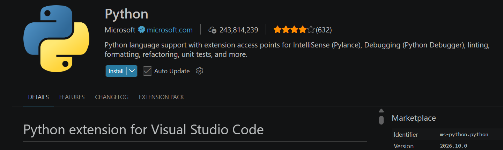
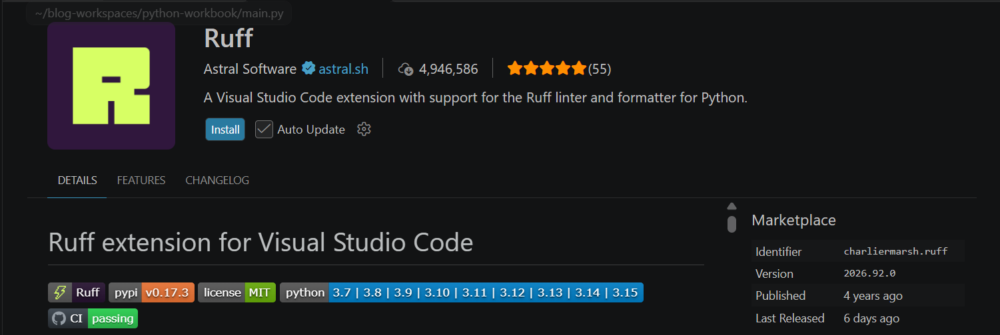

## 1. uv와 Python 설치 {#uv-overview}

**uv는 Astral이 개발한 Python 패키지 및 프로젝트 관리 도구**입니다. Python 설치와 버전 선택, 가상환경 생성, 의존성 설치, 프로젝트 실행을 하나의 CLI에서 처리할 수 있습니다.  

<span id="session-01"></span>

### 🟦 WSL2에 uv 설치하기

WSL의 Ubuntu 터미널에서 Astral 공식 설치 스크립트로 uv를 설치합니다. 터미널을 다시 열어 PATH를 적용한 뒤 설치를 확인합니다.  

```bash
curl -LsSf https://astral.sh/uv/install.sh | sh
uv --version
```

### 🟦 uv python install로 Python 설치하기

`uv python install`은 Python 코드를 실행하는 인터프리터를 uv의 관리 경로에 설치합니다. 설치한 인터프리터는 여러 프로젝트에서 사용할 수 있습니다. 프로젝트에서 사용할 버전은 2절에서 지정합니다.  
이미 pyenv로 Python을 관리하고 있다면 2절의 **pyenv로 설치한 Python 사용하기**로 이동합니다.  

```bash
# 이 글의 예제에 사용할 Python 버전을 설치합니다.
uv python install 3.12.16
```

여러 버전이 필요한 경우에는 한 명령에 나열할 수 있습니다.  

```bash
uv python install 3.11 3.12 3.13
```

`3.12.16`은 패치 버전까지 지정합니다. `3.12`처럼 쓰면 uv가 제공하는 해당 계열의 최신 패치 버전을 요청합니다. 원하는 버전을 찾을 수 없다면 공식 설치 스크립트로 설치한 uv를 `uv self update`로 갱신한 뒤 다시 시도합니다.  

```bash
uv python list --only-installed  # uv가 찾은 설치된 Python 목록
uv python dir                    # uv가 관리하는 Python 설치 디렉터리
uv python find 3.12.16           # uv가 선택한 Python 실행 파일 경로
```

## 2. 프로젝트 환경 구성과 실행 {#session-02}

### 🟦 uv python pin으로 프로젝트 버전 지정하기

`uv python pin`은 현재 디렉터리의 `.python-version`에 Python 버전 요청을 기록합니다.  
uv는 `uv venv`, `uv sync`, `uv run` 등에서 사용할 Python을 선택할 때 이 파일을 참조합니다.  
`pyproject.toml`의 `requires-python`은 프로젝트가 지원하는 Python 버전 범위이며, 선택한 인터프리터는 이 범위에도 맞아야 합니다.  

```text
uv python install 3.11 3.12 3.13
    └── 여러 Python 인터프리터를 설치합니다.
my-project/
    ├── uv python pin 3.12 → .python-version에 3.12를 기록합니다.
    └── uv venv → Python 3.12를 사용해 .venv를 만듭니다.
```

`uv python install`과 `uv python pin`의 역할은 각각 pyenv의 `install`, `local`과 비슷합니다. pyenv는 셸에서 Python을 선택할 때 `.python-version`을 읽고, uv는 자체 명령에서 사용할 Python을 선택할 때 이 파일을 읽습니다.  

| 기능 | pyenv | uv |
| --- | --- | --- |
| Python 설치 | `pyenv install 3.12.16` | `uv python install 3.12.16` |
| 설치 목록 확인 | `pyenv versions` | `uv python list --only-installed` |
| 프로젝트 버전 지정 | `pyenv local 3.12.16` | `uv python pin 3.12.16` |
| 버전 지정 파일 | `.python-version` | `.python-version` |
| Python 제거 | `pyenv uninstall 3.12.16` | `uv python uninstall 3.12.16` |

### 🟦 새 프로젝트 만들기

앞 절에서 Python 3.12.16을 설치한 뒤 진행합니다. 다른 가상환경이 활성화되어 있다면 새 터미널을 열거나 `deactivate`를 실행합니다.  

```bash
mkdir -p ~/workspace
cd ~/workspace

# Python 3.12.16을 기준으로 프로젝트를 초기화합니다.
# 버전 지정 파일은 다음 단계에서 직접 만듭니다.
uv init --app --no-package --python 3.12.16 --no-pin-python python-workbook-uv
cd python-workbook-uv

uv python pin 3.12.16
cat .python-version  # 3.12.16
uv venv

# 프로젝트 의존성을 추가한 뒤 버전과 설치 결과를 확인합니다.
uv add requests
uv run python --version
uv run python -c 'import requests; print(requests.__version__)'
uv run python main.py
```

각 단계의 결과를 확인하기 위해 `uv python pin`과 `uv venv`를 따로 실행합니다.  
평소에는 `uv init --no-package --python 3.12.16`으로 초기화와 버전 지정을 함께 할 수 있습니다. 프로젝트에 `.venv`가 없으면 `uv add`나 `uv sync`가 생성합니다.  

```text
python-workbook-uv/
├── .python-version  # 프로젝트에서 사용할 Python 버전
├── .venv/           # 프로젝트 가상환경
├── pyproject.toml   # 프로젝트 정보와 직접 추가한 의존성
├── uv.lock          # 의존성을 해석해 결정한 버전
└── main.py          # uv init이 만든 실행 예제
```

하위 폴더에 독립적인 프로젝트를 만들려면 `uv init --app --no-package --no-workspace --python 3.12.16 api-practice`를 사용합니다. 해당 폴더에서 `uv sync`를 실행하면 자체 잠금 파일과 가상환경을 준비할 수 있습니다.  

### 🟦 pyenv로 설치한 Python 사용하기

이미 pyenv를 쓰고 있다면 Python 설치와 프로젝트 버전 지정은 pyenv에 맡기고, 가상환경과 패키지는 uv로 관리할 수 있습니다. 이 예시는 별도의 새 프로젝트에서 실행합니다. 이후 절의 명령은 두 프로젝트 중 사용할 프로젝트의 루트에서 실행합니다.  

```bash
pyenv install -s 3.12.16  # 이미 설치한 버전이면 건너뜁니다.
mkdir -p ~/workspace/python-workbook-pyenv
cd ~/workspace/python-workbook-pyenv
pyenv local 3.12.16

# pyenv가 선택한 인터프리터 경로를 uv에 전달합니다.
uv init --no-package --python "$(pyenv which python)" --no-pin-python
uv venv --python "$(pyenv which python)"
uv add requests
uv run python --version
```

`pyenv local`이 만든 `.python-version`을 uv도 읽을 수 있습니다. 이 흐름에서는 `uv python install`과 `uv python pin`을 생략합니다.  

### 🟦 의존성 추가와 환경 복원 {#uv-dependencies}

프로젝트에서 사용할 일반 패키지는 `uv add`, Ruff처럼 개발 과정에서만 쓰는 도구는 `uv add --dev`로 추가합니다. 두 명령 모두 의존성 선언과 잠금 파일을 함께 갱신합니다.  

```bash
# 개발 의존성을 추가합니다.
uv add --dev ruff
```

기존 프로젝트가 `requirements.txt`로 의존성을 관리한다면, uv 프로젝트로 준비한 뒤 `uv add -r requirements.txt`로 가져올 수 있습니다.  
Git에는 `pyproject.toml`, `.python-version`, `uv.lock`을 기록하고 `.venv/`는 제외합니다.  
다른 환경에서 저장소를 받은 뒤 프로젝트 루트에서 다음 명령을 실행하면 잠금 파일을 기준으로 환경을 재현할 수 있습니다.  
잠금 파일이 없거나 프로젝트 설정과 맞지 않으면 오류가 발생합니다.  

```bash
uv sync --locked
```

### 🟦 python과 uv run으로 실행하기 {#uv-run}

#### python으로 직접 실행하기

`python main.py`는 현재 셸에서 `PATH`를 따라 찾은 Python으로 실행합니다.  
프로젝트 가상환경을 활성화해 두면 `.venv/bin`이 `PATH` 앞쪽에 추가되므로, 평소처럼 `python` 명령을 사용할 수 있습니다. `pyproject.toml`을 직접 수정한 뒤에는 `uv sync`로 변경 사항을 반영합니다.  

```bash
source .venv/bin/activate
command -v python
python main.py
deactivate
```

#### uv run으로 실행하기

프로젝트 루트에서 `uv run`을 사용하면 가상환경을 미리 활성화하지 않아도 됩니다.  
uv는 기본적으로 실행 전에 잠금 파일과 프로젝트 환경을 확인하고 필요한 의존성을 동기화합니다.  
뒤에는 Python 스크립트, 모듈 실행 명령, 프로젝트에 설치한 CLI를 넣을 수 있습니다.  

```bash
# Python 스크립트를 실행합니다.
uv run python main.py

# Python 표준 라이브러리의 HTTP 서버를 로컬에서 실행합니다.
uv run python -m http.server --bind 127.0.0.1
# 다음 명령을 실행하기 전에 Ctrl+C로 서버를 종료합니다.
```

테스트가 있는 프로젝트에서는 pytest를 개발 의존성으로 추가한 뒤 실행합니다.  

```bash
uv add --dev pytest
uv run pytest
```

## 3. VS Code와 Ruff 설정 {#session-03}

### 🟦 VS Code에 가상환경 연결하기

Windows의 VS Code에 **WSL** 확장을 설치합니다. Ubuntu 터미널에서 프로젝트 루트로 이동한 뒤 `code .`을 실행합니다. VS Code 왼쪽 아래에 WSL 연결 표시가 있는지 확인하고, 확장 탭에서 Microsoft의 **Python** 확장을 WSL 환경에 설치합니다.  



명령 팔레트에서 **Python: Select Interpreter**를 실행하고 프로젝트의 `.venv/bin/python`을 선택합니다. 목록에 없으면 **Enter interpreter path**에서 직접 지정합니다.  

VS Code로 실행한 코드도 같은 환경을 사용하는지 확인하려면 `check_env.py`를 만들어 **Run Python File in Terminal**로 실행합니다.  

```python
import sys

# 실행 중인 Python의 버전과 경로를 출력합니다.
print(sys.version.split()[0])
print(sys.executable)
```

출력에 `3.12.16`과 현재 프로젝트의 `.venv/bin/python` 경로가 표시되면 VS Code가 프로젝트 가상환경을 사용하고 있습니다.  

### 🟦 Ruff로 코드 검사와 포맷팅 {#session-04}

#### pyproject.toml에 Ruff 규칙 추가

`uv add --dev ruff`로 설치한 Ruff는 `uv run ruff --version`으로 확인할 수 있습니다. 프로젝트의 `pyproject.toml` 아래에 다음 설정을 추가합니다.  

```toml
[tool.ruff]
target-version = "py312"
line-length = 88
indent-width = 4

[tool.ruff.lint]
# 기본 오류, 미사용 코드, import 정렬, 최신 문법과 흔한 실수를 검사합니다.
select = ["E4", "E7", "E9", "F", "I", "UP", "B", "SIM"]

[tool.ruff.format]
quote-style = "double"
indent-style = "space"
```

Ruff는 검사할 파일에서 가장 가까운 설정을 사용합니다. 하위 프로젝트에도 별도 Ruff 설정을 두려면 해당 프로젝트의 `pyproject.toml`에 추가합니다.  

#### VS Code에서 저장 시 자동 정리

확장 탭에서 **Ruff**를 WSL 환경에 설치합니다. 명령 팔레트에서 **Preferences: Open Workspace Settings (JSON)**을 열고 다음 설정을 추가합니다. 기존 `[python]` 설정이 있다면 그 안에 필요한 항목을 합칩니다.  



```json
{
  "[python]": {
    "editor.defaultFormatter": "charliermarsh.ruff",
    "editor.formatOnSave": true,
    "editor.codeActionsOnSave": {
      "source.fixAll.ruff": "explicit",
      "source.organizeImports.ruff": "explicit"
    }
  }
}
```

`Ctrl + S`로 저장하면 Ruff가 수정 가능한 린트 문제를 고치고 import와 코드 서식을 정리합니다. 이 설정을 WSL의 여러 프로젝트에 적용하려면 **Preferences: Open Remote Settings (JSON)**을 사용합니다.  

#### 검사와 포맷팅 실행

터미널에서도 Ruff를 실행할 수 있습니다. 예시를 확인하려면 `ruff_demo.py`에 다음 코드를 넣습니다. 저장 시 자동 정리가 이미 설정되어 있다면 터미널 편집기로 작성해 수정 전 상태를 확인할 수 있습니다.  

```python
# 검사에서 찾을 수 있도록 미사용 import와 공백 문제를 남겨 둡니다.
import os
def add(a,b):
    return a+b
print(add(10,20))
```

```bash
# 첫 검사에서는 미사용 import가 보고됩니다.
# 결과를 확인한 뒤 아래 수정 명령을 실행합니다.
uv run ruff check ruff_demo.py
uv run ruff check --fix ruff_demo.py
uv run ruff format ruff_demo.py

# 프로젝트 전체를 다시 검사하고 예제를 실행합니다.
uv run ruff check .
uv run ruff format --check .
uv run python ruff_demo.py
```

첫 검사에서 사용하지 않은 `os` import가 보고됩니다. 자동 수정과 포맷팅을 실행하면 import가 제거되고 공백이 정리되며, 예제는 `30`을 출력합니다.  

## 4. 자주 쓰는 uv 명령어 {#uv-commands}

### 🟦 Python과 프로젝트 준비

```bash
uv --version                     # 설치한 uv 버전을 확인합니다.
uv python install 3.12.16        # Python 인터프리터를 설치합니다.
uv python list --only-installed  # 설치된 Python 목록을 봅니다.
uv python dir                    # uv의 Python 설치 경로를 확인합니다.

uv init --no-package --python 3.12.16  # 현재 폴더에 새 프로젝트를 초기화합니다.
uv python pin 3.12.16            # 프로젝트에서 사용할 버전을 지정하거나 바꿉니다.
uv venv                          # 현재 폴더에 .venv를 만듭니다.
```

### 🟦 의존성 관리와 실행

프로젝트 루트에서 필요한 명령을 골라 실행합니다.  

```bash
uv add requests        # 프로젝트 의존성을 추가합니다.
uv add --dev ruff       # 개발 의존성을 추가합니다.
uv remove requests     # 사용하지 않는 의존성을 제거합니다.
uv tree                # 의존성과 하위 의존성을 확인합니다.

uv sync                # 프로젝트 설정에 맞춰 가상환경을 동기화합니다.
uv sync --locked       # 저장소의 잠금 파일을 그대로 사용합니다.
uv run python main.py  # 프로젝트 환경에서 프로그램을 실행합니다.
uv run ruff check .     # 프로젝트에 설치한 Ruff로 검사합니다.
```
