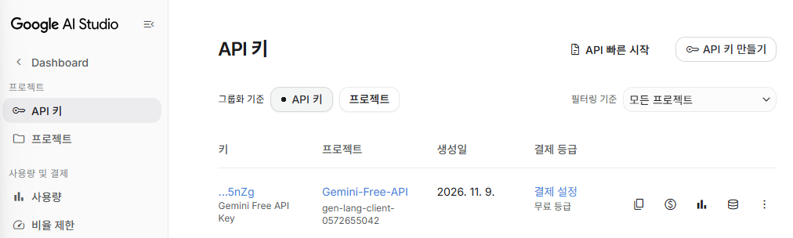

📂 **[[GitHub 코드 보러가기]](https://github.com/cericube/agent-workbook/tree/main/gemini-sdk-basics){: target="_blank" rel="noopener noreferrer" }**

LangChain을 사용하기 전에 SDK로 Gemini를 직접 호출해 보면, 질문을 보내고 응답을 읽는 기본 흐름을 이해하기 쉽습니다.  

## 1. Google Gen AI SDK 설치 및 개발 환경 설정 {#session-01}

Google Gen AI SDK는 Python에서 Google의 생성형 AI API를 호출할 수 있도록 돕는 라이브러리입니다.  

### 🟦 가상환경과 패키지 설치

실습에는 Google Gen AI 3.0.0, Python 3.12.16 가상환경을 사용합니다.  

```bash
# 실습 폴더와 독립된 패키지 설치 공간을 만듭니다.
mkdir -p agent-workbook/gemini-sdk-basics
cd agent-workbook/gemini-sdk-basics
python -m venv .venv

# macOS 또는 Linux에서 가상환경을 활성화합니다.
source .venv/bin/activate

# 현재 Python 환경에 Google Gen AI SDK를 설치합니다.
python -m pip install --upgrade google-genai
python -m pip install python-dotenv
```

### 🟦 Gemini API 키와 모델 설정

[Google AI Studio](https://aistudio.google.com/apikey){: target="_blank" rel="noopener noreferrer" }에서 API 키를 발급받습니다.  


Gemini API는 **무료 등급을 지원하는 모델을 정해진 한도 안에서 무료로 사용**할 수 있습니다.  

실습 폴더인 `agent-workbook/gemini-sdk-basics`에 `.env` 파일을 만들고 다음 내용을 저장합니다.  
`GEMINI_API_KEY`에는 발급받은 실제 API 키를 입력합니다.  

```dotenv
GEMINI_API_KEY="발급받은_API_키"
GEMINI_MODEL="gemini-3.5-flash-lite"
```

`.env` 파일은 `python-dotenv`의 `load_dotenv()`로 파일 내용을 환경 변수에 불러온 뒤, `genai.Client()`가 `GEMINI_API_KEY`를 읽도록 합니다.  
기존 환경 변수가 있으면 `load_dotenv()`는 기본적으로 덮어쓰지 않습니다.  
SDK는 `GEMINI_API_KEY`와 `GOOGLE_API_KEY`를 모두 지원하며, 두 환경 변수가 모두 설정되어 있으면 `GOOGLE_API_KEY`를 우선 적용합니다.  

API 키가 저장된 `.env`가 Git에 올라가지 않도록 실습 폴더의 `.gitignore`에 다음 항목을 추가합니다.  

```gitignore
.env
```

### 🟦 환경 변수와 SDK 설치 확인

```python
# 소스 경로: gemini-sdk-basics/01.check_setup.py
# 비밀 키를 출력하지 않고 필수 설정이 있는지 확인합니다.
import os
from importlib.metadata import version
from dotenv import load_dotenv
from google import genai

# .env의 값을 현재 Python 프로세스의 환경 변수로 불러옵니다.
load_dotenv()

if not os.environ.get("GEMINI_API_KEY"):
    raise RuntimeError(".env 파일에 GEMINI_API_KEY를 설정해 주세요.")
if not os.environ.get("GEMINI_MODEL"):
    raise RuntimeError("GEMINI_MODEL 환경 변수를 설정해 주세요.")

print("SDK 버전:", version("google-genai"))
print("모델:", os.environ["GEMINI_MODEL"])
# Client가 호출 가능한 객체인지 확인합니다.
print("클라이언트 사용 준비:", callable(genai.Client))
```

## 2. 클라이언트 생성과 HTTP 통신 설정 {#session-02}

### 🟦 클라이언트의 역할

**Gemini 모델**은 입력을 해석하고 답변을 생성하며, **Google Gen AI SDK**는 Python에서 요청을 보내고 응답을 다룰 수 있도록 돕습니다. `genai.Client()`는 API 호출에 사용할 인증과 HTTP 통신 설정을 관리합니다.  

클라이언트에는 인증·제한 시간·재시도 정책을 지정하고, 각 요청에는 사용할 모델·질문·생성 옵션을 전달합니다. 전체 흐름은 다음과 같습니다.  

```text
환경 변수 불러오기 → 클라이언트 생성 → 모델과 입력 지정 → API 호출 → 응답 확인
```

### 🟦 예제에서 함께 사용할 클라이언트 준비하기

```python
import os

from dotenv import load_dotenv
from google import genai
from google.genai import types


def create_client():
    # .env의 API 키와 모델 ID를 환경 변수로 불러옵니다.
    load_dotenv()
    return genai.Client(
        http_options=types.HttpOptions(
            # HTTP 요청의 제한 시간입니다. 60_000밀리초는 60초입니다.
            timeout=60_000,
            retry_options=types.HttpRetryOptions(
                # 최초 요청을 포함해 최대 3번 시도합니다.
                attempts=3,
                # 재시도 대기 시간은 초 단위로 지정합니다.
                initial_delay=1.0,
                max_delay=10.0,
                # 요청 시간 초과, 요청량 제한, 지정한 서버 오류를 재시도합니다.
                http_status_codes=[408, 429, 500, 502, 503, 504],
            ),
        ),
    )
```

API 키를 별도로 전달하지 않으면 SDK가 환경 변수에서 읽습니다. `load_dotenv()`는 기본적으로 이미 설정된 환경 변수를 덮어쓰지 않으므로, `.env`를 바꾼 뒤에도 기존 환경 변수의 값이 사용될 수 있습니다.  

### 🟦 제한 시간과 재시도 정책 읽기

| 설정 | 의미 |
|---|---|
| `timeout=60_000` | HTTP 요청의 제한 시간을 60초로 지정합니다. **밀리초 단위**입니다. |
| `attempts=3` | 최초 요청을 포함해 최대 3회 시도합니다. |
| `initial_delay=1.0` | 첫 재시도 전 대기 시간의 초기값입니다. **초 단위**입니다. |
| `max_delay=10.0` | 재시도 사이의 대기 시간 상한입니다. 전체 처리 시간의 상한은 아닙니다. |
| `http_status_codes` | `408`, `429`와 지정한 서버 오류를 재시도 대상으로 설정합니다. |

Interactions의 개별 호출에 지정하는 `timeout`은 **초 단위**입니다. 예를 들어 `client.interactions.create(..., timeout=60.0)`은 해당 호출의 제한 시간을 60초로 지정합니다. `HttpOptions.timeout`과 단위가 다르므로 구분해서 읽습니다.  

이 글의 공통 클라이언트는 `api_version`을 생략합니다. API 버전을 명시하려면 `HttpOptions(api_version="v1", ...)`처럼 지정할 수 있으며, 사용할 API와 모델이 그 버전을 지원하는지 확인해야 합니다. 클라이언트 설정은 [Google Gen AI SDK 공식 문서](https://googleapis.github.io/python-genai/)를 참고합니다.  

## 3. 두 API의 차이와 Interactions API 선택 {#session-03}

### 🟦 이 글에서 Interactions API를 사용하는 이유

Google Gen AI SDK에서는 generateContent와 Interactions API를 모두 호출할 수 있습니다. 두 API 모두 Gemini로 콘텐츠를 생성하지만, 요청 인자와 응답 객체의 구조가 다릅니다.  

Google은 [공식 API 문서](https://aistudio.google.com/api-reference/interactions-api)에서 **신규 프로젝트에 Interactions API를 권장**합니다. 이 글과 이후 실습도 Interactions를 중심으로 진행합니다. generateContent는 기존 예제를 읽을 때 구분할 수 있는 정도로 살펴봅니다.  

| 구분 | generateContent | Interactions API |
|---|---|---|
| SDK 메서드 | `client.models.generate_content()` | `client.interactions.create()` |
| 주요 용도 | 모델의 콘텐츠 생성 | 콘텐츠 생성과 에이전트 작업 흐름 |
| 입력 | `contents` | `input` |
| 생성 옵션 | `config` | `generation_config`와 개별 인자 |
| 시스템 지침 | `config.system_instruction` | `system_instruction` |
| 반환 객체 | `GenerateContentResponse` | `Interaction` (`stream=False`일 때) |
| 텍스트 읽기 | `response.text` | `response.output_text` |
| 상세 결과 | `response.candidates` | `response.steps` |
| 대화 기록 | 클라이언트에서 기록을 관리하거나 SDK의 채팅 기능 사용 | 저장한 Interaction을 `previous_interaction_id`로 연결 가능 |

### 🟦 generateContent의 최소 호출 예제

2절의 import와 `create_client()` 정의 아래에 다음 코드를 넣으면 generateContent로 질문을 보낼 수 있습니다.  

```python
# 질문을 contents로 전달하고, 반환된 객체의 text를 읽습니다.
client = create_client()
try:
    response = client.models.generate_content(
        model=os.environ["GEMINI_MODEL"],
        contents="Gemini API를 한 줄로 소개해 주세요.",
    )
    print(response.text or "텍스트 응답이 없습니다.")
finally:
    # 호출이 끝나면 연결 자원을 정리합니다.
    client.close()
```

이 예제에서는 **입력이 `contents`, 답변이 `response.text`**라는 점만 기억하면 됩니다. 이제 같은 질문을 Interactions API로 보내고, 응답을 더 자세히 읽어 보겠습니다.  

## 4. Interactions 호출과 생성 옵션 {#session-04}

### 🟦 model과 agent 구분하기

`client.interactions.create()`는 Gemini 모델을 `model`로, Google이 제공하는 관리형 에이전트를 `agent`로 지정해 호출할 수 있습니다. 이 글은 `model`로 Gemini를 직접 호출합니다.  

| 인자 | 호출 대상 | 역할 |
|---|---|---|
| `model` | Gemini 모델 | 입력에 대한 콘텐츠 생성, 분석, 추론, 도구 호출 요청을 처리합니다. |
| `agent` | Deep Research 같은 관리형 에이전트 | 에이전트가 작업 계획과 도구 실행 등을 수행합니다. |

`model`을 사용해도 LangGraph 등으로 에이전트를 직접 구현할 수 있습니다. 이 경우 작업의 반복과 도구 실행은 애플리케이션이 제어합니다. `agent`는 API에서 제공하는 관리형 에이전트를 선택할 때 사용하는 인자입니다.  

### 🟦 질문과 생성 옵션 준비하기

질문이나 작업 지시를 담은 입력을 **프롬프트**라고 합니다. `input`에는 이번에 해결할 질문을, `system_instruction`에는 모델의 역할과 응답 방식을 전달합니다.  

| 인자 | 예제에서의 역할 |
|---|---|
| `model` | `.env`의 `GEMINI_MODEL`에서 모델 ID를 읽습니다. |
| `input` | 모델에 전달할 질문입니다. 이 예제에서는 문자열을 사용합니다. |
| `system_instruction` | Python 강사라는 역할을 지정합니다. |
| `generation_config` | 응답 생성에 사용할 옵션을 사전으로 묶습니다. |
| `stream=False` | 이벤트 스트림 대신 `Interaction` 객체 하나를 받습니다. |
| `store=False` | 후속 대화 연결에 사용하지 않는 단일 요청으로 실행합니다. |

예제의 `generation_config`에는 다음 두 옵션을 넣습니다.  

| 옵션 | 의미 |
|---|---|
| `temperature=0.3` | 토큰 선택의 무작위성을 조절합니다. 낮은 값은 비교적 일관된 응답을 유도합니다. |
| `max_output_tokens=500` | 생성할 출력 토큰 수의 상한입니다. 토큰 수는 글자 수나 단어 수와 다릅니다. |

### 🟦 예제: 답변과 토큰 사용량 확인하기

```python
# 소스 경로: gemini-sdk-basics/ch01/interactions_basic.py
from typing import cast

from google.genai import interactions as interaction_types

Interaction = interaction_types.Interaction
client = create_client()

try:
    print("Interactions API 호출 시작", flush=True)
    response = client.interactions.create(
        model=os.environ["GEMINI_MODEL"],
        input="Gemini API를 한 줄로 소개해 주세요.",
        system_instruction="당신은 Python 전문 강사입니다.",
        generation_config={
            "temperature": 0.3,
            "max_output_tokens": 500,
        },
        # 응답을 나누어 받지 않고 Interaction 객체 하나로 받습니다.
        stream=False,
        # 이번 실습은 대화를 이어 가지 않는 단일 요청입니다.
        store=False,
    )

    # 타입 검사 도구에 비스트리밍 응답의 타입을 알려 줍니다.
    response = cast(Interaction, response)

    print("Interactions API 호출 완료", flush=True)
    print("상태:", response.status)
    print("Interaction ID:", response.id)
    print(response.output_text or "텍스트 응답이 없습니다.")

    # 사용량 정보가 포함된 경우에만 토큰 수를 읽습니다.
    usage = response.usage
    if usage is not None:
        print("입력 토큰:", usage.total_input_tokens)
        print("출력 토큰:", usage.total_output_tokens)
        print("전체 토큰:", usage.total_tokens)
except Exception as error:
    # 입문 실습에서는 발생한 오류의 종류와 메시지를 확인합니다.
    print("오류:", type(error).__name__, str(error))
finally:
    # 요청 성공 여부와 관계없이 연결 자원을 정리합니다.
    client.close()
```

### 🟦 stream과 타입 검사 이해하기

`stream=False`는 응답을 스트리밍 이벤트로 나누어 받지 않는다는 뜻입니다. 반대로 `stream=True`이면 이벤트 스트림을 받습니다.  

SDK 버전과 타입 선언에 따라 반환 타입이 `Interaction | Stream[InteractionSSEEvent]`처럼 표시될 수 있습니다. 이 경우 타입 검사 도구가 응답을 스트림일 수도 있다고 판단해 `output_text`나 `usage` 접근에 경고를 표시할 수 있습니다.  

예제의 `cast(Interaction, response)`는 **타입 검사 도구에 응답을 `Interaction`으로 취급하도록 알리는 표현**입니다. 실제 객체를 변환하거나 실행 중 타입을 검사하지는 않습니다. 실행 중에도 타입을 확인하려면 해당 줄을 다음 코드로 바꿀 수 있습니다.  

```python
# 앞선 예제의 cast() 호출 대신 실제 객체의 타입을 확인합니다.
if not isinstance(response, Interaction):
    raise TypeError("예상하지 못한 스트리밍 응답입니다.")
```

## 5. Interaction 응답 구조: 상태와 steps 읽기 {#session-05}

### 🟦 Gemini Interactions API 응답 구조 한눈에 보기

`stream=False`로 받은 `Interaction` 객체의 주요 필드와 `steps`의 대표 유형입니다.  

```text
response · Interaction
client.interactions.create(..., stream=False)
├── id        Interaction ID입니다.
├── status    요청 상태입니다. completed, requires_action 등이 있습니다.
├── usage     토큰 사용량 등의 통계입니다.
└── steps[]   응답에 포함된 단계 목록입니다.
    ├── type = "model_output"    모델 출력입니다.
    ├── type = "function_call"   함수 실행 요청입니다.
    └── type = "thought"         추론 관련 단계입니다.
```

`step.content`를 순회하며 콘텐츠 종류를 확인합니다. 텍스트 항목은 `content.type == "text"`인지 확인한 뒤 `content.text`에서 답변을 읽습니다.  

```text
step · type = "model_output"
└── content[]   출력 콘텐츠 목록입니다. text, image, audio 등이 있습니다.
    └── type = "text"    텍스트 항목의 예시입니다.
        └── text        "배송 중입니다."
```

`step.type`은 단계의 종류이고, `content.type`은 콘텐츠의 종류입니다. 모든 단계에 `content`가 있는 것은 아니므로 단계 종류를 먼저 확인합니다.  

`step.name`에서 실행할 함수 이름을, `step.arguments`에서 인자를 읽습니다. `step.id`는 개별 함수 호출을 식별하므로, 요청 전체를 식별하는 `response.id`와 구분합니다.  

```text
step · type = "function_call"
├── name        함수 이름입니다. 예: "get_order"
├── arguments   함수에 전달할 인자입니다. 예: {"order_id": "ORD-1001"}
└── id          함수 호출 ID입니다.
```

`step.signature`는 추론 관련 서명이고, `step.summary`는 설정에 따라 포함되는 요약입니다. 모델의 답변 텍스트는 `model_output` 단계에서 읽습니다.  

```text
step · type = "thought"
├── signature   추론 관련 서명입니다.
└── summary     추론 요약입니다. 설정에 따라 포함됩니다.
```

### 🟦 response는 Interaction 객체입니다

`client.interactions.create(..., stream=False)`는 `Interaction` 객체 하나를 반환합니다.  

| 항목 | 의미 |
|---|---|
| `response.id` | 이번 Interaction의 ID입니다. 저장된 대화를 이어 갈 때 다음 요청의 `previous_interaction_id`에 전달합니다. |
| `response.status` | 요청 전체의 처리 상태입니다. |
| `response.steps` | 모델 출력, 추론 관련 정보, 도구 호출 등을 순서대로 담은 목록입니다. |
| `response.usage` | 토큰 사용량 등의 통계입니다. |
| `response.output_text` | 모델이 생성한 텍스트를 편하게 읽을 수 있는 Python SDK 속성입니다. |

간단히 답변을 출력할 때는 `output_text`를 사용하고, 어떤 종류의 출력이나 도구 호출이 포함되었는지 확인할 때는 `steps`를 읽습니다.  

### 🟦 status로 요청 전체의 상태 확인하기

`status`는 **요청 전체의 상태**를 나타냅니다. 자주 확인하는 값은 다음과 같습니다.  

| `response.status` | 의미 |
|---|---|
| `completed` | 요청 처리가 완료되었습니다. |
| `requires_action` | 함수 실행 결과 전달처럼 클라이언트의 후속 작업이 필요합니다. |
| `failed` | 요청 처리가 실패했습니다. |
| `incomplete` | 출력 토큰 한도 도달 등의 이유로 결과가 완성되지 않았습니다. |

API 호출이 예외 없이 반환되어도 최종 답변이 완성되지 않았을 수 있습니다.  
특히 `requires_action`은 애플리케이션이 후속 작업을 처리해야 한다는 뜻이므로, 텍스트 유무만으로 성공 여부를 판단하지 않습니다.  
