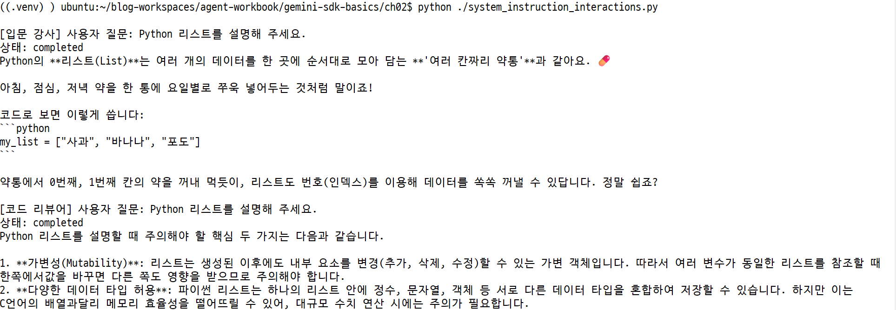
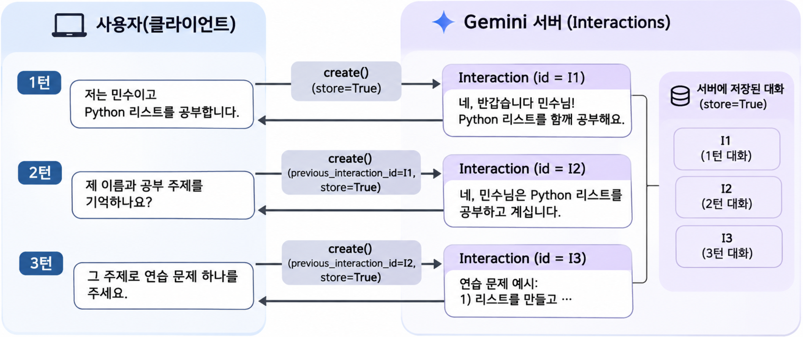
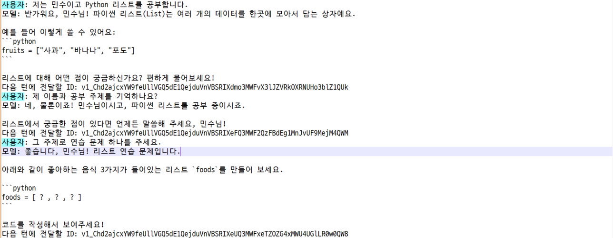
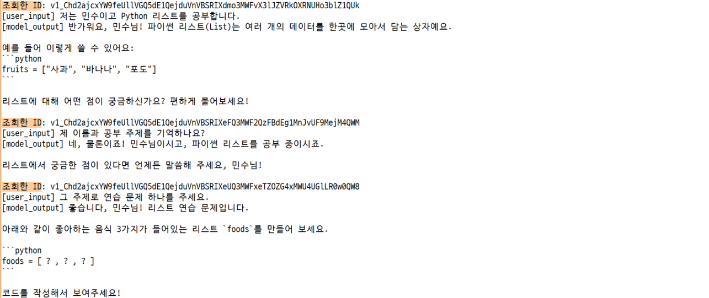
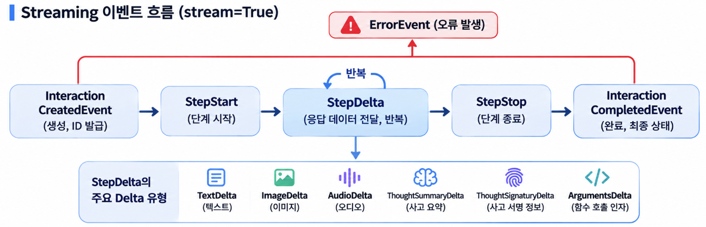
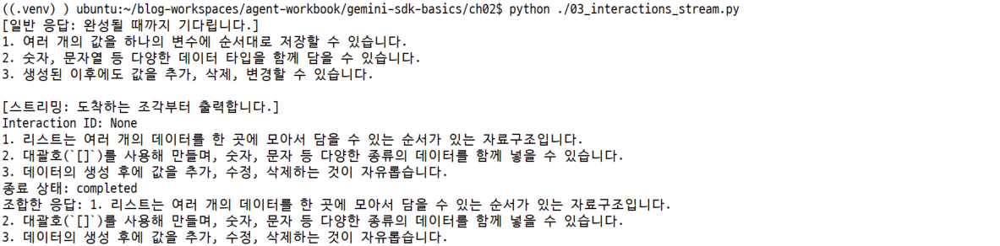
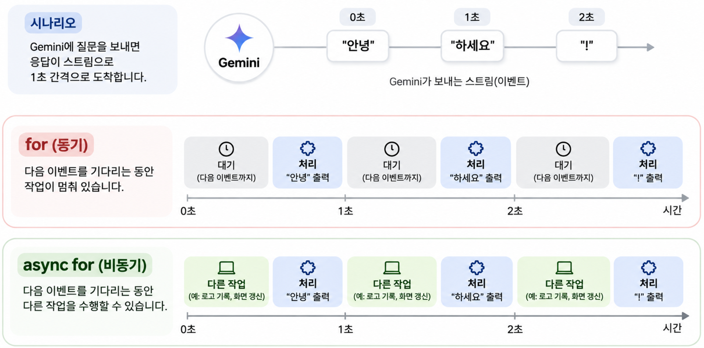

📂 **[[GitHub 코드 보러가기]](https://github.com/cericube/agent-workbook/tree/main/gemini-sdk-basics){: target="_blank" rel="noopener noreferrer" }**

## 1. 시스템 지침으로 역할과 응답 방식 정하기 {#session-01}

시스템 지침(System Instruction)은 모델의 **역할과 응답 방식**을 정하는 지시입니다.  

### 🟦 시스템 지침을 작성하는 이유

답변을 서비스의 목적과 독자의 수준에 맞추기 위해 사용합니다.  
역할·언어·분량 등 공통 규칙은 `system_instruction`에 두고, 매번 달라지는 질문은 `input`으로 전달합니다.  

### 🟦 시스템 지침 작성 방법

**역할 → 대상 → 응답 방식** 순서로 필요한 조건을 구체적으로 작성합니다.  

| 항목 | 예시 |
|---|---|
| 역할 | 당신은 Python 입문 강사입니다. |
| 대상 | Python을 처음 배우는 사람에게 설명하세요. |
| 언어·난이도 | 한국어로 짧고 쉽게 답하세요. |
| 형식·분량 | 주의점 두 가지만 답하세요. |
| 설명 방식 | 일상 비유를 한 가지 사용하세요. |

모든 조건을 넣기보다 목적에 필요한 규칙만 조합합니다. 작성한 지침에 맞게 답하는지는 실제 출력으로 확인합니다.  

### 🟦 예시: 입문 강사와 코드 리뷰어 응답 비교

```python
# 소스 경로: gemini-sdk-basics/ch02/01_system_interactions.py
# 같은 질문에 두 역할의 지침을 적용하고 응답을 비교합니다.
try:
    prompt = "Python 리스트를 설명해 주세요."
    # 사용자 질문은 유지하고 System Instruction의 역할과 응답 방식을 바꿉니다.
    for label, instruction in [
        ("입문 강사", system_instruction + " 일상 비유를 한 가지 사용하세요."),
        (
            "코드 리뷰어",
            "당신은 코드 리뷰어입니다. 한국어로 주의점 두 가지만 답하세요.",
        ),
    ]:
        interaction = client.interactions.create(
            model=model,
            input=prompt,
            # 모델의 역할과 응답 지침은 최상위 매개변수로 전달합니다.
            system_instruction=instruction,
            stream=False,
            store=False,
        )

        # SDK의 반환 타입에는 스트림도 포함되므로 일반 응답인지 확인합니다.
        if not isinstance(interaction, Interaction):
            raise TypeError("일반 Interaction 응답이 필요합니다.")
        if interaction.status != "completed":
            raise RuntimeError(f"응답이 완료되지 않았습니다: {interaction.status}")
        print(f"\n[{label}] 사용자 질문: {prompt}")
        print("상태:", interaction.status)
        print(interaction.output_text or "텍스트 응답이 없습니다.")
except Exception as error:
    print("오류:", type(error).__name__, str(error))
    raise
finally:
    client.close()
```



## 2. 멀티턴 대화와 기록 관리 {#session-02}

`02_interactions_conversation.py`는 **대화 생성·연결 → 기록 조회 → 새 대화와 비교 → 기록 삭제** 순서로 실행합니다.  

### 🟦 대화 저장과 연결

멀티턴 대화는 앞선 질문과 답변의 문맥을 이어 가는 대화입니다.  
같은 클라이언트로 요청하더라도 이전 ID를 전달하지 않으면 새 대화가 시작됩니다.  

| 항목 | 역할 |
|---|---|
| `client.interactions.create()` | 새 질문을 보내 Interaction을 생성합니다. |
| `store=True` | 입력과 응답을 저장해 이후 연결·조회에 사용합니다. |
| `interaction.id` | 생성된 Interaction을 식별합니다. |
| `previous_interaction_id` | 이번 질문에 연결할 이전 Interaction을 지정합니다. |

`store=True`는 저장을, `previous_interaction_id`는 연결을 담당합니다.  
`store=False`로 생성한 응답은 후속 대화의 연결 대상으로 사용할 수 없습니다.  
시스템 지침은 승계되지 않으므로 `system_instruction`을 매 요청에 다시 전달합니다.  

### 🟦 세 번의 질문 이어 가기



첫 질문에서 이름과 공부 주제를 알려 주고, 다음 질문에서 이를 기억하는지 확인한 뒤 연습 문제를 요청합니다.  

```python
# 소스 경로: gemini-sdk-basics/ch02/02_interactions_conversation.py
# 조회·삭제할 ID 목록은 원본에서도 try 밖에 준비합니다.
interaction_ids = []

# 아직 연결할 이전 응답이 없으므로 첫 요청은 새 대화로 시작합니다.
previous_id = None
for question in [
    "저는 민수이고 Python 리스트를 공부합니다.",
    "제 이름과 공부 주제를 기억하나요?",
    "그 주제로 연습 문제 하나를 주세요.",
]:
    # 첫 요청은 이전 ID 없이, 후속 요청은 직전 ID를 지정합니다.
    # 이전 ID는 대화 이력만 연결하므로 역할과 응답 지침은 매 요청에 다시 전달합니다.
    if previous_id is None:
        interaction = client.interactions.create(
            model=model,
            input=question,
            # Interactions API에서는 매 요청마다 system_instruction을 보내야 함
            system_instruction=system_instruction,
            # 입력과 응답을 서버에 저장해 이후 ID 연결과 조회에 사용합니다.
            store=True,
            # 스트리밍 이벤트 대신 완성된 Interaction 객체를 받습니다.
            stream=False,
        )
    else:
        interaction = client.interactions.create(
            model=model,
            input=question,
            # Interactions API에서는 매 요청마다 system_instruction을 보내야 함
            system_instruction=system_instruction,
            store=True,
            stream=False,
            # 서버가 직전 응답과 연결된 문맥을 찾아 새 질문에 이어 붙입니다.
            previous_interaction_id=previous_id,
        )
    # 일반 응답인지 검사하며, Pylance가 반환 타입을 좁히는 데에도 사용됩니다.
    # interaction은 API 호출 결과로 받은 응답 객체
    if not isinstance(interaction, Interaction):
        raise TypeError("일반 Interaction 응답이 필요합니다.")
    # 정상 완료되고 ID가 있는 응답만 다음 대화에 연결합니다.
    if interaction.status != "completed" or not interaction.id:
        raise RuntimeError(f"대화가 완료되지 않았습니다: {interaction.status}")
    interaction_ids.append(interaction.id)
    # 매번 최신 ID로 갱신해야 다음 질문이 방금 끝난 턴에서 이어집니다.
    previous_id = interaction.id
    print("사용자:", question)
    print("모델:", interaction.output_text or "텍스트 응답이 없습니다.")
    print("다음 턴에 전달할 ID:", previous_id)
```

`previous_id`는 다음 질문을 연결할 최신 ID이고, `interaction_ids`는 조회·삭제할 모든 ID의 목록입니다. 응답이 완료되고 ID가 있는지 확인한 뒤 두 값을 갱신합니다.  


### 🟦 저장된 입력과 응답 조회하기

`get()`으로 각 Interaction을 다시 가져옵니다. 로컬 목록에는 ID만 저장되어 있으며, 실제 대화 내용은 서버에서 조회합니다.  

```python
# 소스 경로: gemini-sdk-basics/ch02/02_interactions_conversation.py
from google.genai.interactions import ModelOutputStep, TextContent, UserInputStep

# 서버에 저장된 각 턴의 입력과 응답을 조회합니다.
for interaction_id in interaction_ids:
    # 로컬 목록에는 ID만 있고, 대화 내용은 서버에서 다시 가져옵니다.
    stored = client.interactions.get(interaction_id)
    if not isinstance(stored, Interaction):
        raise TypeError("일반 Interaction 응답이 필요합니다.")
    print("\n조회한 ID:", stored.id)
    # steps는 사용자 입력, 모델 출력, 사고 과정 등으로 구성됩니다.
    # 단계 목록이 없으면 빈 목록을 순회해 출력 없이 넘어갑니다.
    for step in stored.steps or []:
        # 이 실습에서는 사용자 입력과 모델 출력 단계만 확인합니다.
        if isinstance(step, (UserInputStep, ModelOutputStep)):
            for content in step.content or []:
                # 한 단계에 여러 콘텐츠가 있을 수 있으므로 텍스트만 골라 출력합니다.
                if isinstance(content, TextContent):
                    print(f"[{step.type}] {content.text}")
```

`stored.id`로 조회한 대상을 확인하고, `stored.steps`에서 사용자 입력(`UserInputStep`)과 모델 출력(`ModelOutputStep`)을 선택합니다.  
각 단계에는 여러 콘텐츠가 있을 수 있으므로 `TextContent`만 골라 출력합니다.  


### 🟦 이전 ID 없이 새 대화와 비교하기

두 번째 턴과 같은 질문을 보내되 `previous_interaction_id`를 생략합니다. 앞서 입력한 이름과 공부 주제가 이번 요청에 연결되는지 비교할 수 있습니다.  

```python
# 소스 경로: gemini-sdk-basics/ch02/02_interactions_conversation.py
# 이전 ID를 생략하면 앞서 입력한 이름과 공부 주제가 이 요청에 전달되지 않습니다.
# 두 번째 턴과 같은 질문을 보내 연결된 대화와 새 대화의 응답을 비교합니다.
fresh = client.interactions.create(
    model=model,
    input="제 이름과 공부 주제를 기억하나요?",
    system_instruction=system_instruction,
    stream=False,
    # 이 비교 요청은 이후 조회하거나 이어 쓰지 않으므로 서버 저장을 끕니다.
    store=False,
    # previous_interaction_id  생략
)
if not isinstance(fresh, Interaction):
    raise TypeError("일반 Interaction 응답이 필요합니다.")
if fresh.status != "completed":
    raise RuntimeError(f"응답이 완료되지 않았습니다: {fresh.status}")
print("\n[이전 ID 없이 시작한 새 대화]")
print(fresh.output_text or "텍스트 응답이 없습니다.")
# store=False로 생성한 응답은 이후 대화 연결에 사용할 수 없습니다.
```


이 요청은 독립적인 새 대화이며, 이후 조회하거나 이어 쓰지 않으므로 `store=False`로 설정합니다.  
같은 질문이라도 이전 ID의 유무에 따라 전달되는 문맥이 달라집니다.  

### 🟦 finally에서 기록 삭제와 연결 정리하기

원본은 실습이 끝나면 저장한 기록을 자동 삭제합니다. `delete_interactions()`는 최신 턴부터 `delete()`를 호출하고, 성공한 ID만 로컬 목록에서 제거합니다.  

```python
# 소스 경로: gemini-sdk-basics/ch02/02_interactions_conversation.py
def delete_interactions(client: genai.Client, interaction_ids: list[str]) -> None:
    """서버 기록을 최신 턴부터 삭제하고, 성공한 ID는 전달받은 목록에서도 제거합니다."""
    # 원본 목록을 수정하므로 복사본을 역순으로 순회합니다.
    # 삭제가 실패하면 예외를 전달하며, 실패한 ID와 남은 ID는 목록에 유지됩니다.
    for interaction_id in reversed(interaction_ids.copy()):
        client.interactions.delete(interaction_id)
        interaction_ids.remove(interaction_id)
        print("삭제한 ID:", interaction_id)
```

순회 중 원본 목록에서 ID를 제거하면 일부 항목을 건너뛸 수 있으므로, `copy()`로 만든 복사본을 순회합니다.  

## 3. 스트리밍으로 실시간 답변 출력하기 {#session-03}

답변 전체가 완성되기 전에 도착한 텍스트부터 화면에 표시할 수 있습니다. 스트리밍 이벤트에서 텍스트 조각을 골라 출력하고, 응답이 정상적으로 완료됐는지 확인합니다.  

### 🟦 응답 수신 방식 선택: stream

`stream=False`는 일반 `Interaction`을 받은 후 답변을 출력합니다.  
`stream=True`는 이벤트를 순서대로 받아 텍스트 조각이 도착할 때부터 출력합니다.  
`store`는 저장 여부, `stream`은 수신 방식이므로 서로 독립적인 옵션입니다.  

### 🟦 이벤트에서 텍스트와 완료 상태 구분하기



모든 조각이 답변 텍스트는 아니므로, 예제는 `StepDelta`이면서 `delta`가 `TextDelta`인 경우만 출력합니다.  

| 이벤트·타입 | 예제의 처리 |
|---|---|
| `InteractionCreatedEvent` | 생성된 Interaction ID를 확인합니다. |
| `StepDelta` + `TextDelta` | 텍스트 조각을 누적하고 즉시 출력합니다. |
| `InteractionCompletedEvent` | 종료 상태가 `completed`인지 확인합니다. |
| `ErrorEvent` | 오류를 예외로 처리합니다. |

### 🟦 예시: 텍스트 조각을 즉시 출력하기

```python
# 소스 경로: gemini-sdk-basics/ch02/03_interactions_stream.py
# 도착하는 텍스트 조각을 출력하고 스트림의 정상 완료를 확인합니다.
prompt = "Python 리스트의 특징을 세 문장으로 설명해 주세요."
stream = client.interactions.create(
    model=model,
    input=prompt,
    system_instruction=system_instruction,
    stream=True,
    store=False,
)

# 일반 응답 타입을 제외해 스트림으로 타입을 좁힙니다.
# 이 검사 뒤에는 Pylance도 스트림으로 판단합니다.
if isinstance(stream, Interaction):
    raise TypeError("스트리밍 응답이 필요합니다.")

texts = []
completed = False
for event in stream:
    # StepDelta에는 새로 생성된 데이터가 담깁니다. 그중 답변 텍스트인 TextDelta만 출력합니다.
    if isinstance(event, StepDelta) and isinstance(event.delta, TextDelta):
        texts.append(event.delta.text)
        print(event.delta.text, end="", flush=True)
    # Interaction이 만들어지면 ID를 출력합니다. 이때는 아직 답변을 생성하는 중입니다.    
    elif isinstance(event, InteractionCreatedEvent):
        print("Interaction ID:", event.interaction.id, flush=True)
    # 종료 이벤트를 받으면 상태를 확인합니다. completed일 때만 정상 완료로 기록합니다.    
    elif isinstance(event, InteractionCompletedEvent):
        completed = event.interaction.status == "completed"
        print("\n종료 상태:", event.interaction.status)
    # 서버에서 오류 이벤트가 오면 예외를 발생시켜 응답 처리를 중단합니다.    
    elif isinstance(event, ErrorEvent):
        raise RuntimeError(f"스트리밍 오류: {event.error}")
    # step.start, step.stop, 상태 갱신 등은 텍스트로 출력하지 않습니다.
if not completed:
    raise RuntimeError("완료 이벤트 없이 스트림이 끝났습니다.")
print("조합한 응답:", "".join(texts) or "텍스트 응답이 없습니다.")
```

`end=""`는 조각 사이에 불필요한 줄바꿈을 넣지 않고, `flush=True`는 출력 버퍼를 바로 비웁니다.  
`texts`에 모은 문자열을 `"".join(texts)`로 합치면 전체 답변을 얻습니다.  

스트림이 끝났다는 사실만으로 정상 완료를 판단하지 않도록 `completed`도 확인합니다.  
오류 이벤트와 별개로 통신 중 예외가 발생할 수 있으므로, 전체 실행에는 원본처럼 예외 처리와 연결 정리를 적용합니다.  


## 4. 비동기 호출과 스트리밍 처리 {#session-04}

`async def`는 비동기 함수를 정의하고, `await`는 그 작업이 끝날 때까지 기다리는 동안 다른 비동기 작업이 진행될 수 있게 합니다.  

### 🟦 예시: 비동기로 대화 이어 가기

동기 클라이언트의 비동기 인터페이스는 `client.aio`입니다.  
`genai.Client(...).aio`를 `async with ... as client`로 열기 때문에 블록 안의 `client` 자체가 비동기 클라이언트입니다. 따라서 `await client.interactions.create()`로 작성합니다.  

```python
# 소스 경로: gemini-sdk-basics/ch02/04_async_interactions.py
# 비동기 클라이언트로 앞선 응답을 기다리며 대화를 순서대로 연결합니다.
import asyncio

async def main():
    # async with가 비동기 HTTP 연결을 정리합니다.
    async with genai.Client(
        http_options=types.HttpOptions(timeout=60_000)
    ).aio as client:
        previous_id = None
        for question in [
            "저는 민수이고 리스트를 공부합니다.",
            "제 이름과 공부 주제를 알려 주세요.",
        ]:
            # 첫 요청은 이전 ID 없이, 후속 요청은 직전 ID를 지정합니다.
            # System Instruction은 매 요청에 다시 전달합니다.
            if previous_id is None:
                interaction = await client.interactions.create(
                    model=model,
                    input=question,
                    system_instruction=system_instruction,
                    store=True,
                    stream=False,
                )
            else:
                interaction = await client.interactions.create(
                    model=model,
                    input=question,
                    system_instruction=system_instruction,
                    store=True,
                    stream=False,
                    previous_interaction_id=previous_id,
                )
            if not isinstance(interaction, Interaction):
                raise TypeError("일반 Interaction 응답이 필요합니다.")
            if interaction.status != "completed" or not interaction.id:
                raise RuntimeError(f"대화가 완료되지 않았습니다: {interaction.status}")
            previous_id = interaction.id
            print("ID:", previous_id)
            print(interaction.output_text or "텍스트 응답이 없습니다.")

asyncio.run(main())
```

`await`를 사용하더라도 같은 대화의 후속 질문은 앞선 ID가 나올 때까지 기다려야 합니다. 따라서 이 예제는 반복문 안에서 순차 호출합니다. `async with`는 블록이 끝나면 비동기 연결을 정리합니다

### 🟦 예시: async for로 스트리밍 받기

이 예제는 서버에 질문을 보내고, 답변이 조금씩 도착할 때마다 화면에 출력합니다.  

```python
# 소스 경로: gemini-sdk-basics/ch02/05_async_interactions_stream.py
# 비동기 스트림에서 텍스트 이벤트를 받아 출력하고 응답을 조합합니다.
import asyncio

async def main():
    # async with가 비동기 HTTP 연결을 정리합니다.
    async with genai.Client(
        http_options=types.HttpOptions(timeout=60_000)
    ).aio as client:
        stream = await client.interactions.create(
            model=model,
            input="Python 리스트의 특징을 세 문장으로 설명해 주세요.",
            system_instruction=system_instruction,
            stream=True,
            store=False,
        )

        # 일반 응답 타입을 제외해 스트림으로 타입을 좁힙니다.
        if isinstance(stream, Interaction):
            raise TypeError("스트리밍 응답이 필요합니다.")

        texts = []
        completed = False
        async for event in stream:
            # google-genai 3.0.0의 텍스트 조각 이벤트입니다.
            if isinstance(event, StepDelta) and isinstance(event.delta, TextDelta):
                texts.append(event.delta.text)
                print(event.delta.text, end="", flush=True)
            elif isinstance(event, InteractionCreatedEvent):
                print("Interaction ID:", event.interaction.id, flush=True)
            elif isinstance(event, InteractionCompletedEvent):
                completed = event.interaction.status == "completed"
                print("\n종료 상태:", event.interaction.status)
            elif isinstance(event, ErrorEvent):
                raise RuntimeError(f"스트리밍 오류: {event.error}")
            # step.start, step.stop, 상태 갱신 등은 텍스트로 출력하지 않습니다.
        if not completed:
            raise RuntimeError("완료 이벤트 없이 스트림이 끝났습니다.")
        print("조합한 응답:", "".join(texts) or "텍스트 응답이 없습니다.")

asyncio.run(main())
```

먼저 `stream = await client.interactions.create(...)`로 질문을 보내고, 이벤트를 받을 수 있는 `stream`을 얻습니다.  
여기서 `await`는 전체 답변이 완성되기를 기다리는 것이 아니라, 스트림을 사용할 수 있을 때까지 기다립니다.  
그동안 이벤트 루프는 실행할 수 있는 다른 비동기 작업을 진행할 수 있습니다.

그다음 `async for event in stream`으로 이벤트를 하나씩 받습니다.  
동기 스트리밍 예제의 `for event in stream`과 비교하면, **다음 이벤트가 아직 도착하지 않았을 때 기다리는 방식**이 다릅니다.


**동기 스트림을 `for`로 읽는 경우**에는 다음 이벤트가 올 때까지 현재 스레드가 멈춰서 기다립니다. 이 코드를 이벤트 루프가 실행되는 스레드에서 실행하면, 기다리는 동안 같은 이벤트 루프의 다른 코루틴도 진행하지 못합니다.

```text
이벤트 1 기다림 → 도착하면 처리
이벤트 2 기다림 → 도착하면 처리
이벤트 3 기다림 → 도착하면 처리
```

**비동기 스트림을 `async for`로 읽는 경우**에는 다음 이벤트를 기다리는 동안 다른 코루틴이 실행될 수 있습니다. 이벤트가 도착하면 이 반복문이 다시 이어서 실행되어 해당 이벤트를 처리합니다.

```text
이벤트 1 기다림 → 그동안 다른 코루틴 실행 가능 → 도착하면 처리
이벤트 2 기다림 → 그동안 다른 코루틴 실행 가능 → 도착하면 처리
이벤트 3 기다림 → 그동안 다른 코루틴 실행 가능 → 도착하면 처리
```

두 방식 모두 이벤트를 하나씩 순서대로 처리하고, 전체 답변이 완성되기 전부터 텍스트를 출력할 수 있습니다. 
차이는 **`for`는 다음 이벤트가 올 때까지 현재 스레드를 붙잡고 기다리고, `async for`는 다른 코루틴에 실행 기회를 주며 기다린다**는 점입니다.  
단, `async for` 안의 처리 코드가 오래 걸리면 그동안 다른 코루틴도 기다리게 됩니다. 반복문 안의 모든 코드가 자동으로 비동기 실행되는 것은 아닙니다.

### 🟦 예시: gather()로 독립 질문 동시 처리하기

```python
# 소스 경로: gemini-sdk-basics/ch02/06_sync_async_comparison.py
# 서로 독립적인 질문을 동시에 요청하고 질문 순서대로 응답을 확인합니다.
import asyncio
from time import perf_counter

questions = ["Python 리스트란 무엇인가요?", "Python 튜플이란 무엇인가요?"]

async def main():
    async with genai.Client(
        http_options=types.HttpOptions(timeout=60_000)
    ).aio as client:
        start = perf_counter()
        # 서로 독립적인 질문만 함께 실행합니다. 이전 ID가 필요한 대화는 순차 호출합니다.
        # *(...) 생성된 코루틴을 개별 인자로 펼침 (언패킹)
        responses = await asyncio.gather(
            *( # 제너레이터 표현식
                client.interactions.create(
                    model=model,
                    input=question,
                    system_instruction=system_instruction,
                    stream=False,
                    store=False,
                )
                for question in questions
            )
        )
        elapsed = perf_counter() - start
        for question, response in zip(questions, responses, strict=True):
            if not isinstance(response, Interaction):
                raise TypeError("일반 Interaction 응답이 필요합니다.")
            if response.status != "completed":
                raise RuntimeError(f"응답이 완료되지 않았습니다: {response.status}")
            print("질문:", question)
            print("응답:", response.output_text)
        print(f"비동기 동시 호출: {elapsed:.2f}초")

asyncio.run(main())
```

`asyncio.gather()`를 사용하면 한 요청의 응답을 기다리는 동안 다른 요청도 함께 진행할 수 있습니다.  
이때 `*`는 생성한 코루틴을 각각의 인자로 전달하는 역할을 합니다.  
결과는 요청이 끝난 순서가 아니라 질문을 전달한 순서대로 반환되므로, `zip()`으로 각 질문과 해당 답변을 짝지어 출력할 수 있습니다.
