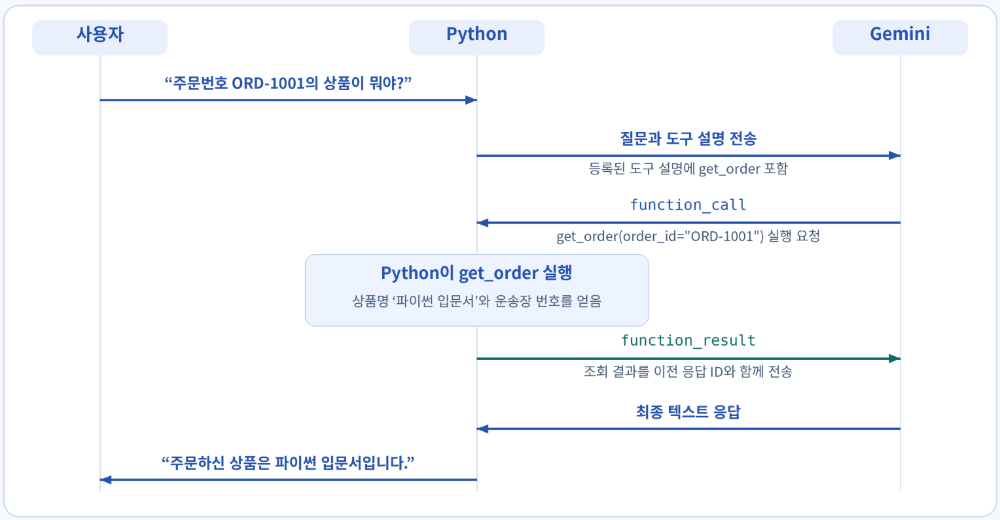
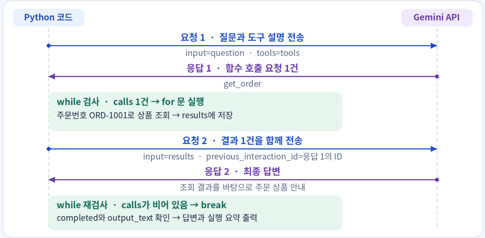
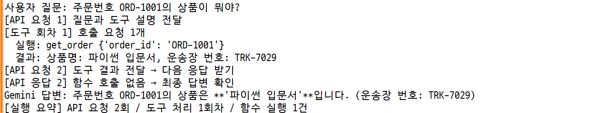
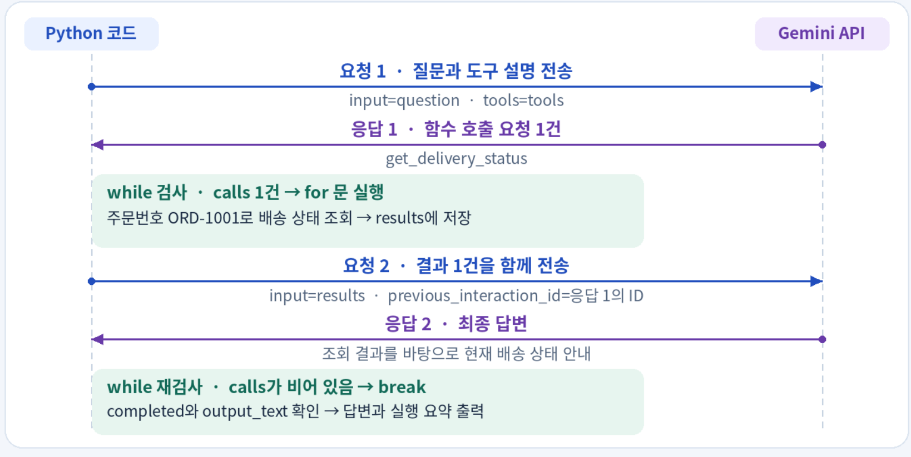
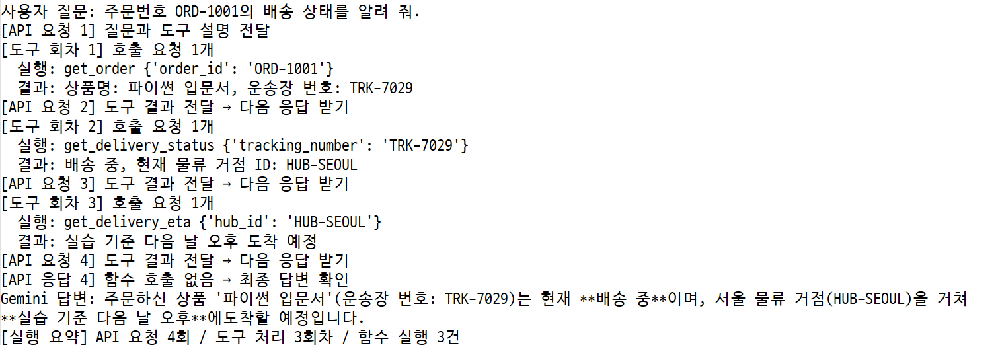
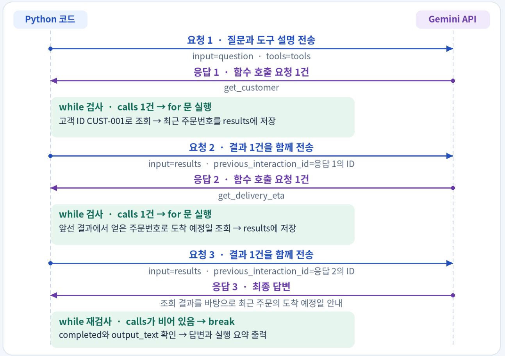
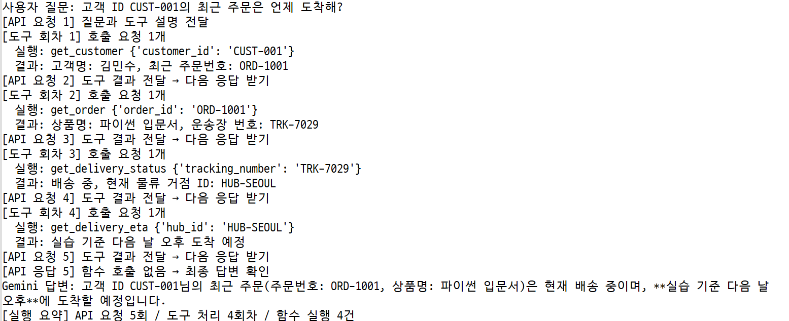
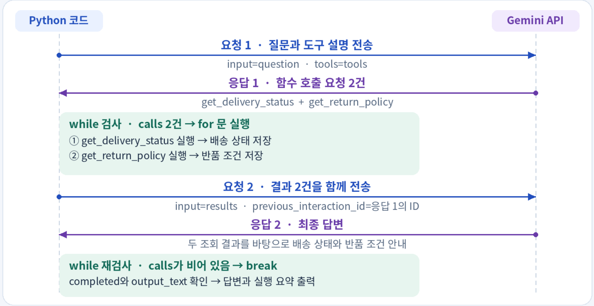
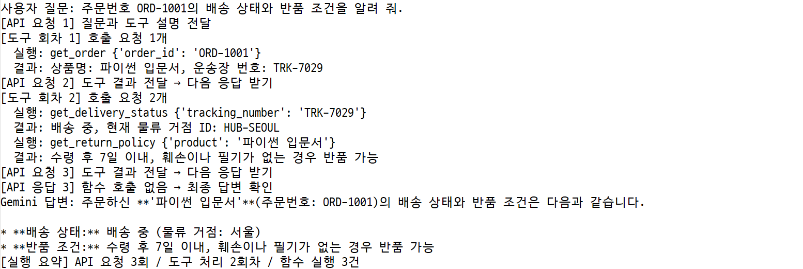

📂 **[[GitHub 코드 보러가기]](https://github.com/cericube/agent-workbook/tree/main/gemini-sdk-basics){: target="_blank" rel="noopener noreferrer" }**

Gemini가 주문 정보나 배송 상태처럼 프로그램 안에 있는 데이터를 이용해 답하려면, 필요한 정보를 조회할 방법이 있어야 합니다. **Function Calling**은 모델이 필요한 함수와 인자를 요청하고, Python이 그 함수를 실행해 결과를 돌려주는 방식입니다.  

## 1. Function Calling의 개념과 역할 구분 {#session-01}

### 🟦 Gemini가 조회를 요청하면 Python이 실행합니다

사용자가 “주문번호 ORD-1001의 상품이 뭐야?”라고 물었다고 가정하겠습니다. 상품명을 알려면 주문 데이터를 조회해야 합니다. Gemini에는 주문을 조회하는 `get_order` 함수가 있다는 설명을 미리 전달합니다.  

Gemini는 그 설명을 보고 **“`get_order`에 주문번호 `ORD-1001`을 넣어 실행해 주세요”**라는 요청을 보냅니다. Python은 실제 함수를 실행하고, 조회한 상품명을 Gemini에 돌려줍니다. Gemini는 그 결과를 읽고 사용자에게 답합니다.  

| 주체 | 하는 일 |
|---|---|
| Gemini | 어떤 함수가 필요한지 판단하고, 함수 이름과 전달할 값인 인자를 정합니다. 받은 결과를 바탕으로 답합니다. |
| Python 프로그램 | Gemini가 요청한 함수를 실행하고, 실행 결과를 Gemini에 전달합니다. |

### 🟦 질문에 답하기까지의 과정



```text
사용자: “주문번호 ORD-1001로 주문한 상품이 뭐야?”
  ↓
Python → Gemini: 질문과 주문 조회 함수에 대한 설명을 전달합니다.
  ↓
Gemini → Python: get_order 함수에 주문번호 ORD-1001을 전달해 실행하도록 요청합니다.
  ↓
Python: 함수를 실행해 상품명이 “파이썬 입문서”임을 확인합니다.
  ↓
Python → Gemini: 조회한 상품 정보를 전달합니다.
  ↓
Gemini: “주문하신 상품은 파이썬 입문서입니다.”라는 답변을 생성합니다.
```

Gemini의 함수 실행 요청을 `function_call`, Python이 전달하는 함수 실행 결과를 `function_result`라고 합니다. 위 예시는 상품명만 보여 주지만, 실습 함수는 운송장 번호도 함께 반환합니다.  

Gemini는 조회 결과를 확인한 뒤 다른 함수를 실행해 달라고 요청할 수도 있습니다. 예를 들어 배송 상태를 묻는 질문에는 주문 조회 결과에 포함된 운송장 번호로 배송 조회를 요청합니다. Python은 요청받은 함수를 실행하고 결과를 다시 전달합니다. 추가 함수 호출 요청이 없으면 반복을 마치고 최종 답변을 확인합니다.  

## 2. Python 함수와 도구 스키마 작성하기 {#session-02}

### 🟦 주문 정보를 조회하는 Python 함수 작성하기

함수 호출 기능을 사용하려면 **실제로 실행할 Python 함수**와 **Gemini에 전달할 함수 설명**이 필요합니다. 먼저 주문번호를 받아 상품명과 운송장 번호를 반환하는 `get_order()`를 작성합니다.  

아래 예제는 `ORDERS` 딕셔너리에서 주문 정보를 찾습니다. 해당 주문이 없으면 안내 문구를 반환합니다.  

```python
# 소스 경로: gemini-sdk-basics/ch04/order_tools.py
ORDERS = {
    "ORD-1001": {"product": "파이썬 입문서", "tracking_number": "TRK-7029"},
    "ORD-1002": {"product": "USB 케이블", "tracking_number": "TRK-4186"},
}

def get_order(order_id: str) -> str:
    """주문번호로 상품명과 운송장 번호를 조회합니다."""
    # 주문번호로 주문 정보를 찾습니다. 해당 번호가 없으면 None을 반환합니다.
    order = ORDERS.get(order_id)
    if order is None:
        # 주문이 없다는 내용도 결과로 반환해 Gemini가 사용자에게 안내하도록 합니다.
        return f"주문번호 {order_id}에 해당하는 주문을 찾을 수 없습니다."
    # 이후 배송 조회에 필요한 운송장 번호도 상품명과 함께 반환합니다.
    return f"상품명: {order['product']}, 운송장 번호: {order['tracking_number']}"
```

실제 서비스에서는 이 함수 안에서 데이터베이스나 외부 API로 주문 정보를 조회할 수 있습니다. 여기서는 함수 호출 과정을 쉽게 따라갈 수 있도록 미리 준비한 데이터를 사용합니다.  

### 🟦 Gemini가 참고할 함수 설명 작성하기

이제 Gemini가 어떤 상황에서 `get_order()`를 요청해야 하는지 알 수 있도록 함수의 이름과 용도, 필요한 인자를 설명합니다. 이 설명을 **도구 스키마**라고 합니다.  

이 실습에서는 함수의 이름·용도·인자를 담은 get_order_tool 딕셔너리를 API 요청의 tools에 넣습니다. 실제 get_order() 함수는 Python 프로그램에서 실행합니다.  

```python
# 소스 경로: gemini-sdk-basics/ch04/order_tools.py
from google.genai.interactions import FunctionParam

get_order_tool: FunctionParam = {
    "type": "function",  # 함수 호출을 요청할 수 있는 도구임을 나타냅니다.
    "name": "get_order",  # Gemini가 호출 요청에 넣을 함수 이름입니다.
    # 모델이 이 도구가 필요한지 판단할 때 참고하는 설명입니다.
    "description": "주문번호로 상품명과 운송장 번호를 조회합니다.",
    "parameters": {
        "type": "object",  # 함수에 전달할 인자들을 하나의 객체로 정의합니다.
        "properties": {
            "order_id": {"type": "string", "description": "주문번호. 예: ORD-1001"},
        },
        "required": ["order_id"],  # 주문번호를 필수 인자로 지정합니다.
    },
}
```

| 항목 | 의미 |
|---|---|
| `type` | 함수 도구이므로 `"function"`을 지정합니다. |
| `name` | Gemini가 실행 요청에 사용할 함수 이름입니다. Python은 이 이름으로 실행할 함수를 구분합니다. |
| `description` | 함수가 하는 일과 반환하는 정보를 설명합니다. Gemini가 사용할 도구를 선택할 때 참고합니다. |
| `parameters.properties` | 함수에 전달할 각 인자의 이름, 자료형, 설명을 정의합니다. |
| `parameters.required` | 실행에 반드시 필요한 인자를 지정합니다. |

스키마에 정의한 `order_id`는 Python 함수의 매개변수 이름과 일치해야 합니다. Gemini가 `{"order_id": "ORD-1001"}`이라는 인자를 요청하면, Python은 이를 `get_order(order_id="ORD-1001")`로 실행하기 때문입니다.  

## 3. Function Calling 요청과 실행 흐름 {#session-03}

Gemini가 함수 실행을 요청하면 Python이 실행 결과를 전달합니다. 필요한 만큼 이 과정을 반복한 뒤 최종 답변을 출력합니다.  

```text
질문과 도구 설명으로 Gemini에 첫 요청을 보냅니다.
while: 응답에서 함수 호출 요청을 확인합니다.
    ├── 함수 호출 없음 → break
    └── 함수 호출 있음
        ├── for: 요청받은 함수를 실행하고 결과를 모읍니다.
        └── 결과를 Gemini에 요청으로 보내고 새 응답을 받아 while 처음으로 돌아갑니다.
반복이 끝나면 최종 답변을 확인하고 출력합니다.
```

다음은 `ask_question()`의 전체 처리 구조입니다. 원본의 import와 도구 정의를 사용하며, 흐름에 집중할 수 있도록 일부 진행 로그는 생략했습니다. 코드의 ①~⑤ 주석을 아래 설명과 함께 읽으면 됩니다.  

```python
# 소스 경로: gemini-sdk-basics/ch04/function_calling.py
def ask_question(client: genai.Client, model: str, question: str):
    """함수 호출 요청 → Python 실행 → 결과 전달을 반복합니다."""
    # ① 사용할 도구 설명을 준비하고 질문과 함께 첫 요청을 보냅니다.
    tools: list[FunctionParam] = [
        get_customer_tool,
        get_order_tool,
        get_delivery_status_tool,
        get_delivery_eta_tool,
        get_return_policy_tool,
    ]
    # 질문마다 API 요청 수, 도구 처리 회차, 함수 실행 건수를 새로 셉니다.
    api_requests = 1
    tool_round = 0
    function_count = 0
    max_tool_rounds = 6

    response = client.interactions.create(
        model=model,  # 요청을 처리할 Gemini 모델입니다.
        input=question,  # 사용자 질문입니다.
        tools=tools,  # 실행을 요청할 수 있는 함수들의 설명입니다.
        stream=False,  # 스트리밍 이벤트 대신 응답 객체를 받습니다.
        store=True,  # 후속 요청에서 이전 응답 ID를 참조할 수 있게 기록을 저장합니다.
    )

    # ② 첫 응답과 후속 응답에서 함수 호출 요청을 확인합니다.
    while True:
        if not isinstance(response, Interaction):
            raise TypeError("일반 응답이 필요합니다.")
        if response.status not in ("completed", "requires_action"):
            raise RuntimeError(f"요청 실패: {response.status}")
        # 한 응답에 여러 함수 호출 요청이 함께 포함될 수 있어 모두 모읍니다.
        calls = [
            step for step in response.steps or [] if isinstance(step, FunctionCallStep)
        ]
        if not calls:
            break  # 반복문을 벗어나 ⑤에서 최종 답변을 확인합니다.
        # 추가 호출이 있어도 도구 처리 회차가 상한에 도달하면 중단합니다.
        if tool_round >= max_tool_rounds:
            raise RuntimeError("도구 실행 회차 제한을 초과했습니다.")

        tool_round += 1
        # ③ 이번 응답에서 요청한 함수를 순서대로 실행하고 결과를 모읍니다.
        results: list[FunctionResultStepParam] = []
        for call in calls:
            # 인자 딕셔너리를 **로 펼쳐 해당 Python 함수에 전달합니다.
            if call.name == "get_customer":
                result = get_customer(**call.arguments)
            elif call.name == "get_order":
                result = get_order(**call.arguments)
            elif call.name == "get_delivery_status":
                result = get_delivery_status(**call.arguments)
            elif call.name == "get_delivery_eta":
                result = get_delivery_eta(**call.arguments)
            elif call.name == "get_return_policy":
                result = get_return_policy(**call.arguments)
            else:
                raise ValueError(f"등록하지 않은 도구입니다: {call.name}")
            function_count += 1
            # 각 결과를 원래 함수 호출 ID와 연결합니다.
            results.append(
                {
                    "type": "function_result",
                    "name": call.name,
                    "call_id": call.id,
                    "result": [{"type": "text", "text": result}],
                }
            )

        # ④ 모은 결과를 한 번에 보내고 response를 새 응답으로 교체합니다.
        if not response.id:
            raise RuntimeError("이전 응답 ID가 없습니다.")
        api_requests += 1
        response = client.interactions.create(
            model=model,
            input=results,
            previous_interaction_id=response.id,  # 방금 처리한 응답과 연결합니다.
            tools=tools,
            stream=False,
            store=True,
        )

        # 새 응답을 받은 뒤 ②로 돌아가 추가 호출이 있는지 확인합니다.

    # ⑤ 반복이 끝나면 완료 상태와 답변을 확인하고 실행 요약을 출력합니다.
    if response.status != "completed" or not response.output_text:
        raise RuntimeError(f"최종 답변을 받지 못했습니다: {response.status}")
    print("Gemini 답변:", response.output_text)
    print(
        f"[실행 요약] API 요청 {api_requests}회 / "
        f"도구 처리 {tool_round}회차 / 함수 실행 {function_count}건"
    )
```

### 🟦 ① 질문과 도구 설명 보내기

`tools`에는 Gemini가 선택할 수 있는 함수의 설명을 모읍니다. 첫 요청의 `input`에는 사용자 질문을 넣습니다.  

`store=True`는 이후 요청에서 이 응답의 ID를 참조할 수 있도록 기록을 저장합니다. 첫 요청에는 `previous_interaction_id`가 없으므로 질문마다 새 대화로 시작합니다.  
이때 Python 조회 함수는 아직 실행되지 않았습니다. Gemini가 질문과 도구 설명을 보고 어떤 함수가 필요한지 판단하는 단계입니다.  

### 🟦 ② 응답에서 함수 호출 요청 확인하기

첫 응답을 `response`에 저장한 뒤 `while True`에 진입합니다. 응답의 타입과 상태를 확인하고, `FunctionCallStep`만 골라 `calls`에 모읍니다.  

호출 요청이 없으면 `break`로 `while`을 벗어나 ⑤의 최종 답변 검사로 이동합니다.  
요청이 있으면 ③에서 함수를 실행합니다. `max_tool_rounds = 6`은 함수 개수가 아니라, 호출을 처리하고 결과를 전달하는 회차의 상한입니다.  

### 🟦 ③ 요청받은 함수를 실행하고 결과 모으기

한 번의 API 요청에 대해 Gemini가 여러 함수의 실행을 함께 요청할 수 있습니다. 이 경우 `calls`에 여러 호출 요청이 담기며, `for call in calls`에서 요청받은 함수를 하나씩 순서대로 실행합니다.  

각 `call`에는 실행할 함수 이름(`call.name`), 함수에 전달할 인자(`call.arguments`), 호출을 구분하는 ID(`call.id`)가 들어 있습니다. 실행 결과는 `function_result` 형식으로 만들어 `results`에 모으고, `call_id`에 `call.id`를 넣어 원래 호출 요청과 연결합니다.  

**이번 응답에서 요청한 함수를 모두 실행한 뒤, 모아 둔 결과를 다음 API 요청 한 번으로 함께 전달합니다.**

### 🟦 ④ 실행 결과를 보내고 다음 응답 확인하기

`for`에서 모든 함수를 실행하면, `results`에 모은 결과를 Gemini에 한 번에 보냅니다. 첫 요청에서는 질문을 보냈지만, 이번에는 함수 실행 결과를 보냅니다.  

| 항목 | 처음 질문을 보낼 때 | 실행 결과를 보낼 때 |
|---|---|---|
| `input` | 사용자 질문인 `question`을 넣습니다. | 실행 결과를 모은 `results`를 넣습니다. |
| `previous_interaction_id` | 넣지 않습니다. | 함수 호출 요청이 담긴 응답의 `response.id`를 넣습니다. |
| `tools` | 사용 가능한 함수의 설명을 보냅니다. | 다른 함수도 요청할 수 있도록 같은 설명을 다시 보냅니다. |

`call.id`는 **어떤 함수 호출의 결과인지** 알려 주고, `response.id`는 **어떤 응답에 이어서 보내는 요청인지** 알려 줍니다.  

새 응답을 받으면 `response`에 저장하고, `while` 처음으로 돌아가 추가 함수 호출 요청이 있는지 확인합니다. 예를 들어 주문 조회 결과를 받은 Gemini가 운송장 번호로 배송 조회를 요청하면, Python은 배송 함수를 실행하고 결과를 다시 보냅니다.  

**추가 호출 요청이 있으면 실행과 결과 전달을 반복하고, 없으면 반복을 끝냅니다.** 정해 둔 회차를 넘어서도 호출 요청이 남아 있으면 오류로 중단합니다.  

### 🟦 ⑤ 최종 답변과 실행 요약 출력하기

`break`로 `while`을 빠져나오면 ⑤의 완료 검사를 실행합니다. 이 부분은 **반복문 밖**입니다.  

호출 요청이 없다는 사실만으로 정상 완료를 뜻하지는 않습니다. `response.status`가 `"completed"`이고 `response.output_text`에 답변이 있어야 최종 답변과 실행 요약을 출력합니다. 어느 한 조건이라도 충족하지 못하면 오류로 종료합니다.  

## 4. 질문별 Python과 Gemini API의 실행 흐름 {#session-04}

### 🟦 실습 1. 주문한 상품 조회하기

Python이 주문번호로 상품 정보를 조회하고 그 결과를 Gemini에 전달합니다. Gemini는 조회한 상품 정보를 바탕으로 답변합니다. **주문 조회 함수를 한 번 실행하면 답변에 필요한 정보를 얻을 수 있습니다.**  




### 🟦 실습 2. 배송 상태와 도착 예정일 조회하기

Gemini는 주문 조회 결과에 있는 운송장 번호로 배송 조회를 요청하고, 이어서 물류 거점 ID로 도착 예정일 조회를 요청했습니다. Python은 요청받은 함수를 차례로 실행하고 결과를 전달했습니다. **조회 결과를 다음 조회에 활용하며 세 함수를 순서대로 실행한 예시입니다.**  




### 🟦 실습 3. 고객의 최근 주문 도착 예정일 조회하기

고객 ID로 최근 주문번호를 찾은 뒤, 주문 정보와 배송 상태, 도착 예정일을 차례로 조회합니다. **네 함수를 실행하는 동안 같은 반복문에서 Gemini의 요청을 확인하고 실행 결과를 전달합니다.**  




### 🟦 실습 4. 배송 상태와 반품 조건 함께 조회하기

주문 조회 결과를 받은 Gemini는 운송장 번호로 배송 상태를, 상품명으로 반품 조건을 조회하도록 **한 응답에서 두 함수의 실행을 요청했습니다.** Python은 두 함수를 순서대로 실행한 뒤 결과를 한 번에 전달했습니다. 주문 조회까지 포함해 함수는 총 3번 실행했지만, 두 호출을 함께 처리했으므로 도구 처리는 2회차입니다.  


