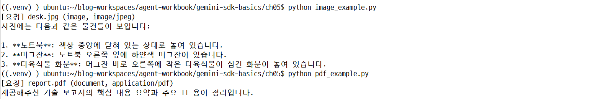
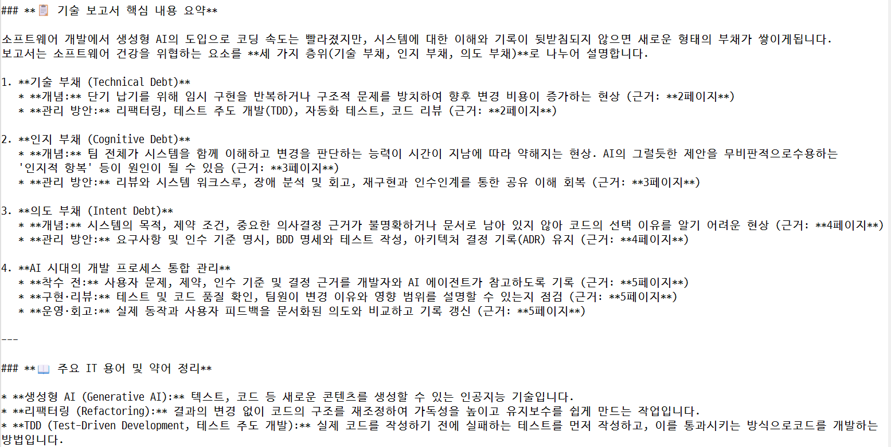
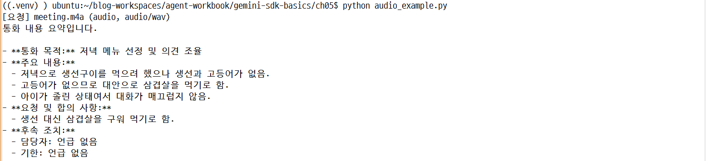
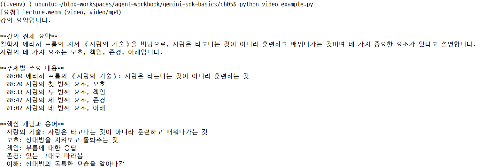

📂 **[[GitHub 코드 보러가기]](https://github.com/cericube/agent-workbook/tree/main/gemini-sdk-basics){: target="_blank" rel="noopener noreferrer" }**

## 1. 멀티모달 API 개념과 입력 데이터 구조 {#session-01}

Gemini에 사진이나 문서, 녹음 파일을 질문과 함께 보내면 내용을 분석해 답변합니다. 예를 들어 영수증에서 합계 금액을 찾거나 통화에서 합의한 내용을 정리해 달라고 요청할 수 있습니다.  

> 아래 예제에는 실제 실행 화면을 함께 실었습니다. 같은 자료를 보내도 실행할 때마다 답변의 표현이나 분석 내용은 달라질 수 있습니다.  

### 🟦 멀티모달 API란?

**멀티모달(Multimodal)**은 텍스트·이미지·소리처럼 서로 다른 형태의 정보를 함께 다루는 것을 뜻합니다. 멀티모달 API에 질문과 자료를 보내면 모델이 자료를 분석해 답변합니다.  

```text
Python → Gemini: “이 영수증의 합계를 알려 주세요.” + 영수증 이미지
Gemini → Python: “합계는 8,560원입니다.”
```

### 🟦 텍스트·이미지·문서·오디오·동영상 입력 유형

Interactions API의 `input`에는 질문과 파일을 각각 하나의 항목으로 넣습니다. 각 항목의 `type`으로 텍스트인지, 이미지나 문서인지 구분합니다.  

| 입력 | `type` | MIME 타입 예시 | 활용 예시 |
|---|---|---|---|
| 텍스트 | `text` | 지정하지 않습니다. | 무엇을 분석할지 지시합니다. |
| 이미지 | `image` | `image/jpeg`, `image/png` | 사진 속 사물이나 글자를 묻습니다. |
| PDF | `document` | `application/pdf` | 문서를 요약하거나 표의 수치를 묻습니다. |
| 오디오 | `audio` | `audio/wav` | 말한 내용을 글로 옮기거나 요약합니다. |
| 동영상 | `video` | `video/mp4` | 장면과 음성을 바탕으로 주요 구간을 찾습니다. |

MIME 타입은 `image/jpeg`처럼 파일 형식을 나타내는 값입니다. 모델마다 지원하는 입력 종류가 다르므로, 사용할 파일 형식을 지원하는 모델을 선택합니다.  

### 🟦 텍스트 지시문과 파일을 하나의 요청으로 구성하기

질문만 보낼 때는 `input="질문"`처럼 문자열을 전달합니다. 파일도 함께 보내려면 `input`을 목록으로 만들고, 질문과 파일을 각각 하나의 항목으로 넣습니다.  

```text
input
├── type = "text"
│   └── text: 무엇을 분석할지 적은 질문입니다.
└── type = "image" / "document" / "audio" / "video"
    ├── mime_type: 파일 형식입니다.
    └── data: 파일을 Base64 문자열로 바꾼 값입니다.
```

여기서는 파일 내용을 요청에 직접 담는 **인라인 입력**을 사용합니다. Python으로 파일을 읽고, Base64 형식의 문자열로 바꾸어 전달합니다.  
파일을 먼저 업로드하고, 업로드한 파일의 URI를 요청에 넣는 **Files API 방식**도 있습니다. 파일이 크거나 같은 파일을 여러 번 분석할 때 활용할 수 있습니다.  

### 🟦 공통 함수에서 파일과 질문 보내기

`ask_file()`은 각 예제에서 함께 사용하는 함수입니다. 파일이 존재하고 내용이 비어 있지 않은지 확인한 뒤, 파일 내용을 Base64 문자열로 바꾸어 질문과 함께 보냅니다.  

```python
# 소스 경로: gemini-sdk-basics/ch05/multimodal_common.py
def ask_file(file_path: str, content_type: str, mime_type: str, question: str) -> str:
    """이미지·PDF·오디오·동영상 파일을 질문과 함께 전달합니다."""
    # 1. ch05/.env를 먼저 읽고, 부족한 설정은 상위 폴더의 .env에서 읽습니다.
    # 이미 설정된 환경 변수는 덮어쓰지 않습니다.
    load_dotenv(BASE_DIR / ".env")
    load_dotenv()
    if not os.environ.get("GEMINI_API_KEY") or not os.environ.get("GEMINI_MODEL"):
        raise RuntimeError(".env에 GEMINI_API_KEY와 GEMINI_MODEL을 설정해 주세요.")

    # 2. 경로 문자열만 전송하지 않고 Python에서 파일 내용을 직접 읽습니다.
    path = BASE_DIR / file_path
    if not path.is_file():
        raise FileNotFoundError(f"실습 파일을 준비해 주세요: {path}")
    file_bytes = path.read_bytes()
    if not file_bytes:
        raise ValueError(f"빈 파일은 분석할 수 없습니다: {path}")

    # 3. 파일 바이트를 요청에 담을 수 있는 Base64 문자열로 바꿉니다.
    # 파일 형식을 변환하는 과정은 아닙니다. mime_type은 실제 파일 형식과 같아야 합니다.
    encoded_data = base64.b64encode(file_bytes).decode("utf-8")

    # 4. 질문과 파일을 같은 input 목록에 넣고 한 번 요청합니다.
    print(f"[요청] {path.name} ({content_type}, {mime_type})", flush=True)
    with genai.Client() as client:
        response = client.interactions.create(
            model=os.environ["GEMINI_MODEL"],
            input=[
                {"type": "text", "text": question},
                {
                    "type": content_type,
                    "mime_type": mime_type,
                    "data": encoded_data,
                },
            ],
            stream=False,  # 스트리밍 대신 완성된 응답 객체를 받습니다.
            store=False,  # 후속 대화 연결에 사용할 기록을 저장하지 않습니다.
        )
    # with를 벗어나면 클라이언트 연결을 닫습니다.

    # 5. 응답 객체, 완료 상태, 답변 텍스트를 확인한 뒤 호출한 예제에 반환합니다.
    if not isinstance(response, Interaction):
        raise TypeError("Interaction 응답이 필요합니다.")
    if response.status != "completed" or not response.output_text:
        raise RuntimeError(f"답변을 받지 못했습니다: {response.status}")
    return response.output_text
```

## 2. 이미지 입력과 분석 {#session-02}

사진 속 물건을 설명하거나 글자를 읽도록 요청할 수 있습니다. 책상 사진을 설명하는 예제와 영수증에서 날짜·합계를 찾는 예제를 살펴봅니다.  

### 🟦 예시: 사진 속 물건 설명하기

`desk.jpg`를 보내고 사진에 보이는 물건을 세 가지 이내로 설명하도록 요청합니다.  

```python
# 소스 경로: gemini-sdk-basics/ch05/image_example.py
from multimodal_common import ask_file

answer = ask_file(
    file_path="samples/desk.jpg",
    content_type="image",
    mime_type="image/jpeg",
    question="사진에 보이는 물건을 세 가지 이내로 설명해 주세요.",
)
print(answer)
```



Gemini가 사진 속 물건의 이름과 위치를 설명한 결과입니다. 실제 사진과 비교해 물건을 제대로 인식했는지 확인합니다.  

### 🟦 예시: 영수증 이미지에서 날짜와 합계 추출하기

`receipt.jpg`에서 결제 날짜와 최종 합계를 찾습니다. 읽기 어려운 항목은 추측하지 않고 '확인 불가'로 표시하도록 요청합니다.  

```python
# 소스 경로: gemini-sdk-basics/ch05/receipt_example.py
from multimodal_common import ask_file

answer = ask_file(
    file_path="samples/receipt.jpg",
    content_type="image",
    mime_type="image/jpeg",
    question=(
        "영수증에서 결제 날짜와 최종 합계 금액을 찾아 주세요. "
        "날짜: YYYY-MM-DD, 합계: 숫자원 형식으로 두 줄로 답하세요. "
        "읽을 수 없는 항목은 '확인 불가'라고 적으세요."
    ),
)
print(answer)
```


날짜와 합계가 요청한 대로 두 줄로 출력되었습니다. 두 값을 프로그램에서 따로 사용하려면 Structured Output으로 응답 구조를 정할 수 있습니다.  

## 3. PDF 및 문서 입력과 분석 {#session-03}

### 🟦 문서 요약과 표·그림에 대한 질의응답

문서 전체를 요약해 달라고 하거나 특정 표에서 수치를 찾아 달라고 요청할 수 있습니다. 필요한 내용을 쉽게 찾을 수 있도록 페이지 번호나 표 제목도 함께 적습니다.  

| 목적 | 질문 예시 |
|---|---|
| 전체 요약 | 보고서의 핵심 내용을 세 문장으로 요약해 주세요. |
| 표 분석 | '분기별 매출' 표에서 매출이 가장 높은 분기와 금액을 알려 주세요. |
| 그림 분석 | 매출 추이 그래프에서 증가 폭이 가장 큰 구간을 설명해 주세요. |

수치를 물을 때는 **어느 기간의 값인지, 단위는 무엇인지, 몇 페이지에 나오는지**도 함께 요청합니다. 계산한 값은 문서에 직접 적힌 값과 구분해서 표시하도록 합니다.  

### 🟦 예시: 기술 보고서 요약과 IT 용어 정리하기

`report.pdf`의 핵심 내용을 요약하고, 근거 페이지와 주요 IT 용어를 함께 정리하도록 요청합니다.  

```python
# 소스 경로: gemini-sdk-basics/ch05/pdf_example.py
from multimodal_common import ask_file

answer = ask_file(
    file_path="samples/report.pdf",
    content_type="document",
    mime_type="application/pdf",
    question=(
        "기술 보고서의 핵심 내용을 한국어로 직관적이고 간결하게 요약해 주세요. "
        "핵심 내용의 근거 근거 페이지를 표시하세요. "
        "이어서 주요 IT 용어와 약어는 간단히 정리 하세요. "
    ),
)
print(answer)
```



## 4. 오디오·동영상 처리 개요와 활용 {#session-04}

녹음 내용을 요약하거나 영상에서 원하는 주제가 나오는 시점을 찾을 수 있습니다. 전화 통화와 강의 영상을 예로 들어 살펴봅니다.  

**전사**는 녹음된 말을 글로 옮기는 작업이고, **요약**은 핵심 내용만 간추리는 작업입니다. 오디오를 보낼 때는 `type`을 `audio`로 지정하고, 질문에 원하는 작업을 적습니다.  

### 🟦 동영상의 장면·음성 분석과 타임스탬프 활용

동영상은 화면과 음성을 함께 분석할 수 있습니다. 원하는 주제가 나오는 시간을 **타임스탬프**로 표시해 달라고 요청할 수도 있습니다. 예를 들어 `00:20`은 영상이 시작된 뒤 20초가 지난 지점입니다.  

### 🟦 예시: 전화 통화 내용 요약하기

통화 녹음인 `meeting.m4a`를 보내고, 통화 목적과 주요 내용, 합의 사항, 후속 조치로 나누어 정리하도록 요청합니다.  

```python
# 소스 경로: gemini-sdk-basics/ch05/audio_example.py
from multimodal_common import ask_file

answer = ask_file(
    file_path="samples/meeting.m4a",
    content_type="audio",
    mime_type="audio/wav",
    question=(
        "전화 통화 내용을 한국어로 요약해 주세요. "
        "'통화 목적', '주요 내용', '요청 및 합의 사항', '후속 조치'로 나누어 정리하세요. "
        "후속 조치의 담당자와 기한은 통화에서 명확히 들리는 경우에만 적으세요. "
        "언급되지 않은 항목은 '언급 없음', 알아듣기 어려운 내용은 '확인 불가'로 표시하고 "
        "추측하지 마세요."
    ),
)
print(answer)
```



### 🟦 예시: 강의 요약과 주제별 시작 시간 정리하기

`lecture.webm`의 강의 내용을 요약하고, 주제별로 설명이 시작되는 시간을 표시하도록 요청합니다.  

```python
# 소스 경로: gemini-sdk-basics/ch05/video_example.py
from multimodal_common import ask_file

answer = ask_file(
    file_path="samples/lecture.webm",
    content_type="video",
    mime_type="video/mp4",
    question=(
        "영상의 화면과 음성을 참고해 강의 내용을 한국어로 요약해 주세요. "
        "먼저 강의 전체를 세 문장 이내로 요약하고, "
        "'주제별 주요 내용', '핵심 개념과 용어', '예제 및 실습', "
        "'복습할 핵심 사항'으로 나누어 정리하세요. "
        "주제별 주요 내용에는 영상 시작을 00:00으로 한 시작 시간을 "
        "MM:SS 형식으로 함께 적으세요. "
        "강의에 없는 내용은 추가하지 말고, 확인하기 어려운 내용은 "
        "'확인 불가', 예제나 실습이 없으면 '없음'으로 표시하세요."
    ),
)
print(answer)
```


