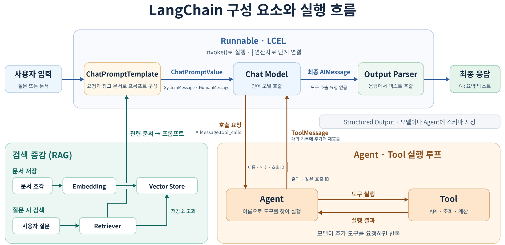
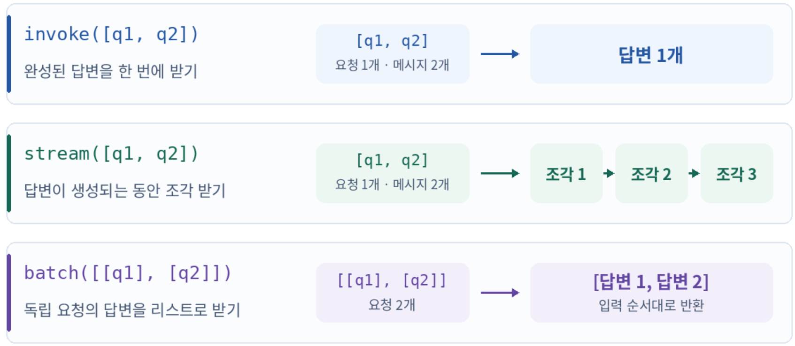

📂 **[[GitHub 코드 보러가기]](https://github.com/cericube/agent-workbook/tree/main/langchain-basics){: target="_blank" rel="noopener noreferrer" }**

## 1. LangChain 프레임워크 개요 {#session-01}

**LangChain**은 대규모 언어 모델(LLM)을 활용해 애플리케이션과 AI 에이전트를 만드는 오픈소스 프레임워크입니다. OpenAI, Anthropic, Google 등 여러 제공자의 모델을 연결할 수 있습니다. 프롬프트 구성, 모델 호출, 문서 검색, 도구 실행, 응답 처리에 필요한 구성 요소를 골라 조합합니다.  

### 🟦 LangChain의 주요 구성 요소

| 구성 요소 | 역할 |
| --- | --- |
| **Chat Model** | 프롬프트나 메시지를 받아 언어 모델을 호출하고 응답 메시지를 반환합니다. |
| **Prompt Template** | 사용자 입력이나 문서 내용을 템플릿에 채워 모델에 보낼 요청을 만듭니다. |
| **Message** | 사용자 요청, 모델 응답, 도구 실행 결과를 역할에 따라 구분합니다. |
| **Output Parser · Structured Output** | Output Parser는 응답을 텍스트나 데이터로 변환합니다. Structured Output은 지정한 스키마에 맞춰 응답을 받는 방식입니다. |
| **Runnable · LCEL** | Runnable은 `invoke()` 같은 공통 실행 방식을 제공합니다. LCEL은 파이프 연산자 등으로 여러 Runnable을 연결하는 표현식입니다. |
| **Tool** | 데이터 조회, API 호출, 계산처럼 모델이 실행을 요청할 수 있는 기능을 정의합니다. |
| **Agent** | 모델이 요청한 도구를 실행하고 결과를 전달해 모델을 다시 호출합니다. 모델이 추가 도구를 요청하면 이 과정을 반복합니다. |
| **Embedding · Vector Store · Retriever** | Embedding은 텍스트를 벡터로 변환합니다. Vector Store는 벡터를 저장하고 유사한 벡터를 찾습니다. Retriever는 질문과 관련된 문서를 찾아 반환합니다. |



### 🟦 LangChain의 주요 패키지

LangChain은 기능별로 패키지가 나뉘어 있습니다. 모델 연동, 문서 처리, 워크플로 구성 등 실습에 필요한 기능에 맞춰 패키지를 설치합니다.  

| 설치 패키지 | 설명 |
| --- | --- |
| `langchain` | `create_agent()`로 에이전트를 만들고 미들웨어를 설정합니다. |
| `langchain-core` | `Document`, 프롬프트, 메시지, Runnable 등 공통 구성 요소를 제공합니다. |
| `langchain-text-splitters` | `RecursiveCharacterTextSplitter` 등으로 문서를 작은 조각으로 나눕니다. |
| `langchain-unstructured` | `UnstructuredLoader`로 PDF, Word, HTML 등의 파일을 읽어 `Document`로 변환합니다. |
| `langchain-google-genai` | Google Gemini 채팅 모델과 임베딩 모델을 연결합니다. |
| `langchain-openai` | OpenAI 채팅 모델과 임베딩 모델을 연결합니다. |
| `langchain-anthropic` | Anthropic Claude 채팅 모델을 연결합니다. |
| `langchain-ollama` | Ollama에서 실행하는 채팅 모델과 임베딩 모델을 연결합니다. |
| `langchain-chroma` | Chroma에 벡터를 저장하고 유사도 검색을 수행합니다. |
| `langchain-mcp-adapters` | MCP 서버가 제공하는 도구를 LangChain 에이전트나 LangGraph 워크플로에서 사용할 수 있게 연결합니다. |
| `langgraph` | 실행 상태를 유지하면서 조건에 따라 분기하거나 반복하는 워크플로를 구성합니다. |
| `langchain-tests` | LangChain 연동 패키지가 공통 인터페이스를 올바르게 구현했는지 확인하는 표준 테스트를 제공합니다. |
| `langchain-classic` | `LLMChain` 등 이전 버전의 LangChain API를 제공합니다. |
| `langchain-community` | 여러 외부 연동을 모아 둔 패키지입니다. 2026년 5월에 유지보수가 종료됐습니다. |

### 🟦 LangChain의 주요 활용

- **대화와 요약** — 고객 상담 챗봇을 만들거나 회의록을 요약합니다.  
- **구조화된 데이터 추출** — 계약서에서 계약일, 당사자, 금액을 추출해 정해진 형식으로 저장합니다.  
- **문서 기반 질의응답(RAG)** — 사내 매뉴얼에서 질문과 관련된 내용을 검색하고, 검색 결과를 바탕으로 답변합니다.  
- **도구를 사용하는 AI 에이전트** — 상품 가격을 조회한 뒤 수량에 따른 총액을 계산해 안내합니다.  

회의록을 세 문장으로 요약하는 기능을 만들 때는 다음과 같이 구성 요소를 연결할 수 있습니다.  

```text
회의록
  → Prompt Template: 회의록을 넣어 요약 요청을 만듭니다.
  → Message: 요약 지시와 회의록을 역할에 맞는 메시지로 담습니다.
  → Chat Model: 모델 API를 호출하고 응답 메시지를 받습니다.
  → Output Parser: 응답에서 사용할 텍스트를 추출합니다.
  → 화면에 요약 표시
```

## 2. Chat Model과 Message {#session-02}

Chat Model은 모델 API를 호출하고, Message는 모델과 주고받는 내용을 담습니다. 두 개념이 어떻게 함께 쓰이는지 살펴봅니다.  

### 🟦 Chat Model은 모델 API를 호출합니다

**Chat Model**은 LLM을 호출할 때 사용하는 LangChain 인터페이스입니다.  
`model.invoke("질문")`을 실행하면 질문을 사용자 메시지 하나로 처리해 모델 API에 보냅니다. 모델이 생성한 답변은 `AIMessage` 객체로 받습니다.  

```text
질문 문자열 또는 메시지 목록
  → Chat Model → 모델 제공자의 API
  ← AIMessage ← 모델이 생성한 답변
```

LangChain의 Chat Model로 OpenAI의 GPT, Anthropic의 Claude, Google의 Gemini 등 여러 모델을 호출할 수 있습니다. 제공자에 따라 다음과 같은 연동 클래스를 사용합니다.  

| 제공자 | 모델 계열 | 연동 클래스 | 설치 패키지 |
|---|---|---|---|
| OpenAI | GPT | `ChatOpenAI` | `langchain-openai` |
| Anthropic | Claude | `ChatAnthropic` | `langchain-anthropic` |
| Google | Gemini | `ChatGoogleGenerativeAI` | `langchain-google-genai` |

사용할 모델에 맞는 패키지를 설치하고 API 키를 설정하면, `invoke()` 같은 기본 메서드로 질문을 보낼 수 있습니다. 지원하는 기능과 세부 옵션은 모델마다 다릅니다. 이번 편에서는 Gemini 연동을 실습합니다.  

제공자별 설정은 [OpenAI 연동 문서](https://docs.langchain.com/oss/python/integrations/chat/openai){: target="_blank" rel="noopener noreferrer" }, [Anthropic 연동 문서](https://docs.langchain.com/oss/python/integrations/chat/anthropic){: target="_blank" rel="noopener noreferrer" }, [Gemini 연동 문서](https://docs.langchain.com/oss/python/integrations/chat/google_generative_ai){: target="_blank" rel="noopener noreferrer" }를 참고합니다.  

### 🟦 Message는 역할과 내용을 담습니다

**Message**는 대화의 역할과 내용을 담는 객체입니다. 시스템 지시, 사용자 질문, 모델 답변, 도구 실행 결과를 구분하며, 대화가 오간 순서대로 목록에 담아 전달할 수 있습니다.  

| 메시지 클래스 | 역할 | 예시 |
|---|---|---|
| `SystemMessage` | 모델의 역할이나 답변 방식을 지시합니다. | “당신은 파이썬 입문자를 가르치는 강사입니다. 쉬운 용어와 짧은 예제로 설명하세요.” |
| `HumanMessage` | 사용자의 질문이나 요청을 담습니다. | “리스트와 튜플은 어떻게 달라?” |
| ` ` | 모델의 답변이나 도구 호출 요청을 담습니다. | 답변 텍스트 또는 주문 조회 요청 |
| `ToolMessage` | 도구를 실행한 결과를 모델에 전달합니다. | 주문 조회 결과: “배송 중” |

각 메시지의 내용은 `content`에 넣습니다. 기본 대화에서는 `SystemMessage`로 답변 방식을 정하고, `HumanMessage`로 질문을 보내면 `AIMessage`로 답변을 받습니다.  

도구가 필요하면 `AIMessage`에 도구 호출 요청이 담깁니다. Python은 요청받은 함수를 실행한 뒤 결과를 `ToolMessage`로 전달하고, 모델은 그 결과를 바탕으로 답변합니다.  

```text
HumanMessage: 사용자 질문
  → AIMessage: 도구 호출 요청
  → Python: 요청받은 함수 실행
  → ToolMessage: 실행 결과 전달
  → AIMessage: 최종 답변
```


`ToolMessage`의 `tool_call_id`는 원래 도구 호출의 ID와 일치해야 합니다.  
답변을 출력할 때는 응답의 `.text`를 읽고, 대화를 이어 갈 때는 받은 `AIMessage` 객체를 메시지 목록에 추가합니다.  

## 3. Gemini 연동과 첫 모델 호출 {#session-03}

Gemini 연동 패키지를 설치하고 API 키와 모델 ID를 설정합니다. 간단한 질문을 하나 보내고, 응답 객체의 타입과 답변을 확인합니다.  

### 🟦 패키지와 환경 변수 준비하기

LangChain은 기능별로 패키지가 나뉘어 있습니다. 이번 실습에서는 Gemini 연동 패키지와 `.env` 파일을 읽는 라이브러리를 설치합니다.  

```bash
# Gemini 연동 패키지와 .env 파일을 읽는 라이브러리를 설치합니다.
# python -m은 모듈(module)을 프로그램처럼 실행하는 옵션
# pip PATH 가 아닌 python 명령으로 선택된 인터프리터에서 pip 모듈 실행
python -m pip install -U langchain-google-genai python-dotenv
```

위 설치 명령을 실행하면 `langchain-google-genai`의 의존성인 `langchain-core`도 함께 설치됩니다. `langchain`은 에이전트 기능이 필요할 때 별도로 설치합니다.  

실습 폴더의 `.env` 파일에 Gemini 모델 ID와 API 키를 설정합니다.  

```dotenv
GEMINI_MODEL=gemini-3.5-flash-lite
GEMINI_API_KEY=발급받은_API_키
```

### 🟦 첫 질문 보내기

```python
# 파일명: /ch01/01_hello.py
from langchain_google_genai import ChatGoogleGenerativeAI
# .env 파일을 찾아 설정을 환경 변수로 불러옵니다.
# 이미 설정된 환경 변수는 덮어쓰지 않으므로 실행 환경의 설정이 우선합니다.
load_dotenv()

model_name = os.getenv("GEMINI_MODEL")
api_key = os.getenv("GEMINI_API_KEY")
if not model_name or not api_key:
    raise SystemExit(".env에 GEMINI_MODEL과 GEMINI_API_KEY를 설정해 주세요.")

# Gemini를 LangChain의 채팅 모델 인터페이스로 호출할 수 있도록 모델 객체를 만듭니다.
model = ChatGoogleGenerativeAI(
    model=model_name,
    api_key=api_key,
    vertexai=False,
)

# 응답 메시지의 타입과 답변 텍스트를 확인합니다.
response = model.invoke("LangChain을 한국어로 한 문장으로 설명해 줘.")
print(type(response).__name__)  # AIMessage
print(response.text)
```

Gemini는 Gemini Developer API와 Google Cloud의 (구)Vertex AI 경로를 통해 호출할 수 있습니다  
`vertexai`는 Gemini를 호출할 경로를 선택합니다.  

- `False`: Gemini Developer API를 사용(기본값)합니다. 이 예제의 설정입니다.
- `True`: Google Cloud의 Gemini Enterprise Agent Platform API를 사용합니다.

호출에 성공하면 첫 줄에는 `AIMessage`가, 다음 줄에는 Gemini가 생성한 답변이 출력됩니다.  

```text
((.venv) ) ubuntu:~/blog-workspaces/agent-workbook/langchain-basics/ch01$ python 01_hello.py 
<class 'langchain_core.messages.ai.AIMessage'>
LangChain(랑체인)은 **대형 언어 모델(LLM)을 활용하여 애플리케이션을 쉽게 개발할 수 있도록 돕는 프레임워크**입니다.
```

## 4. 메시지 목록으로 대화 이어가기 {#session-04}

### 🟦 메시지 목록에 첫 답변과 후속 질문 추가하기

```python
from langchain_core.messages import HumanMessage, SystemMessage

messages = [
    SystemMessage(content="파이썬 입문자에게 한국어로 한 문장으로 간결하게 설명해 주세요."),
    HumanMessage(content="리스트와 튜플 차이는?."),
]
# 1. 시스템 지시와 첫 질문을 보냅니다.
first_reply = model.invoke(messages)
print("첫 번째 답변")
print(first_reply.text)

# 2. 응답 메시지를 그대로 기록에 추가하고, 다음 질문을 붙입니다.
messages.append(first_reply)
messages.append(
    HumanMessage(content="그 차이를 보여주는 짧은 snippet 코드 예시 만들어 줘.")
)

# 3. 이전 질문과 답변이 포함된 목록으로 다시 요청합니다.
second_reply = model.invoke(messages)
print("\n")
print("두 번째 답변")
print(second_reply.text)
```

```text
((.venv) ) ubuntu:~/blog-workspaces/agent-workbook/langchain-basics/ch01$ python 02_conversation.py 
첫 번째 답변
리스트는 값의 수정, 추가, 삭제가 자유롭지만, 튜플은 한 번 만들면 그 값을 바꿀 수 없습니다.

두 번째 답변
my_list = [1, 2, 3]
my_list[0] = 10  # 가능: [10, 2, 3]

my_tuple = (1, 2, 3)
my_tuple[0] = 10  # 에러 발생! (값 변경 불가)
```

| 호출 | 전달하는 메시지 |
|---|---|
| 첫 번째 | 시스템 지시 → 첫 질문 |
| 두 번째 | 시스템 지시 → 첫 질문 → 첫 답변 → 후속 질문 |

이 예제의 **대화 기록은 Python의 `messages` 리스트에 저장**됩니다.  
같은 `model` 객체를 사용해도 이전 대화가 자동으로 포함되지는 않습니다.  
첫 질문과 답변을 함께 보내면 Gemini는 “그 차이”가 리스트와 튜플의 차이를 뜻한다는 것을 알 수 있습니다.  

### 🟦 텍스트 출력과 대화 기록 구분하기

`first_reply.text`는 답변 텍스트이고, `first_reply`는 모델의 응답을 담은 `AIMessage` 객체입니다. 대화를 이어 갈 때는 `messages.append(first_reply)`로 응답 메시지를 목록에 추가합니다.  

```text
첫 요청: [SystemMessage, HumanMessage]
  → AIMessage 반환
  → Python이 AIMessage와 새 HumanMessage를 목록에 추가합니다.
두 번째 요청: [SystemMessage, HumanMessage, AIMessage, HumanMessage]
  → 이전 대화를 참고한 AIMessage 반환
```

대화를 계속하려면 `second_reply`와 새 사용자 메시지를 차례로 목록에 추가합니다. 이 기록은 프로그램이 실행되는 동안만 유지되므로, 종료한 뒤에도 사용하려면 파일이나 데이터베이스 등에 저장해야 합니다.  

## 5. 모델 호출 방식: invoke(), stream(), batch() {#session-05}

같은 질문을 세 가지 방식으로 호출할 수 있으며, **답변을 받는 방식과 요청을 나누는 기준**을 살펴보겠습니다.  

| 메서드 | 처리 방식 | 반환값 |
|---|---|---|
| `invoke()` | 한 요청의 답변이 완성될 때까지 기다립니다. | `AIMessage` 하나 |
| `stream()` | 한 요청의 답변을 생성되는 대로 조금씩 받습니다. | `AIMessageChunk`를 차례로 받습니다. |
| `batch()` | 여러 요청을 각각 독립적으로 처리합니다. | 입력 순서에 맞춘 `AIMessage` 목록 |

먼저 공통으로 사용할 질문 두 개를 준비합니다.

```python
from langchain_core.language_models import LanguageModelInput
from langchain_core.messages import HumanMessage

questions = [
    HumanMessage(content="리스트를 한 문장으로 설명해 줘."),
    HumanMessage(content="튜플을 한 문장으로 설명해 줘."),
]
```

`invoke()`와 `stream()`에는 `questions` 전체를 전달해 두 질문을 **하나의 요청**으로 보냅니다.  
`batch()`에서는 각 질문을 별도의 메시지 목록으로 감싸 **두 개의 독립적인 요청**으로 보냅니다.  

```python
# 두 질문을 한 요청에 담아 완성된 답변 하나를 받습니다.
response = model.invoke(questions)

# 두 질문을 한 요청에 담아 답변을 조각으로 받습니다.
for chunk in model.stream(questions):
    print(chunk.text, end="", flush=True)
print()

# 질문마다 요청을 나누어 답변 두 개를 받습니다.
responses = model.batch([[questions[0]], [questions[1]]])
```

batch([[q1], [q2]])에서 바깥 리스트는 요청 목록이고, 안쪽 리스트는 각 요청의 메시지 목록입니다.  
그래서 invoke([q1, q2])로 호출하면 두 메시지가 한 요청에 들어갑니다.


### 🟦 invoke(): 완성된 응답 받기

`invoke()`는 답변이 완성될 때까지 기다린 뒤 `AIMessage` 하나를 반환합니다. `response.text`로 답변 텍스트를 확인합니다.  

```python
print("=== invoke(): 완성된 응답 ===")
# 메시지 목록 전체를 한 번의 요청으로 전달합니다.
response = model.invoke(questions)
print(response.text)
```

```text
=== invoke(): 완성된 응답 ===
* **리스트(List):** 생성된 후에 요소를 추가, 수정, 삭제할 수 있는 **변경 가능한(Mutable)** 순서가 있는 데이터 집합입니다.
* **튜플(Tuple):** 생성된 후에는 요소를 변경할 수 없는 **불변의(Immutable)** 순서가 있는 데이터 집합입니다.
```

`questions`에 메시지가 여러 개 있어도 각각 따로 호출하지 않습니다. 목록에 담긴 메시지를 모두 한 요청에 포함합니다.  

### 🟦 stream(): 응답 조각 받기

`stream()`은 답변이 생성되는 동안 `AIMessageChunk`를 차례로 전달합니다. 각 조각의 텍스트를 이어서 출력하면 답변이 조금씩 화면에 나타납니다.  

```python
print("\n=== stream(): 응답 조각 ===")
# 각 조각이 완성된 문장인 것은 아닙니다.
for chunk in model.stream(questions):
    # 줄바꿈 없이 이어서 출력하고, 출력 버퍼를 비워 바로 표시합니다.
    print(chunk.text, end="", flush=True)

```

```text
=== stream(): 응답 조각 ===
* **리스트(List):** 생성 후 **요소를 변경(수정, 추가, 삭제)할 수 있는** 가변(Mutable) 시퀀스 자료형입니다.
* **튜플(Tuple):** 생성 후 **요소를 변경할 수 없는** 불변(Immutable) 시퀀스 자료형입니다.
```

### 🟦 batch(): 독립적인 질문 여러 개 처리하기

`batch()`에는 독립적으로 처리할 요청들을 목록으로 전달합니다.  
여기서는 리스트와 튜플에 관한 질문을 각각 보내고, 입력 순서대로 답변을 받습니다.  

```python
print("\n=== batch(): 독립적인 질문 여러 개 ===")
# 바깥 목록은 독립적인 요청들, 안쪽 목록은 각 요청에 포함할 메시지들입니다.
inputs: list[LanguageModelInput] = [[question] for question in questions]

# 각 질문을 독립적으로 처리하고 입력 순서에 맞춘 응답 목록을 받습니다.
responses = model.batch(inputs)
for question, response in zip(questions, responses, strict=True):
    print(question.text)
    print(response.text)
```

```text
=== batch(): 독립적인 질문 여러 개 ===
리스트를 한 문장으로 설명해 줘.
**리스트는 여러 개의 데이터를 순서대로 모아서 관리할 수 있는 자료구조입니다.**
튜플을 한 문장으로 설명해 줘.
튜플은 **수정할 수 없는(immutable) 순서가 있는 데이터 집합**입니다.
```

`[[question] for question in questions]`는 질문마다 메시지 목록을 하나씩 만듭니다. 따라서 두 질문은 **서로 다른 요청**으로 처리되며, 첫 질문의 답변이 다음 질문의 대화 맥락에 포함되지 않습니다. `strict=True`는 질문과 응답의 개수가 다르면 오류를 내어 누락을 확인할 수 있게 합니다.  
