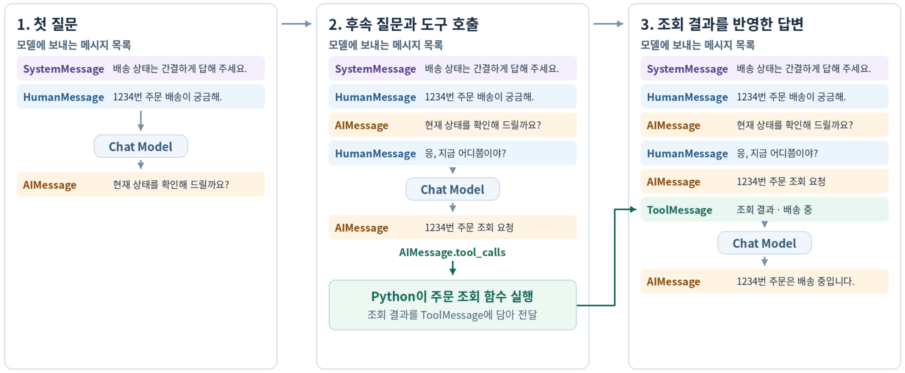

📂 **[[GitHub 코드 보러가기]](https://github.com/cericube/agent-workbook/tree/main/langchain-basics){: target="_blank" rel="noopener noreferrer" }**

## 1. LangChain 프레임워크와 주요 구성 요소 {#session-01}

### 🟦 LangChain으로 애플리케이션 구성하기

**LangChain**은 언어 모델을 활용하는 애플리케이션을 만들기 위한 프레임워크입니다. 모델에 보낼 입력을 만들고 응답을 처리하는 작업을 프롬프트 템플릿, 채팅 모델, 출력 파서 같은 구성 요소로 나누어 연결할 수 있습니다.  

예를 들어 **회의록을 세 문장으로 요약하는 기능**을 만든다고 해 보겠습니다. 프롬프트 템플릿에 회의록을 넣어 요약을 요청하는 메시지를 만들고, 채팅 모델에 전달합니다. 답변을 받으면 응답 메시지에서 텍스트를 꺼내 화면에 표시합니다.  

```text
회의록
  → Prompt Template: 회의록을 넣어 요약 요청을 만듭니다.
  → Message: 요약 지시와 회의록을 역할에 맞는 메시지로 담습니다.
  → Chat Model: 모델 API를 호출하고 응답 메시지를 받습니다.
  → Output Parser: 응답에서 사용할 텍스트를 추출합니다.
  → 화면에 요약 표시
```

위 흐름도는 각 구성 요소가 어떤 역할을 하는지 보여 주는 예시입니다.  

### 🟦 주요 구성 요소의 역할

| 구성 요소 | 하는 일 | 요약 기능에서의 예 |
|---|---|---|
| Prompt Template | 변수 값을 받아 모델에 보낼 입력을 만듭니다. | `{transcript}`에 회의록을 넣어 요약 요청을 만듭니다. |
| Message | 누가 어떤 내용을 말했는지 나타냅니다. | 요약 지시와 회의록을 메시지에 담습니다. |
| Chat Model | 입력을 받아 모델 API를 호출하고 응답 메시지를 반환합니다. | 요약 요청을 Gemini에 전달합니다. |
| Output Parser | 모델 응답을 다음 단계에서 사용할 형태로 변환합니다. | 응답 메시지에서 화면에 표시할 텍스트를 추출합니다. |
| Tool | 모델이 호출을 요청할 수 있는 기능을 정의합니다. | 회의록을 검색하는 함수를 도구로 제공합니다. |
| Runnable | 모델이나 템플릿 등을 공통된 방식으로 실행하고 연결할 수 있도록 합니다. | 프롬프트 생성, 모델 호출, 응답 처리를 하나의 흐름으로 연결합니다. |

필요한 구성 요소만 골라 사용할 수 있습니다.  


## 2. Chat Model과 Message {#session-02}

Chat Model은 모델 API를 호출하고, Message는 모델과 주고받는 내용을 담습니다. 두 개념이 어떻게 함께 쓰이는지 살펴봅니다.  

### 🟦 Chat Model은 모델 API를 호출합니다

**Chat Model**은 LLM을 호출할 때 사용하는 LangChain 인터페이스입니다.  
`model.invoke("질문")`을 실행하면 질문을 사용자 메시지 하나로 처리해 모델 API에 보냅니다. 모델이 생성한 답변은 `AIMessage` 객체로 받습니다.  

```text
질문 문자열 또는 메시지 목록
  → Chat Model → 모델 제공자의 API
  ← AIMessage ← 모델이 생성한 답변
```

LangChain의 Chat Model로 OpenAI의 GPT, Anthropic의 Claude, Google의 Gemini 등 여러 모델을 호출할 수 있습니다. 제공자에 따라 다음과 같은 연동 클래스를 사용합니다.  

| 제공자 | 모델 계열 | 연동 클래스 | 설치 패키지 |
|---|---|---|---|
| OpenAI | GPT | `ChatOpenAI` | `langchain-openai` |
| Anthropic | Claude | `ChatAnthropic` | `langchain-anthropic` |
| Google | Gemini | `ChatGoogleGenerativeAI` | `langchain-google-genai` |

사용할 모델에 맞는 패키지를 설치하고 API 키를 설정하면, `invoke()` 같은 기본 메서드로 질문을 보낼 수 있습니다. 지원하는 기능과 세부 옵션은 모델마다 다릅니다. 이번 편에서는 Gemini 연동을 실습합니다.  

제공자별 설정은 [OpenAI 연동 문서](https://docs.langchain.com/oss/python/integrations/chat/openai){: target="_blank" rel="noopener noreferrer" }, [Anthropic 연동 문서](https://docs.langchain.com/oss/python/integrations/chat/anthropic){: target="_blank" rel="noopener noreferrer" }, [Gemini 연동 문서](https://docs.langchain.com/oss/python/integrations/chat/google_generative_ai){: target="_blank" rel="noopener noreferrer" }를 참고합니다.  

### 🟦 Message는 역할과 내용을 담습니다

**Message**는 대화의 역할과 내용을 담는 객체입니다. 시스템 지시, 사용자 질문, 모델 답변, 도구 실행 결과를 구분하며, 대화가 오간 순서대로 목록에 담아 전달할 수 있습니다.  

| 메시지 클래스 | 역할 | 예시 |
|---|---|---|
| `SystemMessage` | 모델의 역할이나 답변 방식을 지시합니다. | “당신은 파이썬 입문자를 가르치는 강사입니다. 쉬운 용어와 짧은 예제로 설명하세요.” |
| `HumanMessage` | 사용자의 질문이나 요청을 담습니다. | “리스트와 튜플은 어떻게 달라?” |
| `AIMessage` | 모델의 답변이나 도구 호출 요청을 담습니다. | 답변 텍스트 또는 주문 조회 요청 |
| `ToolMessage` | 도구를 실행한 결과를 모델에 전달합니다. | 주문 조회 결과: “배송 중” |

각 메시지의 내용은 `content`에 넣습니다. 기본 대화에서는 `SystemMessage`로 답변 방식을 정하고, `HumanMessage`로 질문을 보내면 `AIMessage`로 답변을 받습니다.  

도구가 필요하면 `AIMessage`에 도구 호출 요청이 담깁니다. Python은 요청받은 함수를 실행한 뒤 결과를 `ToolMessage`로 전달하고, 모델은 그 결과를 바탕으로 답변합니다.  

```text
HumanMessage: 사용자 질문
  → AIMessage: 도구 호출 요청
  → Python: 요청받은 함수 실행
  → ToolMessage: 실행 결과 전달
  → AIMessage: 최종 답변
```


`ToolMessage`의 `tool_call_id`는 원래 도구 호출의 ID와 일치해야 합니다.  

답변을 출력할 때는 응답의 `.text`를 읽고, 대화를 이어 갈 때는 받은 `AIMessage` 객체를 메시지 목록에 추가합니다.  

## 3. Gemini 연동과 첫 모델 호출 {#session-03}

Gemini 연동 패키지를 설치하고 API 키와 모델 ID를 설정합니다. 간단한 질문을 하나 보내고, 응답 객체의 타입과 답변을 확인합니다.  

### 🟦 패키지와 환경 변수 준비하기

LangChain은 기능별로 패키지가 나뉘어 있습니다. 이번 실습에서는 Gemini 연동 패키지와 `.env` 파일을 읽는 라이브러리를 설치합니다.  

```bash
# Gemini 연동 패키지와 .env 파일을 읽는 라이브러리를 설치합니다.
# python -m은 모듈(module)을 프로그램처럼 실행하는 옵션
# pip PATH 가 아닌 python 명령으로 선택된 인터프리터에서 pip 모듈 실행
python -m pip install -U langchain-google-genai python-dotenv
```

| 패키지 | 역할 | 설치 방식 |
|---|---|---|
| `langchain-google-genai` | Gemini를 호출하는 `ChatGoogleGenerativeAI`를 제공합니다. | 위 명령으로 설치합니다. |
| `langchain-core` | 메시지 클래스, 프롬프트 템플릿 등 공통 기능을 제공합니다. | Gemini 연동 패키지의 의존성으로 함께 설치됩니다. |
| `python-dotenv` | `.env`의 설정을 환경 변수로 불러옵니다. | 위 명령으로 설치합니다. |
| `langchain` | 에이전트 등 상위 기능을 제공합니다. | 필요할 때 별도로 설치합니다. |

`langchain-google-genai`를 설치해도 `langchain` 패키지까지 자동으로 설치되지는 않습니다.  

```dotenv
GEMINI_MODEL=gemini-3.5-flash-lite
GEMINI_API_KEY=발급받은_API_키
```

### 🟦 main.py에서 첫 질문 보내기

아래 코드를 `main.py`에 저장하고 `python main.py`로 실행합니다.  

```python
# 파일명: main.py
import os
from pathlib import Path

from dotenv import load_dotenv
from langchain_google_genai import ChatGoogleGenerativeAI

# main.py와 같은 폴더의 .env를 읽습니다.
load_dotenv(Path(__file__).with_name(".env"))

model_name = os.getenv("GEMINI_MODEL")
api_key = os.getenv("GEMINI_API_KEY")
if not model_name or not api_key:
    raise SystemExit(".env에 GEMINI_MODEL과 GEMINI_API_KEY를 설정해 주세요.")

# 모델 ID와 인증 설정으로 Gemini 연동 객체를 만듭니다.
model = ChatGoogleGenerativeAI(
    model=model_name,
    api_key=api_key,
    vertexai=False,
)

# 응답 메시지의 타입과 답변 텍스트를 확인합니다.
response = model.invoke("LangChain을 한국어로 한 문장으로 설명해 줘.")
print(type(response).__name__)  # AIMessage
print(response.text)
```

| 코드의 이름 | 의미 |
|---|---|
| `ChatGoogleGenerativeAI` | LangChain에서 Gemini를 호출하는 연동 클래스입니다. |
| `GEMINI_MODEL` | 호출할 Gemini 모델의 ID를 담는 설정입니다. |
| `model` | 모델 ID와 API 키를 지정해 만든 Gemini 호출용 객체입니다. |
| `response` | 이번 호출에서 반환된 `AIMessage` 객체입니다. |

`vertexai=False`는 Gemini Developer API를 선택하는 설정입니다. 호출에 성공하면 첫 줄에는 `AIMessage`가, 다음 줄에는 Gemini가 생성한 답변이 출력됩니다.  

`load_dotenv()`는 이미 설정된 환경 변수를 기본적으로 덮어쓰지 않습니다. 연동 옵션은 [ChatGoogleGenerativeAI 공식 문서](https://docs.langchain.com/oss/python/integrations/chat/google_generative_ai)를 참고합니다.  

## 4. 메시지 목록으로 대화 이어가기 {#session-04}

먼저 리스트와 튜플의 차이를 묻고, 이어서 “그 차이”를 보여 주는 코드 예제를 요청합니다. 두 번째 질문을 보낼 때 이전 질문과 답변도 함께 전달합니다.  

### 🟦 메시지 목록에 첫 답변과 후속 질문 추가하기

이 절과 다음 절의 예제는 3절에서 만든 `model`을 사용합니다. `main.py`에서 **모델을 만드는 코드까지 그대로 두고**, 아래의 질문·출력 부분을 실습할 코드로 바꿉니다.  

```python
from langchain_core.messages import HumanMessage, SystemMessage

messages = [
    SystemMessage(content="파이썬 입문자에게 한국어로 간결하게 설명해 주세요."),
    HumanMessage(content="리스트와 튜플은 어떻게 달라?"),
]

# 1. 시스템 지시와 첫 질문을 보냅니다.
first_reply = model.invoke(messages)
print("첫 번째 답변")
print(first_reply.text)

# 2. 응답 메시지를 그대로 기록에 추가하고, 다음 질문을 붙입니다.
messages.append(first_reply)
messages.append(
    HumanMessage(content="그 차이를 보여 주는 짧은 코드 예제를 하나 들어 줘.")
)

# 3. 이전 질문과 답변이 포함된 목록으로 다시 요청합니다.
second_reply = model.invoke(messages)
print("두 번째 답변")
print(second_reply.text)
```

| 호출 | 전달하는 메시지 |
|---|---|
| 첫 번째 | 시스템 지시 → 첫 질문 |
| 두 번째 | 시스템 지시 → 첫 질문 → 첫 답변 → 후속 질문 |

이 예제의 **대화 기록은 Python의 `messages` 리스트에 저장**됩니다. 같은 `model` 객체를 사용해도 이전 대화가 자동으로 포함되지는 않습니다. 첫 질문과 답변을 함께 보내면 Gemini는 “그 차이”가 리스트와 튜플의 차이를 뜻한다는 것을 알 수 있습니다.  

### 🟦 텍스트 출력과 대화 기록 구분하기

`first_reply.text`는 답변 텍스트이고, `first_reply`는 모델의 응답을 담은 `AIMessage` 객체입니다. 대화를 이어 갈 때는 `messages.append(first_reply)`로 응답 메시지를 목록에 추가합니다.  

```text
첫 요청: [SystemMessage, HumanMessage]
  → AIMessage 반환
  → Python이 AIMessage와 새 HumanMessage를 목록에 추가합니다.
두 번째 요청: [SystemMessage, HumanMessage, AIMessage, HumanMessage]
  → 이전 대화를 참고한 AIMessage 반환
```

대화를 계속하려면 `second_reply`와 새 사용자 메시지를 차례로 목록에 추가합니다. 이 기록은 프로그램이 실행되는 동안만 유지되므로, 종료한 뒤에도 사용하려면 파일이나 데이터베이스 등에 저장해야 합니다.  

## 5. 모델 호출 방식: invoke(), stream(), batch() {#session-05}

답변을 한 번에 받을 수도 있고, 생성되는 대로 조금씩 받을 수도 있습니다. 독립적인 질문 여러 개를 처리하는 방법도 있습니다. 같은 `model` 객체로 세 가지 호출 방식을 비교합니다.  

| 메서드 | 입력과 반환값 | 사용 예 |
|---|---|---|
| `invoke(input)` | 입력 하나를 받아 완성된 `AIMessage` 하나를 반환합니다. | 질문 하나의 답변을 받습니다. |
| `stream(input)` | 입력 하나를 받아 `AIMessageChunk`를 순서대로 내보냅니다. | 답변이 생성되는 대로 화면에 표시합니다. |
| `batch(inputs)` | 여러 입력의 응답을 입력 순서대로 목록에 담아 반환합니다. | 여러 문서를 각각 요약합니다. |

### 🟦 invoke(): 완성된 응답 받기

3절에서는 질문 문자열을, 4절에서는 메시지 목록을 전달했습니다. 입력 형태는 다르지만, 두 경우 모두 **`invoke()`를 한 번 호출해 완성된 `AIMessage` 하나**를 받습니다.  

`invoke(messages)`는 메시지를 하나씩 따로 보내지 않습니다. 목록 전체를 한 번의 요청으로 전달합니다.  

### 🟦 stream(): 응답 조각 받기

`stream()`을 사용하면 생성된 답변을 조금씩 받아 출력할 수 있습니다. 3절에서 모델을 만드는 코드 아래에 다음 코드를 넣어 실행합니다.  

```python
# 응답 조각의 텍스트를 줄바꿈 없이 이어서 출력합니다.
for chunk in model.stream("리스트와 튜플의 차이를 간단히 설명해 줘."):
    print(chunk.text, end="", flush=True)

# 출력이 끝나면 마지막에 줄을 바꿉니다.
print()
```

`end=""`는 텍스트 조각을 줄바꿈 없이 이어서 출력하고, `flush=True`는 받은 내용을 바로 표시하도록 합니다. 각 조각이 완성된 문장인 것은 아닙니다.  

### 🟦 batch(): 독립적인 질문 여러 개 처리하기

리스트와 튜플에 대한 두 질문을 각각 보냅니다. 아래 코드도 3절에서 만든 `model`을 사용합니다.  

```python
questions = [
    "리스트를 한 문장으로 설명해 줘.",
    "튜플을 한 문장으로 설명해 줘.",
]

# 각 질문을 독립적으로 처리하고 입력 순서에 맞춘 응답 목록을 받습니다.
responses = model.batch(questions)
for question, response in zip(questions, responses):
    print(question)
    print(response.text)
```

`batch(questions)`는 각 질문을 따로 처리하므로 첫 질문의 답변을 다음 질문에서 사용하지 않습니다. `invoke(messages)`에는 이전 질문과 답변을 함께 담아 보낼 수 있습니다.  

| 코드 | 목록의 의미 |
|---|---|
| `model.invoke(messages)` | 한 번의 요청에 보낼 대화 기록입니다. |
| `model.batch(questions)` | 각각 따로 처리할 여러 질문입니다. |

모델 호출의 입력·반환 형식은 [LangChain 모델 공식 문서](https://docs.langchain.com/oss/python/langchain/models)를 참고합니다. 다음 편에서는 `ChatPromptTemplate`으로 시스템 지시와 사용자 메시지의 형식을 만들고, 변수 값만 바꾸어 재사용하는 방법을 살펴봅니다.  

### 🟦 참고 문서

- [LangChain 설치](https://docs.langchain.com/oss/python/langchain/install)
- [LangChain Chat Models](https://docs.langchain.com/oss/python/langchain/models)
- [LangChain Messages](https://docs.langchain.com/oss/python/langchain/messages)
- [LangChain의 Gemini 연동](https://docs.langchain.com/oss/python/integrations/chat/google_generative_ai)
- [Gemini 3.5 Flash-Lite](https://ai.google.dev/gemini-api/docs/models/gemini-3.5-flash-lite)
