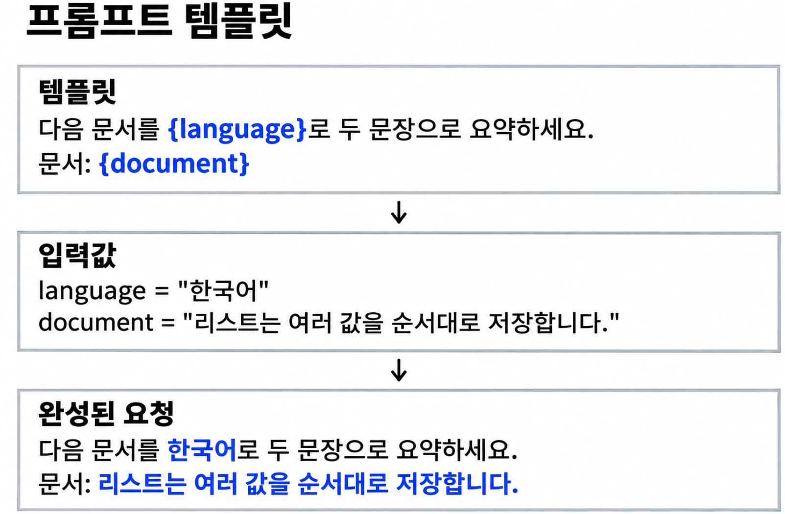
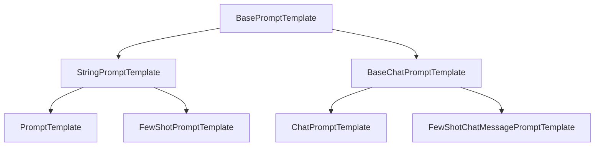
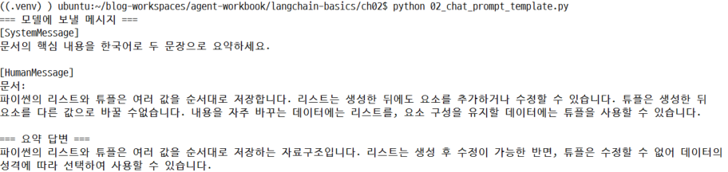
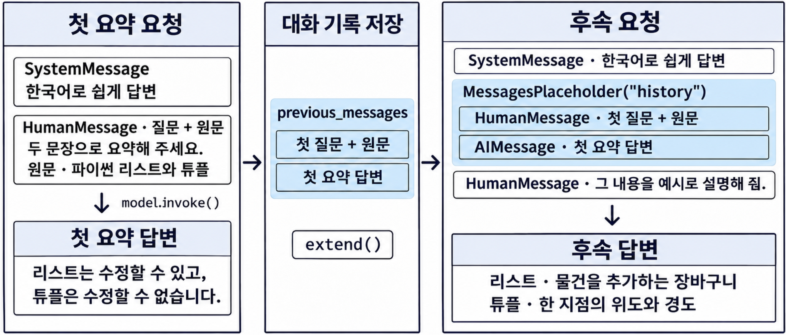
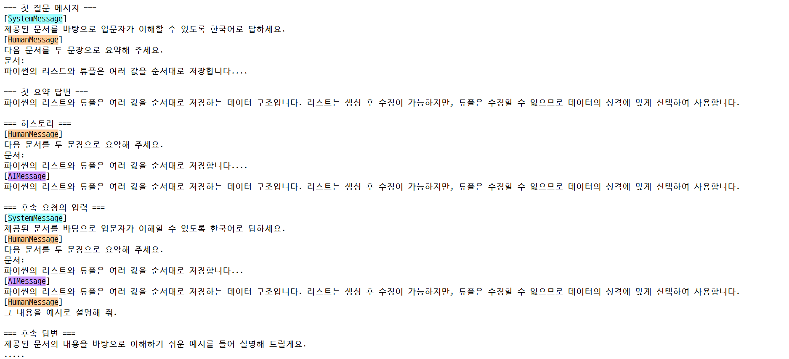
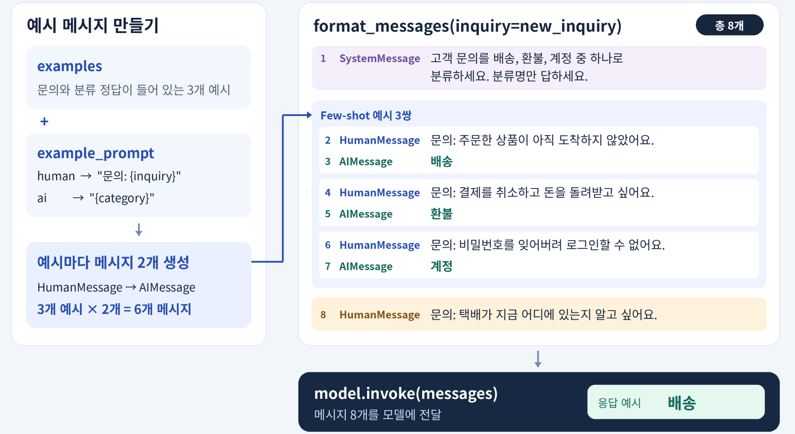
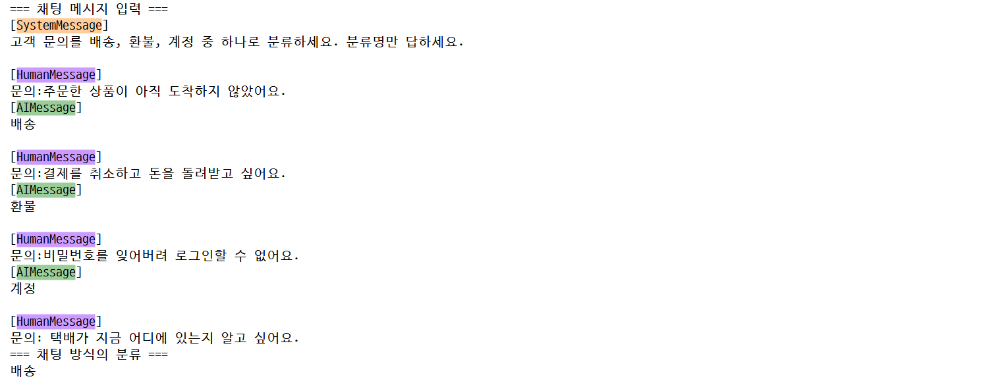
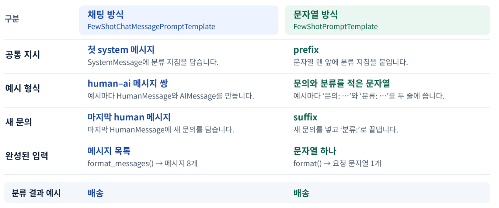

📂 **[[GitHub 코드 보러가기]](https://github.com/cericube/agent-workbook/tree/main/langchain-basics){: target="_blank" rel="noopener noreferrer" }**  
예제는 **`langchain-core 1.8.1`**을 기준으로 작성했습니다.  

## 1. 프롬프트 템플릿의 개념과 구조 {#session-01}

**프롬프트**는 모델에 보낼 요청입니다. **프롬프트 템플릿**은 요청에서 바뀌는 부분을 `{변수명}`으로 표시해 두고, 값만 바꿔 재사용하는 틀입니다.  


같은 템플릿에 **language와 document만 바꿔 넣으면** 새로운 요약 요청을 만들 수 있습니다.  

### 🟦 템플릿 생성부터 Gemini 호출까지

```text
템플릿 생성
  → 변수에 값 채우기
  → 모델에 보낼 입력 확인
  → model.invoke()로 Gemini 호출
  → AIMessage 응답에서 텍스트 확인
```

템플릿에 값을 채우면 모델에 보낼 입력이 완성됩니다. 이를 `model.invoke()`에 전달하면 Gemini를 호출하고, 답변을 `AIMessage`로 받습니다. 답변 텍스트는 `response.text`로 확인합니다.  

### 🟦 문자열·채팅 템플릿의 상속 구조

프롬프트 템플릿은 **문자열을 만드는 템플릿**과 **역할별 메시지를 만드는 템플릿**으로 나뉩니다. 아래는 주요 상속 관계입니다. 화살표는 부모 클래스에서 자식 클래스로 향하며, 내부 구현에 쓰이는 믹스인과 타입 표기는 생략했습니다.  



| 종류 | 클래스 | 구성 방식 | 활용 예 |
|---|---|---|---|
| 문자열 | `PromptTemplate` | 변수에 값을 넣어 문자열을 만듭니다. | 문서 요약 요청 |
| 문자열 | `FewShotPromptTemplate` | 지시, 예시, 새 입력을 문자열로 연결합니다. | 분류 예시를 포함한 문의 분류 |
| 채팅 | `ChatPromptTemplate` | 역할별 메시지를 순서대로 구성합니다. | 요약 지시는 `system`, 문서는 `human`으로 구분 |
| 채팅 | `FewShotChatMessagePromptTemplate` | 입력·답변 예시를 메시지 목록으로 만듭니다. | 문의는 `human`, 분류 결과는 `ai`로 구성 |

`format()`은 값을 채운 문자열을, `format_messages()`는 값을 채운 메시지 목록을 반환합니다.  

### 🟦 모델과 공통 문서 준비하기

```python
# 파일명: /ch02/01_prompt_template.py
from langchain_google_genai import ChatGoogleGenerativeAI

model = ChatGoogleGenerativeAI(
    model=model_name,
    api_key=api_key,
    vertexai=False,  # Gemini Developer API를 사용합니다.
)

document = (
    "파이썬의 리스트와 튜플은 여러 값을 순서대로 저장합니다. "
    "리스트는 생성한 뒤에도 요소를 추가하거나 수정할 수 있습니다. "
    "튜플은 생성한 뒤 요소를 다른 값으로 바꿀 수 없습니다. "
    "내용을 자주 바꾸는 데이터에는 리스트를, "
    "요소 구성을 유지할 데이터에는 튜플을 사용할 수 있습니다."
)
```

## 2. PromptTemplate으로 문자열 프롬프트 만들기 {#session-02}

### 🟦 from_template()과 format()으로 문서 요약 요청하기

`PromptTemplate.from_template()`에 문자열을 전달하면 `{document}`와 `{language}`를 입력 변수로 인식합니다.  
`format()`에 실제 값을 넣으면 모델에 보낼 문자열이 완성됩니다.  

```python
# 파일명: /ch02/01_prompt_template.py
from langchain_core.prompts import PromptTemplate

# 공통 지시와 변수 자리를 정의합니다.
template_text = (
    "다음 문서의 핵심 내용을 {language}로 두 문장으로 요약하세요.\n"
    "문서:\n{document}"
)
template = PromptTemplate.from_template(template_text)

print("입력 변수:", template.input_variables)
prompt_text = template.format(language="한국어", document=document)
print("=== 모델에 보낼 입력 ===")
print(prompt_text)

response = model.invoke(prompt_text)
print("=== 요약 답변 ===")
print(response.text)
```

### 🟦 생성자와 from_file()로 템플릿 만들기

`from_template()` 대신 생성자 `PromptTemplate(...)`를 사용할 수도 있습니다.  

```python
# 파일명: /ch02/01_prompt_template.py
# 같은 문자열과 입력 변수 목록을 생성자에 전달합니다.
explicit_template = PromptTemplate(
    template=template_text,
    input_variables=["language", "document"],
)
print(explicit_template.format(language="한국어", document=document))
```

다음은  `from_file()`로 파일을 읽어서 PromptTemplate를 생성하는 예시 입니다. 

```python
# 파일의 문구를 읽고 중괄호로 표시한 입력 변수를 찾습니다.
file_template = PromptTemplate.from_file(
    "summary_prompt.txt",
    encoding="utf-8",
)
print(file_template.format(language="한국어", document=document))
```

`from_file()`은 **템플릿 문구를 담은 텍스트 파일**을 읽습니다. JSON·YAML 설정을 읽는 `load_prompt()`와는 다릅니다. 기존 `load_prompt()`는 1.8.1에서 사용할 수 있지만 사용 중단이 예고된 API입니다.  

파일은 UTF-8 일반 텍스트로 저장하고, 값이 바뀌는 자리는 {변수명}으로 표시하면 됩니다.  
PromptTemplate.from_file()은 파일 전체를 템플릿 문자열로 읽고, 기본값인 template_format="f-string" 문법으로 입력 변수를 찾습니다


### 🟦 partial_variables와 partial()로 답변 언어 정해 두기

문서를 매번 한국어로 요약한다면 언어를 미리 정해 둘 수 있습니다. `partial()`은 기존 템플릿에서 일부 값을 채운 **새 템플릿**을 만듭니다. 다음 코드는 이 절의 첫 예제에 이어서 실행합니다.  

```python
# 파일명: /ch02/01_prompt_template.py
# 한국어를 기본값으로 채운 새 템플릿을 만듭니다.
korean_template = template.partial(language="한국어")
print("남은 입력 변수:", korean_template.input_variables)

# 실행할 때는 요약할 문서만 전달합니다.
prompt_text = korean_template.format(document=document)
print(prompt_text)
```

원본 `template`은 그대로 두고, `language`에 `"한국어"`를 미리 넣은 새 템플릿을 만듭니다. 새 템플릿의 `input_variables`에는 아직 값을 넣지 않은 `document`만 남습니다.  

처음부터 언어가 정해져 있다면 생성자의 `partial_variables`에 지정할 수도 있습니다.  

```python
korean_template = PromptTemplate(
    template=template_text,
    input_variables=["document"],
    partial_variables={"language": "한국어"},
)
print(korean_template.format(document=document))
```

`partial_variables`는 생성 시점에, `partial()`은 템플릿을 만든 뒤에 값을 지정합니다. 미리 지정한 값은 `format()`에서 다른 값을 명시하면 바꿀 수 있습니다.  

### 🟦 template_format으로 변수 문법 정하기

`from_template()`이나 생성자는 템플릿을 **만드는 방법**이고, `template_format`은 변수 자리를 **표시하는 문법**입니다. 이 글에서는 기본값인 `"f-string"`을 사용해 변수를 `{document}`처럼 표시합니다.  



| `template_format` | 변수 표시 | 설명 |
|---|---|---|
| `"f-string"` | `{document}` | 기본(권장) 형식입니다. |
| `"mustache"` | `{{document}}` | Mustache 문법을 사용합니다. |
| `"jinja2"` | `{{ document }}` | Jinja2도 이중 중괄호를 사용하며, 조건·반복 문법을 지원. |


```python
# 권장 형식입니다.
f_string_prompt = PromptTemplate(
    template="""다음 문서를 {language}로 두 문장으로 요약하세요.\n문서: {document}""",
    template_format="f-string",
)

# Mustache는 변수를 이중 중괄호로 표시합니다.
mustache_prompt = PromptTemplate.from_template(
    "다음 문서를 {{language}}로 두 문장으로 요약하세요.\n문서: {{document}}",
    template_format="mustache",
)

# Jinja2도 이중 중괄호를 사용하며, 조건·반복 문법을 지원합니다.
# 신뢰할 수 없는 출처의 Jinja2 템플릿은 사용하지 않는 것이 좋습니다. 
jinja2_prompt = PromptTemplate.from_template(
    "다음 문서를 {{ language }}로 두 문장으로 요약하세요.\n문서: {{ document }}",
    template_format="jinja2",
)

```

## 3. ChatPromptTemplate으로 역할별 메시지 만들기 {#session-03}

### 🟦 system에 공통 지시, human에 사용자 요청 넣기

`PromptTemplate` 사용하면 요약 지시와 문서를 문자열 하나에 담았습니다.  
`ChatPromptTemplate`을 사용하면 **공통 지시는 `system`에, 요약할 문서는 `human`에** 나누어 넣을 수 있습니다.  

`ChatPromptTemplate.from_messages()`에 `(역할, 내용 템플릿)` 튜플을 목록으로 전달합니다.  
각 메시지는 목록에 작성한 역할과 순서에 따라 만들어집니다.  

### 🟦 ChatTemplate의 구성 요소

`ChatPromptTemplate`에는 역할별 튜플과 함께, 이전 대화나 답변 예시를 넣을 수도 있습니다.  

| 구성 요소 | 담는 내용 | 사용 예 |
|---|---|---|
| `("system", "...")` | 모델이 따를 공통 지시 | 답변 언어나 분류 기준을 첫 메시지로 전달합니다. |
| `("human", "{question}")` | 사용자의 질문이나 요청 | 요약할 문서나 새 질문을 넣습니다. |
| `("ai", "...")` | 모델의 답변 내용 | 모델이 답한 내용을 담습니다. |
| `MessagesPlaceholder("history")` | 이전 질문과 답변을 담은 메시지 목록 | 시스템 지시와 새 질문 사이에 넣습니다. |
| `FewShotChatMessagePromptTemplate` | 개발자가 준비한 입력·답변 예시 | 예시 입력은 `human`, 예시 답변은 `ai`로 만들어 분류 지시와 새 문의 사이에 넣습니다. |

`human`과 `ai`는 메시지의 역할을 구분합니다. 이 글에서는 `FewShotChatMessagePromptTemplate`으로 예시를 `human`–`ai` 메시지 쌍으로 구성합니다.  

```text
후속 질문: 시스템 지시 → 이전 질문과 답변 → 새 질문
문의 분류: 분류 지시 → 입력·답변 예시 → 새 문의
```

두 경우 모두 지시와 새 질문 사이에 메시지 목록을 넣습니다. **대화 기록에는 실제로 나눈 대화**를, **Few-shot에는 답변 기준을 보여 줄 예시**를 담습니다.  

### 🟦 from_messages()와 format_messages()로 입력 확인하기

```python
# /ch02/02_chat_prompt_template.py
from langchain_core.prompts import ChatPromptTemplate

# 요약 지시와 실제 문서를 역할별로 나눕니다.
chat_template = ChatPromptTemplate.from_messages([
    ("system", "문서의 핵심 내용을 {language}로 두 문장으로 요약하세요."),
    ("human", "문서:\n{document}"),
])
messages = chat_template.format_messages(language="한국어", document=document)

print("=== 모델에 보낼 메시지 ===")
for message in messages:
    print(f"[{type(message).__name__}]\n{message.text}\n")

response = model.invoke(messages)
print("=== 요약 답변 ===")
print(response.text)
```

`from_messages()`로 템플릿을 만들고, `format_messages()`로 변수에 값을 넣습니다.  


### 🟦 메시지 하나의 템플릿을 직접 만들기

튜플 대신 역할별 템플릿 객체를 사용할 수도 있습니다.  

| 클래스 | 값을 채운 뒤 만들어지는 메시지 |
|---|---|
| `SystemMessagePromptTemplate` | 공통 지시를 담는 `SystemMessage` |
| `HumanMessagePromptTemplate` | 사용자 요청을 담는 `HumanMessage` |
| `AIMessagePromptTemplate` | 모델 답변 역할의 `AIMessage` |

각 클래스는 **메시지 하나의 틀**을 만듭니다. `ChatPromptTemplate`은 이 틀들을 모아 메시지 순서를 정합니다. 앞서 튜플로 작성한 요약 요청을 다음처럼 템플릿 객체로 작성할 수도 있습니다.  

```python
# /ch02/02_chat_prompt_template.py
from langchain_core.prompts import (
    ChatPromptTemplate,
    HumanMessagePromptTemplate,
    SystemMessagePromptTemplate,
)

system_template = SystemMessagePromptTemplate.from_template(
    "문서의 핵심 내용을 {language}로 두 문장으로 요약하세요."
)
human_template = HumanMessagePromptTemplate.from_template("문서:\n{document}")
chat_template = ChatPromptTemplate.from_messages([
    system_template,
    human_template,
])
messages = chat_template.format_messages(language="한국어", document=document)
for message in messages:
    print(f"[{type(message).__name__}]\n{message.text}\n")
```

## 4. MessagesPlaceholder로 대화 기록 연결하기 {#session-04}

### 🟦 이전 메시지 목록을 `history` 자리에 전달하기

문서를 요약한 뒤 “그 내용을 예시로 설명해 줘”라고 요청하려면 이전 문서와 답변도 함께 보내야 합니다. `MessagesPlaceholder`는 `ChatPromptTemplate` 안에서 **이전 메시지 목록이 들어갈 위치**를 지정합니다.  

```text
SystemMessage: 공통 지시
MessagesPlaceholder("history"): 이전 질문과 답변이 들어갈 자리
HumanMessage: 새 질문
```

`history`는 템플릿에서 이전 메시지가 들어갈 자리의 이름입니다. Python 코드에서는 이전 메시지를 `previous_messages` 리스트에 보관하고, `format_messages(history=previous_messages, ...)`로 그 자리에 전달합니다.  

### 🟦 문서를 요약한 뒤 후속 질문 보내기

첫 요청에서는 빈 `previous_messages`를 전달합니다. 요약 답변을 받으면 첫 사용자 메시지와 모델이 반환한 `AIMessage`를 리스트에 추가합니다. 후속 요청에서는 이 리스트와 새 질문을 같은 템플릿에 전달합니다.  


```python
# /ch02/03_message_place_holder.py
from langchain_core.messages import BaseMessage
from langchain_core.prompts import ChatPromptTemplate, MessagesPlaceholder

# ChatPromptTemplate에 선언한 순서대로 메시지가 구성됩니다.
template = ChatPromptTemplate.from_messages([
    ("system", "제공된 문서를 바탕으로 입문자가 이해할 수 있도록 한국어로 답하세요."),
    MessagesPlaceholder("history"),
    ("human", "{question}"),
])
# BaseMessage로 타입을 지정해 사용자 메시지와 모델 응답을 함께 저장합니다.
previous_messages: list[BaseMessage] = []

# format_messages()는 변수를 채운 메시지 목록을 만듭니다.
first_messages = template.format_messages(
    history=previous_messages,
    question=f"다음 문서를 두 문장으로 요약해 주세요.\n문서:\n{document}",
)
# 실제 전송할 메시지의 역할과 내용을 확인합니다.
print("=== 첫 요청 메시지 ===")
for message in first_messages:
    print(f"[{type(message).__name__}]\n{message.text}\n")

# 완성된 메시지 목록을 전송하고 AIMessage 응답을 받습니다.
first_reply = model.invoke(first_messages)
print("=== 첫 요약 답변 ===")
print(first_reply.text)

# 첫 사용자 질문과 모델의 실제 응답을 순서대로 기록합니다.
previous_messages.extend([first_messages[-1], first_reply])
print("=== 히스토리 ===")
for message in previous_messages:
    print(f"[{type(message).__name__}]\n{message.text}\n")

follow_up_messages = template.format_messages(
    history=previous_messages,
    question="그 내용을 예시로 설명해 줘.",
)

# 이전 메시지와 후속 질문이 템플릿에 들어간 순서를 확인합니다.
print("=== 후속 요청의 입력 ===")
for message in follow_up_messages:
    print(f"[{type(message).__name__}]\n{message.text}\n")

response = model.invoke(follow_up_messages)
print("=== 후속 답변 ===")
print(response.text)
```

`first_messages[-1]`은 문서와 요약 요청을 담은 마지막 사용자 메시지입니다.  
현재 예제는 시스템 지시가 템플릿에 정의되어 있어, `format_messages()`를 호출할 때마다 메시지 목록에 포함됩니다. 따라서 `previous_messages`에는 **이전 사용자 질문과 모델 답변만** 저장합니다. 시스템 메시지까지 저장하면 중복으로 포함됩니다.  
  

### 🟦 optional=True로 대화 기록 생략하기

`optional=True`를 설정하면 `format_messages()`에서 `history`를 생략할 수 있습니다.  
`history`에 이전 메시지 목록을 전달하면 그 메시지들이 포함됩니다. `history`를 생략하면 시스템 지시와 현재 질문만 포함됩니다. 이 동작은 첫 요청과 후속 요청 모두에 적용됩니다.  

기본값인 `optional=False`에서는 `history`를 빠뜨리면 `KeyError`가 발생합니다. 이전 대화가 없다면 `history=[]`를 전달해야 합니다.  

아래 코드는 `history`를 생략한 경우와 앞에서 만든 `previous_messages`를 전달한 경우를 비교합니다.  

```python
optional_template = ChatPromptTemplate.from_messages([
    ("system", "문서에 관한 질문에 한국어로 답하세요."),
    MessagesPlaceholder("history", optional=True),
    ("human", "{question}"),
])
# 기록을 생략하면 시스템 지시와 현재 질문만 포함합니다.
without_history = optional_template.format_messages(
    question="방금 요약을 한 문장으로 줄여 줘.",
)
# 기록을 전달하면 이전 질문과 답변도 포함합니다.
with_history = optional_template.format_messages(
    question="방금 요약을 한 문장으로 줄여 줘.",
    history=previous_messages,
)
```

| 호출 방식 | 모델에 보낼 메시지 |
|---|---|
| `history` 생략 | 시스템 지시 → 현재 질문 |
| `history=previous_messages` 전달 | 시스템 지시 → 이전 질문과 답변 → 현재 질문 |

`without_history`에는 이전 요약이 없습니다. 이를 모델에 보내면 **“방금 요약”의 내용은 전달되지 않습니다.** 앞선 답변을 참고하는 질문에는 `with_history`처럼 기록을 함께 넣어야 합니다.  

이 옵션은 **같은 템플릿으로 새 작업을 시작하거나 이전 대화를 이어 갈 때** 유용합니다.  

| 상황 | `history` 전달 방법 |
|---|---|
| 첫 요청: “이 문서를 요약해 줘.” | 생략해도 됩니다. |
| 새 작업: “이번에는 아래 새 문서를 요약해 줘.” | 이전 대화가 필요 없다면 생략합니다. |
| 후속 질문: “방금 요약을 한 문장으로 줄여 줘.” | 이전 질문과 답변을 함께 전달합니다. |

항상 `history`를 전달한다면 기본값인 `optional=False`를 사용해도 됩니다. 첫 요청에 `history=[]`를 넣으면 이전 대화 없이 시작할 수 있고, 후속 요청에서 기록을 빠뜨리면 오류로 확인할 수 있습니다.  

### 🟦 대화 기록을 관리하는 방법

`RunnableWithMessageHistory`는 실행 전 대화 기록을 불러오고, 실행 후 새 메시지를 기록에 추가합니다. `InMemoryChatMessageHistory`는 메시지를 메모리에 보관하는 객체입니다.  

`langchain-core`에서 `RunnableWithMessageHistory`는 1.3.3부터, `InMemoryChatMessageHistory`는 1.6.4부터 사용 중단이 권고됩니다. 새 에이전트의 대화 상태는 LangGraph 체크포인터로 관리할 수 있습니다.  

## 5. Few-shot Template으로 답변 예시 추가하기 {#session-05}

**Few-shot 프롬프트**는 새 입력 앞에 입력·답변 예시를 몇 개 넣는 방식입니다.  
“배송, 환불, 계정 중 하나로 분류하세요”라는 지시와 함께 실제 분류 예시를 보여 주면 원하는 기준과 답변 형식을 더 구체적으로 전달할 수 있습니다.  

### 🟦 FewShotChatMessagePromptTemplate으로 예시 메시지 넣기

`FewShotChatMessagePromptTemplate`에는 예시 데이터인 `examples`와 예시 하나의 형식인 `example_prompt`를 전달합니다. 이 예제에서는 문의는 `human`, 분류 결과는 `ai`로 만듭니다.  

```python
# /ch02/04_fewshot_template.py
from langchain_core.prompts import (
    ChatPromptTemplate,
    FewShotChatMessagePromptTemplate,
)
# 시스템 지침으로 분류 범위와 답변 형식을 지정합니다.
instruction = "고객 문의를 배송, 환불, 계정 중 하나로 분류하세요. 분류명만 답하세요."
# few-shot 예시로 문의와 정답을 함께 제공해 분류 기준을 보여줍니다.
examples = [
    {"inquiry": "주문한 상품이 아직 도착하지 않았어요.", "category": "배송"},
    {"inquiry": "결제를 취소하고 돈을 돌려받고 싶어요.", "category": "환불"},
    {"inquiry": "비밀번호를 잊어버려 로그인할 수 없어요.", "category": "계정"},
]
# 정답을 제공하지 않고 모델이 분류하도록 할 새 문의입니다.
new_inquiry = "택배가 지금 어디에 있는지 알고 싶어요."

# 예시 하나를 사용자 문의와 모델 답변 역할의 메시지 쌍으로 만듭니다.
# 이 코드의 ("ai", "{category}")는 미리 정해 둔 분류값을 AI가 답한 예시로 넣습니다.
example_template = ChatPromptTemplate.from_messages([
    ("human", "문의: {inquiry}"),
    ("ai", "{category}"),
])
# examples의 각 데이터를 example_prompt에 넣어 문의와 답변으로 이루어진 예시 메시지를 만듭니다.
few_shot_template = FewShotChatMessagePromptTemplate(
    examples=examples,
    example_prompt=example_template,
)
# 시스템 지침, 예시 메시지들, 새 문의 순서로 하나의 요청을 구성합니다.
chat_template = ChatPromptTemplate.from_messages([
    ("system", instruction),
    few_shot_template,
    # 히스토리 위
    ("human", "문의: {inquiry}"),
])
# 예시의 inquiry는 examples에서, 마지막 사용자 메시지의 inquiry는 이 인자에서 가져옵니다.
messages = chat_template.format_messages(inquiry=new_inquiry)

print("=== 채팅 메시지 입력 ===")
for message in messages:
    print(f"[{type(message).__name__}]\n{message.text}\n")

chat_response = model.invoke(messages)
print("=== 채팅 방식의 분류 ===")
print(chat_response.text)
```

`format_messages()`를 호출하면 예시 템플릿이 들어간 자리에 메시지들이 순서대로 삽입됩니다. 예시 세 개가 각각 `HumanMessage`–`AIMessage` 쌍이 되므로 최종 입력은 여덟 메시지입니다.  
  


### 🟦 FewShotPromptTemplate으로 같은 예시를 문자열에 넣기

이번에는 같은 분류 지시와 예시, 새 문의를 `FewShotPromptTemplate`으로 문자열 하나에 담습니다.  

```python
from langchain_core.prompts import FewShotPromptTemplate, PromptTemplate

# 같은 문의와 분류 결과를 문자열 한 쌍으로 표현합니다.
example_template = PromptTemplate.from_template(
    "문의: {inquiry}\n분류: {category}"
)
text_template = FewShotPromptTemplate(
    examples=examples,                # 모델에 보여 줄 문의와 분류 예시입니다.
    example_prompt=example_template,  # 예시 하나를 어떤 문구로 보여 줄지 정합니다.
    prefix=instruction,               # 예시 앞에 분류 지시를 넣습니다.
    suffix="문의: {inquiry}\n분류:",  # 예시 뒤에 새 문의를 넣고 분류 답변을 기다립니다.
    input_variables=["inquiry"],      # 실행할 때 새 문의를 채웁니다.
    example_separator="\n\n",         # 지시, 예시, 새 문의 사이에 빈 줄을 넣습니다.
)
prompt_text = text_template.format(inquiry=new_inquiry)

print("=== 문자열 입력 ===")
print(prompt_text)
text_response = model.invoke(prompt_text)
print("=== 문자열 방식의 분류 ===")
print(text_response.text)

print("채팅 방식:", chat_response.text)
print("문자열 방식:", text_response.text)
```

문자열 방식의 주요 인자는 다음과 같습니다.  

| 인자 | 역할 |
|---|---|
| `examples` | 입력과 기대 답변을 담은 딕셔너리 목록입니다. |
| `example_prompt` | 예시 하나를 문자열로 만드는 템플릿입니다. |
| `prefix` | 예시 앞에 넣을 공통 지시입니다. |
| `suffix` | 예시 뒤에 넣을 새 입력의 틀입니다. |
| `input_variables` | 실행할 때 채울 변수 이름의 목록입니다. |
| `example_separator` | 지시, 각 예시, 새 입력 사이에 넣을 구분자입니다. |

완성된 문자열은 **공통 지시 → 예시 세 개 → 새 문의** 순서입니다. 마지막 `분류:` 뒤에 모델이 분류명을 작성하도록 구성했습니다.  

### 🟦 입력 구조와 분류 결과 비교하기

  
문자열 템플릿에서 시작해 역할별 메시지로 나누고, 필요한 위치에 대화 기록이나 답변 예시를 넣을 수 있습니다.  
새 요청을 만들 때는 **어떤 값을 바꿀지, 어떤 역할의 메시지가 필요한지, 이전 기록이나 예시를 함께 보낼지**를 기준으로 입력을 구성합니다.  
