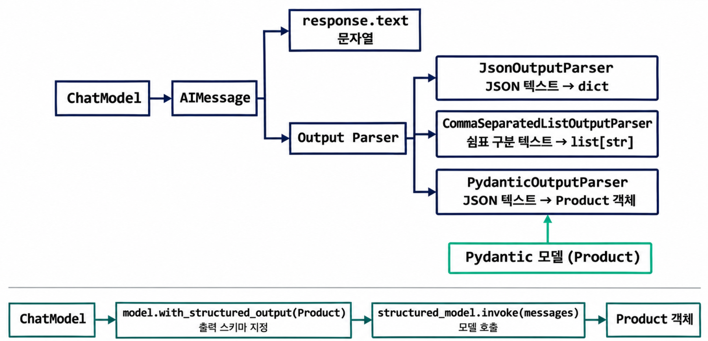
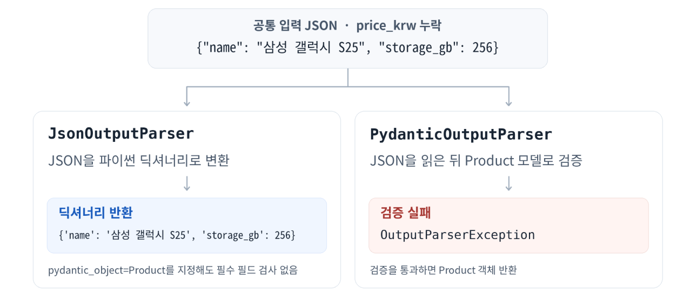

📂 **[GitHub 예제 코드](https://github.com/cericube/agent-workbook/tree/main/langchain-basics){: target="_blank" rel="noopener noreferrer" }**  
예제 코드는 **`langchain-core 1.8.1`**을 기준으로 작성했습니다.  

## 1. 모델 응답 처리 방식과 호출 흐름 {#session-01}

채팅 모델의 `invoke()`를 호출하면 답변이 `AIMessage` 객체로 돌아옵니다.  
이 객체를 `response` 변수에 저장했다면 `response.text`로 답변 내용만 꺼낼 수 있습니다.  
상품명이나 가격처럼 답변 속 값을 코드에서 따로 사용하려면 Output Parser로 응답을 변환하거나, 모델을 호출하기 전에 출력 스키마를 지정합니다.  



### 🟦 원하는 형식으로 답하도록 요청하기

`JsonOutputParser()`는 Pydantic 모델을 정의하지 않아도 사용할 수 있습니다. 모델에 JSON 객체로 답해 달라고 요청한 뒤, 받은 응답을 파서에 넘기면 파이썬 딕셔너리로 변환됩니다.  

1. `get_format_instructions()`로 JSON 객체 형식을 설명하는 텍스트를 가져와 작업 지시와 함께 메시지에 넣습니다.  
2. `model.invoke(messages)`로 모델을 호출하고 `AIMessage`를 받습니다.  
3. 받은 응답을 `parser.invoke(response)`에 넘겨 파이썬 딕셔너리로 변환합니다.  

```python
parser = JsonOutputParser()
messages = make_messages(EXTRACTION_TASK, parser.get_format_instructions())
response = model.invoke(messages)
product_data = parser.invoke(response)  # JSON 객체로 답하면 dict
```

이 예제는 가격을 정수로 답해 달라고 요청하지만, 파서는 키 이름이나 값의 자료형을 검사하지 않습니다. 모델이 유효한 JSON으로 답해도 키 이름이 달라지거나 가격이 빠질 수 있습니다.  

### 🟦 Pydantic 모델로 응답 검증하기

`PydanticOutputParser`에 `Product`를 지정하면, `get_format_instructions()`는 `Product`의 필드 이름과 자료형을 바탕으로 어떤 형식으로 답해야 하는지 설명하는 텍스트를 반환합니다. 이 텍스트를 프롬프트에 넣어 모델에 전달합니다.  

모델의 답변을 파서에 넘기면 상품명, 저장 용량, 가격이 모두 있는지 확인하고 각 값이 `Product`에 정의한 조건을 만족하는지도 검사합니다. 모든 조건을 통과하면 `Product` 객체를 반환합니다.  

```python
parser = PydanticOutputParser(pydantic_object=Product)
messages = make_messages(EXTRACTION_TASK, parser.get_format_instructions())
response = model.invoke(messages)
product = parser.invoke(response)  # 검증을 통과하면 Product
```

### 🟦 채팅 모델에 출력 스키마 지정하기

구조화 출력을 지원하는 채팅 모델에서는 `with_structured_output()`으로 원하는 응답 구조를 미리 지정할 수 있습니다. 아래 예제는 `Product`를 출력 스키마로 사용하고, 채팅 모델의 `json_schema` 방식으로 응답을 받습니다. 메시지에는 작업 지시와 상품 설명만 넣습니다.  

1. `model.with_structured_output(Product, method="json_schema")`로 스키마를 지정합니다.  
2. `structured_model.invoke(messages)`로 요청을 보냅니다.  
3. 모델의 응답이 스키마의 조건을 만족하면 `Product` 객체가 반환됩니다.  

```python
structured_model = model.with_structured_output(Product, method="json_schema")
messages = make_messages(EXTRACTION_TASK)
product = structured_model.invoke(messages)  # Product
```

## 2. Output Parser로 문자열, 리스트, 딕셔너리 얻기 {#session-02}

같은 상품 설명을 여러 파서에 넘겨 보고, 파서에 따라 반환값이 어떻게 달라지는지 확인합니다. 아래 코드는 2절의 모든 예제에서 함께 사용하는 상품 설명, 프롬프트, 출력 함수를 준비합니다.  

```python
# ch03/01_output_parser.py
DESCRIPTION = "삼성 갤럭시 S25는 저장 용량이 256GB이며 가격은 115만 원입니다."
EXTRACTION_TASK = (
    "상품명, 저장 용량, 가격을 추출하세요. "
    "저장 용량은 GB 단위 정수, 가격은 원 단위 정수로 반환하세요."
)
PROMPT = ChatPromptTemplate.from_messages([
    ("system", "주어진 상품 설명만 근거로 답하세요."),
    ("human", "{task}\n\n상품 설명: {description}\n\n{format_instructions}"),
])
def make_messages(task: str, format_instructions: str = ""):
    # 상품 설명은 그대로 두고 작업 지시와 출력 형식 안내를 바꿉니다.
    return PROMPT.format_messages(
        task=task, description=DESCRIPTION, format_instructions=format_instructions
    )
def show_result(label: str, result: object) -> None:
    print(f"{label} {type(result).__name__}")
    print(result)
```

### 🟦 StrOutputParser로 답변에서 텍스트 꺼내기

프롬프트에서 상품 설명을 한 문장으로 요약해 달라고 요청합니다. `StrOutputParser`는 모델의 `AIMessage`에서 답변 텍스트만 꺼내 반환합니다.  

```python
# ch03/01_output_parser.py
parser: StrOutputParser = StrOutputParser()
messages: list[BaseMessage] = make_messages("상품 설명을 한국어 한 문장으로 요약하세요.")
response: AIMessage = model.invoke(messages)
result: str = parser.invoke(response)
show_result("StrOutputParser", result)
```

```text
StrOutputParser TextAccessor
삼성 갤럭시 S25는 저장 용량이 256GB이며 가격은 115만 원입니다.
```

출력에 표시된 `TextAccessor`는 `str`의 하위 클래스입니다. 화면에 표시하거나 다른 문자열과 이어 붙일 수 있습니다.  

### 🟦 CommaSeparatedListOutputParser로 문자열 리스트 만들기

프롬프트에 상품 정보를 쉼표로 구분해 달라는 요청을 추가합니다. `CommaSeparatedListOutputParser`는 쉼표를 기준으로 응답을 나누어 문자열 리스트로 반환합니다.  

```python
# ch03/01_output_parser.py
parser: CommaSeparatedListOutputParser = CommaSeparatedListOutputParser()
message: list[BaseMessage] = make_messages(EXTRACTION_TASK, parser.get_format_instructions())
response: AIMessage = model.invoke(message)
result: list[str] = parser.invoke(response)
show_result("CommaSeparatedListOutputParser", result)
```

```text
CommaSeparatedListOutputParser list
['삼성 갤럭시 S25', '256', '1150000']
```

리스트의 저장 용량과 가격도 문자열입니다. 숫자로 계산해야 한다면 `int()`로 변환해야 합니다.  

### 🟦 JsonOutputParser로 JSON을 딕셔너리로 읽기

기본 `JsonOutputParser()`의 `get_format_instructions()`는 JSON 객체로 답하라는 텍스트를 반환합니다. 이 텍스트를 프롬프트에 넣으면 모델이 JSON 형식으로 답할 가능성이 높아지고, 파서는 받은 JSON을 파이썬 딕셔너리로 변환합니다.  

```python
# ch03/01_output_parser.py
parser: JsonOutputParser = JsonOutputParser()
message: list[BaseMessage] = make_messages(EXTRACTION_TASK, parser.get_format_instructions())
response: AIMessage = model.invoke(message)
result: object = parser.invoke(response)
show_result("JsonOutputParser", result)
```

```text
JsonOutputParser dict
{'상품명': '삼성 갤럭시 S25', '저장_용량': 256, '가격': 1150000}
```

## 3. Output Parser에 Pydantic 스키마 적용하기 {#session-03}

이번에는 같은 `Product` 모델을 `JsonOutputParser`와 `PydanticOutputParser`에 각각 지정합니다.  
두 파서가 모델에게 알려 주는 답변 구조는 비슷하지만, 응답을 받은 뒤 검사하는 범위와 반환값은 다릅니다.  

```python
# ch03/02_output_model_parser.py
DESCRIPTION = "삼성 갤럭시 S25는 저장 용량이 256GB이며 가격은 115만 원입니다."
EXTRACTION_TASK = (
    "상품명, 저장 용량, 가격을 추출하세요. "
    "저장 용량은 GB 단위 정수, 가격은 원 단위 정수로 반환하세요."
)
PROMPT = ChatPromptTemplate.from_messages([
    ("system", "주어진 상품 설명만 근거로 답하세요."),
    ("human", "{task}\n\n상품 설명: {description}\n\n{format_instructions}"),
])
def make_messages(task: str, format_instructions: str = ""):
    # 상품 설명은 그대로 두고 작업 지시와 출력 형식 안내를 바꿉니다.
    return PROMPT.format_messages(
        task=task, description=DESCRIPTION, format_instructions=format_instructions
    )
def show_result(label: str, result: object) -> None:
    print(f"{label} {type(result).__name__}")
    print(result)
class Product(BaseModel):
    name: str = Field(description="상품명")
    storage_gb: int = Field(gt=0, description="저장 용량(GB)")
    price_krw: int = Field(ge=0, description="가격(원)")
```

### 🟦 JsonOutputParser로 Product 형식 설명하기

`JsonOutputParser`에 `pydantic_object=Product`를 지정하면, `get_format_instructions()`가 `Product`의 JSON Schema를 바탕으로 답변 형식을 설명하는 텍스트를 만듭니다. 이 텍스트를 프롬프트에 넣으면 모델에 필드 이름과 자료형을 알려 줄 수 있습니다.  

```python
# ch03/02_output_model_parser.py
parser: JsonOutputParser = JsonOutputParser(pydantic_object=Product)
message: list[BaseMessage] = make_messages(EXTRACTION_TASK, parser.get_format_instructions())
response: AIMessage = model.invoke(message)
result: object = parser.invoke(response)
show_result("JsonOutputParser[Model]", result)
```

```text
JsonOutputParser[Model] dict
{'name': '삼성 갤럭시 S25', 'storage_gb': 256, 'price_krw': 1150000}
```

### 🟦 PydanticOutputParser로 응답 검증하기

`PydanticOutputParser`도 `Product`의 JSON Schema를 바탕으로 답변 형식을 설명합니다. 모델의 응답을 파서에 넘기면 JSON을 읽은 뒤 `Product`에 정의한 필수 필드, 자료형, 값의 범위를 검사합니다. 모든 조건을 통과하면 `Product` 객체를 반환합니다.  

```python
# ch03/02_output_model_parser.py
parser: PydanticOutputParser[Product] = PydanticOutputParser(pydantic_object=Product)
message: list[BaseMessage] = make_messages(EXTRACTION_TASK, parser.get_format_instructions())
response: AIMessage = model.invoke(message)
result: Product = parser.invoke(response)
show_result("PydanticOutputParser", result)
```

```text
PydanticOutputParser Product
name='삼성 갤럭시 S25' storage_gb=256 price_krw=1150000
```

### 🟦 필수 필드가 빠졌을 때 두 파서 비교하기

앞에서 정의한 `Product`에서는 `name`, `storage_gb`, `price_krw`가 모두 필수입니다. 이 가운데 `price_krw`만 빠진 JSON을 `AIMessage`로 만들어 두 파서에 넘겨 보겠습니다.  

```python
# ch03/02_output_model_parser.py
json_parser = JsonOutputParser(pydantic_object=Product)
pydantic_parser = PydanticOutputParser(pydantic_object=Product)
response = AIMessage(content='{"name": "삼성 갤럭시 S25", "storage_gb": 256}')
result = json_parser.invoke(response)
print("JsonOutputParser", type(result).__name__)
print(result)
try:
    pydantic_parser.invoke(response)
except OutputParserException as error:
    print("PydanticOutputParser", type(error).__name__)
```

```text
JsonOutputParser dict
{'name': '삼성 갤럭시 S25', 'storage_gb': 256}
PydanticOutputParser OutputParserException
```

  

- **`JsonOutputParser`**는 응답이 올바른 JSON 형식인지 확인하고 파이썬 딕셔너리로 변환합니다. `pydantic_object=Product`를 지정해도 응답을 파싱할 때 필수 필드는 검사하지 않습니다. 따라서 `price_krw`가 빠진 딕셔너리를 그대로 반환합니다.  
- **`PydanticOutputParser`**는 JSON을 읽은 뒤 실제 `Product` 객체를 만듭니다. 이 과정에서 `Product`의 필수 필드와 각 값의 조건을 검사합니다. 예제 응답에는 `price_krw`가 없으므로 검증에 실패하고, LangChain은 `OutputParserException`을 발생시킵니다.  

## 4. with_structured_output()으로 구조화된 응답 받기 {#session-04}

채팅 모델은 `with_structured_output()`으로 원하는 응답 모델을 미리 지정할 수 있습니다.  

### 🟦 회의 할 일을 표현할 스키마 정의하기

`ActionItem`은 담당자, 할 일, 마감일을 담습니다. `due_date`의 자료형은 `date | None`입니다. 메모에 마감일이 있으면 날짜로 받고, 날짜가 없으면 `None`으로 받습니다.  

`MeetingActions`의 `action_items`는 여러 `ActionItem`을 담는 리스트입니다. 이 클래스를 구조화 출력의 최상위 스키마로 사용합니다.  

```python
# ch03/03_structured_output.py
# 회의 메모에서 추출한 할 일 한 건을 나타냅니다. 담당자, 할 일, 마감일을 담습니다.
class ActionItem(BaseModel):
    assignee: str = Field(description="담당자 이름")
    task: str = Field(description="담당자가 수행할 일")
    # 마감일이 적혀 있지 않은 할 일은 None으로 받습니다.
    due_date: date | None = Field(
        description="마감일(YYYY-MM-DD). 메모에 날짜가 없으면 null",
    )

# 회의 메모 한 건에서 추출한 ActionItem 목록을 담습니다.
# 이 모델을 구조화 출력의 최상위 스키마로 사용합니다.
class MeetingActions(BaseModel):
    action_items: list[ActionItem] = Field(description="메모에 나온 할 일 목록")
```

### 🟦 추출 기준을 프롬프트에 작성하기

시스템 메시지에는 회의 메모에서 어떤 내용을 추출할지 기준을 적습니다.  
이 예제에서는 담당자가 정해진 할 일만 원문 순서대로 찾고, 마감일이 적혀 있지 않으면 날짜를 임의로 만들지 않고 `null`로 반환하도록 요청합니다.  
분석할 회의 메모는 `meeting_notes` 변수로 전달합니다.  

```python
# ch03/03_structured_output.py
PROMPT = ChatPromptTemplate.from_messages(
    [
        (
            "system",
            "회의 메모에서 담당자가 정해진 할 일을 원문 순서대로 추출하세요. "
            "마감일이 명시되지 않은 항목은 날짜를 추정하지 말고 null로 반환하세요.",
        ),
        ("human", "회의 메모:\n{meeting_notes}"),
    ]
)
```

### 🟦 MeetingActions 스키마로 모델 호출하기

`with_structured_output(MeetingActions, method="json_schema")`는 `MeetingActions`의 JSON Schema를 채팅 모델에 전달합니다. 채팅 모델이 반환한 값은 같은 스키마에 따라 검증됩니다.  

LangChain의 타입 선언은 여러 반환 형식을 포함하므로, 이 함수에서는 `cast()`로 타입 검사기에 실제 반환 타입이 `MeetingActions`라고 알려 줍니다. `cast()`는 실행 중에 값을 새 객체로 바꾸지 않습니다.  

```python
# ch03/03_structured_output.py
def extract_action_items(meeting_notes: str) -> MeetingActions:
    messages = PROMPT.format_messages(meeting_notes=meeting_notes)
    # JSON 스키마를 지원하는 채팅 모델에 지정된 형식으로 응답하도록 요청합니다.
    # 응답은 LangChain에서 Pydantic 모델로 검증합니다.
    structured_llm = model.with_structured_output(
        MeetingActions,
        method="json_schema",
    )
    # LangChain의 반환 타입 선언이 포괄적이므로 타입 검사기에 실제 모델 타입을 알려 줍니다.
    return cast(MeetingActions, structured_llm.invoke(messages))
```

### 🟦 회의 메모에서 담당자별 할 일 추출하기

예제 메모에는 마감일이 있는 할 일, 마감일이 없는 할 일, 담당자가 없는 공지가 들어 있습니다. 프롬프트에서 담당자가 정해진 할 일만 요청했으므로 마지막 공지는 결과에서 제외됩니다.  

```python
# ch03/03_structured_output.py
meeting_notes = (
    "민지는 2026년 11월 24일까지 화면 시안을 공유하기로 했다.\n"
    "준호는 운영 서버의 로그 보관 정책을 검토하기로 했다.\n"
    "다음 회의 일정은 추후 공지한다."
)

result = extract_action_items(meeting_notes)
print(result.model_dump_json(indent=2))
```

#### 🔷 실행 결과 예시

```text
{
  "action_items": [
    {
      "assignee": "민지",
      "task": "화면 시안을 공유하기",
      "due_date": "2026-11-24"
    },
    {
      "assignee": "준호",
      "task": "운영 서버의 로그 보관 정책을 검토하기",
      "due_date": null
    }
  ]
}
```
