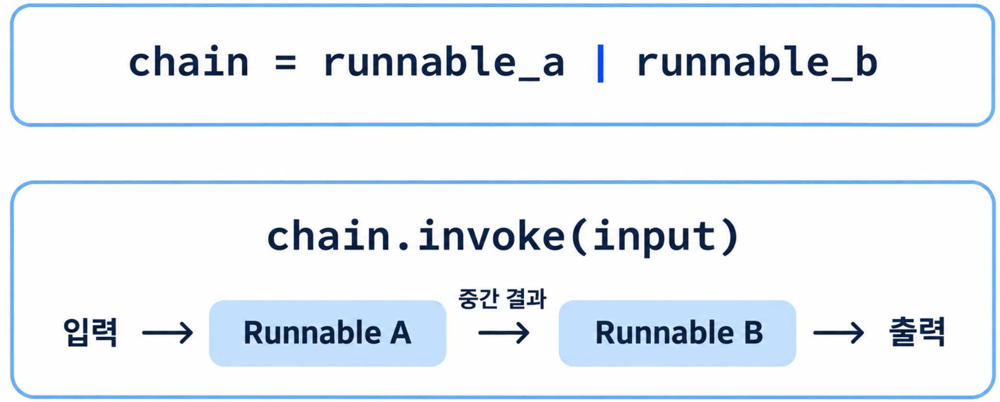
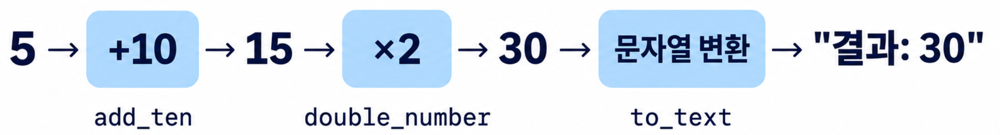
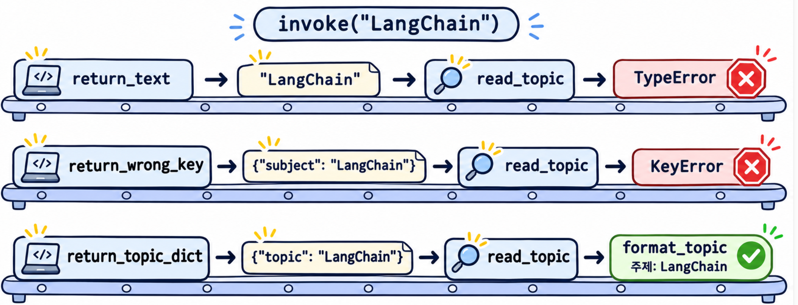
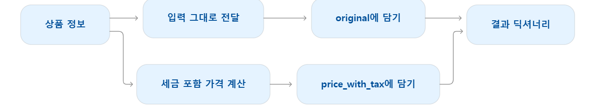
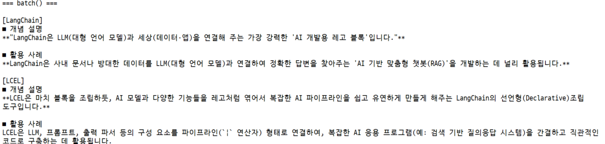
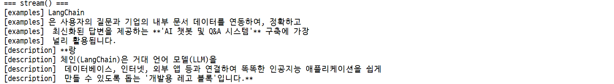

📂 **[GitHub 예제 코드](https://github.com/cericube/agent-workbook/tree/main/langchain-basics){: target="_blank" rel="noopener noreferrer" }**  
예제 코드는 **`langchain-core 1.8.1`**을 기준으로 작성했습니다.  

## 1. Runnable 인터페이스와 LCEL {#session-01}

### 🟦 Runnable의 입력과 출력, `invoke()`로 실행하기

**Runnable**은 입력을 받아 작업을 실행하고 출력을 반환하는 LangChain의 공통 인터페이스입니다.  
`invoke()`는 입력 하나를 처리하고 실행이 끝나면 결과 하나를 반환합니다.  
예를 들어 숫자를 두 배로 만드는 Runnable은 정수 `5`를 받아 정수 `10`을 돌려줍니다.  

### 🟦 RunnableLambda로 Python 함수 연결 준비하기

`RunnableLambda`에 Python 함수를 넘기면 그 함수를 `invoke()`로 실행하거나 다른 Runnable과 연결할 수 있습니다.  
함수 이름 `double`을 넘겨 두고, 실제 입력값은 `invoke()`에 전달합니다.  

```python
# ch04/01_runnable_lamda.py
from langchain_core.runnables import RunnableLambda
def double(number: int) -> int:
    return number * 2
# 두 배를 계산하는 함수를 Runnable로 감싸고 입력값 5를 전달합니다.
double_number = RunnableLambda(double)
print(double_number.invoke(5))
```

```text
10
```

### 🟦 LCEL로 Runnable을 조합한다는 의미


**LCEL(LangChain Expression Language)**은 Runnable을 연결해 여러 작업의 실행 흐름을 구성하는 방식입니다.  
`|`를 사용하면 한 작업의 결과를 다음 작업으로 넘길 수 있습니다.  
이렇게 만든 실행 흐름을 **Chain**이라고 하며, 조합한 Chain도 Runnable 하나처럼 `invoke()`로 실행합니다.  

## 2. 파이프 연산자(|)로 순차 Chain 구성하기 {#session-02}

### 🟦 RunnableSequence와 단계별 데이터 전달

Runnable을 파이프 연산자 `|`로 연결하면 `RunnableSequence`가 만들어집니다.  
왼쪽부터 실행하며, 각 단계의 출력이 바로 다음 단계의 입력이 됩니다.  

```python
# ch04/01_runnable_lamda.py
def add_ten_to_number(number: int) -> int:
    return number + 10

add_ten = RunnableLambda(add_ten_to_number)
to_text = RunnableLambda(lambda number: f"결과: {number}")

# 10을 더한 뒤 두 배로 만들고, 마지막에 문자열로 바꿉니다.
number_chain = add_ten | double_number | to_text
print(type(number_chain).__name__)
print(number_chain.invoke(5))
```

```text
RunnableSequence
결과: 30
```


숫자와 문자열이 전달되는 순서는 `5 → 15 → 30 → "결과: 30"`입니다.  

### 🟦 Prompt → Model → Parser 연결하기

```python
# /ch04/02_prompt_model_parser_chain.py
# .env의 설정을 환경 변수로 불러온 뒤 모델 이름과 API 키를 읽습니다.
load_dotenv()
model: ChatGoogleGenerativeAI = ChatGoogleGenerativeAI(
    model=os.getenv("GEMINI_MODEL"),
    api_key=os.getenv("GEMINI_API_KEY"),
)
# 시스템 메시지로 답변 형식을 지정하고, 사용자 메시지의 {topic}에 주제를 넣습니다.
prompt: ChatPromptTemplate = ChatPromptTemplate(
    [
        ("system", "개념을 한국어로 한문장으로 간결하게 설명하세요."),
        ("human", "개념: {topic}"),
    ]
)
parser: StrOutputParser = StrOutputParser()

# |로 각 단계를 연결합니다. 모델은 프롬프트를 받아 응답하고, 파서는 응답의 텍스트를 추출합니다.
topic_chain: RunnableSerializable[dict[str, Any], str] = prompt | model | parser

# invoke에 넘긴 딕셔너리의 topic 값으로 프롬프트를 채우고 체인을 실행합니다.
result: str = topic_chain.invoke({"topic": "LangChain"})
```

`topic_chain.invoke({"topic": "LangChain"})`을 실행하면 입력이 다음 순서로 전달됩니다.  

```text
{"topic": "LangChain"} → ChatPromptValue → AIMessage → str
```

프롬프트는 주제 값을 채워 메시지를 준비하고, Gemini는 그 메시지에 답하며, 파서는 응답에서 답변 텍스트를 꺼냅니다.  

```text
TextAccessor
LangChain은 대형 언어 모델(LLM)을 활용하여 애플리케이션을 쉽게 구축할 수 있도록 지원하는 개발 프레임워크입니다.
```

### 🟦 연결할 Chain의 입력과 출력 형식 맞추기

`chain_a | chain_b`로 연결하면 `chain_a`의 출력이 `chain_b`의 입력으로 그대로 전달됩니다.  
따라서 **앞 Chain은 뒤 Chain이 처리할 수 있는 형태로 결과를 반환해야 합니다.**  
뒤 Chain이 딕셔너리를 받는다면 자료형과 함께 필요한 키도 확인합니다.  
예를 들어 뒤 Chain이 `topic` 키를 읽는다면 앞 Chain은 `{"topic": "LangChain"}`처럼 해당 키가 들어 있는 딕셔너리를 반환해야 합니다.  

다음 예제에서는 첫 단계가 같은 주제를 문자열, `subject` 키가 있는 딕셔너리, `topic` 키가 있는 딕셔너리로 각각 반환합니다.  
두 번째 단계인 `read_topic()`은 딕셔너리에서 `topic`을 읽고, 세 번째 단계인 `format_topic()`은 그 값을 출력용 문자열로 바꿉니다.  

```python
# 소스 경로: /ch04/03_chain_input_mismatch.py
# 첫 단계에서 같은 주제를 세 가지 형태로 반환해 뒤 단계의 동작을 비교합니다.
def return_text(topic: str) -> str:
    return topic
def return_wrong_key(topic: str) -> dict[str, str]:
    return {"subject": topic}
def return_topic_dict(topic: str) -> dict[str, str]:
    return {"topic": topic}
def read_topic(value: object) -> str:
    # 앞 단계의 결과가 딕셔너리인지 확인한 뒤 필요한 키를 읽습니다.
    if not isinstance(value, dict):
        raise TypeError(
            f"딕셔너리가 필요합니다. 받은 자료형은 {type(value).__name__}입니다."
        )
    # "topic" 키가 없으면 이 조회에서 KeyError가 발생합니다.
    return value["topic"]

def format_topic(topic: str) -> str:
    # 주제가 마지막 단계까지 전달됐는지 확인합니다.
    print("마지막 단계가 실행됐습니다.")
    return f"주제: {topic}"

for label, prepare_input in [
    ("문자열을 반환하는 경우", return_text),
    ("topic 키가 없는 딕셔너리를 반환하는 경우", return_wrong_key),
    ("topic 키가 있는 딕셔너리를 반환하는 경우", return_topic_dict),
]:
    print(f"\n[{label}]")

    # |로 연결할 때는 실행할 순서만 정합니다.
    chain = (
        RunnableLambda(prepare_input)
        | RunnableLambda(read_topic)
        | RunnableLambda(format_topic)
    )
    print("체인 연결 완료")

    try:
        # 같은 입력을 사용해 첫 단계의 반환 형태에 따른 차이를 확인합니다.
        print(chain.invoke("LangChain"))
    except (TypeError, KeyError) as error:
        # 예외를 출력하고 다음 경우를 계속 실행합니다.
        print(f"{type(error).__name__}: {error}")
```


세 경우 모두 `|`로 Chain을 구성할 수 있습니다. 각 함수가 값을 받아 처리하는 시점은 `invoke()`를 호출할 때입니다.  
`read_topic()`은 문자열을 받으면 `TypeError`를 일으킵니다.  
딕셔너리에 `topic` 키가 없으면 `KeyError`가 발생합니다.  
`topic` 키가 있는 딕셔너리를 전달한 경우에만 마지막 단계가 실행되어 `주제: LangChain`이 출력됩니다.  

## 3. RunnablePassthrough로 입력 유지하고 값 추가하기 {#session-03}

`A | B`로 연결하면 `B`는 `A`가 반환한 값을 받습니다.  
예를 들어 상품 정보를 받아 세금 포함 가격 `11000`을 반환하면, 다음 단계에는 그 숫자만 전달됩니다.  
다음 단계에서 “키보드의 세금 포함 가격은 11,000원입니다”처럼 안내 문구를 만들려면 상품명도 함께 전달해야 합니다.  

### 🟦 RunnablePassthrough()로 입력 그대로 전달하기

`RunnablePassthrough()`는 자신이 받은 값을 그대로 반환합니다.  
`A | RunnablePassthrough()`에서는 `A`의 출력이 그대로 전달됩니다.  

상품 원본과 계산 결과를 함께 넘기려면 `RunnableParallel`로 같은 상품 정보를 두 분기에 보냅니다.  
`RunnableParallel`이 각 분기의 결과를 모으는 방식은 4절에서 살펴봅니다.  
RunnableParallel은 입력 하나를 여러 작업에 각각 전달하고, 각 작업의 결과를 하나의 딕셔너리로 모으는 LangChain 클래스입니다.  
한 분기는 원본을 `original`에 담고, 다른 분기는 세금 포함 가격을 계산해 `price_with_tax`에 담습니다.  

```python
# /ch04/04_runnable_passthrough.py
from langchain_core.runnables import RunnableParallel, RunnablePassthrough
product = {"product": "키보드", "price": 10000}

# 같은 상품 정보를 받아 한쪽은 그대로 전달하고 다른 쪽은 가격을 계산합니다.
preserve_product = RunnableParallel(
    original=RunnablePassthrough(),
    price_with_tax=lambda item: item["price"] * 110 // 100,
)
print(preserve_product.invoke(product))
```

```text
{'original': {'product': '키보드', 'price': 10000}, 'price_with_tax': 11000}
```

다음 단계에서는 `item["original"]["product"]`로 상품명을, `item["price_with_tax"]`로 세금 포함 가격을 읽을 수 있습니다.  

### 🟦 assign()으로 딕셔너리에 계산 결과 추가하기

상품명과 가격을 같은 깊이에서 읽으려면 `RunnablePassthrough.assign()`을 사용합니다.  
`assign()`은 입력 딕셔너리 전체를 계산 함수에 넘기고, 그 반환값을 지정한 키에 담아 기존 필드와 합칩니다.  

```python
# /ch04/04_runnable_passthrough.py
# item은 상품 정보 전체이며, 계산한 가격을 price_with_tax에 담습니다.
tax_chain = RunnablePassthrough.assign(
    price_with_tax=lambda item: item["price"] * 110 // 100
)
result = tax_chain.invoke(product)
print(result)
```

```text
{'product': '키보드', 'price': 10000, 'price_with_tax': 11000}
```

`tax_chain.invoke(product)`는 상품 정보에 `price_with_tax`를 더한 새 딕셔너리를 반환합니다.  
원본 `product`는 그대로 유지되며, `tax_chain` 뒤에 단계를 연결하면 그 단계는 `result`와 같은 형태의 딕셔너리를 받습니다.  
예를 들어 가격 안내 문구를 만드는 단계는 `item["product"]`에서 상품명을, `item["price_with_tax"]`에서 세금 포함 가격을 읽습니다.  

### 🟦 검색 결과와 원래 질문을 함께 전달하기

검색 증강 생성(RAG)에서는 질문으로 관련 문서를 검색한 뒤, 프롬프트에 원래 질문과 검색 결과를 함께 전달합니다.  
아래의 `retriever`는 질문 문자열을 받아 관련 문서를 반환하는 Runnable입니다.  

```python
# 문자열 입력에서는 질문을 그대로 전달하는 분기와 검색 분기를 구성합니다.
prepare_from_text = RunnableParallel(
    question=RunnablePassthrough(),
    context=retriever,
)

# 딕셔너리 입력에서는 question만 꺼내 검색하고 결과를 context에 추가합니다.
prepare_from_dict = RunnablePassthrough.assign(
    context=(lambda data: data["question"]) | retriever
)
```

`prepare_from_text`에 질문 문자열을 넘기면 `question`과 `context`가 담긴 딕셔너리를 반환합니다.  
`prepare_from_dict`에 `question`이 들어 있는 딕셔너리를 넘기면 기존 필드를 유지하면서 `context`를 추가합니다.  
두 방식 모두 다음 프롬프트 단계에 질문과 검색 결과를 전달합니다.  

## 4. RunnableParallel로 같은 입력 처리하기 {#session-04}

### 🟦 같은 입력을 여러 분기에 전달하고 결과를 모으는 방식

`RunnableParallel`은 같은 입력을 여러 Runnable에 전달하고, 각 분기의 반환값을 이름별로 모아 딕셔너리로 반환합니다.  
아래에서는 `double`, `square`, `triple`이 모두 같은 숫자 `5`를 받습니다.  

```python
# /ch04/05_runnable_parallel.py
def double_number(number: int) -> int:
    return number * 2
def square_number(number: int) -> int:
    return number**2
def triple_number(number: int) -> int:
    return number * 3
# 각 함수를 RunnableLambda로 감싸고 분기 이름을 지정합니다.
# 각 분기의 반환값은 지정한 이름을 키로 하는 딕셔너리에 모입니다.    
calculation_chain = RunnableParallel(
    double=RunnableLambda(double_number),
    square=RunnableLambda(square_number),
    triple=RunnableLambda(triple_number),
)
print(calculation_chain.invoke(5))
```

```text
{'double': 10, 'square': 25, 'triple': 15}
```

앞 분기의 계산 결과를 기다릴 필요가 없는 작업은 이처럼 병렬로 묶을 수 있습니다.  

### 🟦 개념 설명과 활용 사례를 만들고 결과 합치기

같은 구조로 기술 주제의 개념 설명과 활용 사례를 만들 수 있습니다.  
두 분기는 같은 `topic`을 받으며, 서로 다른 프롬프트에 2절에서 준비한 `model`과 `parser`를 연결합니다.  

```python
# /ch04/06_runnable_parallel_llm.py
description_prompt = ChatPromptTemplate.from_template(
    "{topic}의 개념을 한국어 두 문장으로 설명하세요."
)
example_prompt = ChatPromptTemplate.from_template(
    "{topic}의 활용 사례를 한국어로 두 가지 설명하세요."
)
# 같은 주제로 개념 설명과 활용 사례를 각각 생성합니다.
parallel_chain = RunnableParallel(
    description=description_prompt | model | parser,
    examples=example_prompt | model | parser,
)

def format_result(data: dict[str, str]) -> str:
    # 병렬 실행 결과를 제목이 붙은 하나의 문자열로 합칩니다.
    return (
        f"■ 개념 설명\n{data['description']}\n\n"
        f"■ 활용 사례\n{data['examples']}"
    )

topic_chain = parallel_chain | RunnableLambda(format_result)
print(topic_chain.invoke({"topic": "LangChain"}))
```

주제 하나를 처리할 때 각 분기가 채팅모델을 한 번씩 호출하므로 전체 호출은 두 번입니다.  
`RunnableParallel`이 반환한 딕셔너리에는 `description`과 `examples` 키가 들어 있습니다.  
이 딕셔너리가 `RunnableLambda(format_result)`의 입력이 되고, 최종 출력은 문자열이 됩니다.  

#### 🔷 출력 예시

```text
■ 개념 설명
LangChain은 언어 모델을 활용하는 애플리케이션의 구성 요소를 연결하는 프레임워크입니다.
프롬프트, 모델, 출력 파서를 하나의 실행 흐름으로 구성할 수 있습니다.

■ 활용 사례
1. 검색한 문서를 바탕으로 답하는 질의응답 시스템
2. 외부 API와 언어 모델을 연결한 업무 자동화
```

## 5. 완성한 Chain을 여러 방식으로 실행하기 {#session-05}

Runnable과 Chain은 입력의 개수와 결과를 받는 방식에 따라 실행 메서드를 선택할 수 있습니다.  

| 메서드 | 입력 | 출력 |
| --- | --- | --- |
| `invoke(input)` | 입력 하나 | 완성된 결과 하나 |
| `batch(inputs)` | 입력 목록 | 입력 순서에 맞춘 결과 목록 |
| `stream(input)` | 입력 하나 | 차례로 전달되는 결과 조각 |

비동기 코드에서는 각각 `ainvoke()`, `abatch()`, `astream()`을 사용합니다.  

### 🟦 batch()로 여러 입력 처리하기

4절에서 만든 `topic_chain`에 주제 목록을 넘기면 각 주제의 개념 설명과 활용 사례를 만듭니다.  
`batch()`는 입력 순서대로 결과를 반환하므로, `zip()`으로 각 주제와 결과를 짝지어 출력할 수 있습니다.  

```python
# /ch04/06_runnable_parallel_llm.py
# batch()는 여러 주제를 받아 입력 순서대로 결과 리스트를 반환합니다.
print("\n=== batch() ===")
topics = [{"topic": "LangChain"}, {"topic": "LCEL"}]
for topic, result in zip(topics, topic_chain.batch(topics), strict=True):
    print(f"\n[{topic['topic']}]")
    print(result)
```



### 🟦 stream()으로 출력 조각 받기

4절의 `parallel_chain`에서 `stream()`을 호출하면 개념 설명과 활용 사례의 텍스트 조각을 분기별로 받을 수 있습니다.  
두 분기의 조각이 섞여 도착할 수 있으므로, 아래 예제에서는 조각마다 분기 이름을 함께 출력합니다.  

```python
# /ch04/06_runnable_parallel_llm.py
# format_result는 두 응답이 모두 모일 때까지 기다리므로,
# 분기별 응답 조각을 바로 보려면 parallel_chain에서 stream()을 호출합니다.
print("\n=== stream() ===")
for chunk in parallel_chain.stream({"topic": "LangChain"}):
    # 두 분기의 조각이 섞여 도착할 수 있어 분기 이름도 함께 표시합니다.
    for branch, text in chunk.items():
        if text:
            print(f"[{branch}] {text}", flush=True)
```

