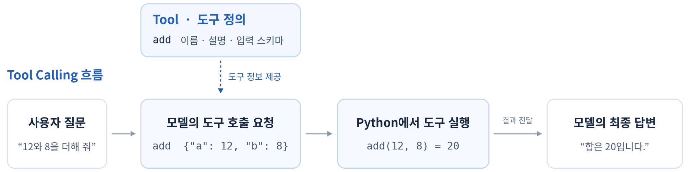
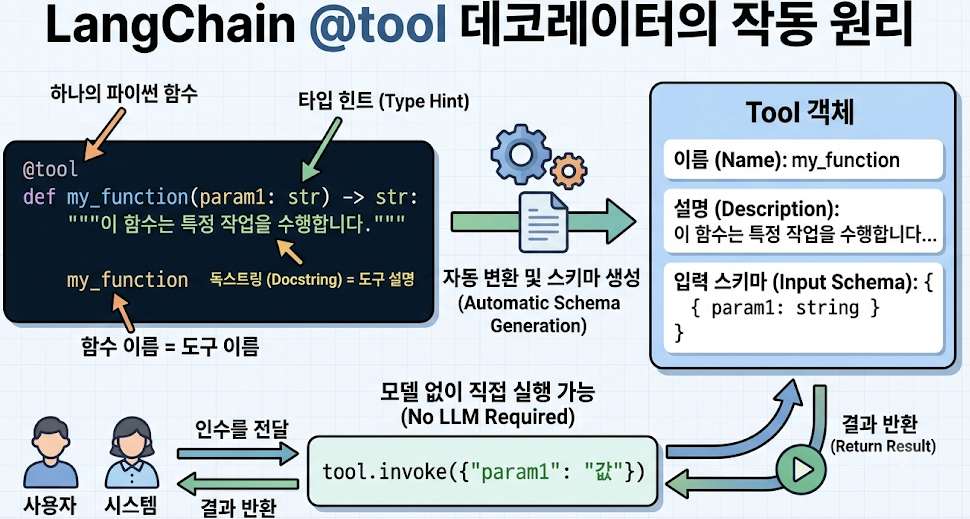

📂 **[GitHub 예제 코드](https://github.com/cericube/agent-workbook/tree/main/langchain-basics){: target="_blank" rel="noopener noreferrer" }**  
예제 코드는 **`langchain-core 1.8.1`**을 기준으로 작성했습니다.  

## 1. 도구 호출에서 모델과 Python의 역할 이해하기 {#session-01}

### 🟦 도구 정의와 실행 요청 구분하기

Tool은 Python 함수, 데이터베이스 조회, 외부 API 호출 같은 기능을 모델에 설명하는 인터페이스입니다.  
도구 이름은 호출할 기능을 구분하고, 설명과 입력 스키마는 모델이 도구를 선택하고 인수를 만드는 데 사용됩니다.  

**Tool Calling**은 모델이 사용할 도구와 인수를 응답으로 요청하는 기능입니다.  
예를 들어 “12와 8을 더해 줘”라는 질문에 모델은 `add`를 `{"a": 12, "b": 8}`로 호출해 달라고 요청할 수 있습니다.  
실제 계산은 Python 애플리케이션이 도구를 실행할 때 이루어집니다. 

```text
사용자 질문 → 모델의 도구 호출 요청 → Python에서 도구 실행
           → 도구 결과를 모델에 전달 → 최종 답변
```



## 2. Python 함수를 도구로 등록하고 입력 검증하기 {#session-02}

### 🟦 @tool로 Python 함수 감싸기



`@tool`은 함수 이름을 도구 이름으로, 독스트링을 도구 설명으로 사용합니다.  
함수의 매개변수와 타입 힌트로 입력 스키마를 만들며, `invoke()`에 인수 딕셔너리를 전달하면 모델 없이도 실행할 수 있습니다.  

> 독스트링(docstring)은 함수, 클래스, 모듈의 역할을 설명하는 문자열입니다.  

```python
# /ch05/01_define_tools.py
@tool
def add(a: int, b: int) -> int:
    """두 정수를 더한 결과를 반환합니다."""
    return a + b

# 도구의 이름과 설명을 확인한 뒤 직접 실행합니다.
print(add.name)
print(add.description)
print(add.invoke({"a": 12, "b": 8}))
```

```text
add
두 정수를 더한 결과를 반환합니다.
20
```

### 🟦 StructuredTool로 기존 함수 재사용하기

독립적으로 사용하던 함수를 도구로 등록하려면 `StructuredTool.from_function()`을 사용할 수 있습니다.  
아래에서는 함수 이름이 `multiply_numbers`지만, 모델에 보여 줄 도구 이름은 `multiply`로 지정합니다.  

```python
# /ch05/01_define_tools.py
def multiply_numbers(a: int, b: int) -> int:
    return a * b

# 기존 함수를 감싸고 도구 이름과 설명을 지정합니다.
multiply = StructuredTool.from_function(
    func=multiply_numbers,
    name="multiply",
    description="두 정수를 곱한 결과를 반환합니다.",
)

print(multiply.invoke({"a": 6, "b": 7}))
```

```text
42
```

### 🟦 Pydantic으로 도구 입력 검증하기

`args_schema`로 Pydantic 모델을 지정하면 필드 설명과 값의 제약을 함께 정의할 수 있습니다.  
아래 도구에서는 나누는 수 `b`를 양수로 제한합니다.  
`b`가 0 이하이면 나눗셈 함수가 실행되기 전에 입력 검증 오류가 발생합니다.

```python
# /ch05/01_define_tools.py
class DivideInput(BaseModel):
    a: float = Field(description="나누어지는 수")
    b: float = Field(gt=0, description="0보다 큰 나누는 수")

@tool(args_schema=DivideInput)
def divide(a: float, b: float) -> float:
    """두 수를 나눈 결과를 반환합니다."""
    return a / b

print(divide.invoke({"a": 20, "b": 4}))
```

```text
5.0
```

## 3. bind_tools()로 도구를 연결하고 호출 요청 받기 {#session-03}

2절에서 만든 `add` 도구를 Gemini 모델에 연결한 뒤, 모델이 어떤 도구와 인수를 요청하는지 확인합니다.  

```python
# ch05/02_bind_tools.py
# 템플릿의 {a}와 {b}에 숫자를 채워 질문 문자열을 만듭니다.
prompt = PromptTemplate.from_template("{a}와 {b}을 더해 줘.")
prompt_text = prompt.format(a=12, b=8)
messages = [HumanMessage(content=prompt_text)]

# bind_tools()는 add의 이름, 설명, 입력 스키마를 모델에 전달하도록 설정합니다.
model_with_tools = model.bind_tools([add])

# invoke()는 완성된 질문과 도구 정의를 Gemini에 보내고 AIMessage를 받습니다.
# 모델이 add 사용을 요청하면 응답의 tool_calls에 a와 b의 값이 담깁니다.
response = model_with_tools.invoke(messages)

# tool_calls에는 모델이 요청한 도구 호출이 담깁니다. 실제 도구 실행은 별도 단계입니다.
# 각 요청의 name은 도구 이름, args는 실행 인수, id는 실행 결과를 연결할 식별자입니다.
# 모델이 도구 호출 없이 바로 답하면 빈 목록이 출력됩니다.
print("=== 도구 호출 요청 ===")
print(response.tool_calls)
```

`bind_tools()`는 사용할 수 있는 도구의 정의를 모델에 전달합니다.  
모델이 도구 사용을 요청하면 응답인 `AIMessage`의 `tool_calls`에 요청이 들어갑니다.  
모델이 바로 답변하면 `tool_calls`는 빈 목록입니다. 

```python
[
    {
        "name": "add",
        "args": {"b": 8, "a": 12},
        "id": "call_10906467441802470924",
        "type": "tool_call",
    }
]
```

`name`은 도구 이름, `args`는 실행 인수, `id`는 나중에 실행 결과를 이 요청과 연결하는 식별자입니다.  

## 4. 도구를 직접 실행하고 ToolMessage로 결과 전달하기 {#session-05}

### 🟦 도구를 실행하고 최종 답변 받기 {#session-04}

요청마다 실행 결과를 `ToolMessage`에 담고, `tool_call_id`에 원래 요청의 `id`를 넣습니다. 모델은 이 ID를 기준으로 어떤 요청의 결과인지 구분합니다.  

질문, 모델의 호출 요청, 도구 실행 결과를 담은 대화 기록으로 모델을 다시 호출합니다. 첫 응답에 도구 호출 요청이 없으면 그 응답을 그대로 출력합니다.  

```python
# ch05/02_bind_tools.py
# 실행할 수 있는 도구를 이름으로 등록합니다. 여기서는 "add"가 add 도구에 연결됩니다.
registered_tools = {add.name: add}

# 사용자 질문과 모델의 도구 호출 요청을 대화에 순서대로 보관합니다.
conversation = [*messages, response]

for tool_call in response.tool_calls:
    # 요청의 name으로 등록된 도구 객체를 찾습니다.
    selected_tool = registered_tools.get(tool_call["name"])
    if selected_tool is None:
        raise ValueError(f"등록되지 않은 도구: {tool_call['name']}")

    # args 딕셔너리의 키와 값을 함수의 인자 이름과 값으로 사용합니다.
    # 예를 들어 {"b": 8, "a": 12}가 들어오면 add에 a=12, b=8을 전달해 20을 얻습니다.
    result = selected_tool.invoke(tool_call["args"])
    print(f"{selected_tool.name} 계산 결과: {result}")

    # tool_call_id=tool_call["id"]는 모델이 보낸 요청의 ID를 그대로 넣습니다.
    # 모델이 도구를 여러 번 호출해도 이 ID로 각 요청과 결과를 연결할 수 있습니다.
    conversation.append(
        ToolMessage(content=str(result), tool_call_id=tool_call["id"])
    )

final_response = model.invoke(conversation) if response.tool_calls else response
print("최종 답변:", final_response.text)
```

#### 🔷 출력 예시

```text
add 계산 결과: 20
최종 답변: 12와 8을 더하면 20입니다.
```

## 5. create_agent()로 도구 호출 과정 자동화하기 {#session-06}

앞 예제에서는 파이썬 코드가 모델의 호출 요청을 읽고 도구를 실행한 뒤, 결과를 담은 `ToolMessage`를 모델에 전달했습니다.  
`create_agent()`를 사용하면 LangChain 에이전트가 이 과정을 맡습니다.  
모델이 `add`의 호출을 요청하면 에이전트가 파이썬에서 도구를 실행하고, 결과를 `ToolMessage`로 대화 기록에 추가한 뒤 모델을 다시 호출합니다. 모델이 더 이상 도구를 요청하지 않고 답하면 그 응답이 최종 답변이 됩니다.  

`agent-workbook` 루트에서 `create_agent()`를 제공하는 `langchain` 패키지를 추가합니다.

```bash
uv add langchain
```

```python
# ch05/03_create_agent.py

agent = create_agent(
    model=model,
    tools=[add],
    system_prompt="덧셈 요청은 등록된 도구로 계산한 뒤 한국어로 답변하세요.",
)

# 질문을 보내면 에이전트가 도구 실행과 모델 재호출을 처리합니다.
result = agent.invoke(
    {"messages": [{"role": "user", "content": "12와 8을 더해 줘."}]}
)

# 대화 기록에서 도구가 반환한 값과 모델의 최종 답변을 확인합니다.
for message in result["messages"]:
    if isinstance(message, ToolMessage):
        print("도구 실행 결과:", message.content)

print("최종 답변:", result["messages"][-1].text)
```

### 🟦 출력 예시

```text
도구 실행 결과: 20
최종 답변: 12와 8을 더하면 20입니다.
```

`ToolMessage`에는 도구가 반환한 계산값이 들어 있고, 마지막 메시지에는 모델이 그 값을 바탕으로 작성한 답변이 들어 있습니다.  
