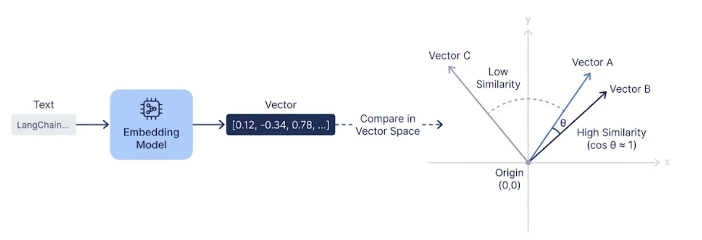
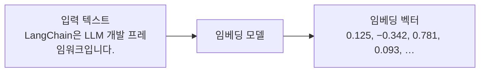
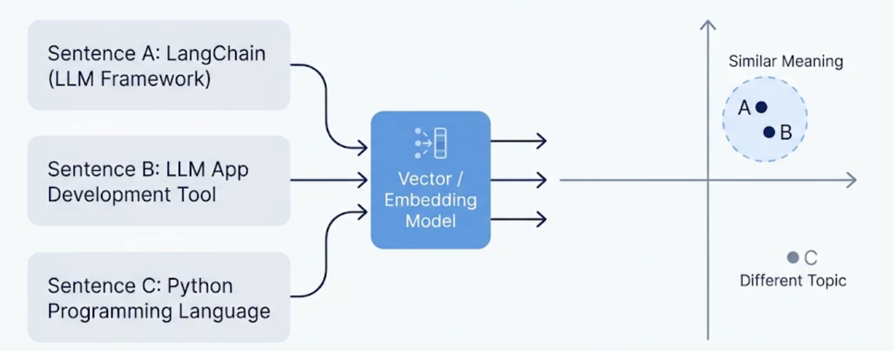
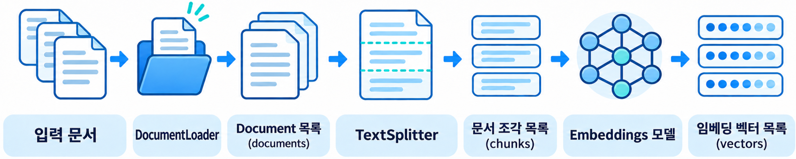
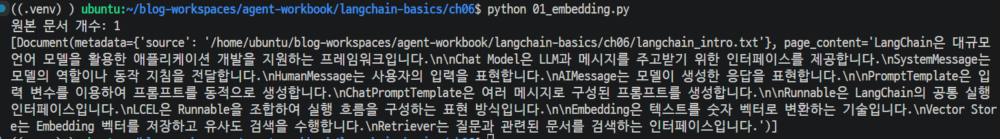
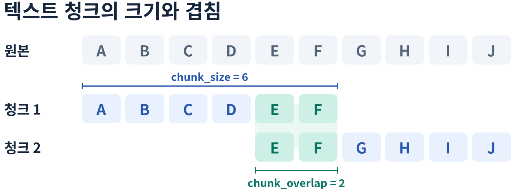
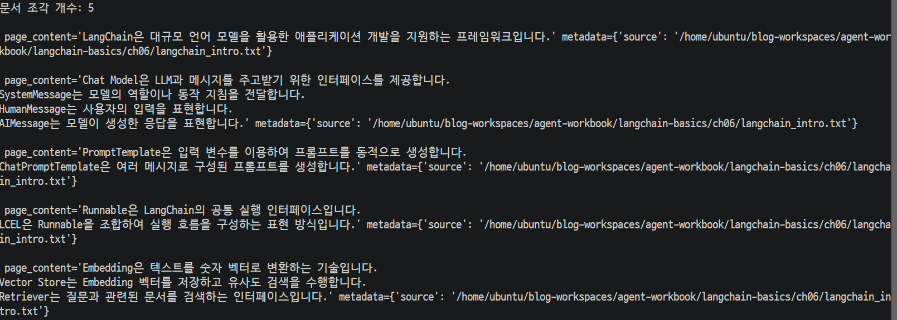

📂 **[GitHub 예제 코드](https://github.com/cericube/agent-workbook/tree/main/langchain-basics){: target="_blank" rel="noopener noreferrer" }**  
예제 코드는 **`langchain-core 1.8.1`**을 기준으로 작성했습니다.  

## 1. 임베딩과 코사인 유사도 이해하기 {#session-01}

검색 증강 생성(RAG)에서는 질문과 관련된 문서 조각을 찾아 모델에 전달합니다.  
질문과 문서 조각을 임베딩으로 변환하면, 두 벡터를 비교해 질문과 관련된 내용을 찾을 수 있습니다.  



### 🟦 Embedding이란?

임베딩(Embedding)은 텍스트처럼 의미를 담은 데이터를 숫자 벡터로 표현하는 방법입니다.  
임베딩 모델은 표현이 달라도 뜻이 비슷한 문장에 서로 비슷한 벡터를 만들도록 학습됩니다.  

- **문장 A** — “LangChain은 LLM 애플리케이션 개발 프레임워크입니다.”  
- **문장 B** — “LangChain은 대규모 언어 모델 기반 프로그램을 개발하는 도구입니다.”  
- **문장 C** — “Python은 다양한 분야에서 사용하는 프로그래밍 언어입니다.”  

A와 B는 표현은 달라도 LangChain을 소개한다는 점에서 비슷합니다. C는 Python을 소개하는 문장이므로, A와 B의 벡터를 비교한 점수가 A와 C를 비교한 점수보다 높을 것으로 예상할 수 있습니다.  

### 🟦 벡터 표현

벡터의 차원은 벡터에 들어 있는 숫자의 개수입니다.  
같은 모델에서 출력 차원을 동일하게 설정하면 문장 길이와 관계없이 벡터의 차원이 같습니다. 예를 들어 출력이 768차원이면 각 문장을 실수 768개로 표현합니다.  



그림 속 숫자는 예시입니다. 실제 숫자와 벡터의 차원은 모델과 설정에 따라 달라집니다. 모델이 학습한 텍스트의 특징은 여러 차원에 걸쳐 표현되므로, 문장 간 유사도는 벡터 전체를 사용해 계산합니다.  

### 🟦 Embedding과 코사인 유사도

코사인 유사도(Cosine Similarity)는 두 벡터가 가리키는 방향이 얼마나 비슷한지 나타내는 점수입니다. 두 벡터의 길이가 모두 0보다 크면 점수는 −1부터 1까지이며, 1에 가까울수록 방향이 비슷합니다.  

| 코사인 유사도 | 벡터 방향 관계 |
| --- | --- |
| 1에 가까움 | 두 벡터의 방향이 거의 같습니다. |
| 0에 가까움 | 두 벡터가 이루는 각도가 90°에 가깝습니다. |
| −1에 가까움 | 두 벡터가 거의 정반대 방향을 가리킵니다. |


문서를 검색할 때는 같은 모델로 만든 질문 벡터와 문서 조각의 벡터를 비교한 뒤, 점수가 높은 조각부터 살펴볼 수 있습니다.  
점수는 벡터의 방향이 얼마나 비슷한지 보여 줍니다. 문장의 뜻이 같거나 반대인지 판단할 때는 문맥도 함께 살펴야 합니다.  
검색 품질은 임베딩 모델, 문서의 주제, 문서를 나누는 방식과 검색 전략에 따라 달라집니다.  

## 2. 문서 임베딩의 전체 흐름 {#session-02}

실습에서는 `langchain_intro.txt`를 읽어 작은 조각으로 나눈 뒤, 각 조각의 본문을 벡터로 바꿉니다.  



1. **문서 읽기** — `Path.read_text()`로 파일을 읽고 본문과 출처를 `Document`에 담습니다. 이 객체를 목록(`documents`)에 넣어 다음 단계로 전달합니다.  
2. **문서 나누기** — Text Splitter로 문서를 작은 조각(`chunks`)으로 나눕니다. 조각 단위로 검색하면 질문과 관련된 부분을 골라낼 수 있습니다.  
3. **벡터 만들기** — 임베딩 모델에 각 조각의 본문을 전달합니다. 문서 조각 하나당 벡터 하나가 만들어지며, 벡터 목록(`vectors`)의 순서는 문서 조각 목록과 같습니다.  

**텍스트·이미지·오디오·동영상·PDF를 임베딩할 수 있습니다.** `gemini-embedding-2`는 2026년 4월 22일 정식 출시(GA)된 멀티모달 모델입니다. 여러 형식의 입력을 같은 벡터 공간에 표현하므로, 예를 들어 ‘바닷가에 파도가 밀려오는 장면’이라는 문장으로 관련 영상을 찾을 수 있습니다. 

### 🟦 문서 형식과 출처에 맞는 로더

문서 로더는 파일이나 웹페이지에서 내용을 읽어 LangChain의 `Document`로 변환합니다. PDF는 표나 문서 구조를 얼마나 보존해야 하는지, 웹페이지나 클라우드 파일은 어디에서 가져오는지에 따라 로더를 고릅니다. 텍스트나 CSV는 Python 표준 라이브러리로 읽은 뒤 `Document`를 직접 만들 수도 있습니다.  

| 로더 또는 읽기 방법 | 패키지 | 용도 |
| --- | --- | --- |
| `DoclingLoader` | `langchain-docling` | PDF, Word, PowerPoint, HTML 등을 로컬에서 파싱합니다. 표와 문서 구조가 중요한 보고서나 기술 문서에 적합합니다. |
| `UnstructuredLoader` | `langchain-unstructured` | PDF, Word 등에서 제목, 본문, 표 같은 요소를 추출합니다. 로컬에서 파싱하려면 `langchain-unstructured[local]`을 설치합니다. |
| `PyMuPDF4LLMLoader` | `langchain-pymupdf4llm` | PDF 본문을 Markdown으로 추출합니다. 독립 패키지로 제공되며, PDF를 읽을 때 `PyPDFLoader` 대신 사용할 수 있습니다. |
| `UpstageDocumentParseLoader` | `langchain-upstage` | Upstage Document Parse API로 PDF를 분석하고 페이지 단위로 읽을 수 있습니다. |
| `FirecrawlLoader` | `langchain-firecrawl` | Firecrawl API로 웹페이지 본문을 가져오거나 여러 페이지를 크롤링합니다. |
| `AzureBlobStorageLoader` | `langchain-azure-storage` | Azure Blob Storage 컨테이너의 파일을 읽습니다. PDF처럼 형식에 맞는 처리가 필요한 경우 별도의 파서를 연결할 수 있습니다. |
| `Path.read_text()` + `Document` | `langchain-core` + Python 표준 라이브러리 | `.txt`나 `.md` 파일의 전체 내용을 읽어 하나의 `Document`를 만듭니다. |
| `csv.DictReader` + `Document` | `langchain-core` + Python 표준 라이브러리 | CSV를 행 단위로 읽고, 검색에 필요한 열을 골라 각 행을 `Document`로 만듭니다. |

### 🟦 문서를 나누는 기준

문서의 제목 구조를 살릴지, 조각의 길이를 기준으로 나눌지에 따라 분할기를 선택합니다.  

| 분할기 | 분할 기준 | 사용 예 |
|---|---|---|
| `RecursiveCharacterTextSplitter` | 문단처럼 큰 단위부터 나누고, 조각이 너무 길면 줄바꿈이나 공백 등 더 작은 경계를 사용합니다. | 일반 텍스트, PDF에서 추출한 본문 |
| `CharacterTextSplitter` | 줄바꿈 등 지정한 구분자를 기준으로 나눕니다. | 구분자가 일정한 텍스트 |
| `TokenTextSplitter` | 토크나이저로 계산한 토큰 수를 기준으로 나눕니다. | 모델 입력 길이를 토큰 기준으로 관리할 때 |
| `MarkdownHeaderTextSplitter` | `#`, `##`, `###` 등의 제목을 기준으로 나눕니다. | Markdown 문서, 기술 문서 |
| `HTMLHeaderTextSplitter` | `h1`, `h2` 등의 제목 태그를 기준으로 나눕니다. | 제목 구조가 있는 HTML 문서 |
| `RecursiveJsonSplitter` | JSON의 중첩 구조를 따라 나눕니다. | 계층 구조가 있는 JSON 데이터 |

### 🟦 임베딩 모델과 실행 방식

임베딩 모델은 제공자의 API로 호출하거나 로컬에서 실행할 수 있습니다. 모델별로 필요한 패키지와 LangChain에서 연결하는 방법을 살펴봅니다.  

| 모델 | 패키지 | 설명 |
| --- | --- | --- |
| `gemini-embedding-2` | `langchain-google-genai` | 이 `GoogleGenerativeAIEmbeddings`로 텍스트를 벡터로 변환합니다. 이미지·오디오·동영상·PDF를 모델에 직접 보내려면 Google GenAI SDK를 사용할 수 있습니다. |
| `text-embedding-3-small`, `text-embedding-3-large` | `langchain-openai` | `OpenAIEmbeddings`로 OpenAI의 텍스트 임베딩 API를 호출합니다. |
| `embed-v4.0`, `embed-v5.0-fast` | `langchain-cohere` | `CohereEmbeddings`로 Cohere 임베딩 API를 호출합니다. |
| `Snowflake/snowflake-arctic-embed-m-v1.5` | `langchain-huggingface` | `HuggingFaceEmbeddings`로 텍스트 검색용 모델을 로컬에서 실행합니다. |
| `nlpai-lab/KURE-v3` | `langchain-huggingface` | 한국어·영어 검색용 11억 파라미터 모델입니다. `HuggingFaceEmbeddings`로 로컬에서 실행할 때는 검색어에 `query: `, 문서에 `passage: `를 붙입니다. |
| `nlpai-lab/KURE-v1` | `langchain-huggingface` | `BGE-M3`를 한국어 데이터로 추가 학습한 약 6억 파라미터 모델입니다. `HuggingFaceEmbeddings`로 로컬에서 실행할 수 있으며, 한국어 중심 RAG에서 KURE-v3보다 작은 모델을 시험할 때 사용할 수 있습니다. |
| `embeddinggemma` | `langchain-ollama` | `OllamaEmbeddings`로 로컬에서 실행 중인 Ollama 모델에 연결합니다. |

## 3. 텍스트 파일을 읽어 Document 만들기 {#session-03}

### 🟦 Document의 본문과 메타데이터 {#session-03-document}

`Path.read_text()`로 텍스트 파일을 읽고, `Document`를 직접 만듭니다. 본문은 `page_content`에, 원본 파일 경로는 `metadata`의 `source`에 담습니다. 이 예제의 `documents`에는 `Document` 하나가 들어갑니다.  

| 속성 | 담기는 값 |
| --- | --- |
| `page_content` | 파일에서 읽은 본문 문자열 |
| `metadata` | 출처 등 문서의 부가 정보. |

Loader마다 `metadata`에 담는 항목이 다르며, 이 정보를 저장하거나 검색에 활용하는 방식은 벡터 저장소에 따라 달라집니다.  

```python
# /ch06/01_embedding.py
# UTF-8 파일의 본문과 출처를 Document에 담습니다.
from langchain_core.documents import Document
text_path = Path(__file__).with_name("langchain_intro.txt")
documents = [
    Document(
        page_content=text_path.read_text(encoding="utf-8"),
        metadata={"source": str(text_path)}, # 원본 파일 경로를 출처로 기록합니다.
    )
]
print("원본 문서 개수:", len(documents))
print(documents)
```

  

## 4. Text Splitter로 문서 나누기 {#session-04}



- `chunk_size`는 청크 하나의 최대 길이입니다. 그림에서는 한 청크에 최대 6글자를 담습니다.  
- `chunk_overlap`은 이웃한 청크에 겹쳐 넣을 텍스트의 목표 길이입니다. 문서를 나누는 지점에서 문맥이 끊기지 않도록 앞 청크의 끝부분을 다음 청크에도 넣습니다. 그림에서는 두 청크에 `EF`가 함께 들어갑니다.  

`RecursiveCharacterTextSplitter`는 빈 줄, 줄바꿈, 공백 등을 차례로 살펴보며 문서를 작은 조각으로 나눕니다.  

```python
# /ch06/01_embedding.py
# 문단, 줄바꿈, 공백 순으로 경계를 찾아 긴 텍스트를 나눕니다.
text_splitter = RecursiveCharacterTextSplitter(
    chunk_size=150,     # 조각 하나의 최대 문자 수입니다.
    chunk_overlap=30,   # 앞뒤 조각의 문맥을 이어 주는 목표 겹침 문자 수입니다.
)
# 각 조각을 Document로 만들고 원본의 metadata를 복사합니다.
chunks = text_splitter.split_documents(documents)
print("문서 조각 개수:", len(chunks))
for chunk in chunks:
    print("\n", chunk)
```


이 예제에서는 기본 길이 계산 방식에 따라 `chunk_size=150`을 최대 150자로 해석합니다. `chunk_overlap=30`은 경계에서 문맥이 이어지도록 일부 글자를 겹치게 하는 설정이며, 실제 겹치는 길이는 분할 위치에 따라 달라집니다. 각 조각은 원본의 출처 메타데이터를 이어받습니다.  

## 5. Gemini로 문서 조각을 벡터로 변환하기 {#session-05}

```python
# ch06/01_embedding.py

embeddings = GoogleGenerativeAIEmbeddings(
    # Gemini API가 텍스트를 수치 벡터로 변환할 때 사용할 모델의 이름입니다.
    model="gemini-embedding-2",
    api_key=SecretStr(api_key),  # 객체를 출력할 때 키를 가립니다.
    vertexai=False,  # Gemini Developer API를 사용합니다.
)

# 각 조각의 본문을 보내고, 입력 순서대로 벡터를 받습니다.
texts = [chunk.page_content for chunk in chunks]
vectors = embeddings.embed_documents(texts)

print("벡터 개수:", len(vectors))
for vector in vectors:
    # 벡터의 타입을 확인하고 출력이 길어지지 않도록 앞쪽 값 5개를 표시합니다.
    print(type(vector), vector[:5], "...")
```

문서 조각마다 벡터 하나가 만들어지므로 `len(vectors)`와 `len(chunks)`가 같습니다. 기본 설정에서는 각 벡터가 3072차원입니다.  

이미지 파일을 벡터로 변환할 때는 Google GenAI SDK의 `client.models.embed_content()`를 사용합니다.  

```python
client = genai.Client(api_key=api_key)

# PNG 파일의 바이트를 읽고, API가 이미지로 해석할 수 있도록 형식을 지정합니다.
image = types.Part.from_bytes(
    data=Path("example.png").read_bytes(),
    mime_type="image/png",
)

# 이미지 한 장을 모델에 전달해 임베딩 벡터를 요청합니다.
result = client.models.embed_content(
    model="gemini-embedding-2",
    contents=[image],
)

# 반환된 벡터의 자료형과 처음 다섯 값을 확인합니다.
for embedding in result.embeddings or []:
    vector = embedding.values or []
    print(type(vector), vector[:5])
```
