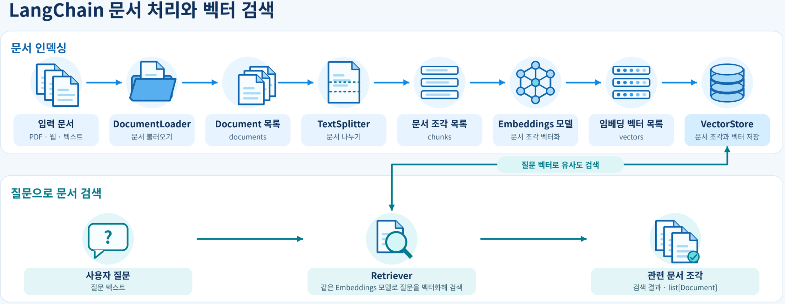
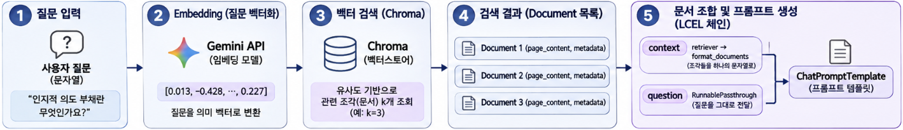
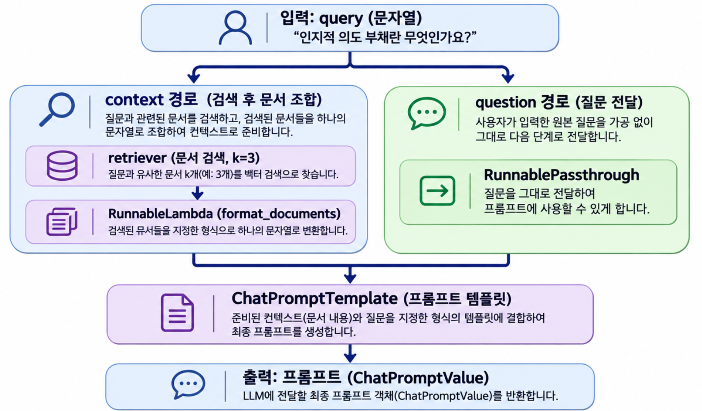
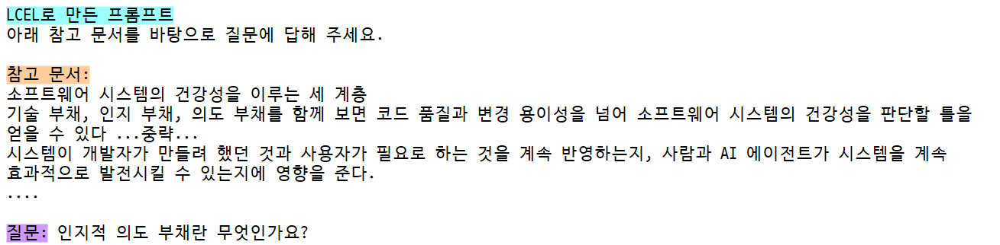

📂 **[GitHub 예제 코드](https://github.com/cericube/agent-workbook/tree/main/langchain-basics){: target="_blank" rel="noopener noreferrer" }**  
예제 코드는 **`langchain-core 1.8.1`**을 기준으로 작성했습니다.  

## 1. 벡터 저장소의 개념과 종류 {#session-01}

### 🟦 벡터 저장소의 역할과 검색 원리

**벡터 저장소(Vector Store)**는 임베딩 벡터를 저장하고, 입력으로 받은 벡터와 가까운 항목을 찾을 수 있게 해 줍니다. Chroma는 문서 조각마다 ID, 본문, 임베딩 벡터, 원본 PDF 경로나 페이지 번호 같은 메타데이터를 함께 보관합니다.  

문서를 저장할 때는 임베딩 모델로 각 조각의 본문을 벡터로 바꿉니다.  
검색할 때는 질문도 같은 모델로 벡터로 바꾼 뒤, 저장된 벡터와 비교해 가까운 조각을 가져옵니다.  
예를 들어 문서에서는 ‘자동차’, 질문에서는 ‘승용차’라고 표현해도 임베딩이 두 표현의 의미를 가깝게 나타내면 관련 조각을 찾을 수 있습니다.  



### 🟦 벡터 저장소의 종류와 예

벡터 검색은 전용 데이터베이스, 기존 데이터베이스의 확장 기능, 애플리케이션에 연결하는 라이브러리 등으로 구현할 수 있습니다.  

| 구현 방식 | 예 | 특징 |
| --- | --- | --- |
| 전용 벡터 데이터베이스 | Chroma, Qdrant | 벡터와 관련 데이터를 함께 관리합니다. 이 실습에서는 Chroma 데이터를 로컬 폴더에 저장합니다. |
| 기존 데이터베이스의 확장 기능 | PostgreSQL의 pgvector | 서비스 데이터와 벡터를 같은 PostgreSQL 데이터베이스에 두고 SQL로 검색합니다. |
| 벡터 검색 라이브러리 | Faiss | 벡터 인덱스를 만들어 유사도 검색을 수행합니다. 문서 본문과 메타데이터는 애플리케이션이나 연동 도구에서 관리합니다. |

### 🟦 벡터 저장소와 Retriever의 역할과 연결 방식

이 예제에서 Chroma는 문서 조각을 저장하고 유사도 검색을 수행합니다.  
**Retriever(리트리버)**는 검색 설정을 담아 두고, `invoke()`에 질문을 전달하면 관련 문서를 반환하는 LangChain 구성 요소입니다.  
PDF를 조각으로 나눈 뒤, 3절에서는 Chroma의 `similarity_search()`를 직접 호출하고 4절에서는 같은 컬렉션을 `as_retriever()`로 연결해 검색 결과 수와 필터를 설정합니다.  

## 2. PdfReader로 PDF를 읽고 문서 조각 만들기 {#session-02}

`pypdf`의 `PdfReader`로 PDF를 열고, 페이지마다 `extract_text()`를 호출해 텍스트를 읽습니다. 이미지로만 된 스캔 페이지에서 글자를 읽으려면 OCR이 필요합니다.  

`agent-workbook` 루트에서 PDF 읽기, 문서 분할, Chroma 연동에 필요한 패키지를 추가합니다.

```bash
uv add pypdf langchain-text-splitters langchain-chroma
```

### 🟦 페이지별 텍스트 추출

다음 코드는 `ch07/01_pdf_embedding.py`에서 PDF를 읽는 부분입니다. 스크립트와 같은 폴더에서 PDF를 열고, 텍스트가 있는 페이지마다 LangChain의 `Document`를 하나 만듭니다. 빈 페이지를 건너뛰더라도 `enumerate()`로 얻은 원본 페이지 번호는 유지됩니다.  

```python
from pathlib import Path

from langchain_core.documents import Document
from pypdf import PdfReader

# 1. 스크립트와 같은 디렉터리에 있는 PDF를 찾습니다.
pdf_path = Path(__file__).with_name("technical-cognitive-intent-debt-ko.pdf")

# 2. pypdf로 각 페이지에 포함된 텍스트를 읽습니다.
# 이미지로만 구성된 페이지의 글자는 OCR 없이 추출할 수 없습니다.
with pdf_path.open("rb") as pdf_file:
    reader = PdfReader(pdf_file)
    pages: list[Document] = []
    for page_index, pdf_page in enumerate(reader.pages):
        text = pdf_page.extract_text().strip()
        if not text:
            continue

        # 3. 텍스트가 있는 페이지마다 원본 페이지 번호를 담은 Document를 만듭니다.
        pages.append(
            Document(
                page_content=text,
                metadata={
                    "source": str(pdf_path),
                    "page_number": page_index + 1,  # 1부터 시작하는 PDF 페이지 번호
                    "page": page_index,  # 0부터 시작하는 페이지 인덱스
                },
            )
        )
```

각 `Document`는 페이지 본문과 함께 PDF 경로(`source`), 1부터 세는 페이지 번호(`page_number`), 0부터 세는 페이지 인덱스(`page`)를 담습니다.  

### 🟦 페이지를 검색용 조각으로 분할

`RecursiveCharacterTextSplitter`가 각 페이지를 1,000자 기준으로 나눕니다. 이 과정을 청킹(chunking)이라고 합니다. 이웃한 조각에 최대 150자까지 같은 텍스트를 남겨 조각 사이의 문맥을 이어 줍니다. 한 문장이 페이지 경계를 넘으면 각 부분은 원래 페이지에 남습니다.  

```python
from langchain_text_splitters import RecursiveCharacterTextSplitter

# 4. 페이지 본문을 검색에 사용할 작은 조각으로 나눕니다.
# 빈 줄이나 줄바꿈을 우선 경계로 삼아 조각의 크기를 조절합니다.
text_splitter = RecursiveCharacterTextSplitter(
    chunk_size=1000,  # 조각 하나의 목표 최대 길이(문자 수)
    chunk_overlap=150,  # 문맥을 유지하기 위해 인접한 조각에 겹쳐 넣을 문자 수의 기준
)

# 페이지를 각각 나누므로 한 조각에 여러 페이지가 섞이지 않습니다.
# chunks는 Document 목록입니다. 각 조각은 나뉜 본문과 원본 페이지의 메타데이터를 담습니다.
chunks = text_splitter.split_documents(pages)
# 저장할 텍스트가 없으면 임베딩을 요청하기 전에 실행을 종료합니다.
if not chunks:
    raise SystemExit(f"{pdf_path.name}에서 추출할 수 있는 텍스트가 없습니다.")
```

조각에도 원본 페이지 정보가 남으므로 검색 결과의 출처를 표시하거나 특정 페이지로 검색 범위를 좁힐 수 있습니다.  

## 3. Chroma에 저장하고 직접 검색하기 {#session-03}

### 🟦 PDF 조각을 임베딩해 저장하기

앞에서 나눈 문서 조각을 Gemini로 임베딩해 Chroma 컬렉션에 저장합니다. 컬렉션은 함께 검색할 문서 조각과 벡터를 이름으로 묶어 관리하는 단위입니다.  
`add_documents()`는 각 조각의 텍스트를 벡터로 변환하고, 본문과 메타데이터를 함께 저장합니다.  
`ids`에는 조각의 순서에 맞춰 ID를 넘깁니다. 각 ID는 같은 컬렉션 안에서 문서 조각 하나를 식별합니다.  

```python
# ch07/01_pdf_embedding.py

# 5. Gemini API 키를 읽고 임베딩 모델을 설정합니다.
# .env에서 환경 변수를 불러옵니다. 기본 설정에서는 이미 설정된 값이 우선합니다.
load_dotenv()

# GEMINI_API_KEY가 설정되어 있지 않거나 비어 있으면 실행을 종료합니다.
api_key = os.getenv("GEMINI_API_KEY")
if not api_key:
    raise SystemExit(".env에 GEMINI_MODEL과 GEMINI_API_KEY를 설정해 주세요.")


# Gemini 임베딩에 사용할 모델과 인증 방식을 설정합니다.
# 문서 텍스트는 add_documents()에서 임베딩을 요청할 때 Gemini API로 전송됩니다.
embeddings = GoogleGenerativeAIEmbeddings(
    model="gemini-embedding-2",
    # SecretStr을 출력하면 키 값이 가려지고, API 인증에는 실제 값이 사용됩니다.
    api_key=SecretStr(api_key),
    # False로 지정하면 Gemini Developer API를 선택해 위 API 키로 인증합니다.
    vertexai=False,
)

# 6. 스크립트와 같은 디렉터리에 로컬 Chroma 저장소를 준비합니다.
# 기존 저장소 전체를 삭제하고 현재 PDF로 다시 만듭니다.
# chroma_db에 있던 다른 컬렉션도 함께 삭제됩니다.
db_path = Path(__file__).with_name("chroma_db")
if db_path.exists():
    shutil.rmtree(db_path)

vector_store = Chroma(
    # 문서와 벡터를 함께 관리할 컬렉션의 이름입니다.
    collection_name="langchain_07_gemini_embedding_2",
    # 저장할 문서 조각을 벡터로 변환하는 객체입니다.
    embedding_function=embeddings,
    # 다음 실행에서도 컬렉션을 열 수 있게 데이터를 로컬 디스크에 보관합니다.
    persist_directory=str(db_path),
)


# 7. 조각별로 ID를 부여하고 본문, 벡터, 메타데이터를 Chroma에 저장합니다.
# chunk_ids는 chunks와 같은 순서의 ID 목록입니다. ID는 PDF 파일명과 0부터 시작하는
# 조각 인덱스를 콜론으로 이어 만듭니다.
chunk_ids = [f"{pdf_path.name}:{index}" for index in range(len(chunks))]
# add_documents()는 Gemini에서 각 조각의 임베딩 벡터를 받아 지정된 ID로 저장합니다.
# 각 레코드에는 벡터, 조각 본문, 원본 PDF 경로와 페이지 번호가 들어갑니다.
vector_store.add_documents(chunks, ids=chunk_ids)

# 8. 텍스트가 있는 페이지 수, 저장한 조각 수, 로컬 저장 경로를 출력합니다.
print("텍스트를 추출한 페이지 수:", len(pages))
print("저장한 문서 조각 수:", len(chunks))
print("Chroma 저장 경로:", db_path)
```

실습 스크립트는 실행할 때마다 기존 `chroma_db` 폴더 전체를 삭제한 뒤 다시 만듭니다. 같은 폴더 안에 다른 컬렉션이 있으면 함께 삭제되므로, 실습 전용 폴더에서 실행해 주세요.

### 🟦 문서 조각의 ID로 조회하고 삭제하기

위 코드에서는 PDF 파일 이름과 0부터 시작하는 조각의 순서를 콜론으로 이어 ID를 만듭니다.  
예를 들어 문서 조각이 세 개라면 `chunk_ids`의 값은 다음과 같습니다.  

```python
chunk_ids = [
    "technical-cognitive-intent-debt-ko.pdf:0",
    "technical-cognitive-intent-debt-ko.pdf:1",
    "technical-cognitive-intent-debt-ko.pdf:2",
]
```

| 저장 항목 | 역할 |
| --- | --- |
| `id` | 컬렉션에서 문서 조각을 식별하는 고유 키 |
| `document` | 문서 조각의 실제 텍스트 |
| `embedding` | 텍스트를 변환한 벡터 |
| `metadata` | 원본 PDF 경로, 페이지 번호 등 문서 조각의 부가 정보 |

ID를 알고 있으면 아래처럼 특정 조각을 바로 조회하거나 삭제할 수 있습니다.  

```python
# 첫 번째 문서 조각을 ID로 조회합니다.
vector_store.get(ids=[chunk_ids[0]])

# 첫 번째 문서 조각을 삭제하려면 주석을 해제합니다.
# vector_store.delete(ids=[chunk_ids[0]])
```

`vector_store.add_documents(chunks)`처럼 `ids`를 생략하면 `Document`에 지정된 ID를 사용하고, ID가 없는 조각에는 UUID를 자동으로 부여합니다. 유사도 검색에서는 질문 벡터와 저장된 임베딩을 비교하고, ID는 저장된 조각을 조회하거나 삭제하는 데 사용합니다.  

### 🟦 저장한 컬렉션에서 질문 검색하기

질문을 벡터로 바꿀 때는 문서 조각을 저장할 때 쓴 임베딩 모델을 그대로 사용합니다. `create_collection_if_not_exists=False`로 설정하면 지정한 경로에 해당 이름의 컬렉션이 없을 때 오류가 발생합니다. 이 경우 저장 경로와 컬렉션 이름을 확인해 주세요.  

```python
# /ch07/02_chroma_similarity_search.py
# 저장된 문서 벡터와 질문 벡터를 비교하기 위해 저장할 때와 같은 모델을 씁니다.
# vertexai=False는 Gemini Developer API를 사용하도록 지정합니다.
embeddings = GoogleGenerativeAIEmbeddings(
    model="gemini-embedding-2",
    api_key=SecretStr(api_key),
    vertexai=False,
)
# 01_pdf_embedding.py가 저장한 경로와 컬렉션 이름으로 기존 컬렉션을 엽니다.
# create_collection_if_not_exists=False는 컬렉션 이름이 없을 때 오류를 발생시킵니다.
vector_store = Chroma(
    collection_name="langchain_07_gemini_embedding_2",
    embedding_function=embeddings,
    persist_directory=str(db_path),
    create_collection_if_not_exists=False,
)
```

`similarity_search(query, k=3)`는 질문과 벡터가 가까운 조각을 최대 세 개 반환합니다.  
결과의 `page_content`는 조각 본문이고, `metadata`에서 PDF 파일 이름과 페이지 번호를 읽을 수 있습니다.  

```python
query = "인지적 의도 부채란 무엇인가요?"
# 검색할 때 질문을 Gemini API로 보내 벡터로 바꾼 뒤, Chroma에서 가까운 조각을
# 최대 3개 찾아 Document 목록으로 반환합니다.
similar_docs = vector_store.similarity_search(query, k=3)

# Document의 page_content에는 조각 본문이, metadata에는 저장할 때 기록한
# PDF 경로와 1부터 시작하는 페이지 번호가 들어 있습니다.
print("검색 질문:", query)
for rank, doc in enumerate(similar_docs, start=1):
    source = Path(doc.metadata["source"]).name
    page_number = doc.metadata["page_number"]
    print(f"\n[{rank}] {source} ({page_number}페이지)")
    print(doc.page_content)
```

## 4. Retriever 사용법과 검색 옵션 {#session-04}

### 🟦 검색 설정을 만들고 질문 전달하기

`as_retriever()`는 Chroma를 검색에 사용할 Retriever를 만듭니다.  
`search_type`으로 검색 방식을, `search_kwargs`로 결과 수와 같은 옵션을 설정합니다.  
실제 검색은 `invoke(query)`를 호출할 때 시작하며, 반환값은 `list[Document]`입니다.  
같은 Retriever를 재사용하면서 질문만 바꿔 전달할 수 있습니다.  

```python
# Retriever는 질문 문자열을 받아 Document 목록을 반환하는 LangChain 실행 단위입니다.
# 여기서는 직접 검색과 같은 유사도 방식과 결과 개수 제한을 적용합니다.
# as_retriever()는 옵션을 설정하고, invoke()가 실제 검색을 실행합니다.
retriever = vector_store.as_retriever(search_type="similarity", search_kwargs={"k": 3})
retrieved_docs = retriever.invoke(query)

print("\nRetriever 검색 질문:", query)
for rank, doc in enumerate(retrieved_docs, start=1):
    source = Path(doc.metadata["source"]).name
    page_number = doc.metadata["page_number"]
    print(f"\n[{rank}] {source} ({page_number}페이지)")
    print(doc.page_content)
```

실습에서는 직접 검색과 Retriever에 같은 질문과 `k=3`을 사용합니다.  
두 호출 모두 같은 Chroma 컬렉션에서 유사도 검색을 수행하므로, 출력된 파일명과 페이지 번호를 비교해 볼 수 있습니다.  
`k`는 페이지 수가 아니라 문서 조각 수이므로, 같은 페이지의 조각이 여러 개 나올 수 있습니다.  

### 🟦 PDF 페이지로 검색 범위 좁히기

아래 코드는 실습 파일의 `vector_store`와 `query`를 재사용하는 추가 예제입니다. PDF 2페이지에 해당하는 조각만 검색하려면 `search_kwargs` 안에 `filter`를 지정합니다. 이때 `page_number`는 PDF 페이지 번호를 나타내는 정수입니다.  

```python
# /ch07/02_chroma_similarity_search.py
page_retriever = vector_store.as_retriever(
    search_type="similarity",
    search_kwargs={"k": 3, "filter": {"page_number": 2}},
)

# 2페이지에 저장된 조각 중 질문과 가까운 결과를 최대 세 개 가져옵니다.
for doc in page_retriever.invoke(query):
    print(doc.metadata["page_number"], doc.page_content)
```

조건에 맞는 조각이 세 개보다 적으면 결과 수도 줄어듭니다. 조건을 만족하는 조각이 없으면 빈 목록이 반환됩니다.  

### 🟦 질문에 맞는 검색 방식 고르기

| `search_type` | 동작 | 주요 옵션 |
| --- | --- | --- |
| `similarity` | 질문과 벡터가 가까운 조각을 가져옵니다. | `k`는 최대 결과 수입니다. |
| `mmr` | 질문과의 유사도와 결과 조각 사이의 다양성을 함께 고려합니다. | `fetch_k`는 비교할 후보 수, `k`는 최대 결과 수입니다. `lambda_mult`가 0에 가까울수록 다양성을 더 중시합니다. |
| `similarity_score_threshold` | 관련도 점수가 기준 이상인 조각을 가져옵니다. | `score_threshold`는 최소 관련도 점수입니다. 기준을 충족한 조각이 없으면 빈 목록을 반환합니다. |

PDF에서 문맥이 겹치는 조각이 상위 결과에 반복될 때는 MMR(Maximal Marginal Relevance)을 사용해 볼 수 있습니다. 다음 설정은 최대 10개의 후보에서 최대 3개의 조각을 고릅니다.  

```python
mmr_retriever = vector_store.as_retriever(
    search_type="mmr",
    search_kwargs={"k": 3, "fetch_k": 10, "lambda_mult": 0.3},
)
mmr_docs = mmr_retriever.invoke(query)
```

## 5. LCEL로 검색 결과를 담은 프롬프트 만들기 {#session-05}

앞 절에서는 Retriever에 질문을 넣어 관련 문서 조각을 가져왔습니다. 이번에는 검색한 조각을 참고 문서로 넣고, 원래 질문과 함께 하나의 프롬프트를 만듭니다. Retriever는 Runnable이므로 LCEL의 `|` 연산자로 검색 결과를 다음 단계에 넘길 수 있습니다.  



`prompt_chain.invoke(query)`를 호출하면 같은 질문이 두 경로에 전달됩니다.  

- `context` 경로에서는 Retriever가 질문과 관련된 문서 조각을 찾습니다. `format_documents()`는 각 조각의 본문을 빈 줄로 구분해 하나의 문자열로 합칩니다.  
- `question` 경로에서는 `RunnablePassthrough()`가 원래 질문을 그대로 전달합니다.  

`ChatPromptTemplate`은 두 경로의 결과를 각각 `{context}`와 `{question}`에 채웁니다. 이 예제는 완성된 프롬프트 메시지의 내용을 출력하는 데까지 진행합니다.  

```python
# ch07/02_chroma_similarity_search.py
prompt = ChatPromptTemplate.from_template(
    "아래 참고 문서를 바탕으로 질문에 답해 주세요.\n\n"
    "참고 문서:\n{context}\n\n질문: {question}"
)
# Retriever가 반환한 문서들의 본문을 검색 순서대로 이어 붙입니다.
# 조각 사이에 빈 줄을 넣어 프롬프트에서 각 조각의 경계를 읽기 쉽게 합니다.
def format_documents(docs: list[Document]) -> str:
    return "\n\n".join(doc.page_content for doc in docs)
# LCEL의 | 연산자는 앞 단계의 출력을 뒤 단계의 입력으로 연결합니다.
# 딕셔너리의 두 경로는 같은 질문 문자열을 입력으로 받습니다.
# context 경로는 Retriever로 얻은 문서 목록을 RunnableLambda로 문자열로 바꾸고,
# question 경로는 RunnablePassthrough로 질문을 그대로 전달합니다.
# 두 출력은 각 키를 변수 이름으로 사용하는 프롬프트 템플릿에 전달됩니다.
prompt_chain = {
    "context": retriever | RunnableLambda(format_documents),
    "question": RunnablePassthrough(),
} | prompt

# 체인을 호출할 때 Retriever가 질문을 다시 검색합니다. 이 예제의 마지막 단계는
# 프롬프트 구성까지이며, 생성된 채팅 메시지의 내용을 출력합니다.
prompt_value = prompt_chain.invoke(query)
print("\nLCEL로 만든 프롬프트")
print(prompt_value.to_messages()[0].content)
```



