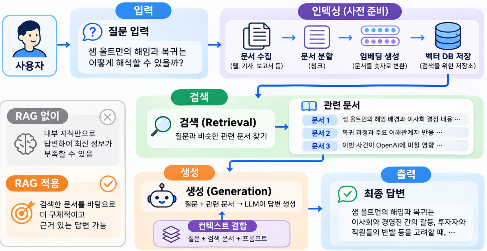
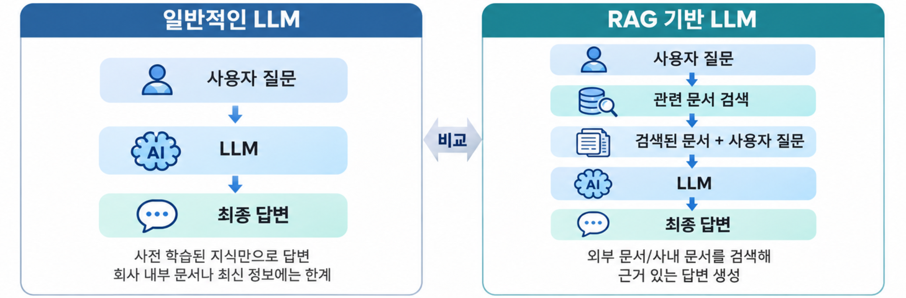
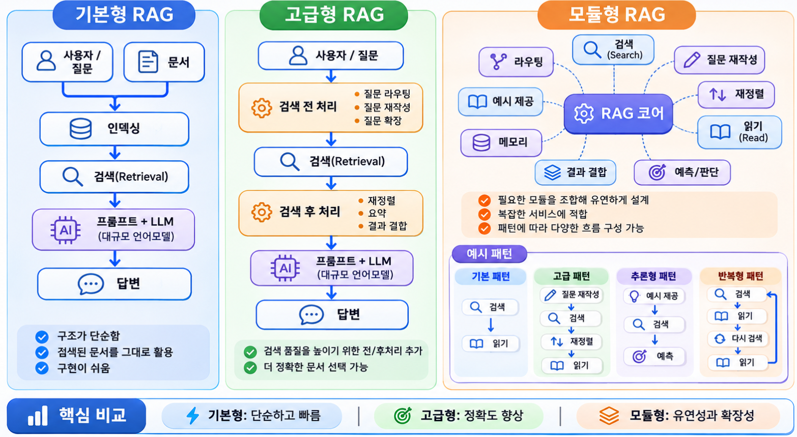
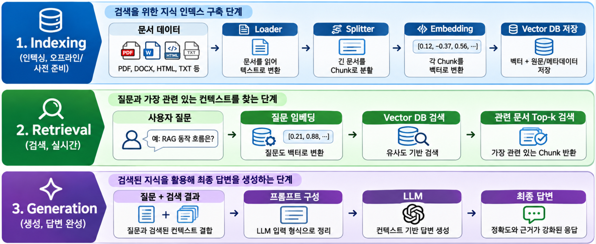

## 1. RAG 개념과 필요성 {#session-01}

**RAG(Retrieval-Augmented Generation, 검색 증강 생성)**는 질문과 관련된 자료를 먼저 찾고, 그 자료를 대규모 언어 모델(LLM)에 전달해 답변을 만드는 방식입니다.  



> 올해 우리 회사의 연차휴가 신청 절차는 어떻게 되나요?

LLM에 질문만 주면 최신 사내 규정을 확인할 자료가 없어 그럴듯하지만 실제와 다른 절차를 안내할 수 있습니다. 모델이 이렇게 사실과 다른 내용을 만들어 내는 현상을 **환각(Hallucination)**이라고 합니다.  
RAG 시스템은 등록된 인사 규정에서 신청 절차가 적힌 부분을 찾아 질문과 함께 LLM에 전달합니다. 답변에 문서 제목과 페이지 번호를 표시하면 사용자가 원문을 직접 확인할 수 있습니다.  
규정이 바뀌면 등록한 문서와 검색 인덱스를 갱신해 최신 내용을 반영합니다. 같은 방식으로 제품 매뉴얼에서 오류 코드에 해당하는 해결 방법을 찾거나, 업무 지침에서 특정 절차를 적용할 조건을 확인할 수 있습니다.  



## 2. Naive, Advanced, and Modular RAG {#session-02}

| 아키텍처 | 동작과 적용 기준 |
| --- | --- |
| **기본형 RAG(Naive RAG)** | 벡터 검색으로 질문과 관련된 문서 조각을 찾아 LLM에 전달합니다. 구조가 단순해 어떤 질문에서 필요한 근거를 찾지 못하는지 확인하기 좋습니다. |
| **고급형 RAG(Advanced RAG)** | 검색하기 전에 질문을 다시 쓰거나, 검색 결과의 순위를 다시 매기는 기능을 추가합니다. 반복되는 검색 문제에 맞춰 기능을 적용하고 검색 품질과 응답 시간의 변화를 확인합니다. |
| **모듈형 RAG(Modular RAG)** | 검색, 재순위화, 문맥 구성 등을 각각 모듈로 만들어 필요에 따라 교체하거나 실행 순서를 바꿉니다. 예를 들어 근거가 충분하면 답변을 만들고, 부족하면 질문을 바꿔 다시 검색할 수 있습니다. |



고급형 RAG에서 어떤 기능을 추가할지는 검색이 기대한 결과를 내지 못하는 이유에 따라 달라집니다. [RAG 아키텍처 분류 참고](https://arxiv.org/html/2312.10997#S2)

| 검색 상황 | 추가할 수 있는 기능 |
| --- | --- |
| 질문이 모호해 필요한 자료를 찾기 어렵습니다. | **Query Rewriting**으로 질문을 검색하기 쉬운 표현으로 바꿉니다. |
| 최신 인사 규정만 찾아야 합니다. | **Metadata Filtering**으로 문서 종류와 버전 등 검색 범위를 제한합니다. |
| 의미가 비슷한 표현과 정확히 일치하는 용어를 함께 찾아야 합니다. | **Hybrid Search**로 벡터 검색과 키워드 검색을 결합합니다. |
| 관련 문서가 검색 결과의 뒤쪽에 있습니다. | **Reranking**으로 각 후보가 질문과 얼마나 관련 있는지 다시 평가해 순위를 조정합니다. |

## 3. Indexing, Retrieval, and Generation {#session-03}

문서를 등록하거나 갱신할 때는 나중에 검색할 수 있도록 **인덱싱(Indexing)**합니다. 질문이 들어오면 미리 만들어 둔 인덱스에서 근거를 **검색(Retrieval)**하고, 찾은 근거를 바탕으로 답변을 **생성(Generation)**합니다.  
아래 그림은 기본 벡터 검색을 예로 보여줍니다. 실습에 쓰는 문서 파싱 도구와 하이브리드 검색은 5절에서 소개합니다.  



### 🟦 Indexing · 문서를 검색할 수 있게 준비하기

1. **문서 로딩** 단계에서 PDF나 Word 같은 원본 파일을 읽습니다.  
2. **파싱·정규화** 단계에서 제목·문단·표의 구조를 해석하고, 각 요소의 원본 위치와 함께 공통 형식에 담습니다.  
3. **청킹(Chunking)** 단계에서 문서를 검색하기 좋은 크기의 조각으로 나눕니다. 예를 들어 인사 규정의 신청 절차와 승인 기준을 각각 별도의 조각으로 나눌 수 있습니다.  
4. **임베딩(Embedding)** 단계에서 각 문서 조각을 숫자 벡터로 바꿉니다.  
5. **벡터 DB**에 벡터를 저장하고, 각 벡터에 해당 조각의 본문과 문서 제목·페이지 번호 같은 메타데이터를 연결합니다.  

### 🟦 Retrieval · 질문에 필요한 근거 찾기

검색기(Retriever)는 질문을 받아 관련 문서 조각을 찾아 돌려줍니다.  
벡터 검색에서는 질문도 문서 조각과 같은 벡터 공간에 표현한 뒤, 질문 벡터와 유사한 문서 벡터를 찾습니다.  

| 방식 | 인사 규정 검색 예시 |
| --- | --- |
| **벡터 검색(Dense Search)** | «휴가는 어떻게 신청하나요?»라는 질문으로 «연차휴가 신청 절차»를 찾습니다. |
| **키워드 검색(Keyword Search)** | «인사 규정 제12조»처럼 정확한 조항 번호나 용어를 찾습니다. |
| **하이브리드 검색(Hybrid Search)** | 의미가 비슷한 문단과 정확한 용어가 들어간 문단을 함께 검색합니다. |

### 🟦 Generation · 찾은 근거로 답변 만들기

사용자 질문, 검색한 문서 조각, 답변 지침을 프롬프트에 담아 LLM에 전달합니다.  

```text
아래 근거를 바탕으로 질문에 답하고 출처를 표시해 주세요.
근거가 부족하면 확인할 수 없다고 답해 주세요.

[근거]
{context}

[질문]
{question}
```

검색에서 필요한 근거를 놓치거나 LLM이 찾은 근거를 잘못 해석하면 답변이 틀릴 수 있습니다.  
대표 질문을 몇 가지 골라 필요한 문서를 찾는지, 답변이 그 문서를 정확히 인용하는지 확인합니다.  

## 4. RAG, Fine-tuning, Long-Context LLM 비교 {#session-04}

| 방식 | 활용 예 | 자료 갱신과 출처 확인 |
| --- | --- | --- |
| **RAG** | 질문에 맞는 규정 조항을 찾아 답변합니다. | 바뀐 문서를 다시 인덱싱하고, 답변에 근거 문서와 해당 위치를 표시합니다. |
| **Fine-tuning** | 사내 보고서 형식으로 답하도록 모델을 추가로 학습시킵니다. | 모델이 익힌 응답 방식을 바꾸려면 추가 학습을 검토합니다. 답변의 출처를 확인하려면 별도의 근거 자료가 필요합니다. |
| **Long-Context LLM** | 인사 규정 한 권을 통째로 입력해 요약합니다. | 다음 요청에는 최신 문서를 입력합니다. 인용한 부분은 입력 문서에서 확인합니다. |

SFT(Supervised Fine-tuning)는 입력과 원하는 응답을 짝지은 예시로 모델을 학습시킵니다.  
DPO(Direct Preference Optimization)는 같은 입력에 대한 두 응답 중 어느 쪽이 더 나은지 표시한 데이터로 모델을 조정합니다.  

자료가 자주 바뀌거나 여러 문서에서 필요한 내용을 반복해서 찾아야 한다면 RAG가 적합합니다. 문서 한두 개를 한 번 요약할 때는 통째로 입력하는 편이 간편합니다. 다만 입력이 길어지면 처리할 토큰 수가 늘고, 근거가 문서의 어디에 있는지에 따라 답변 품질도 달라질 수 있습니다. 여러 검색 결과를 종합해야 한다면 RAG의 답변 생성 단계에서 긴 문맥을 지원하는 모델을 사용할 수 있습니다.  

## 5. 실습 기술 스택과 프로젝트 구성 {#session-05}

### 🟦 편별 기술 스택

실습에서는 공고문과 인증제도 자료에서 근거를 찾아 답변하고, 원본 문서의 위치까지 보여주는 RAG 시스템을 만듭니다. 인덱싱 단계에서 청크와 벡터, 출처 정보를 Qdrant에 저장해 두고, 질문에 답할 때 검색과 인용에 사용합니다.  

| 편 | 기술 스택 | 용도 |
| --- | --- | --- |
| 2편 · 문서 전처리 | Docling, PyMuPDF, PyMuPDF4LLM, RapidOCR, Tesseract, Gemini VLM | 문서 구조 파싱, PDF 파싱 결과 비교, 스캔 문서의 글자 인식과 그림 해석 |
| 3편 · 청킹 | Docling HierarchicalChunker·HybridChunker, LangChain Text Splitters | 문서 구조와 토큰 수를 기준으로 분할하고 전략별 결과 비교 |
| 4편 · 임베딩 | Gemini Embedding 또는 BGE-M3, FastEmbed BM25 | 의미 검색용 Dense 벡터와 키워드 검색용 Sparse 벡터 생성 |
| 5편 · 벡터 저장 | Qdrant, qdrant-client | 청크 벡터와 출처 메타데이터 저장 및 인덱스 갱신 |
| 6편 · 검색 | Qdrant, RRF, BGE Reranker 또는 FlashRank | 의미 검색과 키워드 검색 결과를 합치고 후보 순위를 다시 평가 |
| 7편 · 답변 생성 | LangChain Core, LCEL, Gemini Flash·Pro, Pydantic | 검색 결과를 답변 생성 단계에 전달하고 출처를 담을 응답 형식 정의 |
| 8편 · 검색 고도화 | Gemini Flash, Python `asyncio` | 검색하기 쉬운 표현으로 질문을 바꾸고 서로 의존하지 않는 작업을 비동기로 처리 |
| 9편 · 평가와 모니터링 | RAGAS, LangSmith, pytest | 검색·답변 품질 평가, 실행 흐름 추적, 품질 회귀 테스트 |

LCEL(LangChain Expression Language)을 사용하면 한 단계의 출력을 다음 단계의 입력으로 넘길 수 있습니다. 예를 들어 `prompt | model | parser`는 검색 근거를 담은 프롬프트를 모델에 전달한 뒤, 모델의 응답을 애플리케이션에서 쓸 수 있는 형태로 바꿉니다.  

### 🟦 개발 환경 준비

```text
agent-workbook/
├── pyproject.toml
├── uv.lock
└── rag-basics/
    ├── datasets/
    └── labs/
        └── ch02/
```
