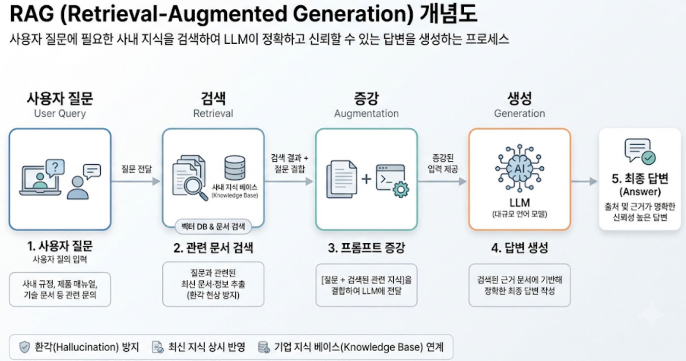
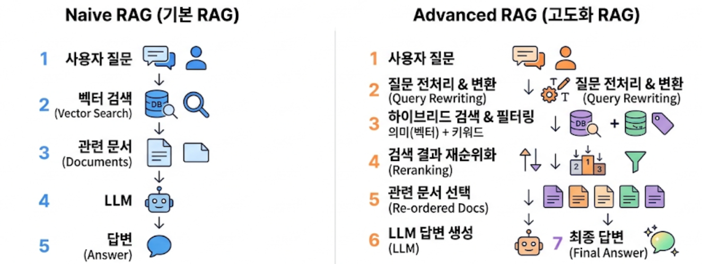
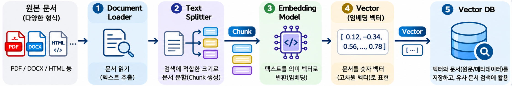
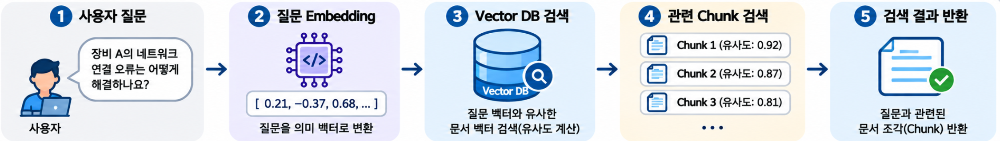
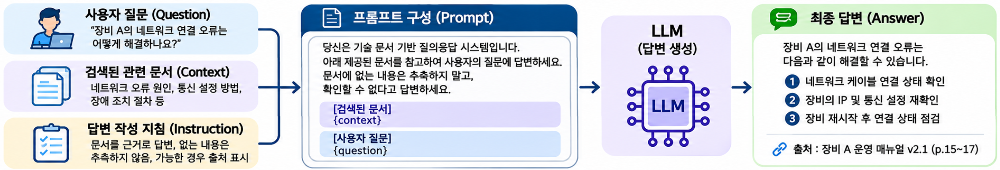
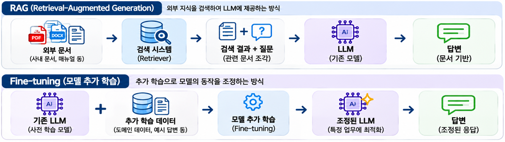

## 1. RAG 개념과 필요성 {#session-01}

### 🟦 RAG란?

RAG는 **외부 데이터에서 질문과 관련된 정보를 검색하고, 검색된 정보를 LLM에 전달하여 답변을 생성하는 기술**입니다.  
일반적인 LLM은 사전 학습 과정에서 습득한 지식과 사용자가 제공한 입력을 바탕으로 답변합니다.  
반면 RAG는 질문과 관련된 문서를 먼저 검색한 다음, 해당 문서를 참고하여 답변을 생성합니다.  



예를 들어 사용자가 다음과 같이 질문했다고 가정하겠습니다.  

> 우리 회사의 2026년 연차휴가 규정은 어떻게 되나요?

일반적인 LLM은 회사 내부 규정을 알지 못하므로 정확하게 답변하기 어렵습니다.  
그러나 RAG 시스템에 회사의 인사 규정 문서가 등록되어 있다면 해당 문서에서 관련 내용을 검색하여 답변할 수 있습니다.  
즉, RAG의 핵심은 **LLM이 모든 정보를 미리 학습할 필요 없이, 필요한 정보를 검색하여 활용하도록 만드는 것**입니다.  


### 🟦 RAG가 필요한 이유

- **사내 자료 활용** — LLM이 학습할 때 접하지 못한 사규나 운영 지침을 찾아 답변에 활용합니다.  
- **최신 정보 반영** — 규정이나 매뉴얼이 바뀌면 문서와 검색 인덱스를 갱신합니다.  
- **환각 감소** — 질문에 맞는 문서를 근거로 답하면 그럴듯하지만 사실과 다른 답변을 줄일 수 있습니다.  
- **근거 확인** — 답변에 문서 제목과 페이지를 표시하면 사용자가 원문을 확인할 수 있습니다.  

검색한 문서가 부정확하거나 LLM이 내용을 잘못 해석하면 답변도 틀릴 수 있습니다.  

## 2. RAG 아키텍처 및 동작 원리 {#session-02}

### 🟦 RAG 파이프라인

RAG는 **Indexing → Retrieval → Generation**의 세 단계로 동작합니다.  

1. **Indexing(인덱싱)** — 문서를 작은 조각으로 나누고 벡터로 변환해 검색할 수 있도록 저장합니다.  
2. **Retrieval(검색)** — 사용자 질문과 관련된 문서 조각을 검색 인덱스에서 찾습니다.  
3. **Generation(답변 생성)** — 질문과 검색한 문서 조각을 LLM에 전달해 근거가 있는 답변을 작성합니다.  


인덱싱은 처음 문서를 등록하거나 문서가 바뀔 때 수행합니다. 검색과 답변 생성은 질문이 들어올 때마다 실행합니다.  

### 🟦 Naive RAG와 Advanced RAG

RAG는 구현 방식에 따라 기본적인 구조와 고도화된 구조로 구분할 수 있습니다.  

**Naive RAG(기본 RAG)**
가장 단순한 형태의 RAG입니다.  
문서를 분할하여 Vector DB에 저장하고, 사용자 질문과 유사한 문서를 검색하여 LLM에 전달합니다.  
구조가 간단하고 구현하기 쉬워 RAG를 처음 학습할 때 적합합니다.  
그러나 검색된 문서가 질문과 정확히 일치하지 않거나, 관련성이 낮은 문서가 포함될 수 있다는 한계가 있습니다.  

**Advanced RAG(고도화 RAG)**
기본 RAG에 검색 품질을 개선하는 기능을 추가한 구조입니다.  
대표적인 기술은 다음과 같습니다.  

- **Hybrid Search:** 의미 기반 벡터 검색과 키워드 검색을 결합
- **Metadata Filtering:** 문서 유형, 작성일, 부서 등의 조건으로 검색 범위 제한
- **Reranking:** 검색된 문서를 질문과의 관련성에 따라 다시 정렬
- **Query Rewriting:** 검색하기 좋은 형태로 사용자 질문을 변환

Advanced RAG는 검색 정확도를 높이는 데 도움이 되지만, 시스템 복잡도와 처리 시간, 운영 비용이 증가할 수 있습니다.  

## 3. Indexing, Retrieval, Generation {#session-03}

### 🟦 Indexing: 문서 수집과 벡터 DB 구축

Indexing은 외부 문서를 검색 가능한 형태로 가공하여 저장하는 과정입니다.  
일반적인 처리 순서는 다음과 같습니다.  

**① Document Loading**
PDF, Word, HTML 등 다양한 형식의 문서를 읽어 텍스트와 메타데이터를 추출합니다.  
**② Chunking**
문서 전체를 하나의 단위로 저장하는 대신 적절한 크기의 텍스트 조각인 Chunk로 분할합니다.  
예를 들어 100페이지 분량의 매뉴얼을 하나의 문서로 검색하는 것보다, 주제별로 분할하여 검색하는 것이 유리할 수 있습니다.  
**③ Embedding**
분할된 텍스트를 Embedding Model을 이용하여 숫자 벡터로 변환합니다. 이 벡터는 텍스트의 의미적 특징을 표현하며, 유사한 내용의 텍스트를 검색하는 데 사용됩니다.  
**④ Vector DB 저장**
생성된 벡터와 원본 텍스트, 문서 제목, 페이지 번호 등의 메타데이터를 Vector DB에 저장합니다.  

### 🟦 Retrieval: 질문과 관련된 문서 검색

Retrieval은 사용자의 질문에 적합한 문서를 찾아오는 과정입니다.  

예를 들어 사용자가 다음과 같이 질문했다고 가정하겠습니다.  

> 장비 A의 네트워크 연결 오류는 어떻게 해결하나요?

Retriever는 Vector DB에서 네트워크 연결 오류, 통신 설정, 장애 조치 방법 등과 관련된 문서 조각을 검색합니다.  

이때 검색 방식은 크게 다음과 같이 구분할 수 있습니다.  

**벡터 검색(Dense Search)**
질문과 문서의 의미적 유사성을 기반으로 검색합니다.  
질문에 사용된 단어와 문서에 사용된 단어가 달라도 의미가 비슷하면 관련 문서를 찾을 수 있습니다.  
**키워드 검색(Sparse / Keyword Search)**
질문에 포함된 특정 단어나 용어를 중심으로 문서를 검색합니다.  
제품 모델명, 오류 코드, API 함수명처럼 정확한 문자열이 중요한 경우 유용합니다.  
**하이브리드 검색(Hybrid Search)**
벡터 검색과 키워드 검색을 결합하는 방식입니다.  
두 검색 방식의 장점을 활용하여 검색 결과의 품질을 개선할 수 있습니다.  
추가로 Reranking을 적용하면 검색된 문서의 순서를 질문과의 관련성에 따라 다시 조정할 수 있습니다.  
이러한 검색 고도화 기술은 6편에서 자세히 다룰 예정입니다.  

### 🟦 Generation: 검색 결과 기반 답변 생성

Generation은 검색된 문서를 LLM에 전달하여 최종 답변을 생성하는 과정입니다.  
일반적으로 사용자 질문, 검색된 문서, 답변 작성 지침을 하나의 프롬프트로 구성합니다.  


예를 들어 다음과 같은 프롬프트를 사용할 수 있습니다.  

```text
당신은 기술 문서 기반 질의응답 시스템입니다.
아래 제공된 문서를 참고하여 사용자의 질문에 답변하세요.
문서에 없는 내용은 추측하지 말고, 확인할 수 없다고 답변하세요.

[검색된 문서]
{context}

[사용자 질문]
{question}
```

여기서 `{context}`에는 검색된 문서 내용이 들어가고, `{question}`에는 사용자 질문이 들어갑니다.  
이렇게 구성하면 LLM이 검색된 문서를 근거로 답변하도록 유도할 수 있습니다.  
다만 프롬프트만으로 답변의 정확성을 보장할 수는 없습니다.  
검색 품질을 관리하고, 답변의 출처를 표시하며, 필요에 따라 평가 절차를 추가해야 합니다.  

## 4. RAG와 Fine-tuning 비교 {#session-04}

LLM을 특정 업무에 맞게 활용하는 대표적인 방법으로 RAG와 Fine-tuning이 있습니다.  
두 기술 모두 LLM의 활용 범위를 확장하는 데 사용되지만 목적과 접근 방식이 다릅니다.  

### 🟦 Fine-tuning이란?

Fine-tuning은 이미 학습된 모델에 추가 데이터를 사용하여 모델의 동작을 조정하는 기술입니다.  
예를 들어 특정한 답변 형식을 따르도록 하거나, 업무에 적합한 표현과 응답 패턴을 학습시키는 데 활용할 수 있습니다.  
반면 RAG는 모델 자체를 변경하지 않고, 외부 데이터를 검색하여 입력에 추가합니다.  
즉, **RAG는 모델에 제공하는 정보를 확장하는 방법이고, Fine-tuning은 모델의 동작을 조정하는 방법**이라고 이해할 수 있습니다.  


### 🟦 RAG와 Fine-tuning 비교

| 구분 | RAG | Fine-tuning |
| --- | --- | --- |
| 핵심 목적 | 외부 지식 검색 및 활용 | 모델의 동작과 응답 특성 조정 |
| 모델 파라미터 변경 | 필요 없음 | 변경됨 |
| 데이터 업데이트 | 문서 및 검색 인덱스 갱신 | 추가 학습이 필요할 수 있음 |
| 최신 정보 반영 | 상대적으로 유리 | 상대적으로 불리 |
| 출처 제공 | 검색 문서를 근거로 제공 가능 | 별도 설계 필요 |
| 초기 구축 | 문서 처리 및 검색 시스템 필요 | 학습 데이터와 학습 환경 필요 |
| 주요 비용 | 임베딩, 검색, LLM 호출 | 학습 및 추론, 모델 운영 |
| 주요 활용 | 사내 문서 검색, 매뉴얼 QA | 응답 형식, 스타일, 특정 작업 최적화 |

RAG와 Fine-tuning은 서로 경쟁하는 기술이라기보다 상호 보완적인 기술입니다.  
예를 들어 Fine-tuning으로 특정 업무에 적합한 응답 형식을 학습시키고, RAG로 최신 업무 문서를 제공하는 방식으로 함께 사용할 수 있습니다.  

### 🟦 Long-Context LLM 시대에도 RAG가 필요할까?

최근 LLM은 한 번에 처리할 수 있는 입력 문맥(Context Window)이 커지고 있습니다.  
Gemini와 같은 Long-Context LLM은 긴 문서를 입력받아 분석할 수 있기 때문에, 문서의 양이 적거나 일회성 분석이라면 별도의 검색 시스템 없이 처리할 수도 있습니다.  
어떤 방식을 쓸지는 문서의 양과 질문의 성격에 따라 달라집니다.  

**Long-Context 방식이 적합한 경우**

- 분석할 문서의 수가 적은 경우
- 특정 문서 전체의 내용을 종합해야 하는 경우
- 일회성 문서 분석이나 요약이 필요한 경우
- 검색 인프라 구축보다 간단한 구현이 중요한 경우

**RAG 방식이 적합한 경우**

- 문서가 수천~수백만 건 이상 존재하는 경우
- 문서가 지속적으로 추가되거나 변경되는 경우
- 질문과 관련된 일부 정보만 검색하면 되는 경우
- 문서별 접근 권한이나 검색 조건이 필요한 경우
- 검색 결과와 답변의 근거를 추적해야 하는 경우

또한 Long-Context LLM을 사용하더라도 입력 토큰 비용과 처리 시간, 긴 문맥에서 필요한 정보를 정확하게 활용하는 능력을 고려해야 합니다.  

따라서 실제 시스템에서는 RAG로 관련 문서를 검색하고, Long-Context LLM이 검색된 여러 문서를 종합하도록 구성할 수도 있습니다.  

## 5. LangChain 기반 RAG 구성 요소 {#session-05}

LangChain은 LLM을 사용하는 애플리케이션을 개발하기 위한 오픈소스 프레임워크입니다. 앞서 살펴본 RAG의 세 단계를 구현할 때 문서 로더, 임베딩 모델, 벡터 저장소, 채팅 모델 등을 공통 인터페이스로 연결할 수 있습니다.  

### 🟦 단계별 구성 요소

| 단계 | 구성 요소 | 역할 |
| --- | --- | --- |
| 인덱싱 | Document Loader | PDF, HTML, DOCX 등에서 텍스트와 메타데이터를 읽어 `Document` 객체로 반환 |
| 인덱싱 | Text Splitter | 문서를 검색에 사용할 조각(Chunk)으로 분할 |
| 인덱싱·검색 | Embedding Model | 문서 조각과 질문을 같은 벡터 공간으로 변환 |
| 인덱싱·검색 | Vector Store | 벡터와 문서 정보를 저장하고 유사도 검색 수행 |
| 검색 | Retriever | 질문을 받아 관련 문서 조각을 반환 |
| 생성 | Prompt Template | 질문, 검색 결과, 답변 지침을 프롬프트로 구성 |
| 생성 | Chat Model (LLM) | 프롬프트를 바탕으로 답변 생성 |
| 생성 | Output Parser | 모델 응답을 문자열 등 애플리케이션에서 사용할 형태로 변환 |

### 🟦 구성 요소 연결 예시

Qdrant를 벡터 저장소로 사용하는 경우, 인덱싱할 때 저장한 문서 조각을 질의응답 과정에서 다시 찾아 활용합니다.  

```text
문서 등록: Document Loader → Text Splitter → Embedding Model → Qdrant
질문 검색: 사용자 질문 → Retriever(질문 임베딩 및 Qdrant 검색) → 관련 문서
답변 생성: 질문 + 관련 문서 → Prompt Template → Chat Model → Output Parser
```

LangChain Expression Language(LCEL)를 사용하면 `prompt | model | parser`처럼 각 구성 요소의 출력을 다음 단계의 입력으로 연결할 수 있습니다.  
문서 처리, 검색, 답변 생성을 분리해 두면 어느 단계에서 문제가 생겼는지 확인하기 쉽습니다. 같은 인터페이스를 사용하는 채팅 모델이나 벡터 저장소로 교체할 때도 변경 범위를 줄일 수 있습니다.  

### 🟦 주요 Python 패키지

| 패키지 | 주요 용도 |
| --- | --- |
| `langchain-core` | `Document`, 프롬프트, Runnable, 출력 파서 등 공통 인터페이스 |
| `langchain-text-splitters` | 문서 조각 분할 |
| `langchain-google-genai` | Gemini 채팅 모델 및 Google 임베딩 모델 연동 |
| `langchain-huggingface` | Hugging Face 임베딩 모델 연동 |
| `langchain-qdrant` | Qdrant 벡터 저장소 연동 |
| `langchain-docling` | Docling 기반 문서 로딩 |
| `langchain-pymupdf4llm` | PyMuPDF4LLM 기반 PDF 로딩 |

프로젝트에서 사용하는 모델, 벡터 저장소, 문서 형식에 맞춰 필요한 통합 패키지를 선택할 수 있습니다.  
`docling`, `pymupdf4llm`, `beautifulsoup4`, `python-docx`로 문서를 직접 읽는 경우에는 추출한 텍스트를 `Document`의 `page_content`에 넣고, 파일명이나 페이지 번호를 `metadata`에 담아 파이프라인에 연결할 수 있습니다.  

`langchain-unstructured`는 여러 문서 형식을 하나의 로더로 처리할 수 있습니다. 로컬에서 PDF의 OCR이나 레이아웃 분석까지 수행하면 추가 의존성이 필요하고 처리 시간이 길어질 수 있습니다.  
PDF는 `pymupdf4llm`, HTML은 `beautifulsoup4`, DOCX는 `python-docx`처럼 형식별로 특화된 라이브러리를 조합하면 필요한 처리만 수행해 속도를 높이고, 문서 구조에 맞춰 추출 품질을 개선할 수 있습니다.  

어떤 라이브러리를 쓰든 최종 출력물을 Markdown 포맷으로 통일해 두면, 이후 단계에서 LangChain의 MarkdownHeaderTextSplitter + RecursiveCharacterTextSplitter를 공통으로 태울 수 있어 파이프라인이 매우 깔끔해집니다.
