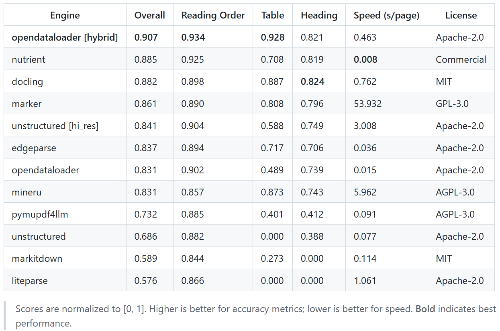
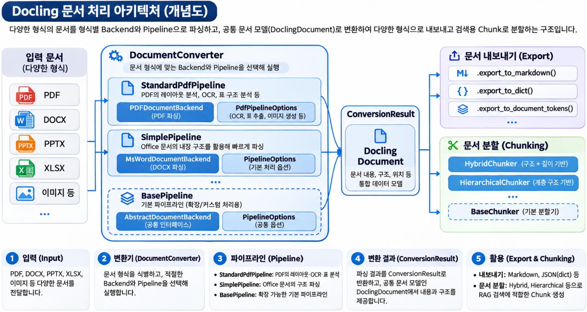
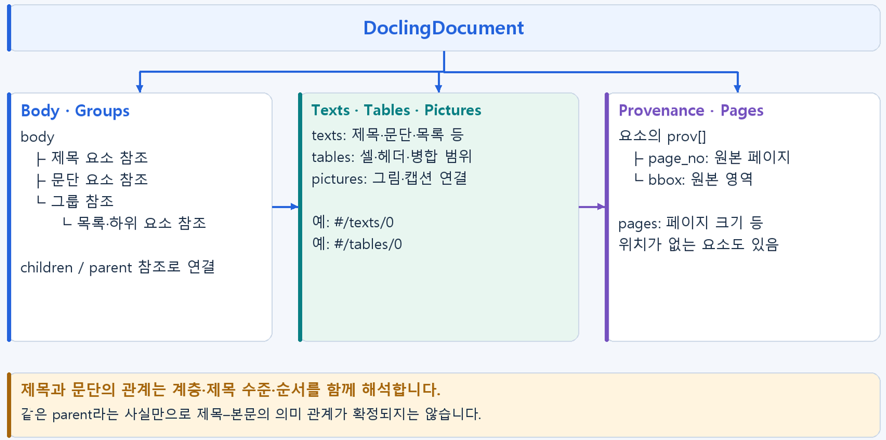
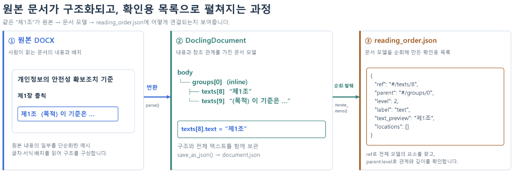
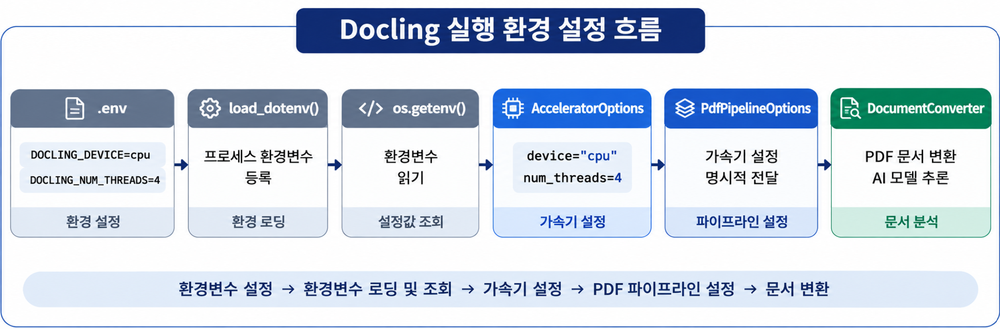
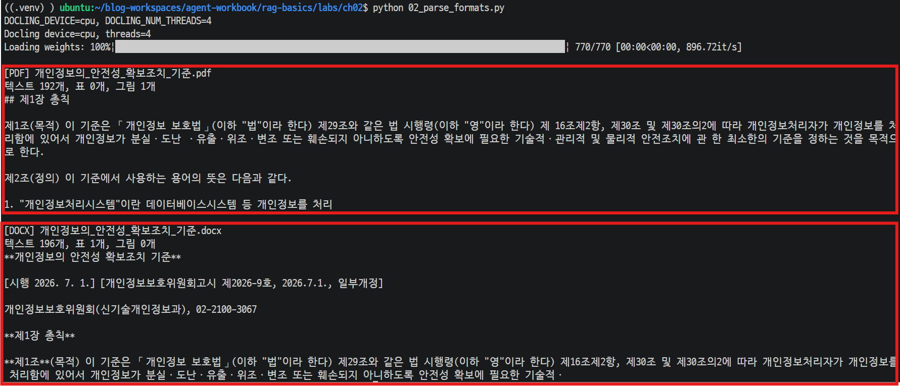
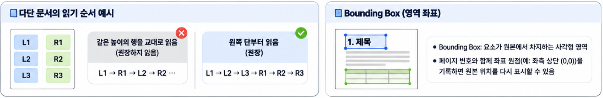
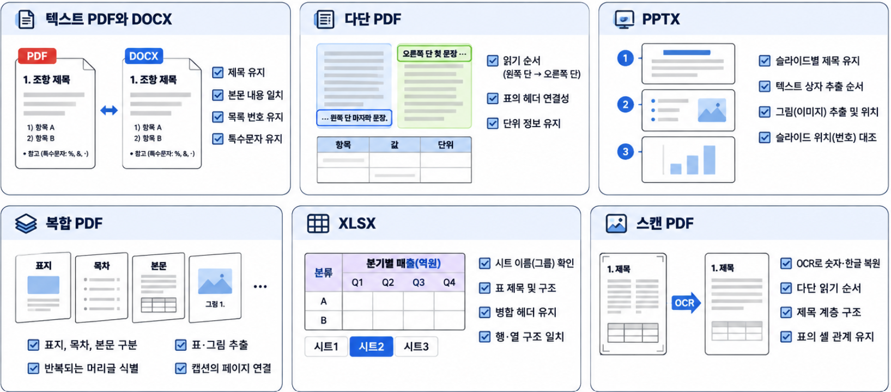
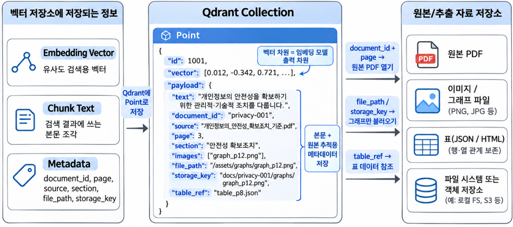

RAG가 문서를 검색하려면 먼저 원본 파일을 읽어야 합니다. 글자를 빠짐없이 추출해도 문단의 읽기 순서가 바뀌거나 표의 헤더와 값이 떨어지면 정확한 근거를 찾기 어렵습니다. 이 글에서는 Docling으로 문서의 **내용·구조·출처**를 함께 보존하고 검색에 쓸 결과를 준비합니다.  

## 1. RAG 문서 전처리와 Docling 아키텍처 {#session-01}

### 🟦 RAG에서 쓰는 문서 로더와 파서

| 도구 | 활용 방식 |
| --- | --- |
| **Docling** | PDF·Office·HTML을 제목 계층, 표 구조, 출처 정보를 담을 수 있는 `DoclingDocument`로 변환합니다. |
| **PyMuPDF4LLM** | PDF 내용을 Markdown 등으로 추출해 검토하거나 청킹에 사용합니다. |
| **Unstructured** | 제목·본문·목록처럼 유형이 지정된 요소를 추출해 필요한 항목을 골라 처리합니다. |

Docling은 다양한 입력 형식을 공통 문서 구조로 변환해 형식별 후처리를 줄이고, 각 청크를 원문 출처와 연결할 수 있는 문서 처리 도구입니다.  
PDF 공고문과 Word 규정을 동일한 청킹 코드로 처리하고, 표의 헤더와 데이터를 함께 담아 문맥을 유지할 수 있습니다.  
원문의 페이지·영역 정보가 제공되는 경우에는 이를 청크와 연결해 답변의 근거로 제시할 수 있습니다.
[OpenDataLoader PDF 공개 평가](https://opendataloader.org/docs/benchmark){: target="_blank" rel="noopener noreferrer" }



### 🟦 Docling 문서처리 아키텍처

`DocumentConverter().convert()`에 파일을 넘기면 Docling이 형식을 판별해 기본 처리 경로를 자동으로 선택합니다.  
PDF는 페이지 배치를 분석하고, DOCX는 파일에 담긴 문단과 표 구조를 읽습니다.  
OCR 사용 여부, 인식 언어, 표 구조 분석은 기본 설정을 따르며 필요에 따라 바꿀 수 있습니다.  



1. **입력** — `convert()`에 PDF·Office 문서·이미지 등을 전달합니다.  
2. **변환기** — `DocumentConverter`가 형식에 맞는 백엔드와 파이프라인을 고릅니다. 백엔드는 파일을 읽고, 파이프라인은 읽은 데이터를 문서 구조로 정리합니다.  
3. **처리** — PDF와 이미지는 기본적으로 `StandardPdfPipeline`에서 페이지 배치와 읽기 순서를 분석합니다. OCR과 표 구조 분석은 설정에 따라 실행합니다. DOCX·PPTX·XLSX는 `SimplePipeline`에서 파일에 이미 담긴 문단·슬라이드·시트 구조를 활용합니다.  
4. **변환 결과** — `ConversionResult.document`에서 문서 내용, 구조, 확보된 원본 위치를 담은 `DoclingDocument`를 얻습니다. 처리 상태와 기록된 오류는 `status`와 `errors`에서 확인합니다.  
5. **활용** — `export_to_markdown()`과 `export_to_dict()`는 각각 Markdown 문자열과 Python 딕셔너리를 반환합니다. JSON 파일은 `save_as_json()`으로 저장합니다. 검색용 청크는 문서 구조를 따르는 `HierarchicalChunker`나 토큰 길이까지 고려하는 `HybridChunker`로 만듭니다.  

```python
# 지정한 PDF 옵션을 적용한 Docling 변환기를 만들어 반환합니다.
# * 뒤의 옵션은 ocr="rapidocr"처럼 이름을 붙여 전달합니다.
def make_converter(
    *,
    ocr: OcrEngine = "off",
    do_table_structure: bool = True,
    generate_picture_images: bool = False,
) -> DocumentConverter:
    # 미리 준비한 모델이 있으면 환경 변수에 해당 폴더를 지정합니다.
    model_dir = os.getenv("DOCLING_ARTIFACTS_PATH")
    # 환경변수에서 AI 모델의 추론 장치와 CPU 스레드 수를 읽습니다.
    # CPU,GPU 사용을 외부에서 설정한다.
    accelerator_options = AcceleratorOptions(
        device=os.getenv("DOCLING_DEVICE", "auto"),
        num_threads=int(os.getenv("DOCLING_NUM_THREADS", "4")),
    )
    # PDF 변환 파이프라인에 가속기 설정을 명시적으로 적용합니다.
    pdf_options = PdfPipelineOptions(
        accelerator_options=accelerator_options,
    )
    pdf_options.do_ocr = ocr != "off"
    pdf_options.artifacts_path = model_dir
    pdf_options.do_table_structure = do_table_structure
    pdf_options.generate_picture_images = generate_picture_images
    if ocr == "rapidocr":
        pdf_options.ocr_options = RapidOcrOptions(
            lang=["iso:ko"], mode=OcrMode.FULL_PAGE
        )
    elif ocr == "tesseract":
        pdf_options.ocr_options = TesseractCliOcrOptions(
            lang=["kor", "eng"], mode=OcrMode.FULL_PAGE
        )

    # PDF 파이프라인에 적용된 가속기 설정을 확인합니다.
    print(
        f"Docling device={pdf_options.accelerator_options.device}, "
        f"threads={pdf_options.accelerator_options.num_threads}"
    )

    # Office와 HTML은 Docling의 형식별 기본 설정을 사용합니다.
    return DocumentConverter(
        format_options={InputFormat.PDF: PdfFormatOption(pipeline_options=pdf_options)}
    )


# 준비된 변환기와 원본 파일 경로를 받아, 성공한 결과의 DoclingDocument를 반환합니다.
# page_range로 시작 쪽과 끝 쪽을 지정할 수 있습니다. 생략하면 모든 쪽을 읽습니다.
def parse(
    converter: DocumentConverter,
    source: Path,
    *,
    page_range: tuple[int, int] = DEFAULT_PAGE_RANGE,
) -> DoclingDocument:
    result = converter.convert(
        source,
        page_range=page_range,
        raises_on_error=True,  # 기본값
    )
    # raises_on_error =True에서
    #   Docling이 일부 실패에 대해 ConversionError를 먼저 발생시켜 result.status 검사까지 도달하지 않을 수 있습니다.
    # False로 설정해도 호출 자체에서 발생하는 예외는 전파될 수 있습니다.

    # 일부 페이지만 성공한 결과가 정상 산출물로 저장되지 않도록 합니다.
    if result.status != ConversionStatus.SUCCESS:
        details = "; ".join(error.error_message for error in result.errors)
        raise ValueError(f"{source.name} {result.status.value} {details}")
    return result.document
```

그림에서 점선으로 표시된 `BasePipeline`과 `BaseChunker`는 새 처리 방식이나 분할 방식을 구현할 때 사용하는 공통 기반입니다. [Docling 아키텍처](https://docling-project.github.io/docling/concepts/architecture/){: target="_blank" rel="noopener noreferrer" } · [DocumentConverter API](https://docling-project.github.io/docling/reference/document_converter/){: target="_blank" rel="noopener noreferrer" }

### 🟦 DoclingDocument 내부 데이터 구조

| 필드 또는 API | 확인하는 내용 |
| --- | --- |
| `body`, `groups` | 문서 요소의 계층과 순서입니다. `iterate_items()`로 요소와 깊이를 확인합니다. |
| `texts`, `tables`, `pictures` | 텍스트·표·그림 요소입니다. 표에서는 셀의 시작과 끝, 헤더 여부를 확인할 수 있습니다. |
| `pages` | 변환 경로가 제공한 페이지 크기 등의 정보입니다. |
| 요소의 `prov` | 원본 위치(Provenance)입니다. 위치가 기록된 요소에서는 페이지 번호와 사각형 영역 좌표(Bounding Box)를 읽을 수 있습니다. |


페이지나 좌표가 없는 요소는 위치 목록이 비어 있을 수 있습니다.  
PDF 뷰어에 영역을 표시할 때는 페이지 크기와 좌표 원점, 단위를 확인합니다.  
XLSX와 같은 문서는 실제 시트와 셀 범위를 대조합니다. [Docling 문서 모델](https://docling-project.github.io/docling/concepts/docling_document/){: target="_blank" rel="noopener noreferrer" }

### 🟦 DOCX의 읽기 순서와 계층 확인하기

개인정보 보호 기준 DOCX를 변환한 뒤, 제목과 조항 번호, 본문이 원본과 같은 순서로 이어지는지 확인해 봅니다. 아래는 실습 파일 `01_document_structure.py`의 `collect_reading_order()` 함수입니다. `iterate_items(with_groups=True)`로 문서 요소와 그룹을 순서대로 읽으면서 계층 깊이(`level`), 텍스트 미리보기, 원본 위치를 모읍니다. [Docling 문서 API](https://docling-project.github.io/docling/reference/docling_document/){: target="_blank" rel="noopener noreferrer" }

```python
# rag-basics/labs/ch02/01_document_structure.py
def collect_reading_order(document: DoclingDocument) -> list[ReadingOrderItem]:
    items: list[ReadingOrderItem] = []
    # 요소를 묶는 그룹도 포함합니다. level은 본문 최상위에서 몇 단계 아래에 있는지를 나타냅니다.
    for item, level in document.iterate_items(with_groups=True):
        if not isinstance(item, (DocItem, GroupItem)):
            continue
        # 텍스트 요소의 앞 100자만 미리보기에 담고, 다른 요소의 미리보기는 비워 둡니다.
        text = item.text if isinstance(item, TextItem) else ""
        # 문서 요소의 원본 페이지 번호와 영역 좌표를 가져옵니다. 그룹에는 빈 목록을 기록합니다.
        item_locations = locations(item) if isinstance(item, DocItem) else []
        # ref는 현재 요소를 가리키고, parent는 상위 요소를 가리킵니다.
        # 두 참조 모두 document.json에서 확인할 수 있으며, 상위 요소가 없으면 parent는 None입니다.
        items.append(
            {
                "ref": item.self_ref,
                "parent": item.parent.cref if item.parent else None,
                "level": level,
                "label": item.label.value,
                "text_preview": text[:100],
                "locations": item_locations,
            }
        )
    return items

def main() -> None:
    # 실습용 DOCX를 읽는 데 사용할 Docling 변환기를 준비합니다.
    converter: DocumentConverter = make_converter()
    # 개인정보 보호 기준 DOCX를 읽고, 변환된 문서 구조를 document에 담습니다.
    # 변환이 실패하거나 일부만 성공하면 parse()가 ValueError를 발생시켜 실행을 멈춥니다.
    document: DoclingDocument = parse(converter, FILE_PRIVACY_DOCX)
    # 제목, 문단, 표 같은 문서 요소를 읽기 순서대로 모아 items에 담습니다.
    items: list[ReadingOrderItem] = collect_reading_order(document)
    # 공통 결과 폴더(processed) 아래에서 이번 실습의 저장 경로를 정합니다.
    folder = OUTPUT / "01_structure"
    # 문서 전체 구조는 document.json에, 요소별 읽기 순서는 reading_order.json에 저장합니다.
    save_document_structure(document, items, folder)
    # 처음 15개 요소의 미리보기와 전체 문서의 요소 수를 터미널에 출력합니다.
    print_document_summary(document, items)
    # 저장된 JSON 파일을 찾을 수 있도록 폴더 경로를 터미널에 출력합니다.
    print(folder)

```

문서 전체 구조는 `document.json`에, 위 함수가 반환한 목록은 `reading_order.json`에 저장됩니다.  
두 파일은 `rag-basics/datasets/processed/01_structure/`에서 확인할 수 있습니다.


## 2. Docling 문서 분석 환경 설정 (GPU·CPU) {#docling-device-setup}

### 🟦 문서 분석 모델과 첫 실행

Docling은 PDF처럼 구조가 복잡한 문서를 처리할 때 AI 모델을 사용합니다.  
레이아웃 모델로 제목·본문·표·그림이 놓인 영역을 찾고, 파이프라인은 이 결과를 바탕으로 읽기 순서를 정리합니다.  
설정에 따라 표의 행·열과 셀 관계를 파악하거나, OCR로 스캔 이미지 속 글자를 읽거나, 그림을 분류하고 설명을 생성할 수 있습니다. [Docling 파이프라인 옵션](https://docling-project.github.io/docling/reference/pipeline_options/){: target="_blank" rel="noopener noreferrer" }

처음 실행할 때 필요한 모델이 로컬에 없으면 Hugging Face Hub 같은 저장소에서 내려받습니다.  
이후 실행에서는 로컬 캐시에 저장된 모델을 재사용합니다.  
인터넷 연결이 제한된 환경에서는 모델을 미리 준비해 둘 수 있습니다. [Docling 모델 사전 다운로드](https://docling-project.github.io/docling/usage/advanced_options/){: target="_blank" rel="noopener noreferrer" }

### 🟦 CUDA 오류가 발생할 때 확인할 항목

Docling은 모델 추론에 GPU 가속을 사용할 수 있습니다. NVIDIA GPU가 인식되더라도 설치한 PyTorch의 CUDA 빌드가 해당 GPU 아키텍처에서 실행할 커널을 제공하지 않으면 다음 오류가 발생할 수 있습니다.

```text
CUDA error: no kernel image is available for execution on the device
```

GPU를 사용할 수 없는 환경에서는 CPU 모드로 실습을 진행할 수 있습니다. [Docling GPU 지원](https://docling-project.github.io/docling/usage/gpu/){: target="_blank" rel="noopener noreferrer" }

### 🟦 `.env` 파일에서 CPU 모드 설정하기

`DOCLING_DEVICE=cpu`는 모델 추론에 CPU를 사용하도록 지정합니다.  
`DOCLING_NUM_THREADS`는 모델 추론에 사용할 CPU 스레드 수 입니다. [Docling 가속기 옵션](https://docling-project.github.io/docling/reference/pipeline_options/){: target="_blank" rel="noopener noreferrer" }

```dotenv
# 실행 장치 선택
# auto   = 사용 가능한 장치 자동 선택 (기본값)
# cpu    = CPU
# cuda   = NVIDIA GPU
# cuda:N = 번호 N의 NVIDIA GPU (예: cuda:0)
# mps    = Apple Silicon GPU
# xpu    = Intel GPU
DOCLING_DEVICE=cpu

# 모델 추론에 사용할 CPU 스레드 수
DOCLING_NUM_THREADS=4

# Hugging Face Hub 인증이 필요한 모델을 사용할 때 설정
# HF_TOKEN=hf_xxxxxxxxxxxxxxxxxxxx
```

### 🟦 PipelineOptions의 기본 가속기 설정  

다음 코드만 사용하면 환경변수 로딩 이전에 초기화된 기본 설정을 사용할 가능성이 있습니다.

```python
pdf_options = PdfPipelineOptions()
```

이를 해결하려면 AcceleratorOptions 객체를 새롭게 생성하여 명시적으로 전달하는 것이 좋습니다.


```python
from docling.datamodel.accelerator_options import AcceleratorOptions

# 환경변수에서 AI 모델의 추론 장치와 CPU 스레드 수를 읽습니다.
accelerator_options = AcceleratorOptions(
    device=os.getenv("DOCLING_DEVICE", "auto"),
    num_threads=int(os.getenv("DOCLING_NUM_THREADS", "4")),
)
# PDF 변환 파이프라인에 가속기 설정을 명시적으로 적용합니다.
pdf_options = PdfPipelineOptions(
    accelerator_options=accelerator_options,
)
# Office와 HTML은 Docling의 형식별 기본 설정을 사용합니다.
return DocumentConverter(
    format_options={
        InputFormat.PDF: PdfFormatOption(pipeline_options=pdf_options) 
    }
)
```

## 3. 문서 유형별 파싱과 레이아웃 분석 {#session-02}

### 🟦 디지털 PDF와 스캔 PDF 구분하기

디지털 PDF에는 바로 읽을 수 있는 텍스트가 들어 있습니다. 스캔 PDF는 페이지가 이미지로 저장돼 OCR이 필요합니다. 한 파일에 두 종류의 페이지가 섞이거나, 화면에서 글자를 선택할 수 있어도 숨겨진 OCR 텍스트가 잘못된 경우가 있습니다.  

대표 페이지에서 추출한 글자를 화면과 대조하고 한글·숫자·특수문자가 정상인지 확인합니다. 이미지 안에만 있는 글자나 페이지마다 다른 텍스트 상태를 확인한 뒤 OCR을 적용할 범위를 정합니다. [Docling OCR 안내](https://docling-project.github.io/docling/concepts/OCR/){: target="_blank" rel="noopener noreferrer" }

### 🟦 같은 문서의 PDF와 DOCX 비교하기

PDF는 페이지 배치를 분석하고 DOCX는 내부 문서 구조를 읽습니다.  
같은 내용을 담아도 출력 문자열은 달라질 수 있으므로 조항 번호와 문단의 순서, 제목과 본문의 관계가 남았는지 확인합니다.  

```python
# 같은 문서의 PDF와 DOCX를 차례로 변환합니다.
# 형식별로 추출된 요소 수와 Markdown 미리보기를 터미널에 보여 주어 결과를 비교할 수 있게 합니다.
def compare_pdf_and_docx() -> None:
    # 두 파일에 공통으로 사용할 Docling 변환기를 한 번 준비합니다.
    converter = make_converter()
    # 같은 문서의 PDF 파일을 먼저 읽고 DOCX 파일을 이어서 읽습니다.
    for source in (PRIVACY_PDF, PRIVACY_DOCX):
        # 현재 파일에서 텍스트, 표, 그림이 담긴 Docling 문서 구조를 얻습니다.
        document = parse(converter, source)
        # 추출된 내용과 순서를 눈으로 확인할 수 있도록 문서 구조를 Markdown 문자열로 바꿉니다.
        markdown = document.export_to_markdown()
        # 출력 앞에 빈 줄을 넣고, 확장자의 점을 뺀 대문자 형식과 파일명을 표시합니다.
        print(f"\n[{source.suffix.upper().lstrip('.')}] {source.name}")
        # 추출된 텍스트 요소, 표, 그림이 각각 몇 개인지 한 줄에 출력합니다.
        print(
            f"텍스트 {len(document.texts)}개, 표 {len(document.tables)}개, "
            f"그림 {len(document.pictures)}개"
        )
        # Markdown의 앞부분을 최대 300자까지 출력합니다.
        print(markdown[:300])
```


[Docling 변환 API](https://docling-project.github.io/docling/reference/document_converter/){: target="_blank" rel="noopener noreferrer" }

### 🟦 다단 PDF, 표, Office 문서 검증하기

오른쪽 단의 첫 문장이 왼쪽 단의 마지막 문장 뒤에 나오는지 확인합니다. 표는 숫자를 인식했는지에 더해 숫자가 올바른 헤더·단위와 이어지는지 살펴봅니다. 머리글·바닥글이 검색 문맥에 반복해서 들어오면 `layout.json`의 `label`과 `layer`를 보고 본문과 구분합니다. 페이지마다 같은 문구가 보여도 조항 제목이나 필수 주석일 수 있으므로 원본에서 역할을 확인하세요.  

예를 들어 `접수 마감 결과 발표 6월 10일 6월 20일`처럼 한 줄로 추출하면 값이 어느 항목에 속하는지 모호합니다. `접수 마감 | 6월 10일`처럼 행 관계를 보존하면 검색 결과에서도 날짜의 의미를 확인할 수 있습니다. 병합된 헤더가 있다면 적용 범위와 빈 셀도 원본과 대조합니다.  



```bash
uv run python rag-basics/labs/ch02/02_parse_formats.py \
  'rag-basics/datasets/실증시험_공고문_2분할.pdf' \
  --compare-table-options --compare-pymupdf4llm
```

이 명령은 내장 텍스트가 있는 공고문을 기본 설정으로 읽고, 표 구조 분석을 끈 결과를 별도로 저장합니다. `02_formats/`에서 `docling_page01.md`와 `pymupdf4llm_page01.md`를 비교하고, `tables.json`의 `row_span`, `col_span`, `column_header`를 원본과 대조합니다. `comparison.json`에는 변환 시간이 기록됩니다. 첫 변환에는 모델 초기화 시간이 포함될 수 있으므로 반복 실행 시간을 비교할 때는 같은 초기화 조건을 맞춥니다.  

### 🟦 입력 문서에 맞게 PDF 옵션 고르기

| 설정 | 역할과 선택 기준 |
| --- | --- |
| `do_ocr`, `ocr_options` | OCR 실행 여부와 엔진·언어·전체 페이지 OCR을 설정합니다. |
| `do_table_structure` | 헤더와 값의 연결을 보존해야 할 때 표 구조 분석을 켭니다. |
| `table_structure_options.mode` | 같은 페이지에서 `FAST`와 `ACCURATE`의 처리 시간과 셀 관계를 비교합니다. |
| `table_structure_options.do_cell_matching` | PDF에서 읽은 텍스트 셀을 모델이 추정한 표 구조에 대응시킬지 정합니다. |
| `generate_picture_images` | 탐지한 그림의 이미지 데이터를 생성합니다. 파일 저장은 별도로 수행합니다. |
| `artifacts_path` | 미리 준비한 분석 모델의 경로를 지정합니다. |

아래 예시는 내장 텍스트가 정상적인 PDF를 대상으로 합니다. `PdfPipelineOptions`를 `PdfFormatOption`에 전달해 OCR을 끄고 표 구조 분석을 유지합니다. 설치 버전에 따라 사용할 수 있는 옵션과 기본값이 달라질 수 있습니다. [Docling 고급 설정](https://docling-project.github.io/docling/usage/advanced_options/) · [파이프라인 옵션](https://docling-project.github.io/docling/reference/pipeline_options/)

```python
from docling.datamodel.base_models import InputFormat
from docling.datamodel.pipeline_options import PdfPipelineOptions, TableFormerMode
from docling.document_converter import DocumentConverter, PdfFormatOption

# 내장 텍스트를 사용하면서 표 구조 분석은 켜 둡니다.
options = PdfPipelineOptions(do_ocr=False, do_table_structure=True)
options.table_structure_options.mode = TableFormerMode.ACCURATE
# PDF에서 읽은 텍스트 셀을 모델이 추정한 표 구조에 대응시킵니다.
options.table_structure_options.do_cell_matching = True
converter = DocumentConverter(
    format_options={InputFormat.PDF: PdfFormatOption(pipeline_options=options)}
)
```

### 🟦 Office·HTML 문서의 구조 확인하기

`02_parse_formats.py`에 파일을 지정하지 않으면 워크북의 기본 PDF와 Office 예제를 처리합니다. XLSX 예제는 `작업내역.xlsx`입니다. HTML의 구조를 비교하려면 별도로 준비한 HTML 파일을 인자로 전달합니다.  

| 원본 | 결과에서 확인할 항목 |
| --- | --- |
| 개인정보 보호 기준 PDF·DOCX | 동일한 조항 번호, 제목, 문단과 목록의 연결 |
| 실증시험 공고문 PDF | 단 사이의 읽기 순서, 접수 날짜가 속한 행과 열 |
| ISMS-P 인증제도 복합 PDF | 표의 헤더와 병합 셀, 그림과 캡션, 원본 페이지 |
| ISMS-P 인증제도 요약 PPTX | 슬라이드 순서, 제목과 본문의 관계, 표와 그림 |
| 작업내역 XLSX | 시트 이름, 표의 헤더, 행·열과 병합 범위 |
| 병합 셀 예제 HTML | 제목 계층과 `rowspan`·`colspan`의 복원 |



## 4. 스캔 문서와 이미지 처리 {#session-03}

### 🟦 같은 페이지에서 한글 OCR 비교하기

스캔 PDF에서는 OCR이 이미지에서 문자와 위치를 읽습니다. 03번 실습은 디지털 원본의 같은 페이지에서 텍스트를 추출하고, 스캔 PDF에는 RapidOCR로 전체 페이지 한글 OCR을 적용합니다. 현재 워크북의 스캔 파일명은 `ISMS-P_인증제도_복합_OCR.pdf`입니다. 페이지 번호는 1부터 셉니다.  

전체 페이지 OCR은 스캔 이미지나 내장 텍스트에 문제가 있는 페이지에 적용할 수 있습니다. 정상적인 내장 텍스트까지 다시 인식하면 처리 시간이 늘고 오류가 추가될 수 있습니다. 워크북은 정해진 스캔 예제를 파일명으로 구분합니다. 임의의 문서를 처리할 때는 실제 페이지의 텍스트와 이미지 상태를 보고 판단합니다. 한국어를 읽으려면 엔진과 지원 언어 모델도 함께 설정합니다. [Docling OCR 엔진 안내](https://docling-project.github.io/docling/concepts/OCR/)

```bash
uv run python rag-basics/labs/ch02/03_ocr_and_vlm.py --page 4 --figures
```

Tesseract도 비교하려면 실행 파일과 `kor`, `eng` 언어 데이터를 설치하고 같은 명령에 `--tesseract`를 추가합니다. `03_ocr/page-004/`의 `scan.png`, `original.txt`, 엔진별 Markdown과 `*_elements.json`을 열어 결과를 대조합니다. `ocr_comparison.json`의 텍스트 유사도는 공백을 제거한 문자열의 순서도 반영합니다. OCR 품질은 아래 네 항목을 함께 보며 판단합니다.  

| 검증 대상 | 확인할 내용 |
| --- | --- |
| 문자 | 한글·영문 약어·숫자·기호의 누락과 오인식. 특히 `10`과 `100`, `이상`과 `이하`처럼 답변의 의미가 바뀌는 오류 |
| 순서 | 문단이나 목록이 원본과 같은 순서로 이어지는지 |
| 구조 | 표 헤더와 값, 행·열, 병합 셀의 관계가 맞는지 |
| 위치 | 인식한 내용과 원본 페이지의 영역이 올바르게 연결되는지 |

### 🟦 그림 추출과 VLM 설명 연결하기 {#image-references}

`--figures`는 선택한 디지털 원본 페이지에서 Docling이 찾은 그림을 별도 PNG로 저장합니다. `images.json`에는 파일명과 원본 해시, 페이지가 기록됩니다. 추출된 그림에는 캡션과 위치 정보도 담깁니다. 개별 그림으로 분리되지 않는 도식은 페이지 전체를 렌더링해 확인할 수 있습니다.  

| 같은 이미지에서 확인할 내용 | OCR | 시각 언어 모델(VLM) |
| --- | --- | --- |
| 표 | 헤더·숫자·단위와 각 문자의 위치 | 행·열이 무엇을 나타내는지와 어떤 값을 비교할 수 있는지 |
| 그래프 | 축 이름, 범례, 눈금 | 계열별 추세와 축·범례의 관계 |
| 구성도 | 상자나 노드에 적힌 이름 | 화살표의 연결 방향과 요소 간 관계 |

`GOOGLE_API_KEY`를 설정한 환경에서 같은 명령에 `--gemini`를 추가하면 저장된 이미지가 Gemini API에 전송되고, 설명과 모델명이 `images.json`에 추가됩니다. API 사용을 결정할 때는 외부로 전송할 수 있는 이미지인지와 호출 비용을 함께 확인합니다. [Gemini 이미지 입력](https://ai.google.dev/gemini-api/docs/image-understanding)

생성한 설명은 원문에서 추출한 텍스트와 구분합니다. 수치와 단위, 화살표 방향을 원본과 대조하고, 운영 환경에서는 이미지 참조와 모델명에 생성 시점과 검토 상태를 함께 기록할 수 있습니다. 검토를 마친 설명은 6절에서 원본 해시가 일치하는 문서에 연결합니다.  

## 5. 문서 정규화와 파싱 품질 검증 {#session-04}

### 🟦 Markdown과 구조화 JSON {#normalize-documents}

Markdown은 제목·본문·표를 사람이 빠르게 읽고 비교하기에 편합니다. DoclingDocument JSON은 문서 요소의 계층과 참조, 표의 셀 범위, 기록된 페이지와 좌표를 보존하고 문서 객체로 다시 읽을 수 있습니다. `export_to_markdown()`은 문자열을, `export_to_dict()`는 Python 딕셔너리를 반환합니다. 파일에 JSON을 저장할 때는 `save_as_json()`을 사용합니다. [Docling 문서 모델](https://docling-project.github.io/docling/concepts/docling_document/)

```bash
uv run python rag-basics/labs/ch02/04_normalize_document.py
```

기본 입력은 개인정보 보호 기준 DOCX입니다. `04_normalized/` 아래에 `document.md`, `document.json`, `metadata.json`, `quality_report.json`이 생기고, 추출 가능한 그림은 별도 파일로 저장합니다. `metadata.json`에는 그림 파일과 문서 요소 참조, 캡션, 기록된 위치가 연결됩니다.  

아래는 첫째 행부터 두 행을 차지하는 셀을 예로 든 것입니다. 이 정보는 `document.json`의 `tables[].data.table_cells`에서 확인합니다. 시작 행은 0부터 세고 끝 행은 범위에 포함하지 않습니다. Markdown 표에서는 같은 값이 각 행에 반복될 수 있습니다.  

```json
{
  "text": "문서",
  "row_span": 2,
  "start_row_offset_idx": 0,
  "end_row_offset_idx": 2
}
```

### 🟦 검색용 표현을 정리할 때 보존할 정보

검색용 텍스트를 추가로 가공할 때는 한 문장 안에 생긴 불필요한 줄바꿈만 합칩니다. 예를 들어 두 줄로 끊긴 ‘신청서는 지정된 양식에 따라 작성하여 제출해야 합니다’를 한 줄로 이을 수 있습니다. 문단, 목록 항목, 표의 행 사이 경계는 유지합니다.  

| 대상 | 처리 기준 |
| --- | --- |
| 머리글·바닥글 | 반복 여부와 역할을 확인해 검색 본문에 넣을지 결정합니다. |
| 조항 번호·날짜·단위 | 의미를 해석하고 근거를 확인하는 데 필요하므로 보존합니다. |
| 표 | 구조화된 셀 정보를 보관하고 검색용 표현에도 헤더와 값의 관계를 유지합니다. |
| 그림 설명 | 생성한 설명임을 표시하고 원본 이미지와 연결합니다. |

검색용 텍스트와 정규화한 JSON을 함께 보관하면 어떤 정보가 처음 파싱할 때 빠졌는지, 후처리에서 달라졌는지 확인하기 쉽습니다.  

### 🟦 자동 검사와 원본 대조

| 검사 | 확인하는 내용 |
| --- | --- |
| 변환 상태 | 성공·부분 성공·실패를 구분합니다. 내용이 정확한지는 원본을 보고 판단합니다. |
| 빈 결과 검사 | 추출한 Markdown에 내용이 있는지 확인합니다. 원래 비어 있는 문서는 별도로 판단합니다. |
| JSON 재로딩과 Markdown 비교 | JSON을 복원할 수 있는지, 다시 내보낸 Markdown이 처음과 같은지 확인합니다. |
| 원본 해시 비교 | 파싱 중 파일 바이트가 바뀌었는지 확인합니다. |
| 원본 대조 | 대표 문서에서 조항 번호, 읽기 순서, 표 구조, 출처 위치가 맞는지 확인합니다. |

`quality_report.json`에서 병합 셀과 출처가 있는 요소의 개수를 확인할 수 있습니다. JSON을 다시 읽은 결과가 같더라도 처음부터 파싱에서 빠진 내용은 발견할 수 없습니다. 원본 표의 헤더가 JSON에도 빠졌다면 파싱 설정을, JSON에만 남아 있다면 Markdown이 구조를 표현하는 방식을 살펴봅니다.  

## 6. 일괄 전처리와 검색 입력 준비 {#session-05}

### 🟦 문서별 처리 조건과 재사용 기준

한 배치에 내장 텍스트가 있는 PDF와 스캔 PDF가 함께 들어올 수 있습니다. 문서 종류에 따라 OCR이나 표 분석 설정을 고르고, 이전 결과를 그대로 쓸 수 있는지 확인합니다. 문서 ID, 캐시, 중복 감지, 품질 보고서는 Docling의 변환 결과를 받아 워크북이 관리합니다.  

- **문서 ID**는 원본 절대 경로를 기준으로 계산합니다. 같은 경로에서 파일을 교체하면 ID는 유지될 수 있고, 파일을 옮기면 달라질 수 있습니다. 실습에서 중복 문서는 경로순으로 첫 번째 파일의 ID를 대표로 사용하고 모든 원본 경로를 기록합니다.  
- **SHA-256**은 원본 바이트로 계산합니다. 같은 내용을 PDF와 DOCX로 저장해도 바이트가 다르므로 해시가 달라집니다. 파일 형식·해시·변환 설정이 같고 기존 결과 파일이 남아 있으면 재사용합니다.  
- **변환 이력**에는 Docling과 Docling Core 버전, OCR 설정, 모델 경로와 리비전을 남깁니다. 같은 경로의 모델 파일을 교체했다면 `RAG_LAB_MODEL_REVISION`을 갱신해 다시 변환합니다. 운영 환경에서는 재현에 필요한 OCR 언어와 처리 시점도 함께 남길 수 있습니다.  
- **변환 실패와 부분 성공**은 오류 메시지와 함께 확인합니다. 이 실습에서는 변환 상태가 `SUCCESS`인 결과를 정규화합니다. 실패하거나 결과가 불완전한 문서는 입력 파일이나 설정을 확인한 뒤 재실행합니다. 재실행 시 기존의 유효한 결과는 재사용합니다.  

### 🟦 문서 폴더를 처리해 documents.jsonl 만들기

05번 실습은 새로 처리할 원본을 Docling으로 파싱해 Markdown·구조화 JSON으로 저장하고 품질을 검사합니다. 동일한 OCR 설정을 쓰는 문서에는 변환기를 재사용합니다.  

```text
원본 파일 수집 → 해시·변환 설정 확인 → 캐시 확인
  ├─ 기존 결과가 유효하면 재사용
  └─ 변환이 필요하면 Docling 파싱 → 정규화 → 품질 확인
                                  ↓
                documents.jsonl + quality_report.json
```

```bash
uv run python rag-basics/labs/ch02/05_preprocess_batch.py
```

인자 없이 실행하면 실습 문서 폴더를 처리합니다. 스크립트가 파일명으로 구분할 수 없는 스캔 PDF는 해당 파일을 지정하고 `--ocr-pdfs rapidocr`를 추가합니다. 이 옵션은 그 실행에 포함된 모든 PDF에 적용됩니다. 4절에서 생성하고 검토한 이미지 설명을 연결하려면 `--image-manifest rag-basics/datasets/processed/03_ocr/page-004/images.json`을 추가합니다. 배치는 원본 해시가 일치하는 설명을 문서에 연결합니다.  

PDF 분석 모델을 아직 준비하지 않았다면 Office 문서만 지정해 같은 배치 흐름을 먼저 실습할 수 있습니다.  

```bash
uv run python rag-basics/labs/ch02/05_preprocess_batch.py \
  rag-basics/datasets/*.docx rag-basics/datasets/*.pptx \
  rag-basics/datasets/*.xlsx
```

| `05_batch/`의 결과 | 쓰임 |
| --- | --- |
| `artifacts/` | 문서별 Markdown, DoclingDocument JSON, 추출한 그림과 메타데이터 |
| `quality_report.json` | 변환·재사용·중복·실패 상태와 문서별 품질 점검 결과 |
| `documents.jsonl` | 문서 ID, 원본 경로, 내용 해시, 파서 정보, 문서 파일 경로, 이미지 참조와 설명을 전달하는 목록 |

JSONL은 각 줄에 JSON 객체 하나를 담는 형식입니다. 아래는 워크북에서 만든 문서 레코드의 주요 필드를 보여주는 예입니다. 원본 경로(`source`)는 절대 경로이며, `document_json`과 `markdown`은 `documents.jsonl`이 있는 폴더를 기준으로 읽습니다. 변환 상태와 오류는 `quality_report.json`에서 확인합니다.  

```json
{
  "document_id": "<원본 경로에서 계산한 ID>",
  "source": "/path/to/notice.pdf",
  "sha256": "<원본 파일의 SHA-256>",
  "document_json": "artifacts/<캐시 폴더>/document.json",
  "markdown": "artifacts/<캐시 폴더>/document.md"
}
```

### 🟦 검색용 텍스트와 출처 확인하기 {#session-06}

검색용 텍스트에 제목, 표 헤더, 캡션을 함께 담으면 짧은 문장도 의미가 분명해집니다. 예를 들어 `6월 10일`은 날짜만 전달하지만, `접수 마감: 6월 10일`은 어느 일정에 해당하는지도 알려줍니다. 청크 본문과 문맥을 보강한 검색용 표현을 각각 보관하면 검색 결과에서 원래 표현을 확인할 수 있습니다.  

배치 명령에 `--preview-chunks`를 추가하면 `HybridChunker`가 문서 구조와 토큰 길이를 고려해 청크를 만들고 `chunks_preview.jsonl`에 기록합니다. `text`는 청크 본문이고, `embedding_text`는 `contextualize()`로 제목이나 캡션 등 문맥을 보강한 검색용 텍스트입니다. `locations`에는 청크에 포함된 원본 요소의 페이지와 좌표가 담깁니다. 청크가 여러 페이지에 걸치면 위치가 여러 개일 수 있고, 기록된 위치가 없으면 문서 ID를 통해 원본을 찾을 수 있습니다. 토크나이저는 임베딩 모델에 맞춰 선택합니다. 실습의 기본값은 BGE-M3이며, 미리 받은 모델 폴더는 `--tokenizer`로 지정할 수 있습니다. [Docling 청킹 구조](https://docling-project.github.io/docling/concepts/chunking/)

### 🟦 검색 결과에서 원본 문서·그림·표 찾기 {#source-storage}

답변에 근거를 제시하려면 검색된 청크에서 원본의 해당 페이지나 그림으로 돌아갈 수 있어야 합니다. 아래 그림은 이 연결을 Qdrant로 구현하는 한 가지 예입니다.  



**Qdrant에는 검색용 벡터와 청크 정보**를 저장합니다. 그림의 Point는 검색 레코드 한 건입니다. 벡터는 관련 청크를 찾는 데 쓰고, 페이로드(`payload`)에는 청크 본문과 문서 ID, 페이지, 그림과 표를 찾는 데 필요한 참조를 담을 수 있습니다. [Qdrant Point 문서](https://qdrant.tech/documentation/manage-data/points/)

**원본 PDF, 추출한 이미지, 표 데이터는 파일 저장소**에 둡니다. 애플리케이션은 검색 결과의 `document_id`로 원본 파일을 찾고 해당 페이지를 열 수 있습니다. 그림은 파일 경로나 객체 저장소의 키로 불러오고, 표는 참조를 따라 행·열 관계가 보존된 JSON이나 HTML에서 확인합니다.  

2편에서 만드는 `documents.jsonl`에는 문서 ID, 원본 경로, 구조화 JSON 경로, 이미지 참조가 들어갑니다. 3편에서 청크를 나눌 때 이 정보와 원본 위치를 이어받으면, 5편에서 벡터와 출처 정보를 Qdrant에 저장하고 7편에서 답변에 출처를 붙일 수 있습니다. 그림 속 `file_path`, `storage_key`, `table_ref`는 이후 저장 구조를 설명하기 위한 예시 필드입니다.  

### 🟦 오프라인 실행과 대량 처리 {#session-07}

인터넷에 연결된 준비 환경에서 표준 PDF 분석과 한글 RapidOCR에 필요한 모델을 받아 실행 환경으로 옮깁니다. Tesseract를 선택한다면 실행 파일과 언어 데이터도 준비합니다. 토크나이저처럼 선택한 기능에 필요한 파일도 확인합니다. 오프라인 명령은 설치가 완료된 Python 환경에서 실행하며, Gemini 같은 외부 VLM API 호출에는 네트워크 연결이 필요합니다. [Docling 모델 사전 다운로드와 오프라인 실행](https://docling-project.github.io/docling/usage/advanced_options/)

```bash
uv run docling-tools models download layout tableformer rapidocr \
  --rapidocr-backend-lang onnxruntime:ko -o ./docling-models

DOCLING_ARTIFACTS_PATH=./docling-models HF_HUB_OFFLINE=1 \
  uv run --no-sync python rag-basics/labs/ch02/05_preprocess_batch.py
```

대량 처리에서는 워커마다 설정이 같은 변환기를 재사용하고, 대표 문서를 처리하면서 CPU·메모리 사용량을 보고 워커 수를 정합니다. PDF 첫 요청의 대기 시간이 중요하면 `initialize_pipeline(InputFormat.PDF)`로 초기화 시점을 앞당길 수 있습니다. [DocumentConverter API](https://docling-project.github.io/docling/reference/document_converter/)

**3편에서는 `documents.jsonl`의 각 행에서 `document_json` 경로를 읽습니다.** 이 경로를 JSONL 파일이 있는 폴더 기준으로 해석해 `DoclingDocument.load_from_json()`으로 연 뒤, 원본 위치를 보존하면서 청크를 만들고 분할 전략별 검색 품질을 비교합니다.  
