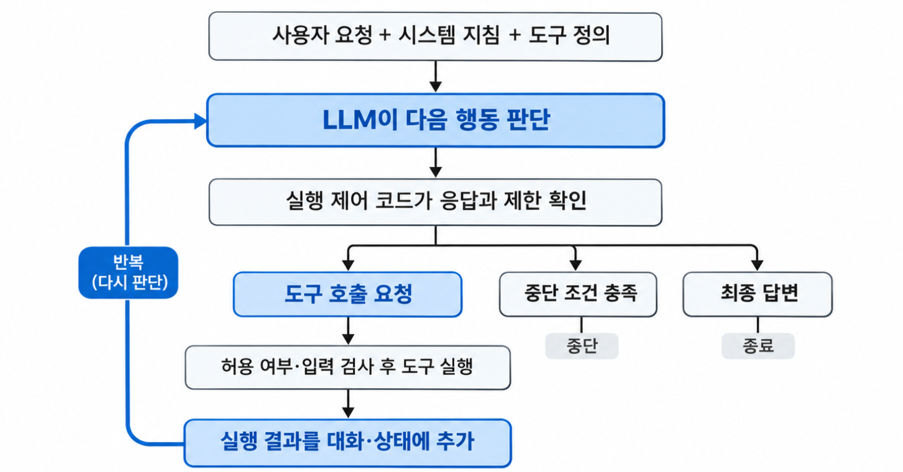

프롬프트는 모델에 질문이나 작업을 요청하고, 원하는 답변과 작업 방식을 알려 주는 입력입니다.  
AI Agent에서는 달성할 목표와 도구를 사용할 때의 규칙, 작업을 마칠 조건도 프롬프트에 담습니다.  

## 1. 프롬프트의 개념과 역할 {#session-01}

### 🟦 프롬프트: 모델에 전달하는 요청

프롬프트(Prompt)는 **LLM에 전달하는 질문·지시·예시·배경 정보**입니다. 누구를 위한 답변인지, 어떤 형식으로 답해야 하는지 함께 알려 주면 원하는 결과를 얻는 데 도움이 됩니다.  

```text
Python의 데코레이터를 설명해 주세요.
초보자가 이해할 수 있도록 간단한 코드 예제를 포함하고,
500자 이내로 작성하세요.
```

이 예시에서는 **주제는 데코레이터, 독자는 초보자**로 정하고, 코드 예제를 포함해 500자 이내로 설명하도록 요청합니다.  

### 🟦 시스템 프롬프트와 사용자 프롬프트

시스템 프롬프트에는 **역할과 공통 규칙**을, 사용자 프롬프트에는 **이번 질문이나 작업**을 담습니다.  

| 구분 | 역할 | 예시 |
|---|---|---|
| 시스템 프롬프트 | 모델의 역할과 공통 응답 규칙 | 당신은 Python 입문 강사입니다. 한국어로 쉽게 설명하세요. |
| 사용자 프롬프트 | 이번에 해결할 질문이나 작업 | Python의 데코레이터란 무엇인가요? |

공통 지침을 따로 두면 질문이 바뀌어도 같은 기준으로 답하도록 요청할 수 있습니다. 지침을 전달하는 방법과 우선순위는 API마다 다릅니다.  

### 🟦 프롬프트 엔지니어링: 요청을 다듬어 원하는 결과 얻기

프롬프트 엔지니어링은 **원하는 결과를 얻도록 요청을 설계하고, 응답을 확인하며 개선하는 과정**입니다.  
“Python을 설명해 주세요.”처럼 범위가 넓은 요청은 다음과 같이 구체화할 수 있습니다.  

```text
프로그래밍 입문자에게 Python의 주요 특징 세 가지를 설명하세요.
각 특징에 간단한 예제를 포함하고 Markdown 목록으로 작성하세요.
```

**대상·작업 범위·출력 형식**을 정한 뒤, 실제 답변을 보며 필요한 조건을 보완합니다.  

## 2. 프롬프트의 분류와 작성 기법 {#session-02}

프롬프트는 **누가 전달하는지, 예시를 몇 개 주는지, 어떻게 작성하는지**에 따라 살펴볼 수 있습니다.  
아래 분류는 서로 겹칠 수 있으며, 모든 API에서 공통으로 사용하는 공식 규격은 아닙니다.  

### 🟦 역할: 누가 어떤 목적으로 전달하는가

| 역할 | 담는 내용 | 예시 |
|---|---|---|
| System | 역할과 공통 행동 기준 | Python 입문 강사로서 한국어로 설명하세요. |
| Developer | 애플리케이션 개발자의 지침 | 설명에 간단한 코드 예제를 포함하세요. |
| User | 이번 질문이나 목표 | 데코레이터란 무엇인가요? |
| Assistant | 모델의 응답 또는 이전 응답 기록 | 데코레이터는 함수의 동작을 감싸 확장하는 데 사용합니다. |

Assistant는 모델에 주는 지침이 아니라, **모델의 답변을 나타내는 메시지 역할**입니다.  
Developer 역할은 OpenAI처럼 이를 지원하는 API에서 사용합니다. API를 바꿀 때는 사용할 수 있는 역할 이름도 확인해야 합니다.  

### 🟦 예시 수: Zero-shot·One-shot·Few-shot

Shot은 원하는 답변 방식을 보여 주기 위해 제공하는 입력·출력 예시를 뜻합니다.  
실제로 답해야 할 질문이나 분류할 문장은 예시 수에 포함하지 않습니다.  

| 구분 | 제공하는 예시 | 감정 분류에 적용하는 방법 |
|---|---|---|
| Zero-shot | 없음 | 긍정·부정·중립으로 분류하라는 지침만 전달 |
| One-shot | 한 개 | “기분이 좋아요 → 긍정”을 보여 준 뒤 분류 요청 |
| Few-shot | 여러 개 | 긍정·부정·중립의 예시를 보여 준 뒤 분류 요청 |

다음은 Few-shot 프롬프트입니다. 예시 부분을 빼면 Zero-shot, 예시 한 쌍만 남기면 One-shot이 됩니다.  

```text
문장을 긍정, 부정, 중립 중 하나로 분류하고 결과만 출력하세요.

예시:
입력: 오늘 정말 기분이 좋아요.
출력: 긍정

입력: 서비스가 너무 불편해요.
출력: 부정

입력: 오늘은 월요일입니다.
출력: 중립

분류할 문장: 이 제품의 품질이 정말 만족스럽습니다.
```

Few-shot처럼 요청에 포함된 예시를 참고해 작업하는 방식을 **문맥 내 학습(In-context Learning)**이라고 합니다.  
모델의 가중치를 바꾸는 파인튜닝과는 다르며, 예시를 추가한다고 항상 정확도가 높아지는 것은 아닙니다.  

### 🟦 작성 기법: 무엇을 어떻게 안내하는가

| 기법 | 방법 |
|---|---|
| Instruction Prompting | 수행할 작업과 조건을 명확히 지시 |
| Role Prompting | 강사·리뷰어 등 역할과 관점 지정 |
| Contextual Prompting | 답변에 필요한 문서나 배경 정보 제공 |
| Few-shot Prompting | 여러 입력·출력 예시로 원하는 패턴 제시 |
| Chain-of-Thought(CoT) Prompting | 문제 해결에 중간 추론 단계를 활용하도록 유도 |
| 출력 형식 지정 | 표·목록·JSON 등 결과 형태 요청 |

“Python 코드 리뷰어로서 아래 코드를 검토하고, 개선점과 이유를 JSON으로 답하세요.”라는 요청은 역할과 작업, 출력 형식을 함께 정한 예입니다.  
JSON으로 답하라는 문구만으로 유효한 JSON이 보장되지는 않습니다. 프로그램에서 사용할 결과라면 JSON Schema 기반 구조화 출력을 지원하는 모델을 사용하고, 받은 값도 검증합니다.  

## 3. AI Agent에서 프롬프트는 어떻게 사용될까요? {#session-03}

일반 LLM 애플리케이션과 AI Agent의 프롬프트는 모두 **LLM에 전달하는 입력 정보**입니다.  
Agent는 이 입력을 바탕으로 답변을 만들고, **어떤 작업을 할지, 다음에는 무엇을 할지**도 판단합니다.  

### 🟦 답변을 요청할 때와 작업을 맡길 때의 차이

| 구분 | 답변 중심의 LLM 애플리케이션 | AI Agent |
|---|---|---|
| 목적 | 원하는 응답 생성 | 작업을 수행해 사용자 목표 달성 |
| 프롬프트에 담는 내용 | 질문·응답 규칙·배경 정보·예시 | 여기에 작업 절차·도구 사용 조건·제약·종료 기준 추가 |
| 요청 예시 | “Gemini의 대화 연결 방식을 설명해 주세요.” | “공식 문서를 검색해 대화 연결 방식을 확인하고 출처와 함께 정리해 주세요.” |

“대화 연결 방식을 설명해 주세요.”는 설명을 요청하는 말입니다. “공식 문서를 검색해 확인해 주세요.”는 정보를 직접 찾아 확인하는 작업까지 맡기는 말입니다.  
Agent의 지침에는 설명할 내용뿐 아니라 **언제 검색하고, 어떤 경우에 더 찾아보고, 언제 작업을 마칠지**도 정합니다.  

### 🟦 무엇을 하고, 어떻게 진행하고, 언제 끝낼지 정하기

Agent의 프롬프트에는 **어떻게 답할지뿐 아니라 어떻게 작업할지**도 작성합니다. 반복해서 적용할 역할과 규칙은 시스템 지침에, 이번 작업의 구체적인 목표는 사용자 요청에 담을 수 있습니다.  

| 항목 | 정할 내용 | 기술 문서 조사 Agent의 예 |
|---|---|---|
| Role | 역할과 책임 | 기술 문서 조사와 요약 담당 |
| Goal | 달성할 목표 | 요청한 기술 정보를 확인하고 정리 |
| Instructions | 작업 절차 | 공식 문서 확인 후 부족한 정보 추가 조사 |
| Tool Usage | 도구 사용 조건 | 최신 정보 확인이 필요하면 웹 검색 |
| Constraints | 제약과 금지 사항 | 확인되지 않은 내용을 사실로 단정하지 않음 |
| Output Format | 최종 결과 형식 | 핵심 요약과 출처 링크 |
| Termination | 완료·중단 기준 | 필요한 정보 확보 시 완료, 확인 불가 시 한계 보고 |

다음은 기술 문서를 조사하는 Agent의 시스템 지침 예시입니다. 애플리케이션에 검색 도구가 연결되어 있다고 가정합니다.  

```python
# 역할뿐 아니라 도구 사용과 종료 기준까지 정의합니다.
system_prompt = """
당신은 기술 문서 조사 AI Agent입니다.

목표:
- 사용자가 요청한 기술 정보를 조사하고 요약합니다.

작업 규칙:
1. 최신 정보가 필요한 경우 제공된 웹 검색 도구를 사용합니다.
2. 검색 결과에서 공식 문서를 우선 확인합니다.
3. 정보가 부족하면 추가 검색을 수행합니다.
4. 확인되지 않은 내용은 추측해 사실로 제시하지 않습니다.

출력 규칙:
- 핵심 내용을 간결하게 요약하고 주요 정보에 출처를 포함합니다.

종료 조건:
- 요청한 정보를 확인하면 최종 답변을 작성합니다.
- 도구를 사용할 수 없거나 정보를 확인할 수 없으면 한계를 알리고 종료합니다.
"""
user_prompt = "Gemini Interactions API의 대화 연결 방식을 공식 문서로 조사해 주세요."
```

“웹 검색을 사용하세요.”라는 문장을 쓰는 것만으로 검색 기능이 생기지는 않습니다.  
애플리케이션에서 검색 도구를 등록하고, 실제로 실행할 수 있도록 연결해야 합니다.  

### 🟦 판단 → 도구 실행 → 결과 확인 → 반복 또는 종료

애플리케이션에 연결된 도구를 사용하는 Agent는 다음과 같은 흐름으로 동작합니다.  



모델이 사용할 도구와 전달할 값을 정하면, 애플리케이션은 그 요청을 검사한 뒤 도구를 실행합니다.  
모델은 실행 결과를 받아 추가로 조사할지, 최종 답변을 작성할지 판단합니다.  

이처럼 판단하고 행동한 뒤 결과를 확인하는 과정을 반복하는 방식은 **ReAct(Reasoning + Acting)** 기반 Agent에서 사용합니다.  
모든 Agent가 같은 구조를 사용하는 것은 아닙니다.  

> ReAct는 **판단(Reasoning) → 행동(Acting) → 결과 확인(Observation)**을 반복하며 작업을 진행하는 설계 방식입니다.  

### 🟦 판단 기준은 프롬프트에, 실행 제어는 코드에

| 프롬프트에 작성할 지침 | 코드·프레임워크에서 제어할 내용 |
|---|---|
| 어떤 조건에서 도구를 사용할지 | 실제 도구 등록과 실행 권한 |
| 어떤 자료를 우선 확인할지 | 도구 인자 검사와 접근 가능한 데이터 범위 |
| 언제 목표를 달성했다고 판단할지 | 종료 분기와 최대 실행 단계·시간·비용 |
| 실패 시 어떻게 설명할지 | 오류 처리와 재시도 횟수 |

프롬프트는 모델이 따를 기준을 알려 줍니다. 실제로 어떤 도구를 허용하고 몇 번까지 실행할지는 코드에서 제어해야 합니다.  
예를 들어 “필요하면 계속 검색하세요.”라는 지침을 주더라도, 코드에서는 검색 횟수의 상한을 정해 무한히 반복하지 않도록 합니다.  

## 4. OpenAI·Gemini·Claude API에 프롬프트 전달하기 {#session-04}

시스템 지침과 사용자 입력을 구분하는 방법은 비슷하지만, API마다 매개변수 이름과 요청 형식이 다릅니다. 일반적인 질문을 보내거나 Agent 지침을 전달할 때 모두 이 차이를 알아야 합니다.  

### 🟦 API별 지침과 입력 필드 비교

| 구분 | OpenAI Responses | Gemini Interactions | Claude Messages |
|---|---|---|---|
| Python 메서드 | `responses.create()` | `interactions.create()` | `messages.create()` |
| 공통 지침 | `instructions` | `system_instruction` | `system` |
| 사용자 입력 | `input` | `input` | `messages`의 `user` 메시지 |
| 텍스트 읽기 | `response.output_text` | `interaction.output_text` | `response.content`에서 텍스트 블록 선택 |

공통 지침은 OpenAI의 `instructions`, Gemini의 `system_instruction`, Claude의 `system`에 넣습니다.  
사용자 질문은 OpenAI와 Gemini에서는 `input`으로, Claude에서는 `messages` 안의 `user` 메시지로 전달합니다.  

답변을 읽는 방식도 다릅니다. OpenAI와 Gemini는 `output_text`로 텍스트를 읽고, Claude는 `content`에 담긴 여러 블록 중 텍스트 블록을 선택해 읽습니다.  

### 🟦 같은 지침을 세 API에 전달하는 스니펫

세 API에 전달할 공통 지침과 사용자 요청을 먼저 준비합니다. `system_prompt`에는 조사 규칙을, `user_prompt`에는 이번에 조사할 내용을 넣습니다.  

```python
# 공통으로 적용할 역할과 작업 규칙입니다.
system_prompt = """
당신은 기술 문서 조사 AI Agent입니다.
제공된 검색 도구로 공식 문서를 우선 확인하세요.
정보가 부족하면 추가 검색하고, 확인한 내용과 출처를 간결하게 정리하세요.
필요한 정보를 확보하면 답변하고, 확인할 수 없다면 그 한계를 알리세요.
"""

# 사용자가 이번에 달성하려는 구체적인 목표입니다.
user_prompt = "Gemini Interactions API의 대화 연결 방식을 공식 문서로 조사해 주세요."
```

#### 🔷 OpenAI Responses API

```python
# 조사 규칙과 사용자 목표를 구분해 전달합니다.
response = openai_client.responses.create(
    model=openai_model,
    instructions=system_prompt,
    input=user_prompt,
)
```

#### 🔷 Gemini Interactions API

```python
# 같은 지침을 system_instruction 필드에 전달합니다.
interaction = gemini_client.interactions.create(
    model=gemini_model,
    system_instruction=system_prompt,
    input=user_prompt,
)
```

#### 🔷 Claude Messages API

```python
# 지침은 system, 사용자 목표는 user 메시지에 전달합니다.
response = claude_client.messages.create(
    model=claude_model,
    max_tokens=1024,
    system=system_prompt,
    messages=[{"role": "user", "content": user_prompt}],
)
```

위 스니펫은 **각 API에서 지침과 요청을 어디에 넣는지** 보여 줍니다. 검색 도구 연결과 작업을 반복하는 코드는 생략했습니다. 실제로 문서를 조사하게 하려면 도구를 설정하고, 결과를 확인해 다음 작업으로 이어 가는 코드도 작성해야 합니다.  
